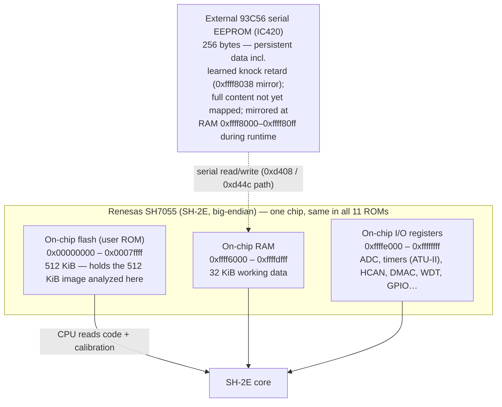
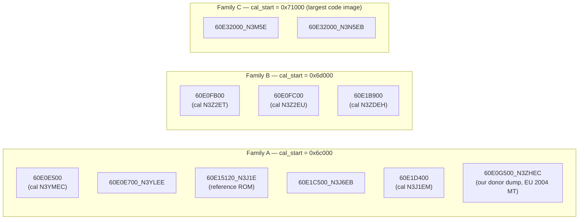
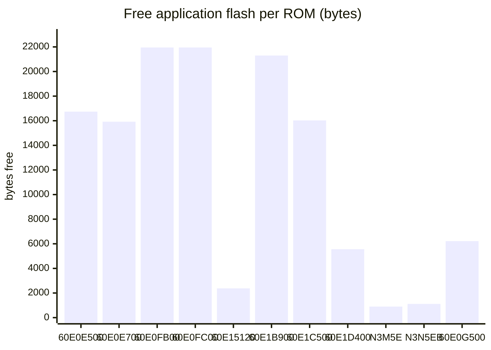

# Flash and memory layout — corpus-wide report (with diagrams)

**Reference ROM:** `60E15120_N3J1E.bin`, SHA-256
`a7cd953c2a87af12ee2814a95c958dc23959d352ef9c5e7f82b8ab8952f264f1`
(pinned submodule copy). **Corpus:** all 10 upstream stock ROMs plus our own
factory dump `binaries/dumps/60E0G500_N3ZHEC.bin` (SHA-256 `a33f79a4…`, see
[`binaries/manifest.csv`](../../binaries/manifest.csv)) = **11 unique ROMs**
(`Stock_ROMs/60E0FC00.bin` and `Data_binaries/60E0FC00.bin` are byte-identical,
counted once). Static analysis of ROM bytes only; every address below was
re-checked against the raw binaries (method in §6, validation in §8). No binary
was modified.

**Related reports:** [firmware design document](design/README.md) §1 (target +
memory map), [free-flash / free-RAM resource scan](../investigations/60E15120_N3J1E/free_resources_report.md)
(the free-space numbers used here), [calibration extraction report](../investigations/60E15120_N3J1E/calibration_extraction_report.md)
(cal-region auto-detection, per-ROM table counts), [UDS/OBD dispatch report](../investigations/60E15120_N3J1E/uds_mode22_dispatch_report.md)
§12 (CVN checksum + SBL services), [OS scheduler / IVT report](../investigations/60E15120_N3J1E/os_scheduler_can_ivt_report.md)
(VBR + interrupt vectors), [learnings](../learnings.md) (VBR value, ROM
read-only behavior), [hardware pinout](hardware/mazda-rx-8-pcm-pinout-series-1.md),
[upstream ROM↔cal-ID table extract](../references/rx8club-user-guide-thread.md) §2.

## 1. Executive summary

Every RX-8 PCM in this corpus is a Renesas **SH7055** (SH-2E core, big-endian)
with **512 KiB on-chip flash, 32 KiB on-chip RAM** and a **256-byte external
93C56 serial EEPROM** (IC420). The 512 KiB flash image has a **fixed skeleton
shared by all 11 ROMs**: an 8 KiB serial-bootloader block (own hardware vector
table, `0x0–0x1fff`), an application image with its firmware-ID string at
`0x2000`, a table-descriptor array and a Denso calibration region in the upper
quarter, a 196-byte all-erased code cave at `0x7fb8c–0x7fc4f`, and the runtime
interrupt-vector table at `0x7fc50–0x7ffff` (VBR). The application CVN checksum
covers `0x2000–0x7ffff` (minus a 128-byte hole).

The differences between the ROMs are **where the calibration region starts**
(three families: `0x6c000`, `0x6d000`, `0x71000`), **how much calibration data
they hold** (381–587 lookup tables), **where the ID header block sits inside the
cal region**, and **how much free flash is left** (0.9–22 KiB). On-chip RAM
layout is **identical across all 11 ROMs** (same idle-boot write pattern, same
4.8 KiB never-written window).

### 1a. Plain-language summary

Think of the ECU's 512 KB chip as a bookshelf with fixed shelves: the first
shelf is a small rescue program (the bootloader that lets a dealer tool reflash
the rest), the next shelves are the engine-control program, and the top shelves
are the "tune" — hundreds of small tables of numbers that say how much fuel,
how much spark advance, and so on. All 11 ROM versions we hold arrange those
shelves the same way; what differs is where the "tune" shelves start, how many
tables they hold, and how much empty shelf space is left over. The ECU also has
a small 32 KB scratchpad (RAM) that works identically in every version, plus a
tiny separate memory chip (256 bytes) that remembers things like learned
corrections across power cycles. The diagrams below show each of these.

## 2. The physical memory map (identical for every ROM)



| Region | Range | Size | Role | Evidence |
|---|---|---|---|---|
| User ROM (flash) | 0x00000000–0x0007ffff | 512 KiB | The dumped image: SBL + app + calibration + runtime IVT | all 11 dumps are exactly 524,288 B; [SH7055 hardware manual](https://www.renesas.com/en/document/mah/sh-2e-sh7055s-hardware-manual) |
| On-chip RAM | 0xffff6000–0xffffdfff | 32 KiB | Working variables, task stacks, EEPROM mirror, CVN result | [design doc §1](design/README.md); emulator profiles `memory.ram` |
| I/O registers | 0xffffe000–0xffffffff | 8 KiB | SH7055 peripherals (volatile) | emulator profiles `memory.io`; [learnings](../learnings.md) |
| External 93C56 | off-chip | 256 B | Persistent storage (IC420) incl. learned knock retard; 0x55aa/0xaa55 magic mirrored at 0xffff8000 (full content not yet mapped) | dumps `Data_binaries/RX8_93c56_ECU_IC420_Read.bin` (256 B); [free-resources report §10](../investigations/60E15120_N3J1E/free_resources_report.md) |

Runtime flash is **read-only** from the CPU: stores to `0x0–0x7ffff` are ignored
(the emulator counts them in `bus.rom_writes_blocked`; on hardware they need
the flash programming sequence — that is what the SBL's UDS `0x34/0x36/0x37`
download services at `0x1ad6/0x1c04/0x1d30` are for, with erase at `0x1d78`;
[UDS report §12.3](../investigations/60E15120_N3J1E/uds_mode22_dispatch_report.md)).

## 3. The flash image — skeleton shared by all 11 ROMs

The 512 KiB image is one flat big-endian address space. Every ROM in the corpus
follows this layout (byte-verified per ROM, §8):

```
address     ┌──────────────────────────────────────────────────────┐  region
0x00000     │ SBL bootloader block                                 │
            │  0x000–0x3ff  hardware vector table (VBR=0 at reset) │
            │               vec 0 → 0x08b8 ref_Manual_Reset         │
            │               exceptions → 0x08b4 Illegal_instr       │
            │  SBL code: CAN cmd loop 0x1378, security 0x27 @0x1858,│
            │            download/erase services 0x1ad6–0x1d78     │  8 KiB
            │  erased gap 0x0b0e–0x0fdf (1,234 B, all 11 ROMs)      │
            │  0xfe0–0xfff non-erased 32-B block (role unknown,     │
            │            identical bytes in all 11 ROMs)            │
0x02000     ├──────────────────────────────────────────────────────┤
            │ APP header: firmware ID string (ASCII, 8 chars,      │
            │   e.g. "60E15120"), 'Copr.DENSO2000S' at 0x2023;      │
            │   readable via OBD/UDS (fw-ID PID maps to 0x2000)     │
0x02034     │ application code + literal pools                     │
            │   (3,355 functions in the reference ROM; task table  │
            │   0x4990, UDS tables 0x5eb40/0x5f10c, dispatch        │
            │   tables 0x2098/0x210c …)                            │ ~410 KiB
            ├──────────────────────────────────────────────────────┤
            │ lookup-table descriptor array                         │
            │   (12/20/28-B Denso descriptors, packed;            │
            │    sits in [cal_start−0x8000, cal_start) — code tail  │
            │    may overlap the low end of this window)            │
            ├──────────────────────────────────────────────────────┤
cal_start   │ CALIBRATION REGION (axes + table data + ID block)    │
            │   'Copr.DENSO' header, cal-ID string + SW package    │
            │   string (e.g. N3J1E / SW-N3ZHEB000.HEX), tables;    │
            │   content ends 0x7d70f–0x7fa0b depending on ROM      │
            │   (0xFF padding below the top fixtures)              │
0x7fb00     ├──────────────────────────────────────────────────────┤
            │ CVN hole 0x7fb00–0x7fb7f (skipped by the app          │  128 B
            │   checksum; erased content varies per ROM)            │
0x7fb80     ├──────────────────────────────────────────────────────┤
            │ code cave 0x7fb8c–0x7fc4f (196 B, erased in ALL 11 —   │  196 B
            │   the patchers' landing zone)                         │
0x7fc50     ├──────────────────────────────────────────────────────┤
            │ RUNTIME INTERRUPT VECTOR TABLE (VBR=0x7fc50)          │
            │   e.g. CMI10B slot 0x7ff18 → trampoline 0x2ec0,       │
            │   WDT ITI 0x7ffa8, HCAN0 RM0 0x7ffa0                  │  944 B
0x80000     └──────────────────────────────────────────────────────┘
```

Key fixed addresses, with what proves them:

| Address | What | Evidence |
|---|---|---|
| 0x0–0x3ff | Hardware vector table, active while VBR=0 (reset) | design doc §2; longwords at 0x0/0x8 = 0x8b8 in all 11 ROMs (byte-checked) |
| 0x8b8 / 0x8b4 | `ref_Manual_Reset` / `Illegal_instr` | [design doc §2–3](design/README.md) |
| 0xb0e–0xfdf | Erased 1,234-B SBL gap (CVN-free — checksum starts at 0x2000) | [free-resources report §3](../investigations/60E15120_N3J1E/free_resources_report.md); re-verified all-0xFF in all 11 |
| 0x2000 | Firmware-ID ASCII string (application start) | byte-checked all 11 (§4 table); [UDS report §12.1](../investigations/60E15120_N3J1E/uds_mode22_dispatch_report.md) |
| 0x2000–0x7ffff | CVN coverage except hole 0x7fb00–0x7fb7f | checksum engine 0x5a3f4 (D3, verified for 60E15120_N3J1E) |
| cal_start−0x8000 … cal_start | Descriptor scan window | [cal-extraction report §2](../investigations/60E15120_N3J1E/calibration_extraction_report.md) |
| 0x7fb8c–0x7fc4f | 196-B all-erased cave | byte-checked all-0xFF in all 11 ROMs |
| 0x7fc50 | Runtime VBR (IVT base) | `ldc` at 0xd206 sets VBR=0x7fc50 ([learnings](../learnings.md), verified for 60E15120_N3J1E; the identical cave/IVT bytes on the other 10 are consistent but the VBR write itself is only proven on the reference ROM) |

## 4. Calibration region — the three ROM families, and per-ROM differences

### 4.1 Three cal-start families

The calibration region start is auto-detected as the 4 KiB-aligned block
containing the first `Copr.DENSO` string above 0x60000. The corpus splits into
three families:



The family only fixes the *block* the cal region is detected in — inside it,
each ROM places its ID header and data differently (§4.2). Family C ROMs are
the only ones whose application code extends past 0x68000 (code + descriptors
extend up to 0x6f22c/0x6eb60, and the cal region correspondingly starts
higher), i.e. the largest firmware images.

### 4.2 Per-ROM layout table (all values byte-verified this pass)

"Cal-ID header" = the ASCII block inside the cal region carrying the
calibration part number and the `SW-….HEX` package string (its position varies
per ROM, see the *addr* column).

| ROM (SHA-256 12) | fw ID @0x2000 | Cal-ID header (addr · ID · SW package) | cal_start | descriptor array | tables | cal data (axes+cells) | cal content ends | app free |
|---|---|---|---|---|---:|---|---|---:|
| 60E0E500 (`c05dfd0422b2`) | `60E0E500` | 0x6c600 · `N3H3EBMW.Z05` · `SW-N3YMEC000.HEX` | 0x6c000 | 0x682d4–0x6aaa0 | 508 | 0x6c7a4–0x7bd34 | 0x7d70f | 16,738 B |
| 60E0E700_N3YLEE (`bba52346a076`) | `60E0E700` | 0x6c600 · `N3YLEBPW.Z05` · `SW-N3YLEE000.HEX` | 0x6c000 | 0x6852c–0x6ad20 | 510 | 0x6c7a4–0x7bde4 | 0x7d7bf | 15,922 B |
| 60E0FB00 (`3d32e2591a11`) | `60E0FB00` | 0x6d300 · `N3Z2EBWW.Z05` · `SW-N3Z2ET000.HEX` | 0x6d000 | 0x677e8–0x69f30 | 503 | 0x6d4a4–0x7c130 | 0x7db14 | 21,956 B |
| 60E0FC00 (`476ddcbed454`) | `60E0FC00` | 0x6d300 · `N3Z2EBWW.Z05` · `SW-N3Z2EU000.HEX` | 0x6d000 | 0x677e8–0x69f30 | 503 | 0x6d4a4–0x7c130 | 0x7db14 | 21,956 B |
| 60E15120_N3J1E (`a7cd953c2a87`) | `60E15120` | 0x6c000 · `N3J1E_1W.Z05` · `SW-N3ZHEB000.HEX` | 0x6c000 | 0x68ef8–0x6bc70 | 587 | 0x6c1a4–0x7dd60 | 0x7f75f | 2,378 B |
| 60E1B900 (`b0dc94f96e8e`) | `60E1B900` | 0x6d300 · `N3ZDEBWW.T50` · `SW-N3ZDEH000.HEX` | 0x6d000 | 0x67a80–0x6a1c8 | 503 | 0x6d4a4–0x7c130 | 0x7db14 | 21,300 B |
| 60E1C500_N3J6EB (`b3b6e1e41682`) | `60E1C500` | 0x6c600 · `N3J6EBMW.T50` · `SW-N3J6EN000.HEX` | 0x6c000 | 0x685a4–0x6ad70 | 508 | 0x6c7a4–0x7bd34 | 0x7d70f | 16,026 B |
| 60E1D400 (`344cb8b960eb`) | `60E1D400` | 0x6ce00 · `N3J1E_3W.T50` · `SW-N3J1EM000.HEX` | 0x6c000 | 0x69934–0x6bff8 | 494 | 0x6cfa4–0x7d950 | 0x7f307 | 5,558 B |
| 60E32000_N3M5E (`d5406459cc0b`) | `60E32000` | 0x71500 · `N3M5E_SW.T01` · `SW-N3M5EK000.HEX` | 0x71000 | 0x6f22c–0x70fec | 381 | 0x716a4–0x7da4e | 0x7fa0b | 899 B |
| 60E32000_N3N5EB (`6c043bd4c958`) | `60E32000` | 0x71000 · `N3N5E_2W.T01` · `SW-N3N5EB000.HEX` | 0x71000 | 0x6eb60–0x70f2c | 462 | 0x711a4–0x7df2c | 0x7f937 | 1,117 B |
| 60E0G500_N3ZHEC (`a33f79a4f1c4`) | `60E0G500` | 0x6ce00 · `N3ZHE_3W.Z05` · `SW-N3ZHEC000.HEX` | 0x6c000 | 0x6969c–0x6bfcc | 533 | 0x6cfa4–0x7d950 | 0x7f307 | 6,214 B |

Notes on the table:

- "cal data" spans come from `data/maps/<rom>/index.tsv` (axis + data cells of
  every scanned descriptor); "cal content ends" is the last non-`0xFF` byte
  below 0x7fb00 — the cal region also holds ID blocks and non-table data, so it
  extends past the table spans. The 60E15120_N3J1E spans match the
  independently verified §9 figures in the
  [calibration extraction report](../investigations/60E15120_N3J1E/calibration_extraction_report.md)
  (axes 0x6c1a4–0x7dd3c, data 0x6c1e4–0x7dd60); the scan's upper bound
  (0x7dd84) is a span estimate that can overshoot by a few dozen bytes
  (type-size rounding on the last table).
- File names vs internal IDs: `60E0E500.bin` has no cal suffix in its file name
  but internally carries the `N3YMEC` package. The upstream
  [ROM↔cal-ID table](../references/rx8club-user-guide-thread.md) §2 agrees with
  the internal strings where it lists them (`N3Z2ET`, `N3Z2EU`, `N3J1EM`,
  `N3ZHEC`), with two documented discrepancies: 60E1B900's internal package is
  `N3ZDEH` (byte-verified here; the forum table and the emu profile name say
  `N3ZBEH`), and the reference ROM's `N3ZHE` at 0x6c046 (already noted as a
  do-not-"fix" discrepancy in that extract). Market/model context per ROM
  (hypotheses, from the
  [emulator profiles](../../utilities/scripts/emu/profiles/README.md)):
  60E0G500_N3ZHEC = EU, 2004 Series 1, 6-port MT.
- The ID-header position inside the cal region varies (`0x6c000`, `0x6c600`,
  `0x6ce00`, `0x6d300`, `0x71000`, `0x71500`) — never assume 0x6c000 holds the
  cal ID.
- Extra build strings in the ID block: `J60E 2.30r1` / `J60E 1.61r1` on the
  `.Z05` ROMs, `J60E_55SF 1.00r2` on the `.T50` ROMs, and
  `PF_J60E_06MY_55 Ver1.00r1` / `J60E 1.80r1`/`1.70r1` on the 60E32000 pair.

### 4.3 Free application flash per ROM (visual)

Free flash = total bytes in `0xFF` runs ≥16 B inside the application area
`0x2000–0x7ffff` (from the [free-resources report §3](../investigations/60E15120_N3J1E/free_resources_report.md),
re-verified this pass). Every ROM also has the 1,234-B SBL gap `0xb0e–0xfdf`
outside the checksum, and the newer generation additionally has
`0x1fc4–0x1fff` (60 B) erased at the SBL tail.



Side-by-side of the three families (schematic, not to scale):

```
Family A (cal 0x6c000)         Family B (cal 0x6d000)        Family C (cal 0x71000)
60E0E500/E700/15120/           60E0FB00/FC00/1B900           60E32000_N3M5E/N3N5EB
1C500/1D400/0G500
─────────────────────────      ─────────────────────────     ─────────────────────────
code ─────────────▶ 0x63fff    code ────────────▶ 0x64fff    code ──────────────▶ 0x68fff
desc 0x682d4–0x6bfcc (per-ROM)   desc array 0x677e8–0x69f30    desc 0x6eb60–0x70fec
(varies inside family)         + big free gap to 0x6d2ff     (fills the window)
cal 0x6c000 … ends ≤0x7f75f    cal 0x6d000 … ends 0x7db14     cal 0x71000 … ends ≤0x7fa0b
roomiest cal-area free runs    roomiest overall (22 KiB free) tightest (0.9–1.1 KiB free)
```

## 5. RAM map — identical across all 11 ROMs

The emulator boots of all 11 ROMs produce the **same** idle RAM write pattern
(27,904 of 32,768 bytes touched after 2M cycles;
[free-resources report §3](../investigations/60E15120_N3J1E/free_resources_report.md)):

```
0xffff6000 ┌──────────────────────────────────────────────┐
           │ working RAM (globals, engine state;           │
           │  densest bins 0xffffa000–0xffffdxxx)          │
0xffff7408 │ task context blocks 0xffff7408–0xffff7498     │
           │ (stacks end at 0xffff7498)                   │
0xffff8000 │ external-EEPROM mirror 0xffff8000–0xffff80ff  │
           │ (0x55aa/0xaa55 magic; 93C56 = 256 B)          │
           │ ─ idle-free window 0xffff8000–0xffff92ff ──    │
           │  4,864 B never written at idle (all 11 ROMs); │
           │  3,852 B static-free, largest contiguous run  │
           │  0xffff8109–0xffff8547 (1,087 B)              │
0xffff9104 │ CVN checksum result (32-bit) + done flag     │
           │  0xffff910c (written by 0x5a714)              │
0xffffdfff └──────────────────────────────────────────────┘
0xffffe000 ┌──────────────────────────────────────────────┐
           │ SH7055 I/O registers (WDT 0xffffec10, DMAC   │
           │ 0xffffecb0, ADC 0xfffff80c, GPIO …) — volatile│
0xffffffff └──────────────────────────────────────────────┘
```

## 6. How the layout facts were computed (pseudocode)

```python
for rom in 11_roms:                       # read-only, no binary touched
    data = open(rom).read(); assert len(data) == 0x80000
    assert data[0x2000:0x2008].isascii()          # fw ID string
    idx = data.find(b"Copr.DENSO", 0x60000)        # cal-region marker
    cal_start = (idx // 0x1000) * 0x1000          # 0x6c000 / 0x6d000 / 0x71000
    strings = printable_runs(data, cal_start, cal_start + 0x1000)
    # cal-ID header = run matching r"^N3\w+\.(Z05|T50|T01)" + b"SW-N3....000.HEX"
    descriptors, caldata = ranges_from(f"data/maps/{rom}/index.tsv")
    content_end = last_non_ff(data, cal_start, 0x7fb00)
    assert is_ff(data, 0x7fb8c, 0x7fc50)          # code cave, all 11
    assert is_ff(data, 0x0b0e, 0x0fe0)             # SBL gap, all 11
    assert struct.be32(data[0:4]) == 0x8b8         # reset vector
```

Free-flash totals are reused verbatim from the
[free-resources report](../investigations/60E15120_N3J1E/free_resources_report.md)
§3 (its scan is the authoritative one); the raw scan JSON of this pass lives in
the session scratchpad (`flash-layout-report/findings.md`).

## 7. Files

- This report: `docs/architecture/flash-memory-layout.md`
- Data backing §4.2: `data/maps/<rom-id>/index.tsv` + `manifest.json` per ROM
- Binaries (read-only): `submodules/Mazda_RX8_PCM_ReverseEngineering/Stock_ROMs/`
  (10), `binaries/dumps/60E0G500_N3ZHEC.bin` (ours, in
  [`binaries/manifest.csv`](../../binaries/manifest.csv))
- Scan script of this pass: session scratchpad (one-off, not committed); the
  committed equivalents are `utilities/scripts/extract_maps.py` (cal-region
  detection) and the free-resources report's scan

## 8. Validation

- Every address in §3/§4.2/§5 re-checked this pass against the raw bytes of all
  11 ROMs (fw ID at 0x2000, `Copr.DENSO` offsets, cal-ID/SW strings, descriptor
  ranges from `data/maps/*/index.tsv`, all-0xFF cave `0x7fb8c–0x7fc4f` and SBL
  gap `0xb0e–0xfdf`, reset vector 0x0 → 0x8b8, ROM sizes).
- SHA-256 of every ROM re-computed during the scan; values match
  [`binaries/manifest.csv`](../../binaries/manifest.csv) and the free-resources
  report §3.
- Cross-checked figures: 60E15120_N3J1E descriptor array 0x68ef8–0x6bc70 and
  cal spans consistent with [cal-extraction report §9](../investigations/60E15120_N3J1E/calibration_extraction_report.md)
  (same lower bound; scan upper bound overshoots the verified data end by 0x24);
  SBL/CVN facts equal [UDS report §12](../investigations/60E15120_N3J1E/uds_mode22_dispatch_report.md);
  free-flash totals equal [free-resources report §3](../investigations/60E15120_N3J1E/free_resources_report.md);
  RAM map equals [design doc §1](design/README.md) + free-resources §10.
- `python utilities/scripts/rx8-pcm-pipeline/validate_reports.py` — PASS
  (this file is outside `docs/investigations/` and not scanned; run as a
  no-regression check). `python utilities/scripts/hash_binaries.py --check` —
  OK (no binary touched). `python -m pytest tests/` — 91 passed, 1
  pre-existing cp1252 failure (`test_extract_scalars.py`, also on `main`,
  unrelated to this docs-only change; `verify_readability.py` fails on the
  same class of pre-existing cp1252 decode error).

## 9. Memory map for validation (key anchors)

| Address | Symbol | Role here |
|---|---|---|
| 0x000008b8 | `ref_Manual_Reset` | reset entry (vector 0x0/0x8) |
| 0x00001378 | SBL CAN command loop | SBL reflash entry point |
| 0x00005a3f4 | `FUN_0005a3f4` | CVN engine — defines coverage 0x2000–0x7ffff + hole |
| 0x00005a714 | `FUN_0005a714` | CVN finalize — writes RAM 0xffff9104 |
| 0x0000d206 | (`ldc r?,vbr`) | sets runtime VBR = 0x7fc50 |
| 0xffff8000 | EEPROM mirror magic | 0x55aa/0xaa55 (93C56, 256 B) |
| 0xffff9104 | CVN result | 32-bit checksum result cell |

## 10. Limits

- **VBR=0x7fc50 and the CVN hole are proven only for 60E15120_N3J1E.** The
  other 10 ROMs have identical bytes at the cave/IVT/hole addresses, which is
  consistent with the same layout, but the runtime VBR write and the checksum
  skip need the same literal-pool check per ROM before being treated as proven
  (same caveat as the free-resources report §9).
- The 32-B block at 0xfe0–0xfff (identical bytes in all 11 ROMs) is
  unidentified; its role is an open question.
- "Cal content ends" is an erased-bytes measure; it does not mean every byte
  below it is meaningful data, and code caves inside the cal region must be
  decode-verified before use (patcher pattern, [learnings](../learnings.md)).
- Market/model attributions come from the emulator profiles and the upstream
  forum table — hypotheses, not independently verified.
- Nothing here is validated by execution against a real ECU; all facts are
  static byte-level or emulator-boot evidence.
