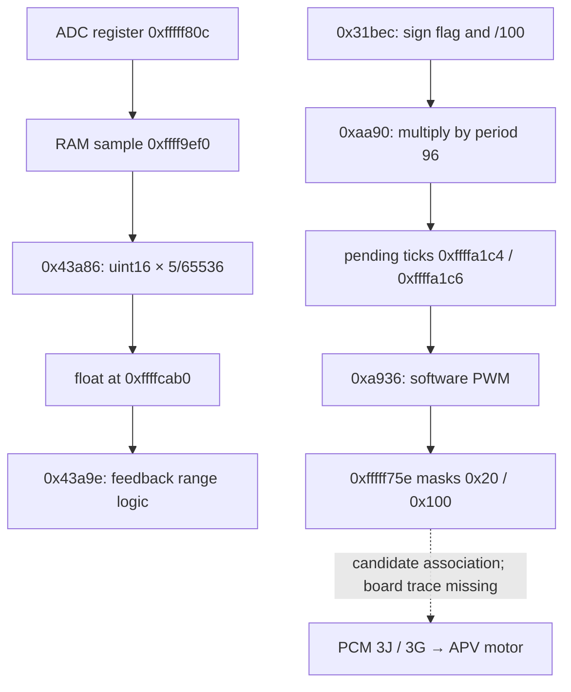

# Series-1 13B-MSP wiring-assisted reconstruction

Working configuration: series-1 RX-8, probably six-port, per the user. The exact
ROM donor year, market and transmission remain unknown. High-power diagrams
are the working match; this is not confirmation of the N3J1E filename or the
N3ZHE bytes observed in the ROM.

**35 component connection records**, **16 function annotations**
and **three compilable arithmetic helpers**. They improve interpretation of the
decompilation; no additional newly discovered functions are claimed.

## Evidence levels

- **Documented harness fact:** visibly traced in the supplied wiring diagram.
  Applies to the depicted vehicle configuration, not automatically every S1 RX-8.
- **Firmware fact:** instruction, literal, RAM address or call relationship read
  from this binary. Register names additionally depend on the existing SH7055 map.
- **Candidate association:** an inferred link between a firmware routine and a
  physical component, supported by inherited names and matching behavior.
- **Unresolved:** processor-pin-to-ECU-connector routing, electrical inversion,
  actuator direction, exact model applicability and most channel ordering.

## What can now be read more clearly

The six injector circuits in the high-power diagram are not six interchangeable
outputs: it distinguishes front/rear primary 1, secondary, and primary 2. Their
PCM terminals are 2M/2J, 2G/2D, and 3A/3D respectively. The firmware analysis
(`reviews/fueling/injector_pin_mapping.md`) established the full chain up
to the chip: firmware channel → ATU-II 8x/1x pair (ch0→8A/1A, ch1→8C/1C,
ch2→8E/1E, ch3→8B/1B, ch4→8D/1D, ch5→8F/1F, ROM 0xd7d4), rotor split
(channels 0-2 / 3-5 per rotor block, ROM 0x4e2c8), and — via the SH7055F
hardware manual (`Sh7055h.pdf`, Tables 1.2/1.3 + PKCR §20.3.21, with the
running PFC config PKCRL=0x5555 from `ref_setRegisters`) — TO8A-F on package
pins 195/197/198/199/200/201. Only the package-pin → connector-terminal hop
(board routing) remains unresolved here. Four separate ignition trigger
circuits are documented: leading front 2AA, trailing front 2AD, leading rear
2Z, trailing rear 2AC.

The SSV solenoid at PCM 1L is separate from the SSV position switch at PCM 1D.
The VDI solenoid is at PCM 1W. The metering oil pump has four winding-control
wires and a separate learning-position switch at PCM 2N; this is not the oil
pressure switch (2E) or oil-level switch (2R). Pages 18-19 describe the oil
pressure switch as closing on low pressure and the MT neutral switch (2O) as
opening in neutral. MCU input polarity can still differ due to ECU circuitry.

The [complete connection table](pcm_connections.tsv) preserves page numbers,
variant notes and component connector IDs. Pin identifiers use the letter O
where shown, for example 1O and 2O; they are not decimal numbers.

## Terminal → signal / wire-colour pinout

[mazda-rx-8-pcm-pinout-series-1.md](mazda-rx-8-pcm-pinout-series-1.md) is the
current text pinout for all five PCM connectors (terminals 1A–5AF), derived from
`../references/13Electrical.pdf` (**ground truth**) and the FSM terminal table.
Honour its `*` / `†` / `–` markers; only 5L lacks a legible colour. On any pinout
update: re-diff and propagate into `pcm_connections.tsv` (`wire_colour` column),
`firmware_annotations.tsv`, and the `[WIRING REVIEW]` blocks in all synchronized
views (keep the marker string so `AnnotateHardware.java` rebuilds reproduce them).

## Best-supported new candidate: APV control path

The diagram shows B1-37 with motor wires PCM 3J/3G, a signal wire at 3B,
reference supply at 1S, and sensor return through 1U. The high-power variant
contains this auxiliary port valve assembly.

The binary has the following internally traceable path:



The scaling constant is the exact binary32 value `0x38a00000`, or `5/65536`.
A sample of 32768 therefore produces 2.5. That supports a voltage-like signal;
it does not establish the analog input circuit, mechanical angle calibration,
or an electrical measurement at PCM 3B.

The command wrapper negates the magnitude only when its flag equals 1, then
divides by 100. The splitter reads a 16-bit period from ROM 0x78bb6, whose value
is 96 in this image. Positive and negative commands populate different pending
tick words. No saturation is present in this splitter.

The PWM service latches these pending values at the period boundary and drives
two GPIO bits with opposite active levels. The two bits are **not assigned** to
3J versus 3G, nor to opening versus closing. A separate routine at 0xaac4 samples
two PHDR bits and remaps a status value; its physical inputs remain unresolved.

Two further candidates now have hardware context:

| Routine | Firmware observation | Harness association, still inferred |
|---|---|---|
| 0x2178c | Writes PEDR 0xfffff754 mask 0x0080 | SSV solenoid, PCM 1L |
| 0x34844 | Writes PDDR 0xfffff746 mask 0x0020 | VDI solenoid, PCM 1W |

## New C and project annotations

[rx8_apv.c](../reconstructed/rx8_apv.c) reconstructs the sample scaling,
signed-percent conversion, and tick splitting as ordinary C. It deliberately
performs no hardware access and does not claim a complete APV controller.
The split function requires a finite normalized input within [-1, 1]; SH FTRC
behavior for NaNs, infinities and out-of-range values is not modeled.

The test checks known sample values, sign-flag behavior, 201 commands spanning
-100% to +100%, mutual exclusion, tick bounds, truncation error and sign symmetry.
It passed with C11 strict warnings. This is a host logic check, not an ECU test.

```sh
cc -std=c11 -Wall -Wextra -Werror -ffp-contract=off \
  reconstructed/rx8_apv.c reconstructed/test_rx8_apv.c -lm -o /tmp/rx8_apv_test
/tmp/rx8_apv_test
```

[firmware_annotations.tsv](firmware_annotations.tsv) is the address-keyed evidence
source. `scripts/AnnotateHardware.java` adds it to the RX8_SH2E project's plate
comments; the combined and individual C exports carry the same notes under
`WIRING REVIEW 2026-09-08`. Inherited names are not promoted to confirmed names.

## Sources and additional diagrams found

1. User-supplied `/home/yannick/Downloads/13Electrical.pdf`, 148 pages. Visually
   inspected complete relevant pages 10, 12, 14, 16-19. Connection records come
   from this document; text extraction alone was inadequate for the drawings.
2. [Mazda engine diagnostics/control manual, mirrored by RotaryHeads](https://www.rotaryheads.com/PDF/RX8/4EngineControl.pdf).
   It includes control-system diagrams on PDF pages 1-2. Its diagnostic entries
   identify APV position sensing (P2017), a motor-driver IC fault (P2006), and a
   stuck-open test using feedback voltage (P2004, PDF page 315). These support
   the component interpretation but do not identify GPIO pins or this ROM's
   exact thresholds. The mirror's parsed diagnostic text was consulted; these
   additional diagram pages were located, not used to transcribe our pin table.
3. [2004 RX-8 PCM connector and terminal-reference tables](https://charm.li/Mazda/2004/RX8%202RTR-1.3L/Repair%20and%20Diagnosis/Diagrams/Connector%20Views/Engine%20Control%20Module/).
   Located as a further factory-service reference covering terminals 1A through
   5AF. Its image tables were not used as independently verified evidence in
   this pass.

Both online references are mirrors, not Mazda-hosted publications. Later-year
or series-2 material was not substituted for the supplied series-1 diagrams.

The best next evidence is the matching PCM part number and donor details, or
an ECU board trace linking connector 3B to the ADC input and 3J/3G to their
motor driver. Logs of APV feedback and commands would help test the candidate
interpretation without relying solely on inherited labels.
