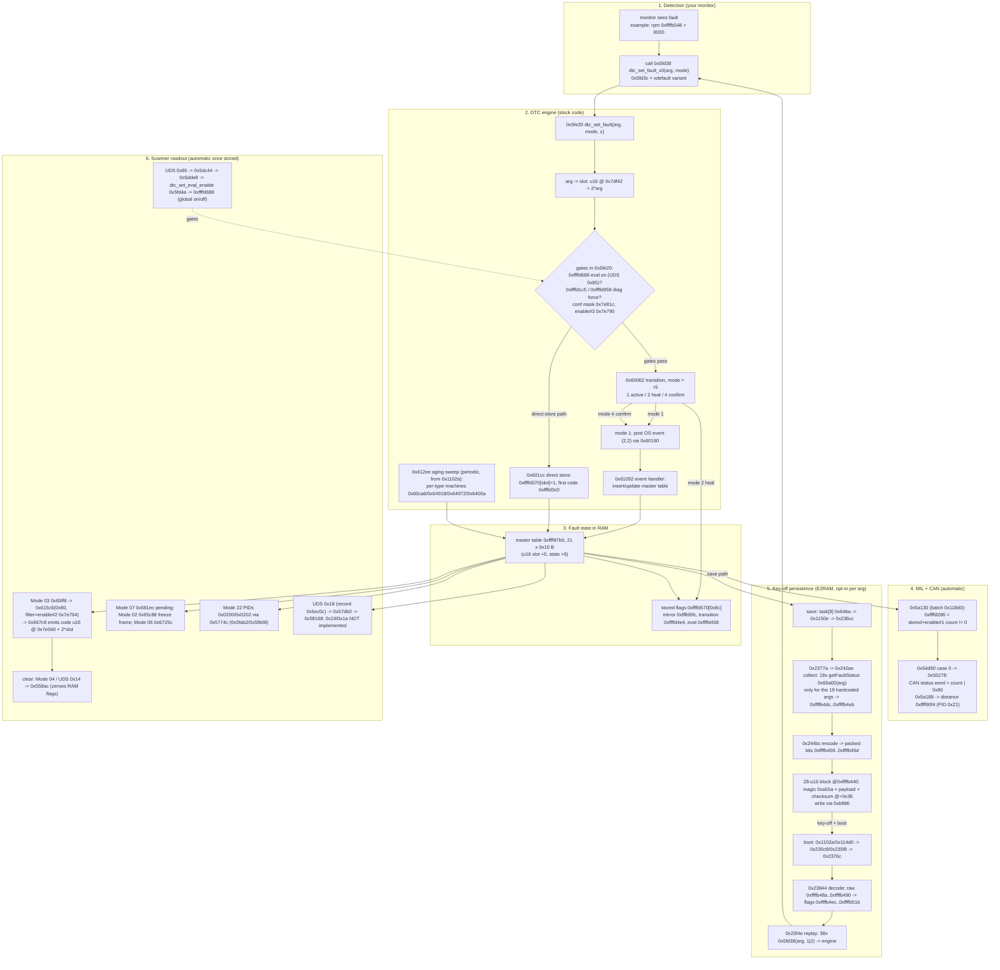

# DTC control + defs-accuracy deep dive — 60E15120_N3J1E (RX-8 PCM, SH7055 / SH-2E)

Target ROM: `submodules/Mazda_RX8_PCM_ReverseEngineering/Stock_ROMs/60E15120_N3J1E.bin`
(512 KiB, SHA-256 `a7cd953c2a87af12ee2814a95c958dc23959d352ef9c5e7f82b8ab8952f264f1`, untouched —
labels/data only, no binary change). Static-analysis disclaimer: findings come from the
canonical export + disassembly + raw ROM bytes, **plus dynamic execution in the SH-2E
emulator** (`utilities/scripts/emu/`); every dynamically-cited claim names the emulator
observation in [`reviews/dtc_control/dynamic_validation_log.txt`](reviews/dtc_control/dynamic_validation_log.txt).
All 11 ROM binaries were audited for the defs-accuracy half (§5). Full evidence:
[`reviews/dtc_control/README.md`](reviews/dtc_control/README.md) +
[`REVIEW_NOTES.md`](reviews/dtc_control/REVIEW_NOTES.md) + `defs_audit_detail.json`; extracted tables in [`data/dtc/`](../../../data/dtc/README.md);
labels in [`data/labels/60E15120_N3J1E/dtc_engine_labels.tsv`](../../../data/labels/60E15120_N3J1E/dtc_engine_labels.tsv)
and [`data/labels/60E15120_N3J1E/dtc_control_labels.json`](../../../data/labels/60E15120_N3J1E/dtc_control_labels.json)
(the DTC-control RAM aliases from the `[ADDITIONAL SOURCE REVIEW]` header comments, each
re-verified against the raw ROM literal pools).

**Related reports:** dispatch plumbing (service table 0x5eb40, PID table 0x5f10c) in
[uds_mode22_dispatch_report.md](uds_mode22_dispatch_report.md); OS task/event plumbing
(group-2 diag events at 0x67d00, `os_schedule_task_event` 0x9630) in
[os_scheduling_deep_dive_report.md](os_scheduling_deep_dive_report.md); defs merge/inheritance
issues in [defs-merge/](labeling/defs-merge/README.md); cross-ROM PID propagation in
[cross_ecu/cross_rom_mode22_pid_handlers.md](labeling/cross_ecu/cross_rom_mode22_pid_handlers.md);
key-off persistence codec + device layer (the E2RAM block in §2b) in
[e2ram_nv_storage_report.md](e2ram_nv_storage_report.md) and
[e2ram_device_layer_report.md](e2ram_device_layer_report.md); the "how to author a new
DTC" checklist and example patcher (which tables/args a new code must touch) in
[dtc_authoring_report.md](dtc_authoring_report.md).

## 1. Executive summary

- The PCM keeps **140 DTC slots**. Each slot has a fixed OBD code in a ROM table
  (**0x7e560**, BE u16 per slot; slot 0 *and* 1 are both P0300 — the two rotors'
  misfire code — and 0x7e55a holds the P0300/P0301/P0302 prefix codes), plus three
  enable/disable calibration blocks (**0x7e678 / 0x7e704 / 0x7e790**, one u8 per slot,
  exposed in the defs as `DTC xxxx Enable/Disable #1/#2/#3`), a type byte
  (**0x7e32a**, selects the aging state machine) and a confirmation mask (0x7e81c).
  An internal fault id maps to a slot via ROM table **0x7df42** (BE u16 per id,
  ids 0x00–0x8b; many-to-one from id 0x15 on — e.g. ids 0x7b/0x7c/0x7d → slots
  0x71/0x72/0x73; unreferenced tail at 0x7e05a). The status/availability mask
  (**0x7e934**, u32) and monitor-source mask (**0x7e29e**, u8) are **arg**-indexed,
  not slot-indexed: 0x66a00 reads `0x7e934 + 4*arg` and 0x5fb68 reads
  `0x7e29e[arg]` directly.
- **Runtime state** lives in RAM: a 21-entry "master" priority table at
  **0xffff87b0** (0x10 B/entry: u16 slot at +0, **state byte at +6**, priority at +0x0d;
  entry 0xffff8900 is skipped by every scan), a stored-flag table **0xffffd570[0x8c]**, a
  state mirror **0xffffd5fc[0x8c]**, eval-state **0xffffd458[0x8c]**, transition state
  **0xffffd4e4[0x8c]**, first-stored code **0xffffd3c0**, MIL flag **0xffffd286**, and the
  global eval-enable **0xffffd688**.
- **State-byte encoding** (observed in scanners 0x61450/0x615c6 and mapper 0x61800):
  `0x00` inactive · `0x01..0x3f` fault active/pending ("0x60" query) · `0x50` special ·
  `0x80..0xbf` stored + MIL bit ("0x80" query; mapped to 0x70 in the mirror array) ·
  `0xc0`/`0xc1` confirmed variants. Pending vs stored vs confirmed is exactly what
  OBD modes 07 vs 03 report.
- **Set path:** monitor code calls **0x5fd38(id, mode)** `dtc_set_fault_x0` (a direct
  tail-call trampoline: `bra 0x5fe20` + `mov #0,r6`, so x=0 — verified, not an indirect
  call) → **0x5fe20** `dtc_set_fault`
  (71 call sites) → state transition **0x60062** (uses type byte 0x7e32a + 0xffffd4e4) →
  either **0x601cc** (marks 0xffffd570[slot]=1 = stored, records first code 0xffffd3c0)
  or an OS event (group 2 event 2 → handler **0x61092**, event table 0x67d00) that inserts
  into the master table; the periodic sweep **0x612ee** `dtc_aging_sweep` walks the master
  table and runs per-type state machines 0x60ca6/0x64918/0x64972/0x6400a.
- **Report path:** OBD **Mode 03** (0x65ff8) = stored DTCs `0x615c6(0x80, filter=enable#2)` →
  **0x667c8** emits codes from 0x7e560 (P0300 first if >1 code); **Mode 07** (0x661ec) =
  pending; **Mode 02** (0x65c88) freeze frame; **Mode 06** (0x6725c) test results; Mode 22
  **PID 0x0200** (count via 0x5fab2) / **0x0202** (count via 0x5fb08) through dispatcher
  0x5774c. UDS **0x14** = clear (0x558ac `ref_ClearFaults_`, shared with Mode 04),
  **0x85** = DTC-setting on/off (0x5dc44), Mazda **0x18** = DTC readout (0x57db0 → 0x58168).
- **MIL:** 0x5a130 sets 0xffffd286 = 1 when a *stored, enabled* DTC exists
  (0x61450(0x80, filter=enable#1) ≠ 0 and 0xffffd1c5 ≠ 1) — verified dynamically: MIL=1
  with stored P0101 (enable1[9]=1), MIL=0 when only the disabled slot was stored.
  0x5a188 accumulates distance-while-MIL-on (`distance_mil_on_ffff90f4` 0xffff90f4, PID 0x21); 0x55278 puts the
  count+0x80 into the CAN status message.
- **Clear:** UDS 0x14 / Mode 04 → 0x558ac → 0x55992 → 0x61b02 + 0x5fd92/0x5fd84
  (zero 0xffffd570, 0xffffd5fc, …); boot-init 0x5fd6c does the same RAM reset.
- **Key-off persistence (opt-in per fault id):** only the 19 ids hardcoded in
  0x242ae/0x23f4e survive key-off, packed into the 28-u16 E2RAM block — save:
  task[9] 0x64ba → 0x1150e → 0x236cc → 0x2377a → collect 0x242ae → encode 0x244bc
  → device write 0xb886; load at boot: 0x1102a/0x114d0 → 0x235c8/0x235f8 → 0x2376c
  → decode 0x23844 → replay 0x23f4e (38 × `0x5fd38(arg, 1|2)`). Full chain: §2b;
  codec/device layer in [e2ram_nv_storage_report.md](e2ram_nv_storage_report.md) and
  [e2ram_device_layer_report.md](e2ram_device_layer_report.md). The charging ids
  0x7b–0x7d are **not** on the list — P2502/P2503/P2504 do not survive key-off.
- **UDS 0x85 chain (ROM-verified):** record 0x5eba0 (svc 0x85) → 0x5dc44: sub 1,
  guard 0x55e3e (0xffffd1cf ≠ 0 → NRC 0x22), permission 0xffffd3b4 & 0xfffc (else
  NRC 0x12) → 0x5dde8(sub) + 0x5de18 (positive response `58 85 sub`); 0x5dde8
  sub 1 → `dtc_set_eval_enable(1)` (0x5fd4a) + 0xffffd378=0 (ON), sub 2 → eval off
  + 0xffffd378=1; 0x5ddb4 auto re-enables when 0xffffd37a ≥ 0x271 and 0xffffd378==1;
  RAM 0xffffd688 gates the set path (0x5fe20 returns early when ≠ 1).
- **UDS 0x19/0x1A are not implemented** — absent from the 0x5eb40 service table
  (ROM-verified); readout is Mode 03/07/02/06, Mode 22 0x0200/0x0202 and Mazda 0x18.
- **"Fully disabling a DTC takes multiple writes" — confirmed (§3a):** enable#1
  (0x7e678) gates MIL + aging, enable#2 (0x7e704) gates the Mode 03 list and freeze
  frame, enable#3 (0x7e790) is a bitmask gating set/confirm/heal paths, plus
  confirmation mask 0x7e81c and monitor-source mask 0x7e29e. Stock example C073 (= U0073 on a standard scanner; def label now `DTC U0073 …`, §5b)
  (slot 0x74: #1=0, #2=1) is still reported by Mode 03 while MIL stays off —
  proven dynamically in the emulator (§3a, `dynamic_multigate_log.txt`).
- **Defs accuracy (§5):** the per-rom defs are **correct for 60E0FC00, 60E0G500_N3ZHEC,
  60E15120_N3J1E, 60E32000_N3N5EB** (0 mismatches against the ROM code table), but
  **wrong for 60E0E700_N3YLEE** (block +3 bytes; firmware literal is 0x7c6d8, def says
  0x7c6db), **60E1B900** and **60E32000_N3M5E** (def blocks point into the code table,
  −0x118 / −0xeb off the real enable block), and **partially wrong for 60E0FB00** (98
  mismatches: duplicated entries + a gap at slot 23) and **60E1D400** (112 mismatches:
  14 def codes absent from that ROM shift everything from slot 17). 60E15120/60E0G500
  per-rom defs bind only the #1 block; #2/#3 exist in ROM but are unbound there.

## 1a. Plain-language summary

- A **DTC** is the car's "check engine" record: each of the 140 possible faults has a
  fixed number (the P-code you see on a scanner, e.g. P0101 = MAF circuit) stored in a
  read-only table in the ROM, and up to three one-byte **on/off switches** in the
  calibration area (the `DTC xxxx Enable/Disable` tables in RomRaider) that decide
  whether that fault is watched and reported at all.
- When a monitor detects a problem it "sets" the DTC: first it's **pending** (seen this
  trip, mode 07), then **confirmed/stored** (mode 03) once it repeats — the exact number
  of repeats depends on the fault's type byte. Stored DTCs light the **MIL** (the
  amber check-engine lamp; flag RAM 0xffffd286) and survive key-off only for the 19
  fault ids on the E2RAM save/replay lists — the fault bits are packed into a 28-u16
  block in the external E2RAM at key-off and replayed at boot (§2b;
  [`e2ram_nv_storage_report.md`](e2ram_nv_storage_report.md)).
- A scanner reads them back over CAN: OBD mode 03/07 (or Mazda's UDS 0x18 / Mode 22
  PIDs 0x0200/0x0202). The ROM translates each stored slot number into its P-code using
  the table at 0x7e560 — verified dynamically in the emulator
  (slot 9 → `01 01` = P0101 in the response bytes).
- **About the defs:** the "DTC Enable/Disable" tables in the XML tell a tuner which
  byte switches off which code — but only if the byte address matches the ROM's real
  layout. For four of our nine per-ROM defs the block is correct; for 60E0E700 it's
  shifted 3 bytes, for 60E1B900 and 60E32000_N3M5E the addresses point at the code
  table instead of the switch block, and for 60E0FB00/60E1D400 parts of the list are
  misaligned. Writing through those defs would flip the *wrong* switch.
- **Each fault has THREE switch bytes, and they do different jobs** (details in §3a):
  - **#1** = "should this fault be tracked and light the check-engine lamp?" —
    gates the MIL and the pending→confirmed→stored aging. Off = no lamp, no aging.
  - **#2** = "may this fault be shown to a scanner?" — gates the Mode 03 DTC list
    and the freeze frame. Off = invisible to a scanner even if it's stored.
  - **#3** = a small bitmask of "which internal actions are allowed" (set / confirm
    / store / heal / report), not a simple on-off.
  - So **fully disabling a DTC means writing #1=0 AND #2=0** (and clearing the #3
    bits if you also want to stop it being set at all). Stock example: C073 (U0073) ships
    with #1=0 but #2=1, so a stored C073 (U0073) does *not* light the lamp but *still shows
    up in Mode 03* — verified in the emulator.

## 2. How it works (condensed pseudocode)

```python
# --- ROM tables (per slot 0..0x8b) ---
code_table   = u16be @ 0x7e560 + 2*slot      # OBD code, e.g. slot 9 = 0x0101
enable1      = u8 @ 0x7e678 + slot           # def 'DTC xxxx Enable/Disable #1' (evaluate/report gate)
enable2      = u8 @ 0x7e704 + slot           # def '#2' (mode-03 stored-list filter)
enable3      = u8 @ 0x7e790 + slot           # def '#3' BITMASK of reporting features (0x02/04/08/10/20)
dtc_type     = u8 @ 0x7e32a + slot           # 0/1/2/3 -> aging state machine
id2slot      = u16be @ 0x7df42 + 2*fault_id   # internal fault id -> slot
conf_mask    = u16be @ 0x7e81c + 2*slot
status_mask  = u32be @ 0x7e934 + 4*fault_id  # ARG-indexed (0x66a00: 0x7e934 + 4*arg); low16 vs RAM 0xffffd930, high16 vs 0x66a58() mask
mon_src      = u8 @ 0x7e29e + fault_id       # ARG-indexed monitor-source mask, ANDed with 8 monitor checks in 0x5fb68 (ptr table 0x604f8)

# --- set fault (called by ~71 monitor sites) ---
def set_fault(fault_id, mode, x=0):                  # 0x5fd38 -> 0x5fe20 dtc_set_fault
    slot = id2slot[fault_id]
    if diag_force (0xffffd1c5 or 0xffffd958):  eval_ok = True
    else:                            eval_ok = dtc_set_eval_state(fault_id)   # 0x5ff5a -> 0xffffd458
    if 0xffffd688 == 1:                              # eval enabled
        if not confirmation_mask_ok(slot):           # 0x5f9c2
            if not enable2_ok(slot):                 # 0x5f9b0 with enable3
                return dtc_state_transition(fault_id, eval_ok, x)   # 0x60062
    else:                                            # direct store:
        dtc_mark_stored(fault_id, x)                 # 0x601cc: 0xffffd570[slot]=1, 0xffffd3c0=first code

def dtc_state_transition(fid, mode, x):              # 0x60062, modes 1/2/4
    t = dtc_type[slot]; prev = 0xffffd4e4[slot]
    # mode 2: if enable3 bit 0x10 clear and master state != 0 -> clear mirror, 0xffffd4e4=2
    # mode 4: if type in {1,2,3} and prev != 4 -> post event, 0xffffd4e4=4
    # mode 1: if not already stored (0x5fb68) -> post OS event (2,2) via 0x60190, 0xffffd4e4=1
    # OS group-2 event 2 handler 0x61092 then inserts/updates the master table entry
    #   and refreshes 0xffffd5fc[slot] = map_master_state(slot)   # 0x602a4/0x61800

def aging_sweep():                                   # 0x612ee, periodic (gated by 0xffff8e7c)
    for each master entry (0x6328a iterator, skip index==0xffff8900):
        dispatch on dtc_type[slot]: 0 -> 0x60ca6, 1 -> 0x64918, 2 -> 0x64972, 3 -> 0x6400a
        mil_status()                                 # 0x606be

def collect(state_query, cal_filter, out_buf):       # 0x615c6 (list) / 0x61450 (count)
    for i in 0..0x14:                                # 21 master entries
        if i == 0xffff8900: continue
        slot, state = master[i]
        if cal_filter==1 and enable1[slot]!=1: continue
        if cal_filter==2 and enable2[slot]!=1: continue
        if state_matches(state_query, state): out_buf.append(slot)

def build_dtc_response(mode, out, slots, n):         # 0x667c8
    if mode in (1,3): prepend prefix codes 0x7e55c.. selected by 0x67bbc bitmap
    if n > 1: out[0] = 0x0300                        # P0300 first (multi-misfire convention)
    for slot in slots: if slot not in (0,1): out.append(u16be @ 0x7e560 + 2*slot)

# --- services ---
mode03: 0x65ff8 -> collect(0x80, filter=2) -> build_dtc_response(3,...)  -> 0x43 response
mode07: 0x661ec -> pending list                                            -> 0x47 response
mode02: 0x65c88 freeze-frame snapshot (0x6071e -> 0xffffd81a)
mode04 / UDS 0x14: 0x660d0 / 0x558ac -> 0x55992 -> clear flags+states (0x5fd92/0x5fd84)
UDS 0x85: 0x5dc44 -> sub 1=on / 2=off DTC evaluation (NRC 0x22 if active)
mode22 PID 0x0200: count = 0x5fab2 = 0x61450(0x80,0) - rotor_adjust(0x5f8fa) + 1, clamp 0xff
mode22 PID 0x0202: count = 0x5fb08 = #{0xffffd570[i]==1}, minus slots 0/1 adjustment
MIL: 0x5a130 -> 0xffffd286 = (0x61450(0x80, filter=enable1) != 0 && 0xffffd1c5 != 1)
CAN: 0x54d90 case 0 -> 0x55278() = stored count | 0x80 into the CAN status message; 0x5a188 -> distance-while-MIL 0xffff90f4 (PID 0x21)
UDS 0x18 (record 0x5ec0c -> 0x57db0): sub 1 + status 3 -> 0x58168 sets 0xffffd228 (1/2), response from the same collect/emit path; 0x19/0x1a NOT in table 0x5eb40 -> default 0x6689a (NRC)
# key-off persistence (E2RAM 28-u16 block; only the 19 args in 0x242ae/0x23f4e): full chain in §2b
# UDS 0x85 chain: record 0x5eba0 -> 0x5dc44 (guard 0x55e3e, permission 0xffffd3b4 & 0xfffc) -> 0x5dde8 + 0x5de18; 0x5ddb4 auto re-enable when 0xffffd37a >= 0x271; 0xffffd688 gates 0x5fe20
```

## 2a. End-to-end flowchart



The last step — picking a free slot, writing the code/enable bytes, binding an arg
and calling the set-fault thunk from a monitor — is the authoring checklist in
[dtc_authoring_report.md](dtc_authoring_report.md) §3 (with a working example
patcher); the key-off persistence half of the diagram is detailed in §2b below.

## 2b. Key-off persistence (E2RAM) — save/replay chain

Stored DTCs survive key-off **only for the 19 fault args hardcoded in the save and
replay routines** (0x13, 0x14, 0x21, 0x22, 0x42, 0x47, 0x4f, 0x5b, 0x5c, 0x5d, 0x5f,
0x60, 0x61, 0x64, 0x65, 0x6a, 0x6b, 0x83, 0x84); the charging args 0x7b/0x7c/0x7d are
not on the list, so P2502/P2503/P2504 do not persist. Mechanism (28-u16 block in the
external E2RAM, staging at 0xffffb440):

- **Save (key-off batch):** task[9] **0x64ba** → **0x1150e** → 0x236cc → 0x2377a →
  collect **0x242ae** (18 × `ref_getFaultStatus__` 0x66a00(arg) → staging
  0xffffb4dc–0xffffb4eb) → encode **0x244bc** (fault bits packed into
  0xffffb459–0xffffb45d; magic 0xa55a at 0xffffb440; checksum = sum of first 27 u16
  at +0x36) → device write 0xb886(0xffffb440, 0x1c).
- **Load (boot):** 0x1102a/0x114d0 → 0x235c8 (0xb99c read) / 0x235f8 (0xb958
  readback, magic 0x5aa5 + checksum) → 0x2376c → decode **0x23844** (raw
  0xffffb48a–0xffffb490 → flags 0xffffb4ec–0xffffb51b) → replay **0x23f4e**
  (38 × `0x5fd38(arg, 1|2)` — back through the set-fault thunk, so replayed DTCs
  re-enter the engine exactly like a live detection).

Codec and device layer: [`e2ram_nv_storage_report.md`](e2ram_nv_storage_report.md),
[`e2ram_device_layer_report.md`](e2ram_device_layer_report.md). Limits: save cadence
known only to callgraph level (0x64ba → 0x1150e); packed-bit placement verified at
byte level, not bit-by-bit (§9). Whether a *new* arg is added to these lists is an
authoring decision — [dtc_authoring_report.md](dtc_authoring_report.md) §3 row 12.

## 3. Key calibrated tables (the defs' DTC switches)

| Def table | ROM (60E15120) | Meaning |
|---|---|---|
| `DTC xxxx Enable/Disable #1` | 0x7e678 + slot | 1 = fault evaluated & counted (filter arg 1; MIL gate) |
| `DTC xxxx Enable/Disable #2` | 0x7e704 + slot | 1 = included in Mode 03 stored list (filter arg 2) |
| `DTC xxxx Enable/Disable #3` | 0x7e790 + slot | **bitmask** of reporting features (0x02/0x04/0x08/0x10/0x20), not a plain on/off |

Per-ROM values (stock bytes) are extracted in [`data/dtc/<rom-id>.tsv`](../../../data/dtc/README.md).
Default stock values: #1/#2 mostly 0x01 with a handful of 0x00 (e.g. slots 7/8 =
P0076/P0077 disabled); #3 holds small feature codes (0x02/0x03/0x0a/0x0f/0x2f/…).

### 3a. "Fully disabling a DTC takes more than one byte" — verified

Fully disabling a DTC takes more than one byte. Each gate below was confirmed at
disassembly level and dynamically in the emulator using stock slot 0x74 = C073 (U0073; the raw mode-03 bytes `C0 73`)
(stock bytes: enable#1=0, enable#2=1, enable#3=0x0e). In plain language, the three
per-DTC switch bytes in the defs are:

- **#1 ("Enable/Disable #1", 0x7e678) — the "lamp & tracking" switch.** If 0, the
  fault is excluded from the MIL decision (0x5a130 runs its stored-count query with
  filter=enable#1) and from the aging/state handlers (0x60f02/0x64234). It does
  **not** hide an already-stored code from Mode 03 or from the raw PID 0x0200 count.
- **#2 ("Enable/Disable #2", 0x7e704) — the "scanner visibility" switch.** If 0,
  the stored DTC is dropped from the **Mode 03** response (0x65ff8 collects with
  filter=enable#2) and from **Mode 02** freeze-frame capture (0x6071e). It does
  **not** stop the MIL if #1=1.
- **#3 ("Enable/Disable #3", 0x7e790) — a behavior bitmask, not on/off.** Bits:
  0x02 = allow the normal set/transition path, 0x04+0x08 = force direct store
  (both in 0x5fe20), 0x10 = allow heal-clear (0x60062 mode 2), 0x20 = "reportable"
  (0x60478, also in the sweep 0x5fd96) — tested via 0x5f9b0 `(bit & #3[slot])`.

| Gate (ROM table 60E15120) | Checked by | Effect when 0 / bit clear |
|---|---|---|
| `0x7e678` enable#1 (def `#1`) | scanners 0x61450/0x615c6/0x61d28 filter=1; predicates 0x60f02/0x64234 called from aging handlers 0x60b14/0x63f64/0x64620/0x6477c; MIL 0x5a130 (filter=1, disasm-verified) | stored DTC **excluded from MIL and aging**; still counted by PID 0x0200 (filter 0) and still listed by Mode 03 (filter 2) |
| `0x7e704` enable#2 (def `#2`) | scanners filter=2 — used by **Mode 03** 0x65ff8 (`0x615c6(0x80,2)`); also 0x6071e gates Mode 02 freeze-frame capture (0x65c88) | stored DTC **still reported by Mode 03** if only #1 is cleared |
| `0x7e790` enable#3 (def `#3`, **bitmask**) | `ref_faultEnableStatus2` 0x5f9b0: bits 0x02/0x04/0x08 gate confirm/store in 0x5fe20, 0x10 gates heal-clear in 0x60062 mode 2, 0x20 gates "reportable" 0x60478 | set/confirm path behavior per bit |
| `0x7e81c` confirmation mask (u16/slot) | `ref_faultConfirmationSomething_` 0x5f9c2 in 0x5fe20 | blocks confirmation |
| `0x7e29e` monitor-source mask (u8/arg, like 0x7e934) | 0x5fb68: ANDed with an 8-bit mask from 8 monitor-check fns (ptr table 0x604f8 → 0x5fbd2…); called in 0x60062 mode-1 store | gates the mode-1 store transition |
| `0x7e06c` 4-byte related/type records | 0x5ff5a (nibbles 0x01/0x02/0x04/0x10/0x20/0x40 select eval-state caching) | per-id eval state |
| `0x7e32a` type (u8/slot) | 0x612ee/0x61092/0x60062/0x618f8 dispatch to per-type state machines; 0x618f8 returns report class 1/2 (types 1/2/3) or 3/4/5 (type 0, graded by #1/#2) | selects aging behavior + report class |
| RAM 0xffffd688 + UDS 0x85 | 0x5fe20 path select; 0x5fd4a | global "DTC setting off" |

Dynamic proof (`reviews/dtc_control/dynamic_multigate_log.txt`): stored C073 →
`0x61450(0x80, filt=0)` count=1 (PID 0x0200 sees it), `filt=1` (enable#1) count=0
→ MIL stays 0 after 0x5a130, but `filt=2` (enable#2) count=1 → Mode-03-style list
emits `C073`; 0x618f8 class=4. So clearing **#1 alone does not remove the DTC from
Mode 03**, and clearing **#2 alone does not stop the MIL/aging paths** — you must
write #1 **and** #2 (and the relevant #3 bits to stop it being set/confirmed at all).
In stock ROMs the two blocks are asymmetric for exactly one used slot: 0x74 (C073,
#1=0/#2=1); ten slots are 0/0 (0076, 0077, 0480, 0481, 0505, 0564, 0571, 1260, 2502,
2503, 2504).

## 4. Labeling applied

New file [`data/labels/60E15120_N3J1E/dtc_engine_labels.tsv`](../../../data/labels/60E15120_N3J1E/dtc_engine_labels.tsv):
~30 DTC-engine functions + 8 RAM cells + 9 ROM tables with addresses and evidence.
Names use the evidence ladder: `dtc_*`/`candidate_*` for new labels, `ref_` names kept
as inherited hypotheses (0x5a130 = `ref_faultSomething0x1`, 0x5f9b0 =
`ref_faultEnableStatus2`, …). No label was upgraded on plausibility alone; every row
cites ROM bytes, decompiled code, callgraph, or the emulator log.

## 5. Defs accuracy audit (all 9 per-rom defs + upstream rx8_defs.xml)

Method: ROM layout derived from the binary itself (code table anchored on the
universal `03 00 03 01 03 02 03 00` prefix; enable block = end of the 0xffff padding
run; cross-checked against literal-pool references). Each def
`DTC xxxx Enable/Disable #N @addr` maps to slot = addr − enable_block − (N−1)*140;
match = (def code == ROM code table[slot]). Pre-repair detail:
[`reviews/dtc_control/defs_audit_detail.json`](reviews/dtc_control/defs_audit_detail.json);
post-repair summary (all zeros): [`data/dtc/defs_audit.tsv`](../../../data/dtc/defs_audit.tsv).

| ROM | code table | enable#1 | def #1/#2/#3 entries | mismatches | verdict |
|---|---|---|---|---|---|
| 60E15120_N3J1E | 0x7e560 | 0x7e678 | 121 / 0 / 0 | **0** | correct (#2/#3 unbound in this def) |
| 60E0FC00 | 0x7c8e4 | 0x7c9fc | 123 / 123 / 123 | **0** | correct |
| 60E0G500_N3ZHEC | 0x7e108 | 0x7e220 | 121 / 121 / 0 | **0** | correct (#3 unbound) |
| 60E32000_N3N5EB | 0x7e548 | 0x7e660 | 132 / 132 / 0 | **0** | correct |
| 60E0E700_N3YLEE | 0x7c5c0 | 0x7c6d8 | 121 / 122 / 0 | **121** (+1 bogus addr 0x0 in #2) | def block +3 bytes (0x7c6db; literal absent from ROM) |
| 60E1B900 | 0x7c8e4 | 0x7c9fc | 121 / 121 / 0 | **121, all out of range** | def addresses point at the code table (−0x118) |
| 60E32000_N3M5E | 0x7e634 | 0x7e74c | 132 / 132 / 0 | **132, all out of range** | def addresses inside the code table (−0xeb) |
| 60E0FB00 | 0x7c8e4 | 0x7c9fc | 244 / 244 / 123 | **98** (#1/#2; #3 OK) | duplicated entries + gap at slot 23 |
| 60E1D400 | 0x7e108 | 0x7e220 | 132 / 132 / 0 | **112** | 14 def codes absent from ROM shift from slot 17 |
| 60E0E500, 60E1C500_N3J6EB | 0x7c510 | 0x7c628 | no per-rom XML | — | ROM table extracted anyway (data/dtc/) |

Upstream `rx8_defs.xml` child ROMs that inherit `Rx8Base` DTC addresses show the
expected inheritance drift (97–98 mismatches for the 60E0FC00-based blocks) — already
tracked in [`defs-merge/inheritance_issues.json`](labeling/defs-merge/inheritance_issues.json)
(0128/1574/1577/2008/2101/2406…). The merged `rx8defs-merged-60E15120.xml` keeps the
DTC category (381 tables). Note the ROM code sets differ per ROM (e.g. 60E1B900 and
60E32000_N3M5E include 0444/0445/0116/… that 60E15120 lacks) — per-ROM tables are in
`data/dtc/`.

#### Corrections — applied to the defs

The per-ROM defs are generated by `utilities/scripts/defs-merge/extend_defs_all_roms.py`,
which runs `repair_dtc_tables()`: every `DTC xxxx Enable/Disable #N` entry in each
ROM block is rebuilt from that ROM's own DTC layout (code table + three enable blocks),
so addresses map slot → the byte the firmware actually reads. After regeneration the
audit reports **0 mismatches for all 9 per-ROM defs across #1/#2/#3** (fixed issues:
60E0E700 was +3 off — firmware literal 0x0007c6d8 at
0x605cc/0x60b90/… vs def 0x7c6db; 60E1B900/60E32000_N3M5E pointed at the code table —
real enable#1 0x7c9fc / 0x7e74c; 60E0FB00 had 98 and 60E1D400 112 misaligned entries;
60E0E700 #2 had a bogus storageaddress 0x0). The merged 60E15120 block
(`rx8defs-merged-60E15120.xml`) gained the missing #2/#3 bindings (363 DTC entries,
0 mismatches). Repair record: `labeling/defs-merge/definition_repairs.json` (entry 83);
pre-repair detail: `reviews/dtc_control/defs_audit_detail.json`.

#### §5b DTC P-code labels in the defs

The def table names carry the standard 5-char OBD code:
`DTC 0420 Enable/Disable #1` → `DTC P0420 Enable/Disable #1` (catalyst system
efficiency below threshold, bank 1). **Correspondence verified:** the ROM code
table stores exactly the two OBD mode-03 response bytes (BE u16) per slot, and
SAE J2012 / ISO 15031-6 decodes them as byte0 bits 7-6 → letter (00 P, 01 C,
10 B, 11 U), bits 5-4 → second digit (0/2 = SAE generic, 1/3 = manufacturer),
low 12 bits → last 3 digits — so `0x0420` = P0420, `0x2504` = P2504, and the
dynamically observed slot-9 emission `01 01` = P0101. All 134 codes used across
the 11 ROMs are mapped in [`data/dtc/pcodes.tsv`](../../../data/dtc/pcodes.tsv)
against two independent SAE J2012 lists (tekseport/obd2-codes @ `ddadc77e`,
foerbsnavi/OBDex @ `3f03bb0`, cross-checked): every `0x0xxx` code is a
generic **P0** code and every `0x2xxx` a generic **P2** code with a standard
meaning; the six `0x1xxx` codes (1260/1574/1577/1686-1688) are **P1
manufacturer-specific** (no SAE text — labeled as such, not guessed); the five
`0xCxxx` codes are **U0 network** codes (C073→U0073 CAN bus A off, C101→U0101
lost comm TCM, C121→U0121 ABS, C155→U0155 instrument cluster, C167→U0167
immobilizer) — 0xC0>>6 = U (network), not chassis. Applied by `utilities/scripts/defs-merge/relabel_dtc_names.py`
(merged def, all active blocks, 4027 tables renamed + 23 P0300 duplicate-site
suffixes + 12 stale descriptions replaced, surgical splice, idempotent) and by
`repair_dtc_tables()` at per-ROM generation time (names + short rule-6b
descriptions — no checksum-range/bench-validate text per rule 6b).
Audit: **0 mismatches** across all 9 per-ROM defs × #1/#2/#3
([`data/dtc/defs_audit.tsv`](../../../data/dtc/defs_audit.tsv)); stats:
[`defs-merge/dtc_pcode_labels_2026-11-03.json`](labeling/defs-merge/dtc_pcode_labels_2026-11-03.json);
tests: `tests/test_dtc_pcode_labels.py` (14 passed). Repair record:
`labeling/defs-merge/definition_repairs.json` (entry 84).

Cross-checked against the Mazda workshop manual `input/4EngineControl.pdf`
("RX8 – Engine Diagnostics & Control", 2003; DTC TABLE section parsed to
[`data/dtc/mazda_dtc_table.tsv`](../../../data/dtc/mazda_dtc_table.tsv), 118 codes):
all manual codes exist in the ROMs (P0301/P0302 are the rotor-misfire
prefix codes at 0x7e55a); 18 ROM codes are absent from the 2003 table (later J2012
additions — they keep their SAE text). The manual supplies the **manufacturer-specific
P1 meanings** the SAE list lacks — P1260 immobilizer system problem, P1574/P1577 TP /
APP sensor output incongruent, P1686-P1688 metering oil pump control circuit
low/high/initial-check flow-side problems — and Mazda's own part wording (P0335
eccentric shaft position sensor, P0076/P0077 VDI solenoid, P2004 APV, P2070 SSV,
P0661/P0662 SSV solenoid), which the def descriptions now prefer over the SAE generic
text (`mazda_manual_description` column in [`data/dtc/pcodes.tsv`](../../../data/dtc/pcodes.tsv)).
One conflict recorded, not resolved silently: **U0167** — SAE generic = lost
communication with the immobilizer module, Mazda manual = keyless control module;
the def uses the Mazda assignment (RX-8-specific).

## 6. Files

- `docs/investigations/60E15120_N3J1E/dtc_control_report.md` — this report.
- `docs/investigations/60E15120_N3J1E/reviews/dtc_control/` — [`README.md`](reviews/dtc_control/README.md),
  [`REVIEW_NOTES.md`](reviews/dtc_control/REVIEW_NOTES.md), `validation.json`, `defs_audit_detail.json`,
  `extract_dtc_tables.py`, `dynamic_validation.py`, `dynamic_validation_log.txt`.
- [`data/dtc/README.md`](../../../data/dtc/README.md) + `data/dtc/<rom-id>.tsv` (11 ROMs) + `data/dtc/defs_audit.tsv` —
  extracted DTC tables and the defs audit (new folder, proposed here per AGENTS.md).
- `data/labels/60E15120_N3J1E/dtc_engine_labels.tsv` — DTC engine labels.
- `data/labels/60E15120_N3J1E/dtc_control_labels.json` — DTC-control RAM aliases
  (0xffff87b0/0xffff8900/0xffffd286/0xffffd3c0/0xffffd3c2/0xffffd458/0xffffd4e4/
  0xffffd5fc/0xffffd688/0xffffd930) promoted from the `[ADDITIONAL SOURCE REVIEW]`
  header comments into a per-subsystem JSON record; binary-level re-verification of
  each cited reader's literal pool recorded per entry.

## 7. Validation

- Binary level (rule 7): ROM bytes re-dumped for all 11 ROMs; enable-block bases
  anchored by literal-pool search per ROM (convicts/acquits as in §5); disassembly
  re-read for 0x5a130, 0x61450/0x615c6, 0x667c8, 0x5fe20/0x60062/0x601cc, 0x558ac,
  0x5dc44; OS event table 0x67d00 dumped. Details in
  [`reviews/dtc_control/REVIEW_NOTES.md`](reviews/dtc_control/REVIEW_NOTES.md).
  The ten DTC-control RAM aliases in
  [`data/labels/60E15120_N3J1E/dtc_control_labels.json`](../../../data/labels/60E15120_N3J1E/dtc_control_labels.json)
  were additionally re-verified against the raw ROM literal pools: each cited reader
  loads the address from a pool word (`mov.l`: 0x61450→0x61554/0x61558, 0x5f9f0→0x5faf8,
  0x5ff5a→0x6001c/0x6012c, 0x60062→0x60130, 0x601cc→0x60278, 0x5fd4a→0x5fe10,
  0x66a00→0x66bf8; `mov.w` sign-extended: 0x5a130→pool word 0xd286 at 0x5a202), and
  the pool bytes in the ROM match the labeled address. Durable check:
  `tests/test_dtc_control_labels.py`.
- Dynamic (emulator, `reviews/dtc_control/dynamic_validation_log.txt`): boot 300k
  cycles; init DTC RAM via ROM 0x5fd6c; plant stored slot 9 (P0101, state 0x80) and
  active slot 8 (P0077, state 0x01); then through the ROM's own code:
  `0x615c6(0x80)` → slot 9 → `0x667c8` emits **0x0101**; `0x615c6(0xf0, filter=enable1)`
  drops disabled P0077; Mode 22 **PID 0x0200 → `62 02 00 01`**, **PID 0x0202 →
  `62 02 02 01`** via dispatcher 0x5774c; MIL flag 0xffffd286 = **1** after 0x5a130;
  set-thunk 0x5fd38 writes 0xffffd458/0xffffd3c2 as expected.
- Pipeline validators (run from the repo root): `validate_export.py`,
  `validate_reports.py`, `verify_readability.py`, `verify_math_units.py` (results in
  `reviews/dtc_control/validation.json`).

## 8. Memory map for validation

### Functions

(Label cell carries the export/index name first, then the semantic name from
`data/labels/60E15120_N3J1E/dtc_engine_labels.tsv`.)

| Address | Label | Role |
|---|---|---|
| 0x0005fd38 | `dtc_set_fault_x0` — set-fault trampoline, x=0 | set-fault entry (71 callers); `bra 0x5fe20` + `mov #0,r6` |
| 0x0005fd3c | `dtc_set_fault_xdefault` — set-fault trampoline, x=0xffff if r6==0 | 2 callers (0x44724, 0x44cec); pool 0x5fe0c = 0xffff |
| 0x0005fd4a | `dtc_set_eval_enable` | writes 1/0 to 0xffffd688 per r4; callers 0x5fd6c (boot), 0x5dde8 (UDS 0x85) |
| 0x0005fe20 | `FUN_0005fe20` — dtc_set_fault | core set path |
| 0x00060062 | `FUN_00060062` — dtc_state_transition | mode 1/2/4 transitions |
| 0x000601cc | `FUN_000601cc` — dtc_mark_stored | 0xffffd570[slot]=1, first code 0xffffd3c0 |
| 0x000601b2 | `FUN_000601b2` — dtc_clear_flag_table | clears 0xffffd570 |
| 0x0006028c | `FUN_0006028c` — dtc_clear_state_array | clears 0xffffd5fc |
| 0x0006020e | `FUN_0006020e` — dtc_rebuild_state_array | recollects 0xf0 states |
| 0x0005fd6c | `FUN_0005fd6c` — dtc_ram_init | boot init (from 0x1102a) |
| 0x000558ac | `uds_service_14_clear_diagnostic_information` | UDS 0x14 / Mode 04 clear |
| 0x0005f9b0 | `ref_faultEnableStatus2` — dtc_fault_enable_status2 | enable3-bitmask test |
| 0x0005f9c2 | `ref_faultConfirmationSomething_` — dtc_fault_confirmation_mask | confirmation-mask test |
| 0x0005ff5a | `FUN_0005ff5a` — dtc_set_eval_state | per-id eval state (0xffffd3c2, 0xffffd458) |
| 0x0005f9f0 | `FUN_0005f9f0` — dtc_query_state | state query by type 0..3 |
| 0x00061450 | `FUN_00061450` — dtc_collect_by_state_count | master-table scanner (count) |
| 0x000615c6 | `FUN_000615c6` — dtc_collect_by_state_list | master-table scanner (list, cal filter) |
| 0x00062df8 | `FUN_00062df8` — dtc_master_lookup_slot | slot lookup in master table |
| 0x00061800 | `FUN_00061800` — dtc_map_master_state | 1..0x3f→0x60, 0x80..0xbf→0x70 |
| 0x0005fab2 | `dtc_count_stored` | PID 0x0200 stored count |
| 0x0005fb08 | `dtc_count_ram_table` | PID 0x0202 RAM-list count |
| 0x0005f8fa | `FUN_0005f8fa` — dtc_rotor_adjust_count | rotor-0/1 adjustment for counts |
| 0x000667c8 | `FUN_000667c8` — dtc_build_response_codes | slot→code emission (table 0x7e560) |
| 0x00065ff8 | `obd_mode03_stored_dtc` | Mode 03 handler |
| 0x000661ec | `obd_mode07_pending_dtc` | Mode 07 handler |
| 0x000660d0 | `obd_mode04_clear_dtc` | Mode 04 handler |
| 0x00065c88 | `obd_mode02_freeze_frame` | Mode 02 handler |
| 0x0006725c | `obd_mode06_test_results` | Mode 06 handler |
| 0x0005dc44 | `uds_service_85_control_dtc_setting` | DTC setting on/off |
| 0x00057db0 | `uds_service_18` — uds_18_mazda_dtc_readout | Mazda DTC readout (high confidence: router 0x68dac reached it at session bit 0, r0 = 24, in the emulator) |
| 0x0006328a | `FUN_0006328a` — dtc_master_iterate | 21-entry master-table iterator |
| 0x00063396 | `FUN_00063396` — dtc_master_pick_priority | priority pick |
| 0x000612ee | `FUN_000612ee` — dtc_aging_sweep | per-type aging state machines |
| 0x00061092 | `FUN_00061092` — group-2 event-2 handler | set-fault message processing |
| 0x0005a130 | `ref_faultSomething0x1` — dtc_update_mil_flag | MIL flag 0xffffd286 |
| 0x0005a188 | `FUN_0005a188` — dtc_distance_mil_accumulator | distance-while-MIL-on `distance_mil_on_ffff90f4` 0xffff90f4 |
| 0x00055278 | `FUN_00055278` — CAN MIL status | count|0x80 into CAN message |
| 0x00066a00 | `ref_getFaultStatus__` — dtc_get_fault_status | 80 callers |
| 0x00066a58 | `FUN_00066a58` — dtc_status_availability_mask | high-half mask builder |
| 0x0005b12e | `ref_dtcCodeTypeInit` | code-type init |
| 0x0005b2f2 | `ref_writeDTCCodeType` — dtc_write_code_type | code-type write |
| 0x00054d90 | `FUN_00054d90` | CAN status message builder (case 0 → 0x55278) |
| 0x00058168 | `FUN_00058168` | UDS 0x18 report selector → 0xffffd228 (record 0x5ec0c → 0x57db0) |
| 0x0005dde8 | `ref_setDiagMode85Bool2` | UDS 0x85 sub 1/2 → dtc_set_eval_enable (0x5fd4a) + 0xffffd378 |
| 0x0005ddb4 | `ref_setDiagMode85Bool_` | auto re-enable when 0xffffd37a ≥ 0x271 and 0xffffd378==1 |
| 0x0005de18 | `FUN_0005de18` | builds positive response 58 85 sub |
| 0x0005fb68 | `FUN_0005fb68` | monitor-source mask test (0x7e29e[arg] ANDed with 8 monitor checks, ptr table 0x604f8) |
| 0x000242ae | `e2ram_fault_status_collect` | key-off persist collect: 18× 0x66a00 → 0xffffb4dc–0xffffb4eb |
| 0x00023f4e | `e2ram_stored_dtc_replay` | boot persist replay: 38× 0x5fd38(arg, 1\|2) |
| 0x00023844 / 0x000244bc | `e2ram_block_decode` / `e2ram_block_encode` | E2RAM block codec; fault bits 0xffffb48a–0xffffb490 ↔ 0xffffb459–0xffffb45d |
| 0x0002376c / 0x0002377a | `e2ram_load_decode_entry` / `e2ram_save_encode_entry` | load / save wrappers |
| 0x000235c8 / 0x000235f8 / 0x000236cc | `FUN_000235c8` / `FUN_000235f8` / `FUN_000236cc` | load / verify / save drivers (boot 0x1102a/0x114d0; save from 0x1150e) |
| 0x0001150e | `FUN_0001150e` | periodic batch containing the E2RAM save; called from 0x64ba |
| 0x000064ba | `knock_sensor_fault_task` | task[9] entry → 0x1150e |

### RAM

| Address | Label | Content |
|---|---|---|
| 0xffff87b0 | `dtc_master_table_21` | 21 × 0x10 B (u16 slot +0, state +6, priority +0x0d) |
| 0xffff8900 | `dtc_master_current_index` | u16, excluded from scans |
| 0xffffd570 | `dtc_ram_flag_table_ffffd570` — dtc_stored_flag_table | 0x8c flags (PID 0x0202) |
| 0xffffd5fc | `dtc_state_array` | 0x8c state bytes |
| 0xffffd458 | `dtc_eval_state_array` | 0x8c eval states |
| 0xffffd4e4 | `dtc_transition_state_array` | 0x8c transition states |
| 0xffffd3c0 | `dtc_first_stored_code` | u16 first stored code |
| 0xffffd286 | `mil_lamp_flag` | MIL flag |
| 0xffffd688 | `dtc_eval_enable` | eval enable |
| 0xffffd930 | `dtc_status_bits` | status bits vs ROM mask 0x7e934 |
| 0xffffd3c2 | `dtc_eval_state_cache` | per-id eval-state cache |
| 0xffffd228 | `DAT_ffffd228` | UDS 0x18 report selector (0x58168) |
| 0xffffd378 | `DAT_ffffd378` | UDS 0x85 "setting off" flag (0x5dde8/0x5ddb4) |
| 0xffffd37a | `DAT_ffffd37a` | UDS 0x85 off-counter, re-enable threshold 0x271 (0x5dd78/0x5de3c) |
| 0xffff90f4 | `distance_mil_on_ffff90f4` | distance-while-MIL (PID 0x21) |
| 0xffffb440 / 0xffffb478 | `e2ram_staging_block` / `e2ram_read_staging` | 28-u16 E2RAM block (save / load) |
| 0xffffb459–0xffffb45d | packed fault bits (encode, 0x244bc) | save side |
| 0xffffb48a–0xffffb490 | raw packed fault bytes (read staging) | load side, unpacked by 0x23844 |
| 0xffffb4dc–0xffffb4eb, 0xffffb51c | collect staging (0x242ae) | live fault-status bytes |
| 0xffffb4ec–0xffffb51b | `stored_dtc_flag_bits` | unpacked flags read by 0x23f4e |

### ROM tables (60E15120_N3J1E; per-ROM values in `data/dtc/`)

| Address | Content |
|---|---|
| 0x7e55a | P0300/P0301/P0302 prefix codes |
| 0x7e560 | DTC code table, 140 × BE u16 |
| 0x7e678 / 0x7e704 / 0x7e790 | enable/disable #1 / #2 / #3 (def tables; #3 = bitmask) |
| 0x7e32a | type byte per slot (only slots 0,1 = 1/2 and 0x1e,0x1f = 3 nonzero) |
| 0x7df42 | fault-id → slot map (BE u16 per id 0x00–0x8b; many-to-one from id 0x15 on; unreferenced tail at 0x7e05a for ids ≥ 0x8c) |
| 0x7e81c / 0x7e06c | confirmation mask (u16/slot) / related-type records (u32/slot; low byte = arg) |
| 0x7e934 | status mask, u32 per **arg** (`0x7e934 + 4*arg` in 0x66a00) |
| 0x7e29e | monitor-source mask, u8 per **arg**, ANDed with 8 monitor checks in 0x5fb68 (ptr table 0x604f8) |
| 0x5eb40 | UDS service dispatch table, 29 × 12 B (no 0x19/0x1a; 0x18 record 0x5ec0c → 0x57db0; 0x85 record 0x5eba0 → 0x5dc44) |
| 0x5f10c | Mode 22 PID table (0x0200/0x0202 → 0x5fab2/0x5fb08 via dispatcher 0x5774c) |
| 0x67d00 | OS event table (group-2 event 2 → 0x61092) |

## 9. Limits

- The aging/confirmation counters (how many trips until pending→confirmed→stored, and
  the clear-after-N-warm-ups rule) in 0x60ca6/0x64918/0x64972/0x6400a were read
  statically only — not executed (the OS tick is not autonomous in the emulator).
- The full set→master-table insertion rides OS group-2 event 2 (0x61092); in the
  emulator the message queue isn't drained autonomously, so the dynamic log plants the
  documented RAM cells directly and proves the *reporting* half end to end.
- MIL lamp GPIO pin not traced to a package pin (flag 0xffffd286 verified; pin
  routing is board-level, see docs/architecture/hardware/).
- Renesas simulator cross-check still pending; the emulator code itself is unchanged.
- UDS 0x19 (ReadDTCInformation) is **not** in the service table 0x5eb40 — DTC readout
  on this PCM is via OBD modes 03/07 (+0x0A-style via 0x667c8 mode arg), Mazda 0x18,
  and Mode 22 PIDs 0x0200/0x0202.
- Key-off persistence covers only the 19 hardcoded args (0x242ae/0x23f4e, §2b); the
  arg→flag-byte map is from the decompiled replay and the packed-bit placement is
  verified at byte level (0xffffb459–0xffffb45d save / 0xffffb48a–0xffffb490 load),
  not bit-by-bit; save cadence is known only to callgraph level (task[9] 0x64ba →
  0x1150e).
- The 0x7e05a tail of the arg→slot table exists in ROM but no code references it —
  treated as unused.
