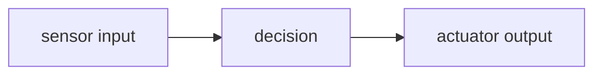

# <Subsystem> — subsystem report

Template guidance: the report is organized top-down from human to machine —
parts 1–2 are for anyone, part 3 for engineers, part 4 is the proof. Write the
final report in a purely factual tone: state what the subsystem is and does,
never "findings", never Q&A-style phrasing ("already", "you see"), and do not
carry this template's explanatory scaffolding lines (including this paragraph)
into the final report. Cross-links to related reports go in the proof section
(§4.7), not in the header.

| Date | What changed | Version |
|------|--------------|---------|
| YYYY-MM-DD | Initial report | 1 |

**Applicable ROMs** — the behavior described here is **assumed identical across
all ROM bins until proven otherwise**; a row documents any per-ROM difference
(also detailed in [`docs/investigations/<rom-id>/`](../investigations/README.md),
never re-derived here). List only ROMs actually investigated for this subsystem
(the reference ROM always present) — never add a row asserting shared logic for
a ROM that has not been investigated; the assumption above covers it until
then:

| ROM | ROM specifics | Short one-line description |
|-----|---------------|----------------------------|
| [`60E15120_N3J1E`](../investigations/60E15120_N3J1E/README.md) | reference ROM — all `0x` addresses in this report are from this bin unless a row says otherwise; SHA-256 `<hash from binaries/manifest.csv>`, untouched | <what this subsystem does on this ROM, one line> |

All content in the report is from static analysis of the canonical export
(`reverse-engineered/decompiled/`), the disassembly and the ROM bytes, except
where a section explicitly states otherwise.

## 1. Introduction — what this subsystem is and does

Plain language, no addresses yet: what the subsystem is, what it does for the
car, and what the key numbers mean.

## 2. How it works, step by step

The basic operation in the order it happens, one short paragraph per step.
Use sub-chapters (`## 2.1`, `## 2.2`, …) to explain the relevant subsystems and
logic where required. When the subsystem touches hardware, start with a hardware
setup diagram (ASCII or mermaid) showing the relevant peripherals, terminals and
signals — distinguishing traced pin routing from firmware-level paths. Near the
start of the body, include a structured overview diagram (ASCII or mermaid) of
the subsystem's components and execution order — which tasks/batches run what,
and in what order — so the whole is visible at a glance before the step-by-step
detail. Add further flow charts or breakdown diagrams where they help, and the
calibrated tables when they explain the operation:

## 2.1 <subsystem / logic stage>

## 2.2 <next subsystem / logic stage>

...

## 3. Technical pseudocode

Only now the machine-level detail: the firmware chain as condensed pseudocode,
each step anchored to its `0x` ROM address.

## 4. Proof — evidence and validation

Everything that backs parts 1–3 lives in this section.

### 4.1 Memory map (mandatory)

Function (ROM address), RAM (`0xffff…`) and ROM table / literal-pool tables.

Every row is machine-checked by
[`validate_reports.py`](../../utilities/scripts/rx8-pcm-pipeline/validate_reports.py):
the address is read from the row's first cell and classified by its own value —
peripheral I/O window (`0xffffe000` and up), RAM cell (`0xffff0000`–`0xffffdfff`),
function entry, or other ROM address (table/descriptor/axis/pool) — then the name
in the second cell must resolve against the tracked sources
(`accepted_function_aliases.tsv`, `accepted_ram_aliases.tsv`,
`metadata/integrated_names.json`, the per-subsystem label records under
`data/labels/<rom-id>/` or `function_index.tsv`). A row is in the map scope when
its heading — or any enclosing heading — says "memory map", or when it sits under
a bold `**Functions**` / `**RAM**` / `**ROM tables**` sub-label, so subsections
inherit the scope. Accepted row forms:

| Form | Example |
|------|---------|
| plain address | `0x0002f890` |
| wrapped in code/bold/italics | `` `0x0002f890` ``, `**0x0002f890**` |
| any 0x width / leading zeros | `0x563de` |
| symbol-led register cell | `` `PEDR_W` 0xfffff754 `` |
| grouped cells in one row | `0xffffa6a0/a6a2`, `0xffffa700 … 0xffffa70f` |
| cell with no alias yet | `DAT_ffff8038` (rule 6 `DAT_` = unnamed, address only) |

A row whose name does not match a tracked alias fails the run — instead of
writing an untracked alias, either commit the evidence and the label record, or
declare the address in
[`report_map_baseline.json`](../../utilities/scripts/rx8-pcm-pipeline/report_map_baseline.json)
(`ram` = no tracked alias exists yet, `ram_conflict` = the tracked alias
disagrees and the discrepancy is being resolved). The ledger may only shrink: an
entry that has been resolved, or that names a report that no longer exists, fails
the run as stale. The per-report row counts are asserted to add up
(`map_rows = fn_checked + ram_checked + data_rows + io_rows`), so no row can be
skipped silently.

### 4.2 Labeling applied

Which labels/aliases this report relies on, and where their evidence lives.

### 4.3 Corrections

Corrections to earlier claims, with the evidence that corrected them.

### 4.4 Files

Artifacts this report produced or depends on (label JSONs/TSVs, review
folders, validation records).

### 4.5 Validation

ROM SHA-256, `validation.json` records, dynamic/emulator checks. Validation
proves what it lists — never write "verified working" beyond what a validation
artifact covers.

### 4.6 Limits

What this report does not cover, and what would disprove the shared-logic
assumption for a given ROM. Scope discipline: while tracing a subsystem you
will inevitably map neighboring items (other relays on the same port bank,
switch inputs read by the same expander, …). Those do **not** get body
sections, memory-map rows or label entries in this report — record them here
as one line each with their key `0x` addresses, add a ROADMAP item for the
subsystem they actually belong to (if none exists), and cross-link it. If a
neighboring item turns out to correct an earlier claim in another document,
that correction goes in §4.3 and is folded back into the source document in
the same change.

### 4.7 Related reports

Links to upstream/downstream subsystem reports and per-ROM difference
documents — cross-link here instead of re-deriving their content.
