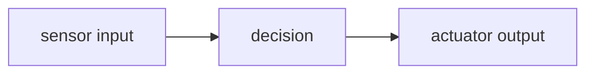

# <Subsystem> — subsystem report

| Date | What changed | Evidence |
|------|--------------|----------|
| YYYY-MM-DD | Initial report | — |

Target ROM: `60E15120_N3J1E.bin` — SHA-256 `<hash from binaries/manifest.csv>`,
untouched. All findings are from static analysis of the canonical export
(`reverse-engineered/decompiled/`), the disassembly and the ROM bytes unless a
section explicitly says otherwise (then it says what was executed instead).

Shared-logic assumption: the behavior described here is **assumed identical
across all ROM bins until proven otherwise**; any per-ROM difference is
documented in [`docs/investigations/<rom-id>/`](../investigations/README.md)
and linked below, never re-derived here.

**Related reports:** <link upstream/downstream subsystem reports and per-ROM
difference documents here instead of re-deriving their content>

This report reads top-down from human to machine (AGENTS.md rule 8): parts 1–2
are for anyone, part 3 for engineers, part 4 is the proof.

## 1. Introduction — what this subsystem is and does

Plain language, no addresses yet: what the subsystem is, what it does for the
car, and what the key numbers mean.

## 2. How it works, step by step

The basic operation in the order it happens, one short paragraph per step.
Add a flow chart or breakdown diagram (ASCII or mermaid) where it helps, and
the calibrated tables when they explain the operation:

## 3. Technical pseudocode

Only now the machine-level detail: the firmware chain as condensed pseudocode,
each step anchored to its `0x` ROM address.

## 4. Proof — evidence and validation

Everything that backs parts 1–3 lives in this section.

### 4.1 Memory map (mandatory)

Function (ROM address), RAM (`0xffff…`) and ROM table / literal-pool tables.

### 4.2 Labeling applied

Which labels/aliases this report relies on, and where their evidence lives.

### 4.3 Corrections

Corrections to earlier claims, with the evidence that corrected them.

### 4.4 Files

Artifacts this report produced or depends on (label JSONs/TSVs, review
folders, validation records).

### 4.5 Validation

ROM SHA-256, `validation.json` records, dynamic/emulator checks. Validation
proves what it lists — never write "verified working" beyond what a validation
artifact covers.

### 4.6 Limits

What this report does not cover, and what would disprove the shared-logic
assumption for a given ROM.
