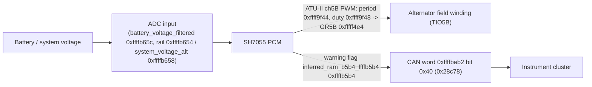
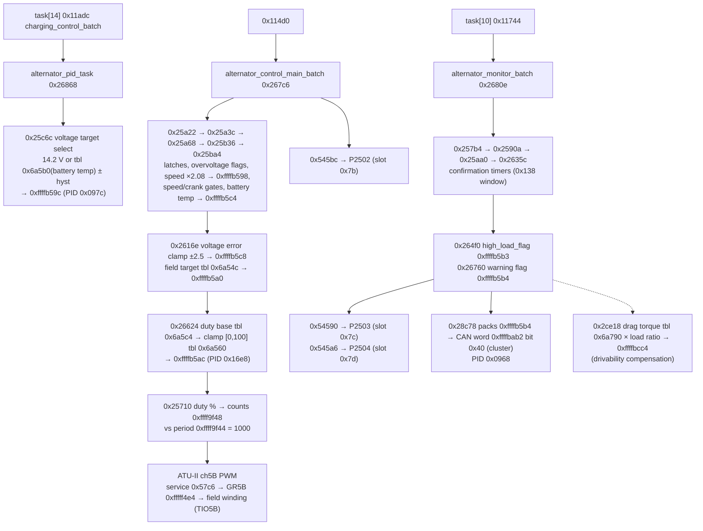

# Alternator / charging control — subsystem report

| Date | What changed | Version |
|------|--------------|---------|
| 2026-11-16 | Initial report in the human-first subsystem format (migrated from `docs/investigations/60E15120_N3J1E/`; content unchanged) | 1 |

**Applicable ROMs** — the behavior described here is **assumed identical across
all ROM bins until proven otherwise**; a row documents any per-ROM difference
(also detailed in [`docs/investigations/<rom-id>/`](../investigations/README.md),
never re-derived here):

| ROM | ROM specifics | Short one-line description |
|-----|---------------|----------------------------|
| [`60E15120_N3J1E`](../investigations/60E15120_N3J1E/README.md) | reference ROM — all `0x` addresses in this report are from this bin unless a row says otherwise; `submodules/Mazda_RX8_PCM_ReverseEngineering/Stock_ROMs/60E15120_N3J1E.bin` (512 KiB, SHA-256 `a7cd953c2a87af12ee2814a95c958dc23959d352ef9c5e7f82b8ab8952f264f1`), untouched | Closed-loop charging control: drives the alternator field with a PWM on ATU-II channel 5B to hold a temperature-compensated target voltage (~14.2 V), monitors for charging faults (P2502/P2503/P2504) and reports a warning flag over CAN |

Everything in this report is from static analysis of the canonical export
([`reverse-engineered/decompiled/`](../../reverse-engineered/decompiled/60E15120_N3J1E/)),
the disassembly and the ROM bytes, except where a section explicitly states
otherwise.

## 1. Introduction — what charging control is and does

The PCM regulates the alternator's field winding so the battery stays charged.
It watches battery voltage and engine speed, works out the alternator's own
rotational speed (engine rpm × 2.08 belt ratio), and decides a target charging
voltage — about 14.2 V, adjusted for a modeled battery temperature. It compares
the target with the measured voltage, turns the error into a field duty cycle
(0–100 %), and drives the field with a **PWM on timer channel 5B of the ATU-II**
(period 1000 counts). If the voltage stays too high or too low for a
confirmation window (0x138 counts), the PCM sets the charging-system fault
codes **P2502 / P2503 / P2504** and raises a warning flag that is reported to
the instrument cluster over CAN (readable as Mode 22 PID 0x0968). It also
estimates the alternator's drag torque and an electrical-load flag so idle and
drivability control can compensate for the extra engine load.

## 2. How it works, step by step

### 2.1 Hardware setup — voltage sense, field PWM, warning flag



The field PWM is generated by the ATU-II timer channel 5B: init `0x25674`
programs `ATUII_GR5B_W` 0xfffff4e4, `ATUII_TIOR5A_B` 0xfffff4eb and TIER3 bit
0x800, and the compare-interrupt service `0x57c6` splits duty vs period into
GR5B compare windows each cycle. The firmware-level path ends at the TIO5B
output; the package-pin ↔ connector-terminal hop for TIO5B is board routing
and is not traced (see §4.6). The battery-voltage ADC channel's package pin is
likewise not traced in this report, so no terminal is claimed for it. The
warning "lamp" is only a reported flag — exported over CAN (word 0xffffbab2
bit 0x40, packed by `0x28c78`) and as Mode 22 PID 0x0968; no dedicated lamp
GPIO is driven from `0x26760`.

### 2.2 Task structure — three mask-0x10 batches

Charging control is split across **three mask-0x10 batches** (all inherited
`ref_alternator*` names — verified and renamed, none a misnomer). The structured
overview — which tasks dispatch which batch, what each batch runs, in what
order, and where the results go:



Callee order within each batch is the literal-word order of the batch's ROM
table (control: 0x26888–0x268b0, monitor: 0x268b4–0x268d0, PID task: 0x268d8).

- `alternator_control_main_batch` 0x267c6 (called from 0x114d0): the **control**
  path — alternator speed, overvoltage flags, battery temperature model,
  voltage-error computation, field-duty calculation, and the final PWM duty
  write 0x25710 → RAM pair 0xffff9f44/0xffff9f48.
- `alternator_monitor_batch` 0x2680e (called from task[10] 0x11744): the
  **monitoring/DTC** path — confirmation timers (0x138 counts) for
  P2502/P2503/P2504, the high-load flag (0x264f0) and the warning-light flag
  (0x26760 → `inferred_ram_b5b4_ffffb5b4` 0xffffb5b4).
- `alternator_pid_task` 0x26868 (called from task[14] 0x11adc
  `charging_control_batch`): the **voltage target** selection 0x25c6c →
  `inferred_ram_b59c_ffffb59c` 0xffffb59c (target volts, PID 0x097c).

### 2.3 Inputs — alternator speed, voltage rails, battery temperature

`alternator_speed_calc` 0x25a68 computes alternator speed as engine rpm × 2.08
(constant at shared literal area 0x74990) into 0xffffb598 and sets the
"alternator turning" flag 0xffffb613 (≥ 859 rpm, 859.0 at 0x74994).
`candidate_overvoltage_flags` 0x25a3c sets 0xffffb612 when either voltage rail
is high (0xffffb654 ≥ 18.471 or 0xffffb658 ≥ 15.938). The idle-charging gates
0x25b36 derive a vehicle-speed threshold (16/20 km/h → 0xffffb649) and a
cranking flag 0xffffb614. `candidate_battery_temp_model` 0x25ba4 builds a
battery-temperature estimate 0xffffb5c4 = intake-air temp + max((coolant −
93) × 0.43, 0) + a filtered table 0x6a524(vehicle speed).

### 2.4 Target voltage

`candidate_alternator_voltage_target_select` 0x25c6c picks 14.2 V (constant at
0x749c8) or a table 0x6a5b0(battery temperature 0xffffb5c4) value ± hysteresis
→ 0xffffb61c, then encodes it via 0x5cba4 into `inferred_ram_b59c_ffffb59c`
0xffffb59c (Mode 22 PID 0x097c).

### 2.5 From voltage error to field duty

`candidate_alternator_voltage_error_calc` 0x2616e computes the charging error
0xffffb5c8 = clamp(target 0xffffb59c − battery_voltage_filtered 0xffffb65c,
±2.5) (2.5 at 0x2623c), looks up the target field drive from table 0x6a54c
(alternator speed 0xffffb598) → `alternator_target_field` 0xffffb5a0, ramps
it → 0xffffb5d0, and integrates (0xffffb5d4/0xffffb5d8).
`candidate_alternator_duty_calc` 0x26624 computes the duty base 3.75 (at
0x26734) or 3-D table 0x6a5c4(alternator speed, electrical load 0xffffb5e0) →
0xffffb5f0, filters → 0xffffb5f4, clamps → 0xffffb5f8, maps through table
0x6a560 → 0xffffb620 = duty percent clamped [0, 100], and encodes it via
0x5c800 into `inferred_ram_b5ac_ffffb5ac` 0xffffb5ac (PID 0x16e8).

### 2.6 Field PWM output

`alternator_field_pwm_output` 0x25710 converts the duty percent to timer counts:
`duty = (pct/100) × 65536 × period >> 16` (constants 100.0 and 65536.0 in its
literal area at 0x25780/0x25788) → `alternator_pwm_duty` 0xffff9f48, against
`alternator_pwm_period` 0xffff9f44 = 1000. Channel init `alternator_pwm_channel_init`
0x25674 sets the period and the ATU-II ch5B registers; the compare service
`alternator_pwm_service` 0x57c6 loads GR5B each cycle.

### 2.7 Monitoring and fault codes

The monitor batch runs confirmation timers with a 0x138-count window:
`candidate_charging_dtc_timer_a` 0x257b4 (counters 0xffffb638/0xffffb63a,
reload 0xffffb608), `charging_dtc_timer_b` 0x2590a (0xffffb60a),
`candidate_hot_engine_dtc_timer` 0x25aa0 (coolant 55/60 → 0xffffb648,
0xffffb60c = 100) and `candidate_low_voltage_dtc_timer` 0x2635c (0xffffb60e;
sets `low_voltage_latch` 0xffffb5b2 when 0xffffb654 ≥ 8.486699).
`candidate_charging_ok_latch` 0x25a22 sets `charging_ok_latch` 0xffffb5b1 =
(0xffffb60a == 0). The DTC raises go through 0x5fd38(slot, status) → code_id
table 0x7df42 + slot×2 → code table 0x7e560 + code_id×2: slots 0x7b/0x7c/0x7d =
**P2502/P2503/P2504** via `candidate_charging_dtc_raise_p2502` 0x545bc,
`candidate_charging_dtc_raise_p2503` 0x54590 and `charging_dtc_raise_p2504`
0x545a6. `candidate_alternator_warning_light_flag` 0x26760 ORs the failure
latches into `inferred_ram_b5b4_ffffb5b4` 0xffffb5b4 (0xffffb613==0 || b5b0 ||
b5b1 || b5b2 || 0xffffc5db), which 0x28c78 packs into CAN word 0xffffbab2 bit
0x40.

### 2.8 Electrical-load flag and alternator drag torque

`candidate_electrical_load_flag_calc` 0x264f0 sets `high_load_flag`
0xffffb5b3 when the filtered load `electrical_load_raw` 0xffffb5e0 (filtered by
0x2633e into `electrical_load_filtered` 0xffffb5a4, factor 0.035335) is ≥ 40
and clears below 30. The flag feeds idle control. `candidate_alternator_drag_torque_calc`
0x2ce18 estimates the alternator's drag torque from table 0x6a790(alternator
speed) × load ratio (0xffffb5a4/0xffffb5a0) → `alternator_drag_torque`
0xffffbcc4, for drivability compensation.

### 2.9 Key calibrated tables

| Table | Dims | Axis | Role |
|---|---|---|---|
| 0x6a54c | 2-D | alt speed 0xffffb598 | target field drive (0x2616e) |
| 0x6a5c4 | 3-D | alt speed, 0xffffb5e0 | duty base (0x26624) |
| 0x6a560 | 2-D | 0xffffb5f8 | duty → percent clamp [0,100] (0x26624) |
| 0x6a524 | 2-D | vehicle speed | battery-temp decay amount (0x25ba4) |
| 0x6a5b0 | 2-D | battery temp 0xffffb5c4 | voltage target vs temp (0x25c6c) |
| 0x6a59c | 2-D | — | voltage target alt mode (0x25c6c) |
| 0x6a790 | 2-D | alt speed | drag torque base (0x2ce18) |

Verified constants (shared literal area 0x74978–0x74a44): 18.471/15.938/16.973/
10.938/8.486699 voltage thresholds, 2.08 @0x74990, 859.0 @0x74994,
93.0/0.43 @0x749b0/0x749b4, 14.2 @0x749c8, 0.1244/0.9672 @0x74a40/0x74a44,
406.25/700.0 @0x749ec/0x749e4.

## 3. Technical pseudocode

```python
# alternator_control_main_batch 0x267c6 (from 0x114d0), mask 0x10
charging_ok_latch()                  # 0x25a22: b5b1 = (b60a == 0)
overvoltage_flags()                  # 0x25a3c: b612 = b654 >= 18.471 || b658 >= 15.938
alternator_speed_calc()              # 0x25a68: b598 = rpm * 2.08; b613 = b598 >= 859
idle_charging_gates()                # 0x25b36: vspeed 16/20 km/h -> b649; b614 = cranking && ...
battery_temp_model()                 # 0x25ba4: b5c4 = IAT + max((coolant-93)*0.43,0) + filtered tbl 0x6a524(vspeed)
alternator_voltage_error_calc()      # 0x2616e: b5c8 = clamp(b59c - b65c, +/-2.5); b5a0 = tbl 0x6a54c(b598); ramp -> b5d0; integral b5d4/b5d8
alternator_duty_calc()               # 0x26624: b5f0 = 3.75 | 3D 0x6a5c4(b598, b5e0); filter -> b5f4; b5f8 = clamp(...); b620 = clamp(tbl 0x6a560(b5f8),0,100); b5ac = 0x5c800(b620)
alternator_field_pwm_output()        # 0x25710: 0xffff9f48 = (b5ac/100)*65536 * 0xffff9f44 >> 16
charging_dtc_raise_p2502()           # 0x545bc: 0x5fd38(0x7b, b5b1==0 ? 2 : 1) -> P2502

# alternator_monitor_batch 0x2680e (from task[10] 0x11744), mask 0x10
charging_dtc_timer_a()               # 0x257b4: b608 = 0x138 reload / countdown, counters b638/b63a
dtc timer b / hot-engine timer       # 0x2590a charging_dtc_timer_b (b60a), 0x25aa0 (b648 coolant 55/60, b60c=100)
low_voltage_dtc_timer()              # 0x2635c: b60e countdown; b5b2 = (b60e==0) when b654 >= 8.486699
electrical_load_flag_calc()          # 0x264f0: high_load_flag b5b3 = filtered b5e0 >= 40 (hyst 30)
alternator_warning_light_flag()      # 0x26760: b5b4 = b613==0 || b5b0 || b5b1 || b5b2 || c5db
charging_dtc_raise_p2503/p2504()     # 0x54590 (slot 0x7c -> P2503), 0x545a6 charging_dtc_raise_p2504 (slot 0x7d -> P2504)

# alternator_pid_task 0x26868 (from task[14] 0x11adc), mask 0x10
alternator_voltage_target_select()   # 0x25c6c: b61c = 14.2 | tbl 0x6a5b0(b5c4) +/- hysteresis; b59c = 0x5cba4(b61c)

# output hardware path
alternator_pwm_channel_init()        # 0x25674: period 0xffff9f44 = 1000, duty 0xffff9f48 = 0, ATU-II ch5B setup
alternator_pwm_service()             # 0x57c6: GR5B = TCNT5 + compare(duty, period); TIOR5A output config
```

Memory addresses for every quantity above are listed in §4.1.

## 4. Proof — evidence and validation

### 4.1 Memory map (mandatory)

Every address below can be checked directly in
[`firmware_disassembly.asm`](../../reverse-engineered/disassembly/60E15120_N3J1E/firmware_disassembly.asm)
(ROM addresses), in
[`decompiled/functions/<address>_*.c`](../../reverse-engineered/decompiled/60E15120_N3J1E/functions)
(per-function C; index in `function_index.tsv`), and in the alias TSVs
(evidence columns). RAM is the 32 KiB window 0xffff6000–0xffffdfff; ROM tables
live in the descriptor / calibration area 0x0006c000–0x0007ffff.

#### Functions (ROM addresses)

| Address | Name | Role |
|---|---|---|
| 0x000267c6 | `alternator_control_main_batch` | control batch (from 0x114d0) |
| 0x0002680e | `alternator_monitor_batch` | monitor/DTC batch (from task[10] 0x11744) |
| 0x00026868 | `alternator_pid_task` | voltage target task (from 0x11adc) |
| 0x00025a68 | `alternator_speed_calc` | rpm × 2.08 → 0xffffb598 |
| 0x00025a3c | `candidate_overvoltage_flags` | overvoltage flags 0xffffb612 |
| 0x00025ba4 | `candidate_battery_temp_model` | battery temp model → 0xffffb5c4 |
| 0x0002616e | `candidate_alternator_voltage_error_calc` | voltage error + target field |
| 0x00026624 | `candidate_alternator_duty_calc` | field duty % → 0xffffb5ac |
| 0x00025710 | `alternator_field_pwm_output` | duty % → 0xffff9f48 counts |
| 0x00025674 | `alternator_pwm_channel_init` | ATU-II ch5B init |
| 0x000057c6 | `alternator_pwm_service` | ATU-II ch5B PWM service |
| 0x00026760 | `candidate_alternator_warning_light_flag` | warning flag → 0xffffb5b4 |
| 0x00025a22 | `candidate_charging_ok_latch` | OK latch 0xffffb5b1 |
| 0x000257b4 | `candidate_charging_dtc_timer_a` | DTC timer A (0x138 window) |
| 0x0002590a | `charging_dtc_timer_b` | DTC timer B 0xffffb60a |
| 0x00025aa0 | `candidate_hot_engine_dtc_timer` | hot-engine timer |
| 0x0002635c | `candidate_low_voltage_dtc_timer` | low-voltage timer → 0xffffb5b2 |
| 0x000545bc | `candidate_charging_dtc_raise_p2502` | P2502 raise (slot 0x7b) |
| 0x00054590 | `candidate_charging_dtc_raise_p2503` | P2503 raise (slot 0x7c) |
| 0x000545a6 | `candidate_charging_dtc_raise_p2504` | P2504 raise (slot 0x7d) |
| 0x00025c6c | `candidate_alternator_voltage_target_select` | target volts → 0xffffb59c |
| 0x0005cba4 | `candidate_alternator_target_encode_u16` | PID 0x097c encoder |
| 0x0005c800 | `candidate_alternator_duty_encode_u16` | PID 0x16e8 encoder |
| 0x0002ce18 | `candidate_alternator_drag_torque_calc` | drag torque → 0xffffbcc4 |
| 0x000264f0 | `candidate_electrical_load_flag_calc` | high_load_flag 0xffffb5b3 |
| 0x000114d0 | `FUN_000114d0` | caller of 0x267c6 |
| 0x00011adc | `charging_control_batch` | caller of 0x26868 (task[14]) |
| 0x00028c78 | `FUN_00028c78` | packs 0xffffb5b4 into CAN word 0xffffbab2 bit 0x40 |

#### Data and entry points (ROM)

| Address | Content |
|---|---|
| 0x26888–0x268b0, 0x268b4–0x268d0, 0x268d8 | batch pools of 0x267c6 / 0x2680e / 0x26868 |
| 0x25780, 0x2578c, 0x25788 | 0x25710 literal area: f32 100.0, 0xffff9f44 ptr, f32 65536.0 |
| 0x74978–0x74a44 | shared float literals (voltage thresholds, 2.08, 859.0, 14.2, filter factors) |
| 0x7df42 + slot×2, 0x7e560 + code_id×2 | DTC slot→code_id→code tables (slots 0x7b/0x7c/0x7d) |
| 0x6a54c, 0x6a5c4, 0x6a560, 0x6a524, 0x6a5b0, 0x6a59c, 0x6a790 | alternator calibration descriptors (§2.9) |
| 0xfffff4e0 `ATUII_TCNT5_W`, 0xfffff4e4 `ATUII_GR5B_W`, 0xfffff4eb `ATUII_TIOR5A_B`, 0xfffff480 `ATUII_TSR3_W` | ATU-II ch5B field PWM timer registers |

#### RAM (0xffff…)

| Address | Name | Meaning |
|---|---|---|
| 0xffff9f44 | `alternator_pwm_period` | ATU-II ch5B period (1000) |
| 0xffff9f48 | `alternator_pwm_duty` | ATU-II ch5B duty counts |
| 0xffffb598 | `DAT_ffffb598` | alternator speed rpm (rpm × 2.08; inferred alias kept) |
| 0xffffb59c | `inferred_ram_b59c_ffffb59c` | voltage target (PID 0x097c) |
| 0xffffb5ac | `inferred_ram_b5ac_ffffb5ac` | field duty percent (PID 0x16e8) |
| 0xffffb5b4 | `inferred_ram_b5b4_ffffb5b4` | warning-light flag (PID 0x0968; CAN 0xffffbab2 bit 0x40) |
| 0xffffb5b1 | `charging_ok_latch` | P2502 gate latch |
| 0xffffb5b2 | `low_voltage_latch` | P2503 gate latch |
| 0xffffb5b3 | `high_load_flag` | electrical-load flag (feeds idle control) |
| 0xffffb5a0 | `alternator_target_field` | target field drive |
| 0xffffb5a4 | `electrical_load_filtered` | filtered load |
| 0xffffb5e0 | `electrical_load_raw` | raw electrical load |
| 0xffffbcc4 | `alternator_drag_torque` | drag estimate |
| 0xffffb654 | `inferred_ram_b654_ffffb654` | voltage rail (PID 0x16e9 × 0.125) |
| 0xffffb658 | `system_voltage_alt` | second voltage rail in DTC timers |
| 0xffffb65c | `battery_voltage_filtered` | filtered battery voltage in the error calc |

### 4.2 Labeling applied

| Address | New label | Confidence |
|---|---|---|
| 0x267c6 | `alternator_control_main_batch` | high |
| 0x2680e | `alternator_monitor_batch` | high |
| 0x26868 | `alternator_pid_task` | high |
| 0x25a68 | `alternator_speed_calc` | high |
| 0x25710 | `alternator_field_pwm_output` | high |
| 0x25674 | `alternator_pwm_channel_init` | high |
| 0x57c6 | `alternator_pwm_service` | high |
| 0x25a3c / 0x25ba4 / 0x2616e / 0x26624 | `candidate_overvoltage_flags` / `candidate_battery_temp_model` / `candidate_alternator_voltage_error_calc` / `candidate_alternator_duty_calc` | medium |
| 0x26760 / 0x25a22 | `candidate_alternator_warning_light_flag` / `candidate_charging_ok_latch` | medium |
| 0x257b4 / 0x2590a / 0x25aa0 / 0x2635c | `candidate_charging_dtc_timer_a` / `charging_dtc_timer_b` / `candidate_hot_engine_dtc_timer` / `candidate_low_voltage_dtc_timer` | medium |
| 0x545bc / 0x54590 / 0x545a6 | `candidate_charging_dtc_raise_p2502` / `candidate_charging_dtc_raise_p2503` / `candidate_charging_dtc_raise_p2504` | medium |
| 0x25c6c | `candidate_alternator_voltage_target_select` | medium |
| 0x5cba4 / 0x5c800 | `candidate_alternator_target_encode_u16` / `candidate_alternator_duty_encode_u16` | medium |
| 0x2ce18 / 0x264f0 | `candidate_alternator_drag_torque_calc` / `candidate_electrical_load_flag_calc` | medium |

RAM aliases: `alternator_pwm_period` 0xffff9f44, `alternator_pwm_duty`
0xffff9f48, `charging_ok_latch` 0xffffb5b1, `low_voltage_latch` 0xffffb5b2,
`high_load_flag` 0xffffb5b3, `alternator_target_field` 0xffffb5a0,
`electrical_load_filtered` 0xffffb5a4, `electrical_load_raw` 0xffffb5e0,
`alternator_drag_torque` 0xffffbcc4, `system_voltage_alt` 0xffffb658,
`battery_voltage_filtered` 0xffffb65c.

Evidence: [`accepted_function_aliases.tsv`](../investigations/60E15120_N3J1E/labeling/source_review/accepted_function_aliases.tsv) /
[`accepted_ram_aliases.tsv`](../investigations/60E15120_N3J1E/labeling/source_review/accepted_ram_aliases.tsv),
[`data/labels/60E15120_N3J1E/alternator_labels.json`](../../data/labels/60E15120_N3J1E/alternator_labels.json).

### 4.3 Corrections

- All three inherited `ref_alternator*` names verified against the binary (batch
  pool words + callgraph callers) and renamed; none was a misnomer.
- DTC slots resolved end to end: 0x5fd38(slot, status) → code_id table 0x7df42 +
  slot×2 → code table 0x7e560 + code_id×2; slots 0x7b/0x7c/0x7d = P2502/P2503/P2504
  (charging system voltage problem/low/high).
- The output path is ATU-II ch5B PWM (0x57c6 service ← 0x25710 duty write), not a
  GPIO bit; the warning lamp is only a reported flag (`inferred_ram_b5b4_ffffb5b4`
  0xffffb5b4 → CAN word 0xffffbab2 bit 0x40 via 0x28c78, and PID 0x0968) — no
  dedicated lamp GPIO is driven from 0x26760.
- 0x5cba4/0x5c800 are diag-override-aware u16 encoders (DID 0x97c / 0x16e8), the
  same pattern as idle_target_encode_u16 0x5ca94 — they publish the target voltage
  and duty percent, they do not drive hardware.

### 4.4 Files

| Artifact | Path |
|---|---|
| Full review (evidence, unresolved items) | [`reviews/alternator_control/README.md`](../investigations/60E15120_N3J1E/reviews/alternator_control/README.md) |
| Review validation record | [`reviews/alternator_control/validation.json`](../investigations/60E15120_N3J1E/reviews/alternator_control/validation.json) |
| Rename map + fix evidence | [`data/labels/60E15120_N3J1E/alternator_labels.json`](../../data/labels/60E15120_N3J1E/alternator_labels.json) |
| Pipeline script (idempotent, wired into `rebuild.sh` after `review_intake_labels.py`) | [`review_alternator_labels.py`](../../utilities/scripts/rx8-pcm-pipeline/review_alternator_labels.py) |
| Accepted alias TSVs | [`accepted_function_aliases.tsv` / `accepted_ram_aliases.tsv`](../investigations/60E15120_N3J1E/labeling/source_review/) |
| Canonical export (symbols renamed in place) | [`reverse-engineered/decompiled/60E15120_N3J1E/`](../../reverse-engineered/decompiled/60E15120_N3J1E/) |

### 4.5 Validation

- Binary-level: batch pool words 0x26888–0x268b0 / 0x268b4–0x268d0 / 0x268d8 read
  from ROM and resolved; 0x25710 literal area (0x25780 = f32 100.0, 0x25788 =
  f32 65536.0, 0x2578c = ptr 0xffff9f44) verified; ATU-II register names from
  `symbols.tsv` (`ATUII_GR5B_W` 0xfffff4e4, `ATUII_TCNT5_W` 0xfffff4e0,
  `ATUII_TIOR5A_B` 0xfffff4eb, `ATUII_TSR3_W` 0xfffff480); DTC slot→code chain
  read from ROM (0x7df42, 0x7e560); constant literals 0x74978–0x74a44 read from
  ROM.
- [`validate_export.py`](../../utilities/scripts/rx8-pcm-pipeline/validate_export.py)
  (ROM SHA-256 + 168,592 instruction bytes + 1,833 exact reference matches),
  [`verify_claims.py`](../../utilities/scripts/rx8-pcm-pipeline/verify_claims.py),
  [`verify_readability.py`](../../utilities/scripts/rx8-pcm-pipeline/verify_readability.py),
  [`verify_math_units.py`](../../utilities/scripts/rx8-pcm-pipeline/verify_math_units.py),
  [`validate_reports.py`](../../utilities/scripts/rx8-pcm-pipeline/validate_reports.py)
  — all PASS; records in
  [`data/labels/60E15120_N3J1E/{validation,claim_validation,report_validation}.json`](../../data/labels/60E15120_N3J1E/).
- Labeling-pass record: [`reviews/alternator_control/validation.json`](../investigations/60E15120_N3J1E/reviews/alternator_control/validation.json)
  (25 functions, 10 RAM cells, 36 export files renamed, 3,355 function bodies
  verified intact).

### 4.6 Limits

- Static analysis only; no emulator run of the charging loop.
- 0xffffb654 vs 0xffffb658 (two voltage rails) are not distinguished beyond their
  uses; 0xffffb654 keeps its inferred alias.
- The instrument-cluster lamp drive is not traced to a GPIO from 0xffffb5b4
  (it is exported over CAN/PID only).
- Package-pin ↔ connector-terminal for the TIO5B output remains board routing
  (unresolved, per the wiring review); the battery-voltage ADC channel pin is
  likewise untraced.
- `candidate_` labels are hypotheses pending dynamic or cross-ROM proof.
- What would disprove the shared-logic assumption for a given ROM: a byte-diff
  of the functions in §4.1 against that ROM (cross-ROM evidence:
  [`cross_rom_differential_labeling.md`](../investigations/60E15120_N3J1E/labeling/cross_ecu/cross_rom_differential_labeling.md)).

### 4.7 Related reports

Task structure in
[`os_scheduling_deep_dive_report.md`](../investigations/60E15120_N3J1E/os_scheduling_deep_dive_report.md)
(task[10] 0x11744, task[14] `charging_control_batch` 0x11adc, 0x114d0); the
electrical-load flag `high_load_flag` 0xffffb5b3 feeds idle control in
[`idle_control_report.md`](../investigations/60E15120_N3J1E/idle_control_report.md);
DTC encoding in
[`dtc_control_report.md`](../investigations/60E15120_N3J1E/dtc_control_report.md)
(slots 0x7b/0x7c/0x7d → P2502/P2503/P2504); Mode 22 PIDs 0x0968/0x16e8/0x097c in
[`uds_mode22_dispatch_report.md`](../investigations/60E15120_N3J1E/uds_mode22_dispatch_report.md);
A/C switch input context in
[`cooling_fan_control_report.md`](../investigations/60E15120_N3J1E/cooling_fan_control_report.md).
