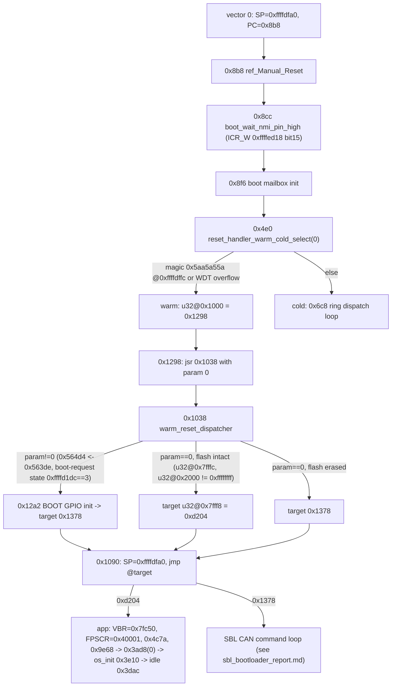

# Boot handover (SBL to application) — subsystem report

| Date | What changed | Version |
|------|--------------|---------|
| 2026-11-16 | Initial report | 1 |

**Applicable ROMs** — the behavior described here is **assumed identical across
all ROM bins until proven otherwise**; a row documents any per-ROM difference
(also detailed in [`docs/investigations/<rom-id>/`](../investigations/README.md),
never re-derived here). The handover-relevant fixed fields were byte-checked in
every corpus ROM
([`data/labels/cross_rom/sbl_first_8k.json`](../../data/labels/cross_rom/sbl_first_8k.json)):

| ROM | ROM specifics | Short one-line description |
|-----|---------------|----------------------------|
| [`60E15120_N3J1E`](../investigations/60E15120_N3J1E/README.md) | reference ROM — all `0x` addresses in this report are from this bin unless a row says otherwise; `submodules/Mazda_RX8_PCM_ReverseEngineering/Stock_ROMs/60E15120_N3J1E.bin` (512 KiB, SHA-256 `a7cd953c2a87af12ee2814a95c958dc23959d352ef9c5e7f82b8ab8952f264f1`), untouched | Warm boot jumps to app entry `0xd204` (u32@`0x7fff8`); SBL loop `0x1378` on BOOT/erased-flash; no CVN check before handover |
| `60E0G500_N3ZHEC` | our own factory dump `binaries/dumps/60E0G500_N3ZHEC.bin` | identical handover fields (SBL byte-identical to reference) |
| `60E0E500`, `60E0E700_N3YLEE`, `60E0FB00`, `60E0FC00` | `Stock_ROMs/` | SBL build A, same handover fields as reference |
| `60E1B900`, `60E1C500_N3J6EB`, `60E1D400` | `Stock_ROMs/` | SBL build B: warm entry u32@`0x1000` = `0x12b4`, app entry u32@`0x7fff8` = `0xd49c` |
| `60E32000_N3M5E`, `60E32000_N3N5EB` | `Stock_ROMs/` | SBL build B: warm entry `0x12b4`, app entry `0xd494` |

All content in this report is from static analysis of the canonical export
([`reverse-engineered/decompiled/`](../../reverse-engineered/decompiled/60E15120_N3J1E/)),
the disassembly and the ROM bytes, plus emulator boot traces, except where a
section explicitly states otherwise.

## 1. Introduction — what the handover is and does

At reset the SH7055 fetches SP and PC from vector 0 (`0xffffdfa0` / `0x8b8`).
The first 8 KiB of flash — the SBL — runs the reset chain and then decides:
**BOOT mode** (CN400 recovery) runs the SBL's own CAN flash-loader loop
(`0x1378`); **normal mode** jumps to the application entry (`0xd204` in build A,
`0xd49c`/`0xd494` in build B), which switches VBR to the runtime interrupt table
at `0x7fc50`, starts the OS (`os_init` `0x3e10`) and settles into the task
scheduler. This report maps that handover chain, the app-validity checks on the
way (there is no checksum check at handover — only erased-flash pointer checks;
the CVN is computed later by the application itself), and the entry mechanism of
`ref_mainInit__` `0x61a8`, which has no direct caller.

## 2. How it works, step by step



### 2.1 Reset and warm/cold selection

`0x8b8` waits for the NMI pin, runs `0x8f6`, and calls `0x4e0` with parameter 0.
`0x4e0` services the watchdog (`0x572`), initializes CAN (`0x170`), clears the
ring indices (`0x3d4`) and early RAM (`0x41c`), then picks the entry: warm if
the magic `0x5aa5a55a` at `0xffffdffc` matches or the WDT overflow check
(`0x5b0`) fires; the warm entry pointer is read from ROM `0x1000` (with an
erased-flash fallback to `u32@0x7fff8`), cold is the ring monitor `0x6c8`.
The magic is written back to `0xffffdffc` and the entry is jumped to through
trampoline `0x40` (SP = `0xffffdfa0`, `jmp @r4`). In the emulator boot trace
this path runs `0x8b8` -> `0x4e0` -> `0x40` -> `0x1298`.

### 2.2 The handover dispatcher and app entry

The warm entry `0x1298` calls `0x1038` (`warm_reset_dispatcher`) with parameter
0. `0x1038` resets the WDT (`0x1364`), re-initializes the diag CAN (`0x109c`),
runs housekeeping (`0x16dc`), then: with parameter != 0 it runs the BOOT-mode
GPIO init `0x12a2` and targets the SBL loop `0x1378`; with parameter 0 it checks
that the IVT tail pointer `u32@0x7fffc` (= `0x2000`) and the app header
`u32@0x2000` are not erased (`0xffffffff`) — if either is erased it falls back
to the SBL loop — and otherwise targets `u32@0x7fff8` = `0xd204`. The jump
itself is trampoline `0x1090` (SP = `0xffffdfa0`, `jmp @r4`). In the emulator
trace the SBL->app transition is exactly `0x1092` -> `0xd204` at step 2856 of a
200,000-cycle boot.

App entry `0xd204` sets VBR = `0x7fc50` and FPSCR = `0x40001`, calls the nop
`0x4c7a`, then `0x9e68`, which runs `0x4c80`, a RAM-swap/semaphore mark
(`0xd518`), `0x9f0c(0)`, sets the interrupt mask (`0x2054` with `0xe0`), sets
`PFDR_W` `0xfffff74e` bit 3, calls `0x2064` and `0x4cf0`, and finally calls
`0x3ad8(0)` — `os_init` `0x3e10` — after which the scheduler runs and the CPU
settles in the idle loop `0x3dac`. The boot reaches idle in ~200k cycles.

### 2.3 App validity: no CVN check at handover

The handover checks only that the two flash pointers are not erased. The
application CVN (incremental dual-u16 additive sum over `0x2000–0x7ffff`,
skipping the hole `0x7fb00–0x7fb7f`, engine `0x5a3f4`, finalize `0x5a714`
storing to `0xffff9104`/`0xffff910c`) is computed **after** boot by the
application: its only caller chain is task[0] entry `0x62a0` -> `0x1122a` ->
`0x5a3f4` (task table at `0x4990`, record 0 byte-verified). It is exposed
diagnostically via `0x5a5a6` (see [the UDS dispatch report
§12.1](../investigations/60E15120_N3J1E/uds_mode22_dispatch_report.md)). So a
corrupt app image is still booted; the CVN mismatch is only observable
afterwards through diagnostics.

### 2.4 Entry mechanism of `ref_mainInit__` `0x61a8`

`0x61a8` has **no direct caller**: no `jsr`/`bsr`/branch targets it, no ROM32
pointer holds `0x000061a8`, and it is not one of the 19 task-table entries at
`0x4990`. Its only reference is pool word `0x25164` (holds `0x61a8`,
byte-verified), loaded inside `0x2508c` (`FUN_0002508c`), which posts a record
{handler `0x61a8` at `0xffff9f38`, enable byte at +9 = 1} and arms an ATU-II
channel-4 compare (GR4B = TCNT4+1, TIER3 bit `0x40`). `0x2508c` is reached via
thunk `0x21b84` from `0x1102a` (the large init fan-out), whose only callgraph
caller is `0x61a8` itself — a cycle, so the *first* entry of `0x61a8` is not a
direct call. The `0xffff9f38` record is consumed by interrupt handlers `0x567a`
(IVT offset `0x204`, trampoline `0x2b00`, handler pool `0x2b10`) and `0x57c6`
(IVT offset `0x224`, trampoline `0x2b78`, pool `0x2b88`). Dynamically,
`0x61a8` is never executed in a 2,000,000-cycle emulator boot (with or without
crank input), because the crank-angle-synchronous OS tick that dispatches tasks
never fires in the emulator — consistent with
[the OS scheduling deep dive](../investigations/60E15120_N3J1E/os_scheduling_deep_dive_report.md).

### 2.5 Reset-at-10,000-RPM review fold-in

The open [reset_at_10000_rpm review](../investigations/60E15120_N3J1E/reviews/reset_at_10000_rpm.md)
found no confirmed reset-causing bug: the 10,000-RPM comparisons (`0xc3ce`,
`0x1f6ae`, `0x49c5a`, `0x123da`, `0x124d6`) are control-mode transitions or
blending factors, not reset requests. Combined with §2.3: nothing in the boot
or handover path resets the ECU at high RPM, and no CVN gate exists at handover;
the unresolved reset mechanisms remain watchdog starvation, supply/reset-pin
disturbance or crank-signal faults, none demonstrated at that speed.

## 3. Technical pseudocode

```c
// vector 0: SP = u32@0x4, PC = u32@0x0
0x8b8: boot_wait_nmi_pin_high();          // 0x8cc
       sbl_boot_mailbox_init();           // 0x8f6
       reset_handler_warm_cold_select(0); // 0x4e0

0x4e0(p): wdt_keyed_reset(); can_init(); ram_init(); ring_reset();
          warm = (magic@0xffffdffc == 0x5aa5a55a) || wdt_overflow_check(7);
          entry = p ? 0x6c8
              : warm ? (flash_ok(0x7fffc, 0x2000) ? u32@0x1000 : u32@0x7fff8)
                     : 0x6c8;
          magic@0xffffdffc = 0x5aa5a55a;
          SP = 0xffffdfa0; jmp entry;      // 0x40

0x1298: jsr 0x1038 with r4 = 0;

0x1038(p): wdt_reset(0x1364); resetOBDCAN(0x109c); handleException(p, 0x16dc);
           target = p ? (boot_gpio_init(0x12a2), 0x1378)
                      : (u32@0x7fffc != -1 && u32@u32@0x7fffc != -1
                         ? u32@0x7fff8 : 0x1378);
           SP = 0xffffdfa0; jmp target;     // 0x1090

0xd204: VBR = 0x7fc50; FPSCR = 0x40001;  // pools 0xd2c0/0xd2c4
        jsr 0x4c7a;                     // nop
        jsr 0x9e68;                     // -> 0x3ad8(0) -> os_init 0x3e10
```

## 4. Proof — evidence and validation

### 4.1 Memory map (mandatory)

Functions (reference-ROM addresses, index names):

| Address | Index name | Role |
|---------|-----------|------|
| `0x00000040` | `FUN_00000040` | entry trampoline (SP, jmp @r4) |
| `0x000004e0` | `reset_handler_warm_cold_select` | warm/cold entry select |
| `0x000006c8` | `cold_entry_ring_dispatch_loop` | cold boot monitor |
| `0x000008b8` | `ref_Manual_Reset` | reset entry |
| `0x000008cc` | `boot_wait_nmi_pin_high` | NMI poll |
| `0x00001038` | `warm_reset_dispatcher` | SBL/app handover dispatcher |
| `0x00001090` | `FUN_00001090` | handover trampoline (SP, jmp @r4) |
| `0x000012a2` | `FUN_000012a2` | BOOT-mode GPIO init |
| `0x00001378` | `FUN_00001378` | SBL CAN command loop |
| `0x0000563de` | `FUN_000563de` | boot-request state machine (0xffffd1dc==3 + param 1 -> 0x564d4) |
| `0x000564d4` | `FUN_000564d4` | calls 0x1038 with param 1 |
| `0x000061a8` | `ref_mainInit__` | application init; no direct caller, posted as handler at 0xffff9f38 by 0x2508c |
| `0x00002508c` | `FUN_0002508c` | posts {0x61a8 -> 0xffff9f38}, arms ATU-II ch4 |
| `0x00021b84` | `jump_to_FUN_0002508c` | thunk to 0x2508c |
| `0x0001102a` | `FUN_0001102a` | init fan-out, calls 0x21b84 |
| `0x0000d204` | — | app entry: VBR/FPSCR, -> 0x9e68 |
| `0x00009e68` | `recovery_finalize_set_pf3_halt` | app entry finalize (sets PFDR_W 0xfffff74e bit 3, -> 0x3ad8) |
| `0x00003ad8` | `FUN_00003ad8` | calls os_init 0x3e10 |
| `0x00005a3f4` | `FUN_0005a3f4` | CVN checksum engine (app side) |
| `0x00005a714` | `FUN_0005a714` | CVN finalize -> 0xffff9104 |
| `0x0000567a` | `FUN_0000567a` | IVT 0x204 handler consuming 0xffff9f38 |

RAM (only addresses with accepted aliases are listed):

| Address | Alias | Role |
|---------|-------|------|
| `0xffffdfa8` | `reset_cause` | reset cause byte |
| `0xffffdffc` | `warm_boot_magic` | warm-boot magic 0x5aa5a55a |

ROM fixed locations (byte-verified, all 11 ROMs unless noted):

| Address | Reference ROM | Build-B ROMs |
|---------|---------------|--------------|
| `0x00000000` / `0x00000004` | `0x000008b8` / `0xffffdfa0` | identical |
| `0x00001000` | `0x00001298` (warm entry) | `0x00012b4` |
| `0x00007fff8` | `0x0000d204` (app entry) | `0x0000d49c` / `0x0000d494` |
| `0x00007fffc` | `0x00002000` (IVT tail / validity pointer) | `0x00002000` |
| `0x00025164` | pool word `0x000061a8` (only reference to ref_mainInit__) | — |

### 4.2 Labeling applied

New label records:
[`data/labels/60E15120_N3J1E/boot_handover_labels.json`](../../data/labels/60E15120_N3J1E/boot_handover_labels.json)
(handover chain, CVN caller analysis, 0x61a8 entry mechanism, reset-review
fold-in). SBL-side labels:
[`data/labels/60E15120_N3J1E/sbl_bootloader_labels.json`](../../data/labels/60E15120_N3J1E/sbl_bootloader_labels.json)
and [`sbl_bootloader_report.md`](sbl_bootloader_report.md).

### 4.3 Corrections

The design doc §3 stated that `ref_mainInit__` `0x61a8` "has no caller in the
call graph, the disassembly, or as a ROM32 pointer" — this report confirms that
and adds the one indirect reference (pool `0x25164`, handler registration in
`0x2508c`) plus the dynamic observation that it never executes in emulator
boot. No earlier claim is contradicted.

### 4.4 Files

- [`data/labels/60E15120_N3J1E/boot_handover_labels.json`](../../data/labels/60E15120_N3J1E/boot_handover_labels.json) — handover label records
- [`data/labels/cross_rom/sbl_first_8k.json`](../../data/labels/cross_rom/sbl_first_8k.json) — per-ROM handover fields (warm entry, app entry, IVT tail)
- [`docs/investigations/60E15120_N3J1E/reviews/boot_handover/`](../investigations/60E15120_N3J1E/reviews/boot_handover/README.md) — evidence notes + emulator traces
- [`sbl_bootloader_report.md`](sbl_bootloader_report.md) — the SBL side of the handover

### 4.5 Validation

- ROM SHA-256 `a7cd953c2a87af12ee2814a95c958dc23959d352ef9c5e7f82b8ab8952f264f1`
  quoted above equals the actual ROM hash; no binary was modified.
- Rule 7: every pool word, vector slot, task-table record, IVT trampoline pair
  and ROM32 reference cited above was re-read from the raw ROM / committed
  disassembly this session; callers were taken from `callgraph.tsv` and
  cross-checked by raw u32/u16 scans (0x61a8 has zero u32 references; its only
  reference is pool `0x25164`).
- Dynamic: emulator boot from vector 0, 200,000 cycles — SBL->app transition
  `0x1092` -> `0xd204` at step 2856, idle `0x3dac` reached; a second run of
  2,000,000 cycles (also with ATU-II crank input at 900 rpm) never executes
  `0x61a8`/`0x1102a`/task[0] `0x62a0`/CVN `0x5a3f4`, because the crank-synchronous
  tick never fires in the emulator. Trace notes in
  [`reviews/boot_handover/`](../investigations/60E15120_N3J1E/reviews/boot_handover/).
- `validate_reports.py`, `verify_claims.py`, `verify_readability.py`,
  `verify_math_units.py` and `python -m pytest tests/` run clean (recorded in
  the review folder README).

### 4.6 Limits

- The first entry of `0x61a8` is not proven: the only static reference is the
  handler registration in `0x2508c`, which is itself reachable only through
  `0x61a8` -> `0x1102a`; the consuming IVT handlers (`0x567a`, `0x57c6`) read the
  `0xffff9f38` record but the exact first-dispatch path on real hardware is not
  traced. Candidate-level.
- The emulator never fires the crank-synchronous tick, so task dispatch (and
  therefore any task-mediated entry into `0x61a8` or the CVN computation) is not
  dynamically covered.
- Build-B ROMs carry the same handover structure at shifted addresses
  (`0x12b4`/`0xd49c`/`0xd494`); their build-B SBL code was byte-diffed, not
  functionally re-analyzed.
- The CN400/BOOT-mode pin routing remains untraced (D9 conflict open); only the
  firmware-side boot-request path (`0x563de`/`0x564d4`) is mapped.

### 4.7 Related reports

- [`sbl_bootloader_report.md`](sbl_bootloader_report.md) — the SBL block: reset chain, CAN command loop, flash services
- [Firmware design document](../architecture/design/README.md) §2–3 — entry points and boot flow
- [OS scheduling deep dive](../investigations/60E15120_N3J1E/os_scheduling_deep_dive_report.md) — task table, tick, why tasks don't run in the emulator
- [OS scheduler / IVT report](../investigations/60E15120_N3J1E/os_scheduler_can_ivt_report.md) — VBR, IVT, CAN transport
- [UDS dispatch report §12](../investigations/60E15120_N3J1E/uds_mode22_dispatch_report.md) — CVN engine and seed/key
- [Ignition power-state report](../investigations/60E15120_N3J1E/ignition_power_state_report.md) — key-on latch, shutdown/relay-hold
- [reset_at_10000_rpm review](../investigations/60E15120_N3J1E/reviews/reset_at_10000_rpm.md) — folded in at §2.5
- [Flash and memory layout](../architecture/flash-memory-layout.md) §3 — shared flash skeleton
