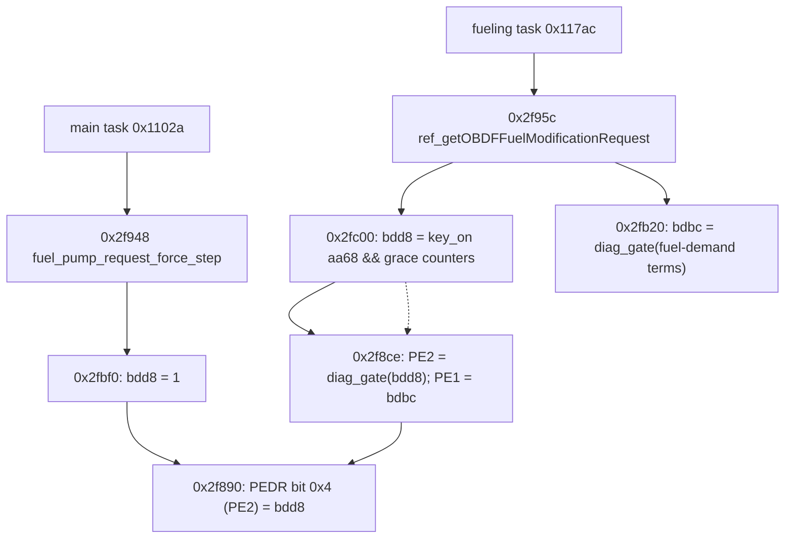

# Fuel pump control (relay drive + speed control + switch inputs) — subsystem report

| Date | What changed | Version |
|------|--------------|---------|
| 2026-11-19 | Initial report | 1 |

**Applicable ROMs** — the behavior described here is **assumed identical across
all ROM bins until proven otherwise**; a row documents any per-ROM difference
(also detailed in [`docs/investigations/<rom-id>/`](../investigations/README.md),
never re-derived here). List only ROMs actually investigated for this subsystem
(the reference ROM always present):

| ROM | ROM specifics | Short one-line description |
|-----|---------------|----------------------------|
| [`60E15120_N3J1E`](../investigations/60E15120_N3J1E/README.md) | reference ROM — all `0x` addresses in this report are from this bin; `submodules/Mazda_RX8_PCM_ReverseEngineering/Stock_ROMs/60E15120_N3J1E.bin` (512 KiB, SHA-256 `a7cd953c2a87af12ee2814a95c958dc23959d352ef9c5e7f82b8ab8952f264f1`), untouched | Fuel pump relay drive on PEDR bit 0x4 (PE2) from request flag `0xffffbdd8`, pump speed control candidate on PE1, oil-pressure switch read over the SCI0 expander |

All content in this report is from static analysis of the canonical export
([`reverse-engineered/decompiled/`](../../reverse-engineered/decompiled/60E15120_N3J1E/)),
the disassembly and the raw ROM bytes; the output drive paths were additionally
exercised dynamically in the SH-2E emulator (§4.5).

## 1. Introduction — what this subsystem is and does

The PCM switches the fuel pump's power via a relay it drives itself: the
wiring book shows PCM terminal **5P "Fuel pump relay control"** on cars with
the immobilizer system and **5L** on cars without it (the two are
variant-exclusive), plus **4M "Fuel pump speed control"** for the pump-speed
relay that bypasses the series resistor at high demand
([`docs/architecture/hardware/mazda-rx-8-pcm-pinout-series-1.md`](../architecture/hardware/mazda-rx-8-pcm-pinout-series-1.md)).

In firmware, the pump relay request is a single RAM flag
`fuel_pump_relay_request` (`0xffffbdd8`): it is high while the ignition is on
(key-on flag `0xffffaa68`) with short grace counters, and low at key-off. The
flag is computed in the fueling task and forced high once per main-task pass,
and it drives port bit **PE2 (PEDR_W `0xfffff754` bit 0x4, SH7055F package pin
9)** through two output routines — one direct (`0x2f890`), one gated by the
UDS actuator-override state machine (`0x2f8ce`). The companion bit **PE1
(bit 0x2, pin 8)** is driven from `fuel_pump_speed_request` (`0xffffbdbc`),
a fuel-demand-derived flag — the speed-control relay candidate.

The oil pressure switch (PCM terminal **2E**, "closes on low pressure") is not
a direct MCU pin: it is read through the external input expander over SCI0
(channel 1 bit 0x80 for the warning light, channel 2 bit 0 for the gauge).
The inertia (fuel-cut) switch is **not** wired to any PCM input in the pinout;
on this car it sits in the fuel pump feed circuit on the hardware side, so it
is not a firmware condition.

## 2. How it works, step by step

### 2.1 Hardware setup

```text
Main relay (PCM 4E, held by PD11 "relay hold" 0x251d0) --+--> +12 V feed
                                                          |
                                        inertia switch (in the pump feed,
                                        hardware-side, not a PCM input)
                                                          |
                                        fuel pump relay coil --+--> PCM 5P (immo) / 5L (non-immo)
                                                          |
                                        PCM drives PE2 low-side (PEDR bit 0x4)

Fuel pump speed control relay coil --+--> PCM 4M   (PCM drives PE1, PEDR bit 0x2)
                                     +--> bypasses the pump series resistor

Oil pressure switch (PCM 2E) --+--> input expander ch1 bit 0x80 (light, 0x2bafc)
                               +--> input expander ch2 bit 0x00 (gauge, 0x2bb74)
        expander read over SCI0 (sci0_gpio_expander_read 0x70ac, channel select
        on PH13/PH14); results latched to 0xffff9ecc/9ecd/9ede by 0x6744/0x6796
```

Firmware-level paths are distinguished from pin routing: the package-pin →
connector-terminal hop (PE2 pin 9 → 5P, PE1 pin 8 → 4M, etc.) is board routing
and remains unresolved in this repo (see §4.6).

### 2.2 Structured overview — which tasks run what, in what order



### 2.3 The relay request flag (0x2fc00)

`0xffffbdd8` is computed each fueling-task pass as:

```
bdda = bdda + 1 (saturating) while key_on 0xffffaa68 == 1, else 0   # key-on ticks
bdde = bdde + 1 (saturating) while injectors_off 0xffffa42c == 1, else 0
bde0 = (bdde != 0)
bddc = bddc + 1 (saturating) every call
bdd8 = key_on aa68 && (bdda < 0x1f || (injectors_off a42c && bde0) || bddc < 0x3e)
```

Thresholds are ROM words `0x1f` (31) at `0x7bc58` and `0x3e` (62) at
`0x7bc5c`; the increment helper is `0x2460` (pool `0x2fcdc`). The main task
additionally forces the flag high once per pass (`0x2fbf0` from `0x2f948`)
and resets `bddc` to `0xffff` (`0x2fbf8`). Dynamically (emulator): PE2 is high
at key-on, during cranking and while running, and low at key-off
(`tests/test_fuel_pump_control_dynamic.py`).

### 2.4 The output drives

- `0x2f890` (main task): `PEDR_W bit 0x4 = (0xffffbdd8 == 1)` — direct drive.
- `0x2f8ce` (fueling task): `PEDR_W bit 0x4 = (0x5c204(0xffffbdd8) == 1)` and
  `PEDR_W bit 0x2 = (0xffffbdbc == 1)`. `0x5c204` is the UDS actuator-override
  gate (passes the normal flag through unless a diagnostic output test is
  active on the `0xffffd3xx` state machine).
- `0x2fb20` (`ref_fuelingAddOBDControlMode_`): `0xffffbdbc =
  0x5c2e4((0xffffbdd5 && engine_stopped_latch 0xffffa41c == 0) ||
  (injectors_off 0xffffa42c == 1 && key_on 0xffffaa68 == 1))`, where
  `0xffffbdd5` is the fuel-demand threshold term (`bdc0 >= bdc4 - 3.5`).

### 2.5 Related relay outputs found while tracing (and one correction)

| Bit | pkg pin | Drive | Flag chain | Harness candidate |
|-----|---------|-------|------------|-------------------|
| PE2 (PEDR 0x4) | 9 | `0x2f890` / `0x2f8ce` | `0xffffbdd8` ← `0x2fc00` (key-on + grace) | **fuel pump relay 5P/5L** |
| PE1 (PEDR 0x2) | 8 | `0x2f8ce` | `0xffffbdbc` ← `0x2fb20` (fuel demand / injectors-off) | fuel pump speed control 4M |
| PD7 (PDDR 0x80) | 256 | `0x3a0ec` | `0xffffcfb6` ← `0xffffcfbc` ← `0xffffd15c` (`0x532d0`: vspeed≈0 && cranking `0xffffaa62` && engine_running `0xffffa428` && E2-shadow `0xffff86e8` < 0xea) | starter relay 5A (high only while cranking — dynamic) |
| PE0 (PEDR 0x1) | 7 | `0x3a0ec` (inverted) | `0xffffcfb7` ← `0x4ef86` (3D tables `0x6b3c8`/`0x6b3dc`) | DBW relay 4C |
| PJ7 (PJDR 0x80) | 183 | `0x2e800` / `0x2e840` | `0xffffbd68` ← `ref_calculateACClutchOn__` `0x2e89c` (A/C switch `0xffffbd69`, rpm thresholds 600/7800) | **A/C relay 5AA — not the fuel pump** (corrects the earlier candidate note in [`reviews/intake_solenoids/README.md`](../investigations/60E15120_N3J1E/reviews/intake_solenoids/README.md)) |

### 2.6 Oil pressure switch input path

- Light: `ref_writeOilPressureLight__` `0x2bafc` reads expander channel 1
  (`sci0_gpio_expander_read` `0x70ac` with r4=1) bit 0x80 (`tst 0x80` at
  `0x2bb12`), debounced over counters `0xffffbc0e`/`0xffffbc10` against
  threshold 16 (ROM `0x775b8`), result `0xffffbc0c`.
- Gauge: `ref_writeOilPressureGauge__` `0x2bb74` reads channel 2 bit 0,
  with engine-running fallback, result `0xffffbc14`, exported to CAN by
  `ref_setOilPressureGaugeStatus` `0x28c52` (status word `0xffffbab0`).
- Neither feeds the pump relay flag chain; the oil pressure switch is the
  hardware backup in the pump feed circuit, not a PCM pump input.

## 3. Technical pseudocode

```c
// fueling task 0x117ac -> 0x2f95c -> 0x2fc00  (request flag)
u8 fuel_pump_relay_request_calc(void) {
    if (key_on_ffffaa68) bdda = sat_add16(bdda, 1); else bdda = 0;
    if (injectors_off_ffffa42c) bdde = sat_add16(bdde, 1); else { bdde = 0; bde0 = 0; }
    bddc = sat_add16(bddc, 1);
    bdd8 = key_on_ffffaa68 && (bdda < 0x1f || (injectors_off_ffffa42c && bde0) || bddc < 0x3e);
    return bdd8;
}
// main task 0x1102a -> 0x2f948: bdd8 = 1 (0x2fbf0); bddc = 0xffff (0x2fbf8); output (0x2f890)
// fueling task: 0x2f8ce output
void fuel_pump_outputs(void) {              // 0x2f8ce
    set_bit(PEDR_W, 0x0004, diag_gate_0x5c204(fuel_pump_relay_request) == 1);  // PE2
    set_bit(PEDR_W, 0x0002, fuel_pump_speed_request_ffffbdbc == 1);            // PE1
}
void fuel_pump_relay_drive(void) {          // 0x2f890
    set_bit(PEDR_W, 0x0004, fuel_pump_relay_request == 1);                     // PE2
}
```

## 4. Proof — evidence and validation

### 4.1 Memory map (mandatory)

Functions:

| Address | Label | Role |
|---------|-------|------|
| `0x0002f890` | `fuel_pump_relay_drive_pe2` | PEDR bit 0x4 (PE2) = `0xffffbdd8`; direct drive, main task |
| `0x0002f8ce` | `fuel_pump_outputs_pe2_pe1` | PEDR bit 0x4 via diag gate `0x5c204`; PEDR bit 0x2 = `0xffffbdbc`; fueling task |
| `0x0002f948` | `fuel_pump_request_force_step` | calls `0x2fbf0`/`0x2fbf8`/`0x2f890` |
| `0x0002fbf0` | `fuel_pump_request_set` | `0xffffbdd8 = 1` |
| `0x0002fc00` | `fuel_pump_request_calc` | computes `0xffffbdd8` from key-on + grace counters |
| `0x0002fb20` | `ref_fuelingAddOBDControlMode_` | computes `0xffffbdbc` (speed request) |
| `0x0002e800` / `0x0002e840` | `ac_clutch_relay_drive_pj7[_diag]` | PJDR bit 0x80 (PJ7) = `0xffffbd68` (A/C clutch) |
| `0x0002e89c` | `ref_calculateACClutchOn__` | computes `0xffffbd68` from `0xffffbd69` + rpm |
| `0x0003a0ec` | `relay_output_pair_pd7_pe0` | PD7 = `0xffffcfb6`; PE0 = (`0xffffcfb7` == 0) |
| `0x000532d0` | `cranking_in_progress_calc` | computes `0xffffd15c` (feeds PD7 chain) |
| `0x00070ac` | `sci0_gpio_expander_read` | expander channel read (switch inputs) |
| `0x0002bafc` / `0x0002bb74` | `ref_writeOilPressureLight__` / `ref_writeOilPressureGauge__` | oil pressure switch reads (expander ch1 bit 0x80 / ch2 bit 0) |
| `0x00028c52` | `ref_setOilPressureGaugeStatus` | exports gauge status to CAN `0xffffbab0` |

RAM:

| Address | Label | Type | Written by | Read by |
|---------|-------|------|-----------|---------|
| `0xffffbdd8` | `fuel_pump_relay_request` | u8 | `0x2fc00`, `0x2fbf0` | `0x2f890`, `0x2f8ce` → PE2 |
| `0xffffbdbc` | `fuel_pump_speed_request` | u8 | `0x2fb20` | `0x2f8ce` → PE1 |
| `0xffffbd68` | `ac_clutch_relay_drive` | u8 | `0x2e89c` | `0x2e800`, `0x2e840` → PJ7 |
| `0xffffbc0c` | `oil_pressure_switch_light_status` | u8 | `0x2bafc` | status packing |
| `0xffffbc14` | `oil_pressure_gauge_status` | u8 | `0x2bb74` | `0x28c52` |
| `0xffffd15c` | `cranking_in_progress` | u8 | `0x532d0` | `0x4ed3c` → `0xffffcfbc` |
| `0xffffcfb6` | `pd7_relay_flag` | u8 | `0x4ef86` | `0x3a0ec` → PD7 |
| `0xffffcfb7` | `pe0_relay_flag` | u8 | `0x4ef86` | `0x3a0ec` → PE0 (inverted) |
| `0xffffcfbc` | `pd7_relay_condition` | u8 | `0x4ed3c` | `0x4ef86` |

### 4.2 Labeling applied

`data/labels/60E15120_N3J1E/fuel_pump_control_labels.json` (9 function +
9 RAM aliases, each with raw-bin evidence); mirrored as rows in
[`accepted_function_aliases.tsv`](../investigations/60E15120_N3J1E/labeling/source_review/accepted_function_aliases.tsv)
and
[`accepted_ram_aliases.tsv`](../investigations/60E15120_N3J1E/labeling/source_review/accepted_ram_aliases.tsv).

### 4.3 Corrections

- PJ7 (`0x2e800`/`0x2e840`) was noted as a "fuel-pump relay candidate" in
  [`reviews/intake_solenoids/README.md`](../investigations/60E15120_N3J1E/reviews/intake_solenoids/README.md);
  it is the **A/C clutch relay** drive: `0xffffbd68` is computed by
  `ref_calculateACClutchOn__` `0x2e89c` from `ac_clutch_on` `0xffffbd69` and
  rpm thresholds (pools `0x2e968`/`0x2e96a`/`0x2e96c`; floats 600.0/7800.0 at
  ROM `0x774c0`/`0x774c4`). Harness candidate terminal 5AA.

### 4.4 Files

- [`data/labels/60E15120_N3J1E/fuel_pump_control_labels.json`](../../data/labels/60E15120_N3J1E/fuel_pump_control_labels.json)
- [`tests/test_fuel_pump_control.py`](../../tests/test_fuel_pump_control.py), [`tests/test_fuel_pump_control_dynamic.py`](../../tests/test_fuel_pump_control_dynamic.py)
- [`docs/investigations/60E15120_N3J1E/reviews/fuel_pump_control/](../investigations/60E15120_N3J1E/reviews/fuel_pump_control/) — evidence, raw-bin re-verification log, validation record

### 4.5 Validation

- Rule-7 binary checks: every cited literal pool and instruction word was
  re-read from the raw ROM (SHA-256 pinned) — see
  [`reviews/fuel_pump_control/rawbin_reverify_log.txt`](../investigations/60E15120_N3J1E/reviews/fuel_pump_control/rawbin_reverify_log.txt)
  and `tests/test_fuel_pump_control.py` (9/9 pass).
- Dynamic (SH-2E emulator, profile `60E15120_N3J1E`): PE2 follows
  `0xffffbdd8` (on at key-on/cranking/running, off at key-off), PE1 follows
  `0xffffbdbc`, PD7/PE0 follow `0xffffcfb6`/`0xffffcfb7`, PD7 high only while
  cranking via `0xffffd15c`, PJ7 follows `0xffffbd68` —
  `tests/test_fuel_pump_control_dynamic.py` (6/6 pass).
- Pipeline validators + full pytest suite run from the repo root (see
  [`reviews/fuel_pump_control/validation.json`](../investigations/60E15120_N3J1E/reviews/fuel_pump_control/validation.json)).

### 4.6 Limits

- Package-pin → connector-terminal routing is board-level unresolved in this
  repo; the 5P/5L/4M/5A/4C/5AA associations above are candidate associations
  from [`mazda-rx-8-pcm-pinout-series-1.md`](../architecture/hardware/mazda-rx-8-pcm-pinout-series-1.md),
  not traced wires.
- The exact timer semantics of the grace counters (`0xffffbdda` < 0x1f,
  `0xffffbddc` < 0x3e, and the `0x2fbf8` reset) are traced to the counters
  and ROM thresholds but their task-relative periods are not pinned down.
- Only the reference ROM `60E15120_N3J1E` was investigated; no cross-ROM
  byte-match was run for this chain yet (the shared-logic assumption stands
  until proven otherwise).
- The inertia switch is not a PCM input in the pinout; if a PCM-side inertia
  input exists on another variant it is not covered here.

### 4.7 Related reports

- [`ignition_power_state_report.md`](../investigations/60E15120_N3J1E/ignition_power_state_report.md) — main relay hold (PD11 `0x251d0`), key-on flag `0xffffaa68` origin, shutdown logic
- [`intake_solenoids_report.md`](../investigations/60E15120_N3J1E/intake_solenoids_report.md) — neighboring PEDR/PBDR output drives (SSV/VDI/VFAD/AIR pump/APV); its PJ7 note is corrected here (§4.3)
- [`cooling_fan_control_report.md`](../investigations/60E15120_N3J1E/cooling_fan_control_report.md) — fan relay drives (PE11/PE4), same output-helper idiom
- [`fueling_control_report.md`](../investigations/60E15120_N3J1E/fueling_control_report.md) — fuel-cut arbitration and injectors-off flag `0xffffa42c` feeding the pump request grace terms
- [`docs/architecture/hardware/mazda-rx-8-pcm-pinout-series-1.md`](../architecture/hardware/mazda-rx-8-pcm-pinout-series-1.md) — terminals 5P/5L/4M/5A/4C/5AA/2E
