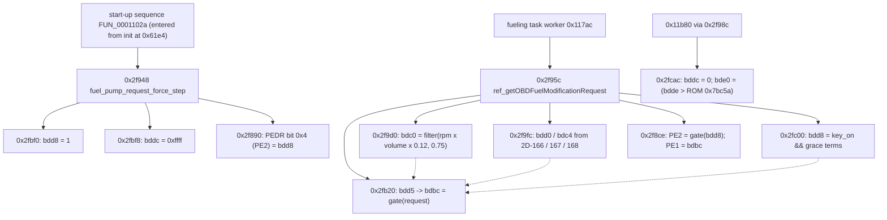

# Fuel pump control (relay drive + speed control + switch inputs) — subsystem report

| Date | What changed | Version |
|------|--------------|---------|
| 2026-11-19 | Initial report | 1 |
| 2026-11-19 | §2.4: spell out the fuel-demand threshold term (`0xffffbdd5`) and its inputs, cross-link the load/fueling derivation | 2 |
| 2026-11-19 | Scope discipline: neighboring relay outputs (PD7 starter, PE0 DBW, PJ7 A/C clutch) moved out of the body and memory map into §4.6 with ROADMAP cross-links | 3 |
| 2026-11-22 | Corrected against the disassembly: task attribution of the start-up prime, `bddc <= 0x3e` window, `bde0` owner (`0x2fcac`), third request term and hold counter, the baro/battery table split and 200/190 margins of `0x2f9fc`, diagnostic modes 5/7, PD7 chain address; memory map extended to 12 functions / 13 cells | 4 |

**Applicable ROMs** — the behavior described here is **assumed identical across
all ROM bins until proven otherwise**; a row documents any per-ROM difference
(also detailed in [`docs/investigations/<rom-id>/`](../investigations/README.md),
never re-derived here). List only ROMs actually investigated for this subsystem
(the reference ROM always present):

| ROM | ROM specifics | Short one-line description |
|-----|---------------|----------------------------|
| [`60E15120_N3J1E`](../investigations/60E15120_N3J1E/README.md) | reference ROM — all `0x` addresses in this report are from this bin; `submodules/Mazda_RX8_PCM_ReverseEngineering/Stock_ROMs/60E15120_N3J1E.bin` (512 KiB, SHA-256 `a7cd953c2a87af12ee2814a95c958dc23959d352ef9c5e7f82b8ab8952f264f1`), untouched | Fuel pump relay drive on PEDR bit 0x4 (PE2) from request flag `0xffffbdd8`, pump speed control on PE1 |

All content in this report is from static analysis of the canonical export
([`reverse-engineered/decompiled/`](../../reverse-engineered/decompiled/60E15120_N3J1E/)),
the disassembly and the raw ROM bytes; the output drive paths were additionally
exercised dynamically in the SH-2E emulator (§4.5).

## 1. Introduction — what this subsystem is and does

The PCM switches the fuel pump's power via a relay it drives itself: the
wiring book shows PCM terminal **5P "Fuel pump relay control"** on cars with
the immobilizer system and **5L** on cars without it (the two are
variant-exclusive), plus **4M "Fuel pump speed control"** for the pump-speed
relay that bypasses the series resistor at high demand
([`docs/architecture/hardware/mazda-rx-8-pcm-pinout-series-1.md`](../architecture/hardware/mazda-rx-8-pcm-pinout-series-1.md)).

In firmware, the pump relay request is a single RAM flag
`fuel_pump_relay_request` (`0xffffbdd8`): it is high while the ignition is on
(key-on flag `0xffffaa68`) with short grace counters, and low at key-off. The
flag is recomputed each fueling-task pass (`0x2fc00`) and additionally primed to
1 by the start-up sequence `FUN_0001102a` (`0x2f948` → `0x2fbf0`, which also
disables the run-on grace term by loading `0xffff` into `0xffffbddc`). It drives
port bit **PE2 (PEDR_W `0xfffff754` bit 0x4, SH7055F package pin 9)** through two
output routines — one direct (`0x2f890`), one gated by the UDS
actuator-override state machine (`0x2f8ce`). The companion bit **PE1 (bit 0x2,
pin 8)** is driven from `fuel_pump_speed_request` (`0xffffbdbc`), a
fuel-demand-derived flag — the speed-control relay candidate. PE1 is a plain
on/off GPIO output (single-bit set/clear in `0x2f8ce`), **not PWM**: the speed
change is done by a relay that bypasses the pump series resistor, not by
duty-cycling the supply.

The inertia (fuel-cut) switch is **not** wired to any PCM input in the pinout;
on this car it sits in the fuel pump feed circuit on the hardware side, so it
is not a firmware condition.

## 2. How it works, step by step

### 2.1 Hardware setup

```text
Main relay (PCM 4E, held by PD11 "relay hold" 0x251d0) --+--> +12 V feed
                                                          |
                                        inertia switch (in the pump feed,
                                        hardware-side, not a PCM input)
                                                          |
                                        fuel pump relay coil --+--> PCM 5P (immo) / 5L (non-immo)
                                                          |
                                        PCM drives PE2 (PEDR bit 0x4)

Fuel pump speed control relay coil --+--> PCM 4M   (PCM drives PE1, PEDR bit 0x2;
                                     +--> bypasses the pump series resistor)  on/off, not PWM
```

Firmware-level paths are distinguished from pin routing: the package-pin →
connector-terminal hop (PE2 pin 9 → 5P, PE1 pin 8 → 4M, etc.) is board routing
and remains unresolved in this repo (see §4.6). The firmware establishes the port
bit and its value only; whether the pin sinks or sources the relay coil is not
decided by the code.

### 2.2 Structured overview — which tasks run what, in what order



`0x2f95c` runs `0x2fc00`, `0x2f9d0`, `0x2f9fc`, `0x2fb20` and `0x2f8ce` in that
order inside one SR-masked section (`0x3920` mask `0x10`, restored by `0x3934`),
so the speed request always sees the demand values of the same pass.

### 2.3 The relay request flag (0x2fc00)

`0xffffbdd8` is recomputed each fueling-task pass:

```text
bdda = sat16(bdda + 1) while key_on 0xffffaa68 == 1, else 0     # key-on ticks
bdde = sat16(bdde + 1) while injectors_off 0xffffa42c == 1, else { 0; bde0 = 0 }
bddc = sat16(bddc + 1) on every call                            # run-on ticks
bdd8 = key_on && (bdda < 0x1f || (injectors_off && bde0) || bddc <= 0x3e)
```

The two grace thresholds are ROM words `0x1f` (31) at `0x7bc58` and `0x3e` (62)
at `0x7bc5c`; the three counters are u16 cells and the increment helper is
`0x2460` (pool `0x2fcdc`), which saturates at the u16 word `0xffff` in ROM
`0x2474`. The `bdda` term branches on `cmp/hs` (`0x2fc64`/`0x2fc66`, keep while
`bdda < 0x1f`), the `bddc` term on `cmp/hi` (`0x2fc84`/`0x2fc86`, keep while
`bddc <= 0x3e`), so the run-on window is 63 calls.

`bde0` is a second-stage flag rather than part of this expression: `0x2fc00`
only clears it while injection is enabled (`0x2fc50`), and `0x2fcac` maintains
it from the same counter, using a third ROM threshold:

```text
0x2fcac: bddc = 0;  bde0 = (bdde > ROM[0x7bc5a] = 0)
```

`0x2fcac` sits behind the SR-masked wrapper `0x2f98c` (`0x3920` mask `0x10`,
`0x3934` restore) and is reached from `0x11b80`, independently of the fueling
task. The start-up sequence primes the flag and disables the run-on term in one
step: `0x2f948` calls `0x2fbf0` (`bdd8 = 1`), then `0x2fbf8` (`bddc = 0xffff`,
which puts the counter past the `0x3e` window), then tail-jumps into the output
routine `0x2f890`.

### 2.4 The output drives

- `0x2f890` (start-up sequence): `PEDR_W bit 0x4 = (0xffffbdd8 == 1)` — direct
  drive.
- `0x2f8ce` (fueling task): `PEDR_W bit 0x4 = (0x5c204(0xffffbdd8) == 1)` and
  `PEDR_W bit 0x2 = (0xffffbdbc == 1)`. Both gates are the UDS
  actuator-override state machine: the request passes through unless a
  diagnostic output test is active on the `0xffffd3xx` state machine, whose mode
  byte `0xffffd36c` is tested for **5 or 7** (`0x5c298`/`0x5c2a0` in `0x5c204`,
  `0x5c378`/`0x5c380` in `0x5c2e4`).
- `0x2fb20` (`ref_fuelingAddOBDControlMode_`) computes the speed request:

  ```text
  bdd5 = 1 if bdc0 >= bdc4; 0 if bdc0 < bdc4 - 3.5; unchanged inside the band
  request = (bdd5 && engine_stopped 0xffffa41c == 0)
         || (injectors_off 0xffffa42c == 1 && key_on 0xffffaa68 == 1)
         || (ROM[0x775bd] == 0 && 0xffffbdd4 > 0)
  0xffffbdbc = 0x5c2e4(request)
  ```

  The fuel-demand threshold term `0xffffbdd5` is set at `0x2fb44` when the max
  demand `0xffffbdc4` is at or below the filtered demand `0xffffbdc0`, and
  cleared at `0x2fb4c` once `0xffffbdc0` falls more than 3.5 below it, so the
  comparison carries 3.5 of hysteresis (ROM `0x775d8`); inside the band the cell
  keeps its previous value. `0xffffbdd4` is a hold counter driven by the same
  function: loaded from `ROM[0x775be]` (= 1) while injectors are off, otherwise
  incremented by 255 with u8 saturation, so it reads non-zero once injection has
  been enabled. `ROM[0x775bd]` is `0x01` in this bin, so the third term is inert
  here; a calibration that clears that byte would assert the speed request from
  the hold counter alone.
- The demand inputs behind that comparison:
  - `0xffffbdc0` — filtered fuel-volume demand,
    `filter(rpm 0xffffb548 × fuel_volume_final 0xffffbeb0 × 0.12, coeff 0.75)`
    from `0x2f9d0` (`ref_filterFuelVolumeRequest`; filter helper `0x23b0`, snap
    threshold `1e-05` at pool `0x2fad8`); derivation in
    [`load_fueling_report.md`](../investigations/60E15120_N3J1E/load_fueling_report.md)
    §2 ("consumers worth noting", `decel_cut_base`);
  - `0xffffbdc4` — max fueling request from `0x2f9fc`
    (`ref_calculateFuelingRequestMaxForOBDControl`): the barometric-pressure
    lookup 2D-166 (`0x6a968`, axis `0xffffad14`) is stored in `0xffffbdd0` and
    scaled by 200.0 (ROM `0x775c4`) and 190.0 (`0x775c8`) to form the intake-air
    margins. While intake air `0xffffaddc` stays at or below
    `200 × 0xffffbdd0 − 0xffffbdc8`, the function looks up 2D-168 (`0x6a990`) on
    battery voltage `0xffffb590` when intake air is also at or below the 190
    margin, else 2D-167 (`0x6a97c`), and stores the result in `0xffffbdc4` with
    `0xffffbdcc = 0`; above the 200 margin it stores `0.0` and sets
    `0xffffbdcc = 1`. `0xffffbdc8` is zeroed at the end of the function through
    the first branch on ROM byte `0x775bc` (0 in this bin), which leaves the
    alternative tail comparison against `61.5` (ROM `0x775d0`, axis
    `0xffffad14`) unreachable here.

### 2.5 The two pump outputs

| Bit | pkg pin | Drive | Flag chain | Harness candidate |
|-----|---------|-------|------------|-------------------|
| PE2 (PEDR 0x4) | 9 | `0x2f890` / `0x2f8ce` | `0xffffbdd8` ← `0x2fc00` (key-on + grace) | **fuel pump relay 5P/5L** |
| PE1 (PEDR 0x2) | 8 | `0x2f8ce` | `0xffffbdbc` ← `0x2fb20` (fuel demand / injectors-off) | fuel pump speed control 4M |

Other relay outputs on the same port banks were mapped while tracing the port
writes (PD7, PE0, PJ7); they are not part of the fuel pump chain and are
recorded in §4.6 with their key addresses and ROADMAP items. The PJ7 entry
also corrects an earlier note that called it a fuel-pump candidate — it is
the **A/C clutch relay** (see §4.3).

## 3. Technical pseudocode

```c
// start-up sequence FUN_0001102a (jsr at 0x11136) -> 0x2f948
void fuel_pump_request_force_step(void) {              // 0x2f948
    fuel_pump_request_set();                           // 0x2fbf0: 0xffffbdd8 = 1
    fuel_pump_run_on_disable();                        // 0x2fbf8: 0xffffbddc = 0xffff
    fuel_pump_relay_drive_pe2();                       // 0x2f890
}

// fueling task worker 0x117ac -> 0x2f95c (SR mask 0x10 via 0x3920/0x3934)
void fuel_pump_task_pass(void) {                       // 0x2f95c
    fuel_pump_request_calc();                          // 0x2fc00 -> 0xffffbdd8
    fuel_pump_demand_filter();                         // 0x2f9d0 -> 0xffffbdc0
    fuel_pump_max_demand();                            // 0x2f9fc -> 0xffffbdd0/0xffffbdc4
    fuel_pump_speed_request_calc();                    // 0x2fb20 -> 0xffffbdd5/0xffffbdbc
    fuel_pump_outputs_pe2_pe1();                       // 0x2f8ce
}

u8 fuel_pump_request_calc(void) {                      // 0x2fc00
    if (key_on_0xffffaa68 == 1) key_on_counter_0xffffbdda = sat16(key_on_counter_0xffffbdda + 1);
    else                        key_on_counter_0xffffbdda = 0;
    if (injectors_off_0xffffa42c == 1) injectors_off_counter_0xffffbdde = sat16(injectors_off_counter_0xffffbdde + 1);
    else { injectors_off_counter_0xffffbdde = 0; injectors_off_seen_0xffffbde0 = 0; }
    run_on_counter_0xffffbddc = sat16(run_on_counter_0xffffbddc + 1);
    fuel_pump_relay_request_0xffffbdd8 = key_on_0xffffaa68
        && (key_on_counter_0xffffbdda < 0x1f                          // ROM 0x7bc58, cmp/hs
         || (injectors_off_0xffffa42c == 1 && injectors_off_seen_0xffffbde0 == 1)
         || run_on_counter_0xffffbddc <= 0x3e);                       // ROM 0x7bc5c, cmp/hi
    return fuel_pump_relay_request_0xffffbdd8;
}

void fuel_pump_grace_eval(void) {                      // 0x2fcac, via 0x2f98c from 0x11b80
    run_on_counter_0xffffbddc = 0;
    injectors_off_seen_0xffffbde0 = (injectors_off_counter_0xffffbdde > ROM[0x7bc5a]);  // ROM = 0
}

void fuel_pump_speed_request_calc(void) {              // 0x2fb20
    if (max_demand_0xffffbdc4 > filtered_demand_0xffffbdc0) {
        if (max_demand_0xffffbdc4 - 3.5 > filtered_demand_0xffffbdc0) demand_threshold_0xffffbdd5 = 0;
    } else demand_threshold_0xffffbdd5 = 1;
    u8 request = (demand_threshold_0xffffbdd5 == 1 && engine_stopped_0xffffa41c == 0)
              || (injectors_off_0xffffa42c == 1 && key_on_0xffffaa68 == 1)
              || (ROM[0x775bd] == 0 && speed_hold_0xffffbdd4 > 0);    // ROM[0x775bd] = 1 here
    fuel_pump_speed_request_0xffffbdbc = ref_obdFuelingAddRequst_0x5c2e4(request);
    if (injectors_off_0xffffa42c == 1) speed_hold_0xffffbdd4 = ROM[0x775be];   // = 1
    else if (speed_hold_0xffffbdd4 > 0) speed_hold_0xffffbdd4 = sat_u8(speed_hold_0xffffbdd4 + 0xff);
}

// output routines (SR-masked; bit helper ref_setRegister_REG_BIT_VAL 0x4bbc)
void fuel_pump_outputs_pe2_pe1(void) {                 // 0x2f8ce
    ref_setRegister_REG_BIT_VAL(PEDR_W /* 0xfffff754 */, 0x0004,
        ref_diagGate_0x5c204(fuel_pump_relay_request_0xffffbdd8) == 1);      // PE2
    ref_setRegister_REG_BIT_VAL(PEDR_W /* 0xfffff754 */, 0x0002,
        fuel_pump_speed_request_0xffffbdbc == 1);                            // PE1
}

void fuel_pump_relay_drive_pe2(void) {                 // 0x2f890
    ref_setRegister_REG_BIT_VAL(PEDR_W /* 0xfffff754 */, 0x0004,
        fuel_pump_relay_request_0xffffbdd8 == 1);                            // PE2
}
```

## 4. Proof — evidence and validation

### 4.1 Memory map (mandatory)

Functions:

| Address | Label | Role |
|---------|-------|------|
| 0x0002f890 | `fuel_pump_relay_drive_pe2` | PEDR bit 0x4 (PE2) = `0xffffbdd8`; direct drive from the start-up sequence |
| 0x0002f8ce | `fuel_pump_outputs_pe2_pe1` | PEDR bit 0x4 via gate `0x5c204` (PE2); bit 0x2 = `0xffffbdbc` (PE1); fueling task |
| 0x0002f948 | `fuel_pump_request_force_step` | `0x2fbf0` → `0x2fbf8` → `0x2f890`; called from `FUN_0001102a` |
| 0x0002f95c | `ref_getOBDFuelModificationRequest` | fueling-task wrapper: `0x2fc00`, `0x2f9d0`, `0x2f9fc`, `0x2fb20`, `0x2f8ce` under SR mask `0x10` |
| 0x0002f98c | `fuel_pump_grace_eval_locked` | SR-masked wrapper calling `0x2fcac`; reached from `0x11b80` |
| 0x0002f9d0 | `ref_filterFuelVolumeRequest` | `0xffffbdc0` = filter(rpm × fuel volume × 0.12, coeff 0.75) |
| 0x0002f9fc | `ref_calculateFuelingRequestMaxForOBDControl` | `0xffffbdd0` / `0xffffbdc4` from 2D-166 / 167 / 168 |
| 0x0002fb20 | `ref_fuelingAddOBDControlMode_` | `0xffffbdd5` + `0xffffbdd4` → `0xffffbdbc` |
| 0x0002fbf0 | `fuel_pump_request_set` | `0xffffbdd8 = 1` |
| 0x0002fbf8 | `fuel_pump_run_on_disable` | `0xffffbddc = 0xffff` |
| 0x0002fc00 | `fuel_pump_request_calc` | computes `0xffffbdd8` from key-on + grace counters |
| 0x0002fcac | `fuel_pump_grace_eval` | `0xffffbddc = 0`; `0xffffbde0 = (0xffffbdde > ROM 0x7bc5a)` |

RAM:

| Address | Label | Type | Written by | Read by |
|---------|-------|------|-----------|---------|
| 0xffffbdd8 | `fuel_pump_relay_request` | u8 | `0x2fc00`, `0x2fbf0` | `0x2f890`, `0x2f8ce` → PE2 |
| 0xffffbdbc | `fuel_pump_speed_request` | u8 | `0x2fb20` | `0x2f8ce` → PE1; also `0x2aa46`, `0x49308` |
| 0xffffbdd5 | `fuel_pump_demand_threshold` | u8 | `0x2fb20` | `0x2fb20` (hysteresis latch) |
| 0xffffbdd4 | `fuel_pump_speed_hold_counter` | u8 | `0x2fb20` | `0x2fb20` |
| 0xffffbdc0 | `fuel_pump_filtered_demand` | f32 | `0x2f9d0` | `0x2fb20`, `0x2f9d0` (filter state) |
| 0xffffbdc4 | `fuel_pump_max_demand` | f32 | `0x2f9fc` | `0x2fb20` |
| 0xffffbdc8 | `fuel_pump_demand_margin` | f32 | `0x2f9fc` | `0x2f9fc` |
| 0xffffbdd0 | `fuel_pump_demand_reference` | f32 | `0x2f9fc` | `0x2f9fc` |
| 0xffffbdcc | `fuel_pump_margin_high_flag` | u8 | `0x2f9fc` | `0x2f9fc` |
| 0xffffbdda | `fuel_pump_key_on_grace_counter` | u16 | `0x2fc00` | `0x2fc00` |
| 0xffffbddc | `fuel_pump_run_on_grace_counter` | u16 | `0x2fc00`, `0x2fcac`, `0x2fbf8` | `0x2fc00` |
| 0xffffbdde | `fuel_pump_injectors_off_counter` | u16 | `0x2fc00` | `0x2fc00`, `0x2fcac` |
| 0xffffbde0 | `fuel_pump_injectors_off_seen` | u8 | `0x2fcac` | `0x2fc00` |

### 4.2 Labeling applied

`data/labels/60E15120_N3J1E/fuel_pump_control_labels.json` (8 function + 13 RAM
aliases, each with raw-bin evidence); mirrored as rows in
[`accepted_function_aliases.tsv`](../investigations/60E15120_N3J1E/labeling/source_review/accepted_function_aliases.tsv)
and
[`accepted_ram_aliases.tsv`](../investigations/60E15120_N3J1E/labeling/source_review/accepted_ram_aliases.tsv).

### 4.3 Corrections

- PJ7 (`0x2e800`/`0x2e840`) was noted as a "fuel-pump relay candidate" in
  [`reviews/intake_solenoids/README.md`](../investigations/60E15120_N3J1E/reviews/intake_solenoids/README.md);
  it is the **A/C clutch relay** drive: `0xffffbd68` is computed by
  `ref_calculateACClutchOn__` `0x2e89c` from `ac_clutch_on` `0xffffbd69` and
  rpm thresholds (pools `0x2e968`/`0x2e96a`/`0x2e96c`; floats 600.0/7800.0 at
  ROM `0x774c0`/`0x774c4`). Harness candidate terminal 5AA.

### 4.4 Files

- [`data/labels/60E15120_N3J1E/fuel_pump_control_labels.json`](../../data/labels/60E15120_N3J1E/fuel_pump_control_labels.json)
- [`tests/test_fuel_pump_control.py`](../../tests/test_fuel_pump_control.py), [`tests/test_fuel_pump_control_dynamic.py`](../../tests/test_fuel_pump_control_dynamic.py)
- [`docs/investigations/60E15120_N3J1E/reviews/fuel_pump_control/](../investigations/60E15120_N3J1E/reviews/fuel_pump_control/) — evidence, raw-bin re-verification log, validation record

### 4.5 Validation

- Rule-7 binary checks: every literal pool, instruction word, ROM threshold and
  peripheral symbol cited above is re-read from the raw ROM (SHA-256 pinned) by
  [`verify_fuel_pump_chain.py`](../../utilities/scripts/rx8-pcm-pipeline/verify_fuel_pump_chain.py);
  its output is
  [`reviews/fuel_pump_control/rawbin_reverify_log.txt`](../investigations/60E15120_N3J1E/reviews/fuel_pump_control/rawbin_reverify_log.txt)
  (134/134 checks pass).
- Static: `tests/test_fuel_pump_control.py` (6 tests) checks the label record
  against the ROM bytes, the function index and the two alias TSVs.
- Dynamic (SH-2E emulator, profile `60E15120_N3J1E`):
  `tests/test_fuel_pump_control_dynamic.py` (3 tests) calls `0x2f890`, `0x2f8ce`
  and `0x2fc00` through the harness with RAM cells stubbed and verifies the
  resulting PEDR bits. The neighbouring PD7/PE0/PJ7 drives were exercised in the
  same emulator runs and are covered by their own subsystem tests (see §4.6).
- Pipeline validators + full pytest suite run from the repo root (see
  [`reviews/fuel_pump_control/validation.json`](../investigations/60E15120_N3J1E/reviews/fuel_pump_control/validation.json)).

### 4.6 Limits

Neighboring items mapped while tracing (out of scope here; one line each with
key addresses — no body sections or memory-map rows above):

- **A/C compressor clutch relay** — PJ7 (PJDR `0xfffff76c` bit 0x80) driven by
  `0x2e800` / `0x2e840` from `ac_clutch_relay_drive` `0xffffbd68` (computed by
  `0x2e89c` from `0xffffbd69` + rpm thresholds at ROM `0x774c0`/`0x774c4`);
  harness candidate terminal 5AA. ROADMAP C item 92; label record
  [`ac_compressor_clutch_labels.json`](../../data/labels/60E15120_N3J1E/ac_compressor_clutch_labels.json),
  tests `tests/test_ac_compressor_clutch.py`.
- **Starter relay (PD7)** and **cranking detection** — PD7 (PDDR `0xfffff746`
  bit 0x80) = `0xffffcfb6` via `0x3a0ec`; `0xffffcfb6` ← `0xffffcfbc` (`0x4ef86`,
  which copies the `== 1` test), and `0xffffcfbc` ← `cranking_in_progress`
  `0xffffd15c` (`0x4ed3c`, itself fed by `0x532d0`); harness candidate 5A.
  ROADMAP C item 31; label record
  [`starting_cranking_labels.json`](../../data/labels/60E15120_N3J1E/starting_cranking_labels.json),
  tests `tests/test_starting_cranking.py`.
- **DBW relay (PE0)** — PE0 (PEDR bit 0x1) = (`0xffffcfb7` == 0), same drive
  function `0x3a0ec`; harness candidate 4C. Label record
  [`throttle_dbw_labels.json`](../../data/labels/60E15120_N3J1E/throttle_dbw_labels.json),
  tests `tests/test_throttle_dbw.py`; analyzed in
  [`throttle_dbw_control_report.md`](throttle_dbw_control_report.md).

- Package-pin → connector-terminal routing is board-level unresolved in this
  repo; the 5P/5L/4M/5A/4C/5AA associations above are candidate associations
  from [`mazda-rx-8-pcm-pinout-series-1.md`](../architecture/hardware/mazda-rx-8-pcm-pinout-series-1.md),
  not traced wires.
- The exact timer semantics of the grace counters (`0xffffbdda` < 0x1f,
  `0xffffbddc` <= 0x3e, and the `0x2fbf8` load of `0xffff`) are traced to the
  counters and ROM thresholds but their task-relative periods are not pinned
  down.
- The third term of the `0x2fb20` request (ROM byte `0x775bd`) is inert in this
  bin; a calibration that clears it would assert the speed request from the
  `0xffffbdd4` hold counter alone. No such bin was exercised here.
- The tail block of `0x2f9fc` (the `61.5` comparison against `0xffffad14` that
  would overwrite `0xffffbdc8`) is unreachable in this bin because ROM byte
  `0x775bc` is 0; its intended calibration meaning is not established.
- `0xffffbdbc` is also read by `0x2aa46` and `0x49308`, outside this chain; those
  consumers are not analyzed.
- 16-bit literal pools hold the sign-extended low half of a RAM address
  (`0xffffbdd8` is encoded as `0xbdd8`); the label record cites them in that
  low-half form where the disassembler prints it, the verifier log resolves the
  full address.
- Only the reference ROM `60E15120_N3J1E` was investigated; no cross-ROM
  byte-match was run for this chain yet (the shared-logic assumption stands
  until proven otherwise).
- The inertia switch is not a PCM input in the pinout; if a PCM-side inertia
  input exists on another variant it is not covered here.

### 4.7 Related reports

- [`ignition_power_state_report.md`](../investigations/60E15120_N3J1E/ignition_power_state_report.md) — main relay hold (PD11 `0x251d0`), key-on flag `0xffffaa68` origin, shutdown logic
- [`intake_solenoids_report.md`](../investigations/60E15120_N3J1E/intake_solenoids_report.md) — neighboring PEDR/PBDR output drives (SSV/VDI/VFAD/AIR pump/APV); its PJ7 note is corrected here (§4.3)
- [`cooling_fan_control_report.md`](../investigations/60E15120_N3J1E/cooling_fan_control_report.md) — fan relay drives (PE11/PE4), same output-helper idiom
- [`fueling_control_report.md`](../investigations/60E15120_N3J1E/fueling_control_report.md) — fuel-cut arbitration and injectors-off flag `0xffffa42c` feeding the pump request grace terms
- [`load_fueling_report.md`](../investigations/60E15120_N3J1E/load_fueling_report.md) — derivation of the fuel-demand input `0xffffbdc0` (`0x2f9d0`) and `fuel_volume_final` `0xffffbeb0` feeding the `0xffffbdd5` threshold term in §2.4
- [`docs/architecture/hardware/mazda-rx-8-pcm-pinout-series-1.md`](../architecture/hardware/mazda-rx-8-pcm-pinout-series-1.md) — terminals 5P/5L/4M/5A/4C/5AA/2E
