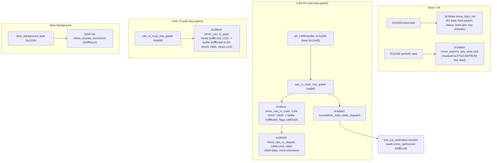
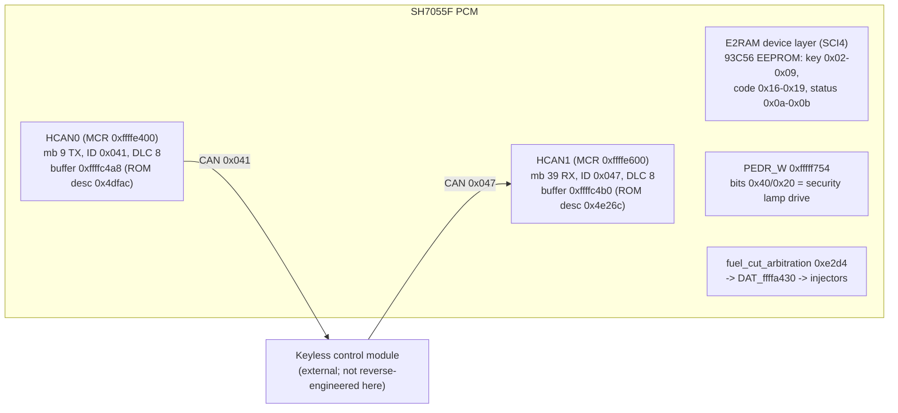
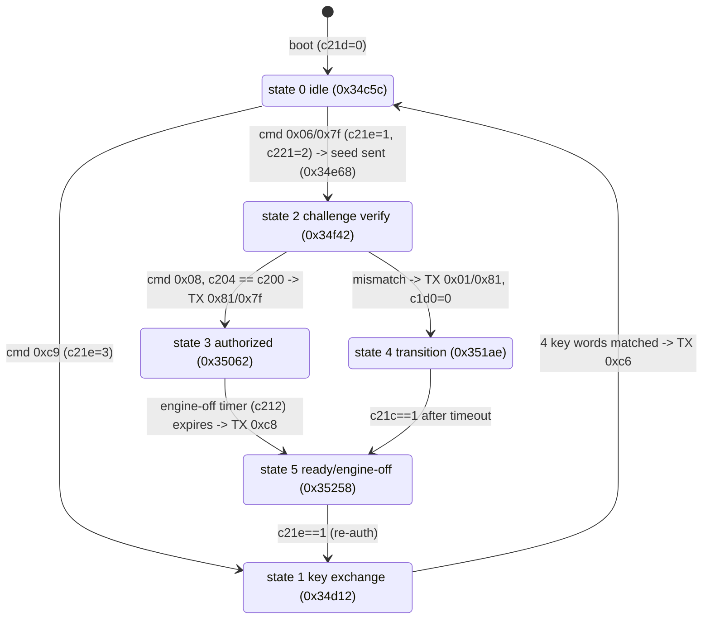

# Immobilizer (keyless-module challenge/response) — subsystem report

| Date | What changed | Version |
|------|--------------|---------|
| 2026-11-17 | Initial report | 1 |
| 2026-11-19 | Scope discipline: non-immobilizer rows found while labeling (`0x169d4` cal-ID copy, `0x11c4`/`0xffffdfa0`) moved out of the memory map into §4.6; `0xffffdfa0` dual-label conflict with the SBL report recorded as ROADMAP D14 | 2 |
| 2026-11-20 | `0x169d4` label fixed: inherited misnomer `ref_ImmoRelatedFaultSomething_` renamed to body-evidenced `cal_id_string_copy` in the label record and the accepted-alias TSV | 3 |

**Applicable ROMs** — the behavior described here is **assumed identical across
all ROM bins until proven otherwise**; a row documents any per-ROM difference
(also detailed in [`docs/investigations/<rom-id>/`](../investigations/README.md),
never re-derived here). List only ROMs actually investigated for this subsystem
(the reference ROM always present):

| ROM | ROM specifics | Short one-line description |
|-----|---------------|----------------------------|
| [`60E15120_N3J1E`](../investigations/60E15120_N3J1E/README.md) | reference ROM — all `0x` addresses in this report are from this bin unless a row says otherwise; `submodules/Mazda_RX8_PCM_ReverseEngineering/Stock_ROMs/60E15120_N3J1E.bin` (512 KiB, SHA-256 `a7cd953c2a87af12ee2814a95c958dc23959d352ef9c5e7f82b8ab8952f264f1`), untouched | PCM-side immobilizer: CAN 0x047/0x041 challenge/response with the keyless module, seed/key math from the EEPROM key, fuel cut + security lamp when not authorized |
| [`60E0G500_N3ZHEC`](../investigations/README.md) | own donor-ECU dump, `binaries/dumps/60E0G500_N3ZHEC.bin` (SHA-256 `a33f79a4f1c47007fd95a667ef8a8e14740eb8522c0b26a4fc1022db7fd85db2`), untouched | Same chain, byte-identical functions (unique_exact_bytes, 30/30 mapped); CAN buffers shifted +0x70 (TX 0xffffc518 / RX 0xffffc520); patch sites 0x35af8/0x35f44 |

All content in this report is from static analysis of the canonical export
([`reverse-engineered/decompiled/`](../../reverse-engineered/decompiled/60E15120_N3J1E/)),
the disassembly and the ROM bytes, except where a section explicitly states
otherwise (the challenge/response sequence was additionally reproduced
dynamically in the SH-2E emulator — §4.5).

## 1. Introduction — what the immobilizer is and does

The PCM is one half of the car's immobilizer; the other half is the keyless
control module on the CAN bus. Before the engine may run, the two modules run
a challenge/response over CAN: the PCM sends a fresh random **seed**, the
keyless module answers with a word computed from that seed and the **immobilizer
key stored in the PCM's EEPROM**, and the PCM compares the answer against its
own computation. A matching answer sets the *authorized* flag
(`0xffffc1d0` = 1), which removes the immobilizer's contribution to the
fuel-cut arbitration; a wrong or missing answer leaves the flag at 0 and both
rotor banks stay fuel-cut. The security lamp on the dash is driven alongside
(on = authorized/OK indication, off = rejected).

Key numbers:

- CAN frames are 8 bytes: the keyless module → PCM on **ID 0x047** (HCAN1
  mailbox 39), PCM → keyless module on **ID 0x041** (HCAN0 mailbox 9).
- The seed is a 32-bit random value regenerated per boot from ADC noise,
  free-running timers and running counters (`0xffffc208`).
- The EEPROM key is 8 bytes (93C56 bytes 0x02–0x09) plus a 4-byte code
  (0x16–0x19) and a status byte pair (0x0a–0x0b), read through the E2RAM
  device layer.
- The immobilizer-off calibration patches (the `Immobilizer Disable` tables in
  the RomRaider defs) target two code sites: `0x34b10` (without RKE) and
  `0x34f5c` (with RKE) — see §2.6.

## 2. How it works, step by step

### 2.1 Where the code runs



The state machine runs inside the CAN-RX main `0xdbf6`, which first services
the keyless-module RX mailbox and then calls the immobilizer main `0x34ae2` —
so every received 0x047 frame and one state-machine step happen in the same
pass. The dispatcher only advances the state machine while the engine is
running (`engine_running_flag` `0xffffaa68` == 1 and `engine_stopped_latch`
`0xffffb578` != 1); otherwise it resets the main state and clears the
authorized flag.

### 2.2 Hardware setup — CAN, EEPROM, lamp



Firmware-level paths only: the CAN IDs, mailboxes and buffers come from the
ROM mailbox descriptor records (re-read from the raw ROM); the lamp is a GPIO
register write; the EEPROM is read over the SCI4-attached E2RAM device. The
package-pin ↔ connector-terminal routing of the lamp pins is board routing and
is not traced here.

### 2.3 The command channel (CAN 0x047 → PCM)

Each received 0x047 frame is `[cmd][d0][d1][d2][d3][d4][chkH][chkL]`; the
unpack (`0x38150`) copies it to `0xffffc4b9..c4c4` and sets the pending flag
`0xffffc4bf = 1`. The decoder `0x355f0` (called at `0x34b10` inside the
dispatcher) consumes it in the same cycle and sets the command sub-state
`0xffffc21e`:

| cmd | meaning | effect |
|-----|---------|--------|
| 0x00 | idle | c21e = 0 |
| 0x06 | keyless request; sub-status in d0/d1 | d0=0x00,d1=0xff → c21e=1, c221=1; d0=0x01,d1=0xff → c21e=1, c221=3; d0=0x7f → c21e=1, c221=2 (**seed request**); else c21e=6 |
| 0x08 | challenge/response word | c21e=2, `0xffffc204` = BE32(d0..d3) |
| 0x90 | key word; d0 = tag 1..4 | c21e=4, `0xffffc1ec` = BE32(d0..d3) (tag included); other d0 → c21e=6 |
| 0xc9 | begin key exchange | c21e=3 |
| other / none | — | c21e=5 |

### 2.4 The state machine and the challenge/response

The main state `0xffffc21d` selects the handler in `0x34ae2`:



Step by step:

1. **Seed request** — cmd 0x06 with d0=0x7f sets c21e=1, c221=2. State 0
   (`0x34c5c`) forwards to the wait-for-key step `0x34e68`, which on c221==2
   checks the registered-key count (`0xffffc282`; 2 = both keys registered),
   sets/clears the authorized flag and lamp accordingly, computes the expected
   response `0xffffc200 = 0x354dc(key_a, key_b, seed)` (`0x353ce`), and
   transmits the **raw seed** `0xffffc208` big-endian as TX cmd 0x07
   (`0x35738`), then moves to state 2.
2. **Challenge verify** — the keyless module answers cmd 0x08 with its
   computed word; state 2 (`0x34f42`) compares it against `0xffffc200` at
   `0x34f5c` (`cmp/eq r2,r3`). Match → `0x352c4` (immo_set_authorized: lamp on,
   `0xffffc1d0`=1, c21d=3) and TX cmd 0x81 with status 0x7f. Mismatch →
   `0x35338` (immo_set_rejected: lamp off, `0xffffc1d0`=0, c21d=4), TX cmd 0x01
   with status 0x81, reject counter `0xffffc22a`=1.
3. **Key-word exchange** (registration/verification of the 4 key words) — cmd
   0xc9 (c21e=3) at state 0 moves to state 1 and computes the four expected
   words `0xffffc1f0..c1fc` (`0x35356`): each is a scrambled half of the key
   pair (key regs `0xffffc26c`/`0xffffc270`) mixed with the seed, tagged with
   0x01..0x04 in the top byte. The PCM transmits the currently selected word
   as TX cmd 0x09 (`0x35738`, index `0xffffc220`). The keyless module sends
   them back as cmd 0x90 with d0 = tag 1..4; state 1 compares
   `0xffffc1ec` against `c1f0/c1f4/c1f8/c1fc` in order. All four match → TX
   0xc6 and back to state 0.
4. **Authorized operation** — state 3 (`0x35062`) latches the authorized state
   (`0xffffc274`=1, c226=1) when no command is pending, watches for engine
   stop (RPM ≤ 0 → 15000-count timer, then TX 0xc8 "ready, engine off" and
   state 5).
5. **Timeouts** — every exchange step has a ~500-count timer
   (`0xffffc20c/c20e/c210/c214/c216`); expiry routes to the rejected state.
   The dispatcher also counts consecutive error sub-states (c21e ∈ {5,6}):
   three strikes set `0xffffc1d1`.

### 2.5 Effect on the engine — fuel cut and lamp

The authorized flag `0xffffc1d0` is an input to the fuel-cut arbitration
`0xe2d4`: when it is 0, `DAT_ffffa430` is set to 0x0003 — both rotor banks are
fuel-cut (pool words `0xe406`/`0xe43c` = 0xc1d0, read with `tst`; store via
pool `0xe43e` = 0xa430, `mov.w r4,@r3` at `0xe438`). The lamp driver
`0x2556c` sets/clears `PEDR_W` `0xfffff754` bits 0x40 and 0x20.

### 2.6 The immobilizer-off patch sites

The RomRaider `Immobilizer Disable` tables point at two code sites (addresses
per ROM in
[`data/labels/cross_rom/immobilizer_start_patterns.json`](../../data/labels/cross_rom/immobilizer_start_patterns.json)):

- without RKE, `0x34b10` on the reference ROM: the pattern
  `B56E000960D0600C88008D1100098801` starts at the `bsr 0x355f0` — the
  command-decoder call inside the dispatcher `0x34ae2` (pattern at +0x2e of
  the 298-byte function).
- with RKE, `0x34f5c` (= start + 0x44c): the `cmp/eq r2,r3` at `0x34f5c` in
  `0x34f42` — the challenge comparison itself (bytes `3320 8F08 0009 B1AF`).

Upstream's patch writer NOPs the 0xf8-byte dispatch block at the start pattern
and neutralizes the compare at +0x44c, so the authorization path always
succeeds. These are calibration patch targets; the stock ROM is untouched.

### 2.7 EEPROM key storage and the UDS/immo diagnostic surface

`e2ram_immo_key_read` (`0x375c0`, called mask-protected from `0x34a04`) reads
the key, code and status from the 93C56 via the E2RAM device (device words
0x6010000–0x6040000 = EEPROM 0x02–0x09; 0x60b0000/0x60c0000 = 0x16–0x19;
0x6050000 = 0x0a–0x0b), setting erased flags `0xffffc1d5..c1d8` on all-00/all-ff.
It is gated by `0xffffd1ce` (security) and `ref_securityNotUnlocked(1)`.
Defaults when erased (`0x34a74`): key regs 0x10001 / 0x55aa55aa, code cells
0x55aa / 0xb7e3. The key regs are additionally mixed with the free-running
timer `ATUII_TCNT0H_W` (`0xfffff430`) by `0x360a8` each dispatcher pass.

The `ref_afterImmo_1..8` handlers (`0x36acc`–`0x37bde`, dispatched by
`0x36908` at the end of every dispatcher pass) form the EEPROM parameter-write
progress machine for the immo block and complete Mazda-specific UDS service
0xb1 responses (e.g. payload `f1 01 01` in `0x36acc`). The slow task
`0x11534` increments the immo counter `0xffffd1e2` via `0x5674a` when
`0xffffd1e4`==1; the diag readout PID 0xc116 (thunk `0x576c2`) exposes the
`0xffffc239..c281` state block.

## 3. Technical pseudocode

```c
// per CAN-RX pass (can_rx_main_key_gated 0xdbf6):
immo_can_rx_main();            // 0x3811c: mb39 (ID 0x047) -> 0xffffc4b0, set 0xffffc4bf=1
immo_can_rx_unpack();          // 0x38150: c4b9=cmd, c4ba..c4bd=data, c4c4=BE16(chk)
immobilizer_main();            // 0x34ae2:

if (engine_running_flag_ffffaa68 == 1 && engine_stopped_latch_ffffb578 != 1) {
    immo_eeprom_flag_sequencer();                    // 0x35ea0
    sub = immo_can_command_decode();                 // 0x355f0: consumes 0xffffc4bf
        // cmd 0x06/0x7f -> {1, c221=2}; cmd 0x08 -> {2, c204=BE32(data)}
        // cmd 0x90 tag 1..4 -> {4, c1ec=BE32(data)}; cmd 0xc9 -> {3}; else {5/6}
    switch (immo_main_state_ffffc21d) {              // dispatch at 0x34b14
        case 0: immo_state0_idle();        break;     // 0x34c5c
        case 1: immo_state1_key_exchange();break;     // 0x34d12
        case 2: immo_state2_challenge_verify(); break;// 0x34f42: if (c204 == c200) at 0x34f5c
        case 3: immo_state3_authorized();  break;     // 0x35062
        case 4: immo_state4_transition();  break;     // 0x351ae
        case 5: immo_state5_ready_engine_off(); break;// 0x35258
        default: immo_main_state_ffffc21d = 0;
    }
    if (c21e >= 5 && c226 == 0 && c229 == 0 && ++c21f > 2) { c21f = 0; c1d1 = 1; }
    immo_eeprom_write_dispatch();                    // 0x36908 -> afterImmo_1..8
} else {
    c21d = 0; immo_lamp_drive(0); c1d0 = 0; c1d1 = 0; // 0x2556c: PEDR_W 0xfffff754 bits 0x40/0x20
}

// wait-for-key step 0x34e68, c221==2 (seed request):
c200 = immo_seed_mix(c26c, c270, c208);              // 0x354dc via 0x353ce
immo_tx_frame_build(0x07);                           // 0x35738: TX = [07][c208 BE]...
c21d = 2;

// state 2 verify 0x34f42:  c204 == c200 ? immo_set_authorized()  // 0x352c4: c1d0=1, c21d=3
//                                     : immo_set_rejected();  // 0x35338: c1d0=0, c21d=4
// state 1 key words 0x34d12: c1f0..c1fc = immo_compute_expected_key_words(); // 0x35356
//   per cmd 0x90: if (c1ec == c1f0/c1f4/c1f8/c1fc[c220]) advance c220; 4/4 -> TX 0xc6, c21d=0

// fuel cut 0xe2d4: if (c1d0 == 0) DAT_ffffa430 |= 0x0003;   // both rotor banks cut
```

## 4. Proof — evidence and validation

### 4.1 Memory map (mandatory)

Every address below can be checked directly in
[`firmware_disassembly.asm`](../../reverse-engineered/disassembly/60E15120_N3J1E/firmware_disassembly.asm)
(ROM addresses), in
[`decompiled/functions/<address>_*.c`](../../reverse-engineered/decompiled/60E15120_N3J1E/functions)
(per-function C; index in `function_index.tsv`), and in the label records
(`data/labels/60E15120_N3J1E/immobilizer_labels.json`,
`accepted_function_aliases.tsv` / `accepted_ram_aliases.tsv`).

#### Functions (ROM addresses)

| Address | Name (index name; alias) | Role |
|---|---|---|
| 0x00034ae2 | `FUN_00034ae2` (immobilizer_main_state_dispatch) | immo main: engine gate, command call at 0x34b10, dispatch on c21d, fail counter |
| 0x000355f0 | `FUN_000355f0` (immo_can_command_decode) | consumes c4bf; cmd 0/6/8/0x90/0xc9 → c21e, c204/c1ec |
| 0x00034c5c | `FUN_00034c5c` (immo_state0_idle) | main state 0 |
| 0x00034d12 | `FUN_00034d12` (immo_state1_key_exchange) | main state 1; 4-word compare vs c1f0..c1fc |
| 0x00034f42 | `FUN_00034f42` (immo_state2_challenge_verify) | main state 2; compare at 0x34f5c (with-RKE patch site) |
| 0x00035062 | `FUN_00035062` (immo_state3_authorized) | main state 3; authorized latch, engine-off timer |
| 0x000351ae | `FUN_000351ae` (immo_state4_transition) | main state 4 |
| 0x00035258 | `ref_ImmoStateReadyToDriveEngineOff` (immo_state5_ready_engine_off) | main state 5 |
| 0x000352c4 | `ref_ImmoGoodStateSet_` (immo_set_authorized) | c1d0=1, lamp on, c21d=3 |
| 0x00035338 | `ref_ImmoBadStateSet_` (immo_set_rejected) | c1d0=0, lamp off, c21d=4 |
| 0x00034e68 | `FUN_00034e68` (immo_wait_for_key_step) | c221 dispatch; c221==2 → seed TX, c21d=2 |
| 0x00035356 | `ref_immo_related__` (immo_compute_expected_key_words) | c1f0..c1fc = tagged scrambled words |
| 0x000353ce | `ref_ImmoGetSeed` (immo_compute_seed) | c200 = 0x354dc(c26c,c270,c208) |
| 0x00035438 | `FUN_00035438` (immo_key_word_scramble) | 24-bit scramble half |
| 0x000354dc | `FUN_000354dc` (immo_seed_mix) | seed/response mix |
| 0x00035738 | `FUN_00035738` (immo_tx_frame_build) | builds c1c8..c1d1 TX frame |
| 0x0003587c | `ref_Immo_Keygen_related_ADC` (immo_random_seed_gen) | c208 from ADC + timers + counters |
| 0x000360a8 | `FUN_000360a8` (immo_key_regs_mix_timer) | c26c/c270 ^= ATUII_TCNT0H_W 0xfffff430 |
| 0x000349e4 | `ref_ImmoSomethingOrOther__` (immo_boot_init) | boot init from 0x1102a |
| 0x00034a04 | `FUN_00034a04` (immo_eeprom_key_read_kick) | masked 0x375c0 + 0xe2d4(1), from task 0x114d0 |
| 0x00034a74 | `ref_immoRelatedMaybe__` (immo_key_defaults_init) | erased-key defaults |
| 0x00035ea0 | `ref_ImmoUpdateRelated` (immo_eeprom_flag_sequencer) | 'Z' flag write sequencer (c268) |
| 0x00035f64 | `ref_checkImmoStatus_` (immo_status_housekeeping) | status/fault housekeeping |
| 0x00036908 | `ref_afterImmoMain` (immo_eeprom_write_dispatch) | calls afterImmo_1..8 |
| 0x00036acc | `ref_afterImmo_1` (immo_eeprom_write_step_1) | write step; UDS 0xb1 completion f1 01 01 |
| 0x000375c0 | `e2ram_immo_key_read` | EEPROM key/code/status read → c1d5-c1d8 |
| 0x0003811c | `ref_CAN47RX_Main` (immo_can_rx_main) | CAN 0x047 mb39 → c4b0, c4bf/c4c0=1 |
| 0x00038150 | `ref_can47RXunpack` (immo_can_rx_unpack) | c4b9..c4c4 unpack |
| 0x000380c8 | `ref_can41TXPack` (immo_can_tx_pack) | c1c8..c1cf → c4a8..c4af, CAN 0x041 mb9 |
| 0x0000dbf6 | `can_rx_main_key_gated` | calls 0x3811c + 0x34ae2 |
| 0x0000db58 | `can_tx_main_key_gated` | calls 0x380c8, clears c1d1 |
| 0x0002556c | `ref_setImmoLight__` (immo_lamp_drive) | PEDR_W 0xfffff754 bits 0x40/0x20 |
| 0x00016b20 | `ref_readImmoBit` (immo_diag_bit_check) | diag bit test → 0x16a1c(2); the bit it tests is disputed — §4.6 |
| 0x0005674a | `ref_runImmoRelatedCounter` (immo_counter_increment) | d1e2++ if d1e4==1, from 0x11534 |
| 0x0000e2d4 | `FUN_0000e2d4` (fuel_cut_arbitration) | c1d0==0 → DAT_ffffa430 |= 3 |

#### RAM (0xffff…)

| Address | Alias | Type | Meaning |
|---|---|---|---|
| 0xffffc1c8 | `immo_tx_frame` (c1c8–c1cf) | u8[8] | TX frame: cmd, payload, valid flag at c1d1 |
| 0xffffc1d0 | `inferred_ram_c1d0_ffffc1d0` | u8 | immo authorized flag (fuel-cut gate) |
| 0xffffc1d1 | `immo_tx_frame_valid` | u8 | TX frame ready (pack gate) |
| 0xffffc1d5 | `inferred_ram_c1d5_ffffc1d5` (c1d5–c1d8) | u8[4] | EEPROM key/code/status erased flags |
| 0xffffc1dc | `immo_computed_key_words` (c1dc–c1e8) | u32[4] | raw scrambled key words |
| 0xffffc1ec | `immo_received_key_word` | u32 | cmd 0x90 word |
| 0xffffc1f0 | `immo_expected_key_words` (c1f0–c1fc) | u32[4] | tagged expected words |
| 0xffffc200 | `immo_seed_expected` | u32 | c200, computed expected response |
| 0xffffc204 | `immo_challenge_received` | u32 | c204, cmd 0x08 word |
| 0xffffc208 | `immo_random_seed` | u32 | per-boot random seed (sent as cmd 0x07) |
| 0xffffc20c | `immo_timer_a` (c20c/c20e/c210/c212/c214/c216) | u16[6] | exchange timeout counters |
| 0xffffc21c | `immo_ready_engine_off_pending` | u8 | state-3→5 handover flag |
| 0xffffc21d | `immo_main_state` | u8 | main state 0–5 |
| 0xffffc21e | `immo_command_substate` | u8 | per-cycle command decode 0–6 |
| 0xffffc21f | `immo_fail_counter` | u8 | consecutive error cycles; 3 → c1d1 |
| 0xffffc220 | `immo_key_word_index` | u8 | 1–4 exchange progress / TX word select |
| 0xffffc221 | `immo_request_subtype` | u8 | cmd 0x06 subtype (2 = seed request) |
| 0xffffc224 | `immo_status_code` | u8 | 0x7f OK / 0x80 / 0x81 NG |
| 0xffffc226 | `immo_authorized_latch_flag` | u8 | state-3 latch |
| 0xffffc22a | `immo_reject_event_flag` | u8 | reject event counter flag |
| 0xffffc26c | `immo_key_reg_a` / 0xffffc270 `immo_key_reg_b` | u32[2] | EEPROM key halves (default 0x10001 / 0x55aa55aa) |
| 0xffffc274 | `inferred_ram_c274_ffffc274` | u8 | authorized latch (state 1 gate) |
| 0xffffc282 | `immo_registered_key_count` | u8 | registered key count (2 after authorization) |
| 0xffffc268 | `e2ram_param_block` (c268–c282) | u8[0x1b] | E2RAM param block ('Z' magic, write sequencer) |
| 0xffffc4a8 | `can041_tx_buffer` (c4a8–c4af) | u8[8] | CAN 0x041 TX mailbox buffer |
| 0xffffc4b0 | `can047_rx_raw_buffer` (c4b0–c4b7) | u8[8] | CAN 0x047 RX mailbox buffer |
| 0xffffc4b9 | `immo_rx_command` / 0xffffc4ba `immo_rx_data` (c4b9–c4be) | u8[6] | unpacked RX frame |
| 0xffffc4bf | `immo_rx_command_pending` | u8 | RX command pending flag |
| 0xffffd1e2 | `immo_counter` / 0xffffd1e4 `immo_counter_enable` | u8 | immo counter (slow task) |
| 0xffffd1ce | `security_unlocked_flag` | u8 | gates 0x375c0 |

#### ROM tables / descriptors

| Address | Content |
|---|---|
| 0x004dfac | CAN 0x041 TX mailbox descriptor (mb 9, DLC 8, buffer 0xffffc4a8) |
| 0x004e26c | CAN 0x047 RX mailbox descriptor (mb 39, DLC 8, buffer 0xffffc4b0); last record of the HCAN1 table at 0x4e21c |
| 0x0034b10 | without-RKE immo-off patch pattern (16 B, in 0x34ae2) |
| 0x0034f5c | with-RKE immo-off patch site (`cmp/eq` in 0x34f42) |
| 0x00356b6–0x00356d2 | literal pool of 0x355f0 (c4bf/c4b9/c4ba/c4bb/c4bc/c4bd, consts 0x90/0xc9/0xff, c21e/c221/c204) |

### 4.2 Labeling applied

`data/labels/60E15120_N3J1E/immobilizer_labels.json` (35 function aliases,
35 RAM aliases, CAN IDs, protocol, dynamic results) with matching rows in
`accepted_function_aliases.tsv` / `accepted_ram_aliases.tsv` (rule-7 pool
anchoring proven by `tests/test_source_review_ram_aliases.py`) and
`symbols.tsv`. Per-ROM equivalents:
`data/labels/60E0G500_N3ZHEC/immobilizer_labels.json` and the cross-ROM chain
map `data/labels/cross_rom/immobilizer_function_map.json` (26–40 byte-identical
chain functions per ROM across all 11 dumped ROMs, from
`cross_rom_function_matches.tsv`). The pre-existing start-pattern records
(`immobilizer_start_patterns.json`, per-ROM `rom_code_patterns`) are unchanged
and extended, not duplicated.

### 4.3 Corrections

- `0x169d4` was inherited as `ref_ImmoRelatedFaultSomething_`, a misnomer: its
  body copies the 16-byte calibration string `N3J1E_1W.Z05` to
  `0xffffdf70..df7f` and sets `0xffffdf90 = 0xc` (called from boot task
  `0x1102a`). It is not an immobilizer fault handler; the label record now
  carries the body-evidenced alias `cal_id_string_copy` (the inherited `ref_`
  name is kept in the evidence string).
- The upstream def addresses for the immobilizer-disable tables were
  ROM-proven wrong for some ROMs before RX8Defs 39d98a0; the N3N5EB case
  remains open as discrepancy D13 (see
  [`upstream-sync-validation.md` §3](../investigations/60E15120_N3J1E/labeling/rx8defs-analysis/upstream-sync-validation.md)).

### 4.4 Files

- `data/labels/60E15120_N3J1E/immobilizer_labels.json` (extended),
  `data/labels/60E0G500_N3ZHEC/immobilizer_labels.json` (extended),
  `data/labels/cross_rom/immobilizer_function_map.json` (new)
- `docs/investigations/60E15120_N3J1E/labeling/source_review/accepted_function_aliases.tsv`,
  `accepted_ram_aliases.tsv`, `reverse-engineered/decompiled/60E15120_N3J1E/symbols.tsv` (rows appended)
- `docs/investigations/60E15120_N3J1E/reviews/immobilizer/` (evidence +
  validation record)
- `tests/test_immobilizer_labels.py`, `tests/test_immobilizer_dynamic.py`
- This report: `docs/subsystem-logic/immobilizer_report.md`

### 4.5 Validation

- ROM SHA-256 `a7cd953c2a87af12ee2814a95c958dc23959d352ef9c5e7f82b8ab8952f264f1`
  verified unchanged (`validate_export.py`, `hash_binaries.py --check` for the
  own dump); all quoted ROM bytes (patterns, descriptors, pool words) re-read
  from the raw ROM in `tests/test_immobilizer_labels.py`.
- Dynamic, SH-2E emulator (profile 60E15120_N3J1E, 1e6 boot cycles,
  `harness.call` on the real ROM functions — `tests/test_immobilizer_dynamic.py`,
  4/4 pass): cmd 0x06/0x7f → c21e=1/c221=2, TX frame `[07][seed BE]`, c21d=2,
  c1d0=1; cmd 0x08 with the matching seed → c224=0x7f, c21d=3, TX
  `[81][7f]`; wrong word → c224=0x81, c21d=4, c1d0=0, c22a=1, TX `[01][81]`;
  cmd 0xc9 + cmd 0x90 tags 1–4 with the computed words → c220 advances 1→4,
  c21d=0, TX 0xc6; `0xe2d4` returns DAT_ffffa430 = 0x0003 with c1d0=0 and
  0x0000 with c1d0=1 (all other cut flags 0).
- Pipeline validators: `validate_export.py`, `validate_reports.py`,
  `verify_claims.py`, `verify_readability.py`, `verify_math_units.py`,
  `python -m pytest tests/` — results recorded in
  [`reviews/immobilizer/validation.json`](../investigations/60E15120_N3J1E/reviews/immobilizer/validation.json).

### 4.6 Limits

Neighboring items mapped while tracing (out of scope here; one line each with
key addresses — no body sections or memory-map rows above):

- **`0x169d4` `cal_id_string_copy`** (inherited `ref_ImmoRelatedFaultSomething_`
  was a misnomer, renamed per §4.3) — not an immobilizer fault handler: its body
  copies the 16-byte calibration string
  `N3J1E_1W.Z05` to `0xffffdf70..df7f` and sets `0xffffdf90 = 0xc` (called from
  boot task `0x1102a`). Belongs to the calibration-ID / UDS surface — correction
  recorded in §4.3, cross-link
  [`uds_mode22_dispatch_report.md`](../investigations/60E15120_N3J1E/uds_mode22_dispatch_report.md).
- **`0x11c4` / `0xffffdfa0`** — `0x11c4` sits inside the SBL block
  (`0x1000–0x1fff`) and zeroes the u16 at `0xffffdfa0`; the SBL report
  dynamically proves that cell as `sbl_inactivity_counter` (relock tests), so
  the `immo_diag_bit` alias here conflicts — ROADMAP D14, cross-link
  [`sbl_bootloader_report.md`](sbl_bootloader_report.md). `0x16b20`
  `ref_readImmoBit` testing that bit remains immo-diag surface pending D14.

- The keyless control module itself is external and not analyzed; the protocol
  is described from the PCM side only (which words are sent, compared,
  transmitted). What the keyless module computes internally is out of scope.
- The seed/key algebra (`0x354dc`, `0x35438`) is verified at the bit-operation
  level (decompiled + dynamic I/O), not reduced to a closed-form equation.
- Static + emulator validation only; no bench/vehicle validation. Nothing here
  flashes a vehicle — the immobilizer-off patch sites are documented, not
  applied (stock ROMs untouched).
- The emulator models HCAN1 as a register file, so the dynamic test drives the
  RX path at the buffer level (unpack + flags) rather than via a peripheral
  frame injection; the mailbox descriptors binding IDs 0x047/0x041 to the
  buffers are ROM-verified instead.
- The lamp GPIO (PEDR_W bits 0x40/0x20) is firmware-verified; the
  package-pin ↔ connector-terminal hop is not traced.
- Shared-logic assumption: the chain byte-matches into all 11 dumped ROMs
  (see §4.2), but only 60E15120_N3J1E was analyzed function-by-function and
  only 60E0G500_N3ZHEC additionally dumped/verified on our side. What would
  disprove sharing for a given ROM: a non-matching dispatcher (patch site) or
  a divergent CAN descriptor.

### 4.7 Related reports

- [`can_mailbox_config_report.md`](../investigations/60E15120_N3J1E/can_mailbox_config_report.md) — mailbox descriptor format, HCAN register model
- [`dsc_can_arbitration_report.md`](../investigations/60E15120_N3J1E/dsc_can_arbitration_report.md) — CAN 0x212 RX path pattern (same unpack style)
- [`e2ram_device_layer_report.md`](../investigations/60E15120_N3J1E/e2ram_device_layer_report.md) — E2RAM/SCI4 device protocol behind 0x375c0
- [`eeprom_content_map_report.md`](../investigations/60E15120_N3J1E/eeprom_content_map_report.md) — 93C56 byte map (immo key 0x02–0x09, code 0x16–0x19)
- [`fueling_control_report.md`](../investigations/60E15120_N3J1E/fueling_control_report.md) — fuel-cut arbitration consumer of `0xffffc1d0` (0xe2d4)
- [`dtc_control_report.md`](../investigations/60E15120_N3J1E/dtc_control_report.md) — immo-related DTCs; PID 0xc116 state readout
- Per-ROM evidence: [`reviews/immobilizer/`](../investigations/60E15120_N3J1E/reviews/immobilizer/README.md),
  [`upstream-sync-validation.md` §3](../investigations/60E15120_N3J1E/labeling/rx8defs-analysis/upstream-sync-validation.md) (patch addresses, D13)
