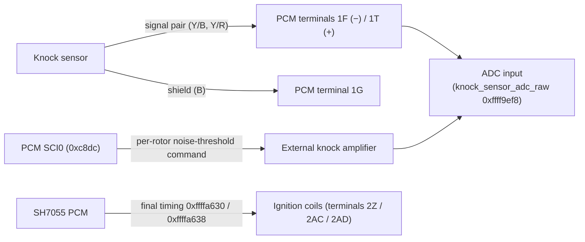

# Knock control — subsystem report

| Date | What changed | Version |
|------|--------------|---------|
| 2026-11-16 | Initial report in the human-first subsystem format (migrated from `docs/investigations/60E15120_N3J1E/`; content unchanged) | 1 |
| 2026-11-19 | Scope discipline: open/closed-loop fueling state, OL/CL fueling functions and tables, O2-monitor and UDS-diag items moved out of the body and memory map into §4.6 with cross-links | 2 |

**Applicable ROMs** — the behavior described here is **assumed identical across
all ROM bins until proven otherwise**; a row documents any per-ROM difference
(also detailed in [`docs/investigations/<rom-id>/`](../investigations/README.md),
never re-derived here):

| ROM | ROM specifics | Short one-line description |
|-----|---------------|----------------------------|
| [`60E15120_N3J1E`](../investigations/60E15120_N3J1E/README.md) | reference ROM — all `0x` addresses in this report are from this bin unless a row says otherwise; `submodules/Mazda_RX8_PCM_ReverseEngineering/Stock_ROMs/60E15120_N3J1E.bin` (512 KiB, SHA-256 `a7cd953c2a87af12ee2814a95c958dc23959d352ef9c5e7f82b8ab8952f264f1`), untouched | Closed-loop knock control: retards ignition up to −10° when the knock sensors hear detonation, recovers slowly, learns a persistent offset to EEPROM |

Everything in this report is from static analysis of the canonical export
([`reverse-engineered/decompiled/`](../../reverse-engineered/decompiled/60E15120_N3J1E/)),
the disassembly and the ROM bytes, except where a section explicitly states
otherwise.

## 1. Introduction — what knock control is and does

The PCM runs a **closed-loop knock control** on both rotors. It listens to each
rotor through an external knock amplifier (per-rotor noise threshold commanded
over SCI0, filtered level read back via ADC), integrates the knock magnitude
against an adaptive noise threshold, and when knock is detected it **retards
the ignition timing quickly (−1.0° per cycle)**. When knock stops it **recovers
slowly (+0.35° per 62 cycles)**. The retard is a negative angle clamped to a
calibrated, RPM-dependent window of [−10°, 0°], fail-safes to a table (up to
−10°) when the knock sensors are unhealthy, resets at very high RPM, and slowly
learns a persistent offset into EEPROM.

In plain language:

- If the knock sensors hear detonation, the PCM **immediately retards the
  spark a little (−1.0° per cycle)**; when the knock stops it creeps back
  slowly (+0.35° per 62 cycles), never past the calibrated window (−10…0°).
- Consequence: the **ignition timing reported on OBD includes any knock
  retard** — the base timing maps do not show it. If the knock sensors are
  unhealthy, a fail-safe table applies instead, and a persistent learned offset
  is stored in EEPROM.

**Knock control applies in open loop as well as closed loop.**
None of the ~40 functions in the knock chain read the loop-mode flags; its
gates are engine conditions only (run time, coolant, load, RPM, sensor health,
timing-not-already-retarded). Loop mode changes the *fueling* around the
knock correction, not the correction itself — the loop-mode state itself
belongs to fueling control ([`fueling_control_report.md`](../investigations/60E15120_N3J1E/fueling_control_report.md),
recorded in §4.6).

## 2. How it works, step by step

### 2.1 Hardware setup — sensor, amplifier, pins



Terminals 1F/1T/1G and the coil terminals are documented harness connections
([`pcm_connections.tsv`](../architecture/hardware/pcm_connections.tsv),
[`mazda-rx-8-pcm-pinout-series-1.md`](../architecture/hardware/mazda-rx-8-pcm-pinout-series-1.md)).
The SCI0 threshold-command path is firmware-level (0xc8dc); its package pins
are not traced, so no terminal is claimed for it here.

### 2.2 Sensing — listening to each rotor

Every engine cycle the PCM reads the crank period (RPM comes from the crank
ISR chain, raw value in RAM `0xffff9f80`), samples the knock-sensor ADC
channel (only meaningful in the 200–2000 RPM window, task[6] `0x661e` →
`0xc3ce`, ADC `0xffff9ef8`), and reads a reference channel (`0xc276` →
`0xffffa326`). The per-rotor noise-threshold command is sent to the external
knock amplifier over SCI0 (`0xc8dc`; sensor pins 1F/1T/1G).

### 2.3 From voltage to knock magnitude

`0xc486` (per rotor) computes the knock voltage
`(sample − reference) × 5/65536` (`0xffffa370`), maps it through a voltage →
magnitude table (`0x6b250`) minus a command-code term → knock magnitude
(`0xffffa330`), then integrates it against an adaptive per-rotor noise
threshold (`0xffffa33c[2]`, `0xffffa350[2]` with filter coefficients
`0xffffc060`/`0xffffc064`). `knock_detected` (`0xffffa324`) is set when the
commanded base threshold falls below the measured magnitude.

### 2.4 Decision inputs

`0x336c4` / `0x33970` turn the raw signals into decisions: a 3D knock-level
threshold is looked up from load and RPM (tables `0x6b2b8/0x6b2d4/0x6b2f0/0x6b304`
→ `0xffffa328`), and the attack condition (`0xffffc05c`) requires latched knock
detection, engine running ≥ 2.5 s, and both leading and trailing timing still
above `5 − threshold_a × 0.15625`.

### 2.5 Enable gates — engine conditions only

`0x13826` / `0x1388a` / `0x138b2` combine into `knock_active` (`0xffffa73c`):
run time ≥ 3 s, coolant ≥ 10 °C, load ≥ 0.5 (table `0x6af54`), RPM < 5000,
and both knock sensors healthy (`0xffffcd64`/`0xffffcd66`).

### 2.6 The retard state machine

```mermaid
flowchart TD
    A[knock_active?] -->|no| H[hold / target 0]
    A -->|yes, sensors unhealthy| F[fail-safe table 0x6afa4 vs RPM]
    A -->|yes, just activated| L[edge table 0x6afb8 vs learned EEPROM retard]
    A -->|yes, attack condition 0xffffc05c| ATK[ATTACK: -1.0 deg/cycle]
    A -->|yes, no attack condition| REC[RECOVER: +0.35 deg per 62 cycles]
    H --> C[clamp to RPM window, tables 0x6af68/0x6af7c min, 0x6af90 max]
    F --> C
    L --> C
    ATK --> C
    REC --> C
    C --> R[knock_retard 0xffffa734, negative deg in [-10, 0]]
```

`0x13a60` (attack) and `0x13b40` (slow recovery) pick the target, `0x13bd2`
clamps it to the calibrated RPM-dependent window [−10°, 0°] and stores it in
`knock_retard` (`0xffffa734`, mirror `0xffffa738`).

### 2.7 Learning a persistent offset

When the learn trigger fires (`0xffffa73f`, `0x139c4`), the current retard is
low-pass filtered into the EEPROM learned-retard cell (EEPROM address held in
RAM `0xffff8038`) and written — so a persistent knock adaptation survives
restarts.

### 2.8 Applying the retard to ignition timing

`0x125bc` / `0x125f6` subtract the retard (plus rough-knock, coolant-derate,
cold-start and A/C terms) from the base leading/trailing timing
(`0x123ba`/`0x123ca` → `0x12300`) and clamp into the final outputs
`0xffffa630` / `0xffffa638`. The retard therefore enters the ignition timing
*after* the base maps — see [ignition timing](../investigations/60E15120_N3J1E/ignition_timing_report.md).

### 2.9 Sensor health, fail-safe and DTCs

Sensor health is monitored independently (`0xc290` ADC window check →
`0x49fac` persistence → `0x4a084` raises **DTC 0x23/0x24**; the codes are
firmware-inferred — this ROM's def block has no DTC 0023/0024 tables).
Unhealthy sensors both block knock control and force the fail-safe retard
table.

### 2.10 Reading it on a scan tool

RomRaider PID 0x1746 "Knock Retard" (handler `0x5707a`
`diag22_pid1746_knock_retard_deg`, uint8 × 0.3515625° — scale constant
`0x3eb40000` verified in the handler's literal pool; dispatch via the Mode-22
table in [`uds_mode22_dispatch_report.md`](../investigations/60E15120_N3J1E/uds_mode22_dispatch_report.md)).
Note the 0x1746 encoding (clamp(trunc(x/0.3515625 + 0.5), 0, 255)) spans
[0, +89.7]°, so with knock_retard clamped to [−10, 0] the PID always reports
0.00° in this ROM; the logger def's desc text ("Tire Size") is a copy-paste
error.

### 2.11 Key calibrated tables

| Table | Contents |
|---|---|
| `tbl_knock_retard_clamp_min_0006af68` / alt `…_0006af7c` | retard clamp minimum vs RPM: −10° … 0° |
| `tbl_knock_retard_clamp_max_0006af90` | retard clamp maximum vs RPM: 0.0° (all cells) |
| `tbl_knock_recovery_target_0006afa4` | fail-safe retard when sensors unhealthy, vs RPM (−10…0°) |
| `tbl_knock_learned_retard_scale_0006afb8` | activation-edge target vs learned EEPROM retard (−8.4…+8.4°; all 0 in this ROM) |
| `tbl_knock_enable_load_floor_0006af54` | load floor 0.5 (flat) vs RPM 800–9600 |
| `tbl_knock_level_3d_a..d_0006b2b8/b2d4/b2f0/b304` | 3D knock level vs load/RPM |
| `tbl_ignition_timing_threshold_a/b_…_0006b27c/b294` | raw u16 thresholds A/B (alt pair) |
| `tbl_knock_transient_hold_0006b264` | 20-cycle transient hold (raw u8 << 1) |

All five retard tables (0x6af68/0x6af7c/0x6af90/0x6afa4/0x6afb8) are u8-cell 2-D
descriptors carrying multiplier **0.5 at descriptor+12** and offset **−64.0 at
descriptor+16** (ROM bytes verified): raw 108 → −10°, 118 → −5°,
128 → 0°.

## 3. Technical pseudocode

```python
# --- sensing (per engine cycle; tasks 0x65f6 / 0x661e) ---
rpm_raw       = 120_000_000 / crank_period_sum            # ISR 0x803e -> RAM 0xffff9f80
knock_sample  = filter(read_adc(knock_sensor), 0.004)     # 0xc3ce; ADC 0xffff9ef8, only 200-2000 RPM; called from task[6] 0x661e
knock_ref     = read_adc(knock_reference)                 # 0xc276 -> RAM 0xffffa326; called from 0xc8dc (task[5] chain) and 0x5a4c

# --- magnitude (0xc486, per rotor) ---
voltage   = (knock_sample - knock_ref) * 5/65536           # RAM 0xffffa370
magnitude = lookup(tbl_0x6b250, voltage) - command_code*32 # RAM 0xffffa330
level_integrator[rotor] += min(|noise|, c060*|magnitude - level_running|)  # c060 = knock_filter_coeff_a 0xffffc060; RAM 0xffffa33c[2]
noise_threshold[rotor]  += step * c064                    # c064 = knock_filter_coeff_b 0xffffc064; RAM 0xffffa350[2], adaptive, clamped
command[rotor]  = clamp(level_combined + level_threshold*noise_excess, 64, 255) + noise_excess*2  # base RAM 0xffffa364, command RAM 0xffffa368[2]
send command[rotor] to knock amplifier over SCI0          # 0xc8dc; sensor pins 1F/1T/1G
knock_detected = (command_base <= magnitude)              # RAM 0xffffa324

# --- decision inputs (0x336c4 / 0x33970) ---
level_threshold = lookup_3d(load, rpm, knock_level_tables)   # RAM 0xffffa328; tables 0x6b2b8/0x6b2d4/0x6b2f0/0x6b304
attack_condition = knock_detected_latched and engine_running and run_time >= 2.5s \   # RAM 0xffffc078 / 0xffffa428 / 0xffffa424
                   and leading_timing  > 5 - threshold_a*0.15625 \                      # RAM 0xffffa630; threshold_a = knock_threshold_a_raw 0xffffc090 (= knock_ignition_threshold_a 0xffffa37e)
                   and trailing_timing > 5 - threshold_a*0.15625                          # RAM 0xffffa638

# --- gates (0x13826/0x1388a/0x138b2): engine conditions only ---
knock_enable = run_time >= 3s and coolant >= 10C and load >= 0.5 and rpm < 5000   # RAM 0xffffa73d
knock_active = knock_enable and knock_sensors_healthy     # RAM 0xffffa73c = a73d && a73e (knock_sensor_healthy_a/b 0xffffcd64 / 0xffffcd66)

# --- retard state machine (0x13a60 attack, 0x13b40 recovery, 0x13bd2 clamp) ---
# state: knock_retard = RAM 0xffffa734 (negative deg, [-10, 0]); mirror RAM 0xffffa738
if not knock_enable:            target = 0                        # control off
elif not sensors_healthy:       target = lookup(tbl_0x6afa4, rpm) # fail-safe, up to -10 deg
elif just_activated:            target = lookup(tbl_0x6afb8, learned_eeprom_retard)
elif knock_active and attack_condition:
                                target = knock_retard - 1.0          # ATTACK: -1 deg/cycle
elif knock_active and not attack_condition:
                                target = knock_retard + 0.35         # RECOVER: per 62 cycles (knock_recovery_counter_a/b 0xffffa74a/a74b)
else:                           target = knock_retard                # hold
knock_retard = clamp(target, lookup_min(rpm), lookup_max(rpm))      # 0x13bd2; min tbl 0x6af68/0x6af7c, max tbl 0x6af90
knock_retard_mirror = knock_retard

# --- learning (0x139c4): persistent adaptation; EEPROM address held in RAM 0xffff8038 ---
if knock_seen_learn_trigger:                                  # RAM 0xffffa73f
    eeprom = filter(knock_retard, eeprom, 0.0039); eeprom_write(eeprom)

# --- apply (0x125bc/0x125f6 -> 0x123ba/0x123ca -> 0x12300) ---
correction  = (knock_retard - rough_knock_correction)         # rough: rough_knock_correction_leading/trailing 0xffffa6ac / 0xffffa6b0
correction -= max(coolant_derate, cold_start_reduction)       # coolant_timing_derate_leading/trailing 0xffffa750/a754, cold_start_timing_reduction_leading/trailing 0xffffc9a0/c9a4
correction += idle_base_term + ac_compressor_retard           # idle/base term = RAM 0xffffa5e0 (writer not identified); A/C: ac_compressor_leading/trailing_timing_retard 0xffffb288/b28c, -5 deg while ramping
final_leading  = clamp(base_leading_timing  + correction, limits)   # leading_timing_with_corrections 0xffffa634 -> output leading_ignition_timing_ffffa630 0xffffa630
final_trailing = clamp(base_trailing_timing + correction, limits)   # trailing_timing_with_corrections 0xffffa63c -> output trailing_ignition_timing_ffffa638 0xffffa638
```

**RPM input.** The RPM used above (`engine_speed_rpm_raw` `0xffff9f80`) is
produced by the crank-angle tick chain — details and emulator evidence in
[os_scheduling_deep_dive_report.md](../investigations/60E15120_N3J1E/os_scheduling_deep_dive_report.md)
§7/§9 (attribution recorded in §4.6).

Memory addresses for every quantity above are listed in §4.1.

## 4. Proof — evidence and validation

### 4.1 Memory map (mandatory)

Every address below can be checked directly in
[`firmware_disassembly.asm`](../../reverse-engineered/disassembly/60E15120_N3J1E/firmware_disassembly.asm)
(ROM addresses), in
[`decompiled/functions/<address>_*.c`](../../reverse-engineered/decompiled/60E15120_N3J1E/functions)
(per-function C; index in `function_index.tsv`), and in the alias TSVs
(evidence columns). RAM is the 32 KiB window 0xffff6000–0xffffdfff; ROM tables
live in the descriptor / calibration area 0x0006c000–0x0007ffff.

#### Functions (ROM addresses)

| Address | Name | Role |
|---|---|---|
| 0x0000803e | `crank_isr_compute_rpm` (ISR; see §3) | crank period sum → raw RPM 0xffff9f80 |
| 0x0000c276 | `knock_reference_adc_read` | reference-channel ADC → 0xffffa326; called from 0xc8dc and 0x5a4c |
| 0x0000c290 | `ref_knockSensorADCFault` | knock ref ADC 0xffff9f0e vs u16 thresholds 51249/16121 at ROM 0x6c17e/0x6c17c → fault status |
| 0x0000c3ce | `knock_voltage_sample` | knock ADC sample/filter (200–2000 RPM window), 10k flag; called from 0x661e (task[6]) |
| 0x0000c486 | `knock_magnitude_integrate` | magnitude, per-rotor integration, knock detected |
| 0x0000c7ba | `ref_setupCoilOutputs` | coil pulse timing from thresholds 0xffffa37e/a37c |
| 0x0000c8dc | `knock_sensor_sci_command` | per-rotor threshold command over SCI0 |
| 0x0000c1f8 | `ref_knockRelatedInit` | defaults: thresholds 94/193, level 3.6875 |
| 0x0000c14c | `ref_knockFunctionInit` | knock subsystem init (called from 0x61a8) |
| 0x000197be | (speed/load calc) | calls 0x336c4 |
| 0x000336c4 | `knock_threshold_setup` | 3D level → 0xffffa328; raw thresholds → 0xffffa37e/a37c; stability |
| 0x00033632 | `knock_filter_constants_init` | calm filter constants |
| 0x00033970 | `knock_attack_condition` | sets 0xffffc05c |
| 0x000335e4 | `knock_condition_snapshots_init` | state reset + snapshots |
| 0x000339ea | `knock_state_reset_rpm_window` | 6500/7000 RPM hysteresis → 0xc116 (from 0x19cf4) |
| 0x0000c116 | `reset_knock_state_on_mode_change` | knock state reset (misnomer corrected) |
| 0x00013826 | `knock_enable_gate` | sets 0xffffa73d |
| 0x0001388a | `knock_sensor_health_gate` | sets 0xffffa73e |
| 0x000138b2 | `knock_active_gate` | sets 0xffffa73c |
| 0x00013a60 | `knock_retard_attack` | retard target; −1.0°/cycle attack |
| 0x00013b40 | `knock_retard_slow_recovery` | +0.35° per 62 counts |
| 0x00013bd2 | `knock_retard_clamp` | clamp [min, max] (RPM); returns value (bug fixed) |
| 0x000139c4 | `knock_retard_learn_to_eeprom` | persistent learned retard |
| 0x0001391c | `ref_calcKnockRAMUpdate_` | knock-seen counter 0xffffa748 |
| 0x000145c8 | `timing_retard_fast_task` | 0x1391c + 0x13b40 + throttle/rev-limit/AC retards |
| 0x000125bc | `knock_retard_apply_leading` | writes 0xffffa648 |
| 0x000125f6 | `knock_retard_apply_trailing` | writes 0xffffa658 |
| 0x000123ba | `leading_timing_add_corrections` | 0xffffa634 = base + corrections |
| 0x000123ca | `trailing_timing_add_corrections` | 0xffffa63c |
| 0x00012300 | `trailing_final_timing_clamp_output` | clamps into 0xffffa630/a638 |
| 0x00013034 | `knock_rough_correction_targets` | rough-knock targets (descriptors 0x69630–0x6974c) |
| 0x00013210 | `ref_roughKnockCorrection` | leading/trailing rough corrections 0xffffa6ac/a6b0 (inherited name; semantic unproven) |
| 0x0001467c | `knock_rough_correction_update` | rough-correction task chain |
| 0x00049fac | `knock_sensor_health_persistence` | health persistence → 0xffffcd64/cd66 |
| 0x0004a084 | `knock_sensor_dtc_report` | DTC 0x23/0x24 via 0x5fd38 |
| 0x000390b8 | `knock_sensor_monitor_task` | 0x49fac + 0x4a084 |
| 0x000064ba | `knock_sensor_fault_task` | task[9]: 0xc290 |

#### Data and entry points (ROM)

| Address | Contents |
|---|---|
| 0x00004998–0x00004ab7 | task table: 18 × 16-byte records {entry, mask, param, stack}; stacks 0xffff7410–0xffff7498 (OS structure — [os_scheduling_deep_dive_report.md](../investigations/60E15120_N3J1E/os_scheduling_deep_dive_report.md)) |
| 0x00005f10c | `tbl_diag22_dispatch_records_0005f10c`: PID 0x1746 → handler 0x5707a `diag22_pid1746_knock_retard_deg` (§2.10) — dispatch table itself: [uds_mode22_dispatch_report.md](../investigations/60E15120_N3J1E/uds_mode22_dispatch_report.md) |

Task-table entries running knock code: 0x65f6 `ref_task1_` (knock sensing),
0x661e `ref_task2_` (engine control; also calls 0xc3ce knock_voltage_sample),
0x64ba `knock_sensor_fault_task`, 0x65b2 (→ 0x1467c). Wrapper 0x64e8 →
0x11534 → 0x145c8.

#### RAM (0xffff…)

Core knock state:

| Address | Name | Meaning |
|---|---|---|
| 0xffffa734 | `knock_retard` | current retard; negative deg, [−10, 0] |
| 0xffffa738 | `knock_retard_mirror` | copy for the trailing apply path |
| 0xffffa73c | `knock_active` | = enable && sensors healthy |
| 0xffffa73d | `knock_enable` | engine-conditions gate |
| 0xffffa73e | `knock_sensors_healthy` | = 0xffffcd64 && 0xffffcd66 |
| 0xffffa73f | `knock_seen_learn_trigger` | learn-to-EEPROM trigger |
| 0xffffa744 | `knock_recovery_target` | attack/recovery target |
| 0xffffa748 | `knock_seen_counter` | u16 knock-seen counter |
| 0xffffa74a / 0xffffa74b | `knock_recovery_counter_a/b` | recovery pacing counters (u8) |
| 0xffffa74c | `knock_active_previous` | activation-edge detection |
| 0xffffa324 | `knock_detected` | knock detected this cycle |
| 0xffffc078 | `knock_detected_latched` | latched detection |
| 0xffffc05c | `knock_attack_condition` | attack allowed |
| 0xffffc05d | `knock_transient_flag` | stability (0 = stable) |
| 0xffffc060 / 0xffffc064 / 0xffffc068 | `knock_filter_coeff_a/b/c` | filter constants |
| 0xffffa328 | `knock_level_threshold` | 3D level threshold |
| 0xffffa37e / 0xffffa37c | `knock_ignition_threshold_a/b` | thresholds A/B (defaults 94/193) |
| 0xffffc090 / 0xffffc092 | `knock_threshold_a/b_raw` | raw table values |
| 0xffffc0ac | `knock_transient_hold_counter` | 20-cycle hold (u16) |
| 0xffffa378 / 0xffffa326 | `knock_voltage_sample` / `knock_voltage_reference` | filtered sample / reference ADC |
| 0xffffa37a / 0xffffa374 | `knock_adc_raw` / `knock_adc_filtered` | raw / filtered knock ADC |
| 0xffffa370 / 0xffffa330 / 0xffffa32c | `knock_voltage` / `knock_magnitude` / `knock_noise_filtered` | |
| 0xffffa344 / 0xffffa348 / 0xffffa34c | `knock_integrator_step` / `knock_baseline_slow` / `knock_level_combined` | |
| 0xffffa334[2] / 0xffffa33c[2] / 0xffffa350[2] | `knock_level_running` / `knock_level_integrator` / `knock_noise_threshold` | per rotor |
| 0xffffa358 / 0xffffa360 | `knock_noise_floor` / `knock_noise_excess` | |
| 0xffffa364 / 0xffffa368[2] | `knock_threshold_command_base` / `knock_threshold_command` | |
| 0xffffa387[2] / 0xffffa389[2] | `knock_reference_voltage` / `knock_reference_voltage_latched` | per-channel ROM refs |
| 0xffffa381[2] / 0xffffa380 | `knock_command_code` / `knock_command_code_current` | |
| 0xffffa384 / 0xffffa386 / 0xffffa38c | `knock_rotor_index` / `high_rpm_10k_flag` / `knock_state_mode` | |
| 0xffffa325 | `knock_sensor_fault_status` | 0 OK, 1/2 per-channel fault |
| 0xffffcd64 / 0xffffcd66 / 0xffffcd65 / 0xffffcd67 | `knock_sensor_healthy_a/b` / `knock_sensor_fault_a/b` | |
| 0xffffcd68 / 0xffffcd6a / 0xffffcd6c | `knock_sensor_healthy/fault counters` | u16 |
| 0xffff8038 | (EEPROM address holder) | EEPROM address of the learned retard, used by 0x139c4 |

Sensing, timing and shared state:

| Address | Name | Meaning |
|---|---|---|
| 0xffff9f80 / 0xffff9f88 / 0xffff9ef8 / 0xffff9f0e | `engine_speed_rpm_raw` / `crank_period_accumulator` / `knock_sensor_adc_raw` / knock ref ADC (fault check) | |
| 0xffffb548 | `engine_speed_rpm` | filtered RPM used by the tables |
| 0xffffa424 / 0xffffa428 / 0xffffa426 / 0xffffa42c | `engine_running_timer` / `engine_running` / `engine_on_time_counter` / `engine_injectors_off` | |
| 0xffffa630 / 0xffffa638 | `leading/trailing_ignition_timing` | final outputs |
| 0xffffa634 / 0xffffa63c | `leading/trailing_timing_with_corrections` | |
| 0xffffa648 / 0xffffa658 | `leading/trailing_timing_correction_total` | |
| 0xffffa6ac / 0xffffa6b0 | `rough_knock_correction_leading/trailing` | |
| 0xffffa750 / 0xffffa754 | `coolant_timing_derate_leading/trailing` | |
| 0xffffb288 / 0xffffb28c | `ac_compressor_leading/trailing_timing_retard` | −5.0° while ramping |
| 0xffffc9a0 / 0xffffc9a4 | `cold_start_timing_reduction_leading/trailing` | |
| 0xffffaddc / 0xffffc150 | `intake_air_temperature` (working copy) / `engine_load_delta` | |
| 0xffffa98c | `inferred_coolant_temperature` | coolant temperature (inferred_ label; gates at 0x13826/0x1c13c) |
| 0xffffc0b4 | `engine_load` | load input to the 3D knock-level tables (0x336c4) |
| 0xffffa5e0 / 0xffffa5e4 | (unnamed `DAT_`) | idle/base terms read by 0x125bc/0x125f6; writer not identified |
| 0xffffa5e8 / 0xffffa5ec | `leading/trailing_base_timing_final` | base timing blended by loop weight `timing_blend_weight` 0xffffb118 (0x11f00/0x1206c) |
| 0xffffa5f0 / 0xffffa5f4 | `leading/trailing_coolant_scaled_advance_term` | coolant-scaled advance terms written by the base-timing calcs 0x11f00/0x1206c |
| 0xffffa5fc | (unnamed `DAT_`) | unweighted base timing sum (0x11f00) |
| 0xffffa640 | (unnamed `DAT_`) | base timing after cranking blend (0x123da) |
| 0xffffa644 | `cranking_timing_multiplier_leading` | cranking blend multiplier (0x123da) |
| 0xffffa66c / 0xffffa670 | (unnamed `DAT_`) | leading/trailing timing trims, subtracted in 0x125bc/0x125f6 |

Full list of all named locations: [`accepted_ram_aliases.tsv`](../investigations/60E15120_N3J1E/labeling/source_review/accepted_ram_aliases.tsv).

#### ROM tables and constants

| Address | Name | Contents |
|---|---|---|
| 0x0006af54 | `tbl_knock_enable_load_floor_0006af54` | 12 cells, 0.5 flat; axis 0x795e8 (RPM 800–9600) |
| 0x0006af68 | `tbl_knock_retard_clamp_min_0006af68` | u8 cells × mult + offset(−64): −10…0°; axis 0x79624 (RPM 2000–5000) |
| 0x0006af7c | `tbl_knock_retard_clamp_min_alt_0006af7c` | alt min: −10/−7.5/−5×4/0; axis 0x79648 |
| 0x0006af90 | `tbl_knock_retard_clamp_max_0006af90` | 0.0° ×15; axis 0x7966c (RPM 800–6400) |
| 0x0006afa4 | `tbl_knock_recovery_target_0006afa4` | fail-safe target −10…0°; axis 0x796b8 (RPM 500–5500) |
| 0x0006afb8 | `tbl_knock_learned_retard_scale_0006afb8` | 0.0 ×13; axis 0x79704 = learned retard −8.4…+8.4° |
| 0x0006b250 | (voltage → magnitude) | knock voltage → magnitude scale |
| 0x0006b264 | `tbl_knock_transient_hold_0006b264` | raw u8 0x0a → <<1 = 20-cycle hold |
| 0x0006b270 / 0x0006b27c | threshold A raw u16 vs RPM (normal / alt) | → 0xffffc090 → 0xffffa37e |
| 0x0006b288 / 0x0006b294 | threshold B raw u16 vs RPM (normal / alt) | → 0xffffc092 → 0xffffa37c |
| 0x0006b2a0 | (noise threshold min) | clamp floor for 0xffffa350[2] |
| 0x0006b2ac | (noise floor) | lookup vs raw RPM → 0xffffa358 |
| 0x0006b2b8 / 0x6b2d4 / 0x6b2f0 / 0x6b304 | `tbl_knock_level_3d_a..d` | 3D knock level vs load/RPM (20×12 scaled / 1×1 raw) |
| 0x00069630–0x0006974c | RX8Defs "Ignition 4..17" descriptors | rough-knock targets (0x13034) |
| 0x00006b83c | (cold-start reduction) | min(c9a8, lookup(RPM)) (0x12630) |
| 0x00007a750 / 0x00007a752 | per-channel reference bytes | selected by the 10k flag; both `01 01` in this ROM |
| 0x00007a234–0x00007a248 | filter constants c060/c064/c068: transient 0.1875/0.1253/0.09375 @0x7a234/38/3c, calm 0.0625/0.1253/0.03125 @0x7a240/44/48 | 0x33632 (calm literals), 0x336c4 (switch on c05d; c068 from ROM) |
| 0x0006c17c / 0x0006c17e | knock reference ADC fault thresholds (u16 values 16121 / 51249) | 0xc290 |

### 4.2 Labeling applied

- **39 functions** named in [`accepted_function_aliases.tsv`](../investigations/60E15120_N3J1E/labeling/source_review/accepted_function_aliases.tsv)
  (38 high confidence; 1 medium → `candidate_` prefix: `candidate_fuel_open_loop_condition`.
  The five former `candidate_` task/monitor labels — `timing_retard_fast_task`
  0x145c8, `knock_sensor_monitor_task` 0x390b8, `knock_sensor_fault_task` 0x64ba,
  `knock_rough_correction_update` 0x1467c, `o2_monitor_integrator` 0x3d010 —
  were promoted to high: ROM task-table pointers at 0x116e0/0x11978/0x4a28/
  0x11a84 verified against the raw ROM, callee chains confirmed in
  `callgraph.tsv`, byte-exact matches in `cross_rom_function_matches.tsv`).
- **84 RAM locations** named in [`accepted_ram_aliases.tsv`](../investigations/60E15120_N3J1E/labeling/source_review/accepted_ram_aliases.tsv)
  (integrated as `<alias>_<address>`), e.g. `knock_retard_ffffa734` (pre-existing),
  `knock_detected_ffffa324`, `knock_attack_condition_ffffc05c`,
  `knock_level_integrator_ffffa33c[2]`; 8 `snapshot_` locals renamed to match.
  The open/closed-loop fueling aliases that the same labeling pass also named
  (`open_loop_active_ffffb12c`, `closed_loop_active_ffffae1f`, the `ol_*`/
  `cl_*` cells, …) are **fueling-control scope**, not knock — recorded in §4.6
  with cross-links; this report's memory map above lists only knock-owned state.
- **15 lookup-table rows** in [`accepted_lookup_aliases.tsv`](../investigations/60E15120_N3J1E/labeling/source_review/accepted_lookup_aliases.tsv)
  (merged into `named/lookup_aliases.tsv`).
- All renames applied to every synchronized view: per-function files,
  [`firmware_decompiled.c`](../../reverse-engineered/decompiled/60E15120_N3J1E/firmware_decompiled.c),
  [`named/firmware_named.c`](../../reverse-engineered/decompiled/60E15120_N3J1E/named/firmware_named.c),
  `function_index.tsv` (name column; historical filenames kept),
  `callgraph.tsv`, `symbols.tsv`, and accumulated in
  [`integrated_names.json`](../../data/labels/60E15120_N3J1E/integrated_names.json).
  Evidence notes added to the per-function files (`[ADDITIONAL SOURCE REVIEW]` blocks).

### 4.3 Corrections

1. **Misnomer** `ref_setClosedLoopBool` (0x1ee30) → `set_open_loop_flag`.
2. **Misnomer** `ref_enableDisableCruiseControl__` (0xc116) →
   `reset_knock_state_on_mode_change` (it only resets knock state).
3. **Polarity**: 0xffffb12a/0xffffb12c are the **open**-loop flag (1 = open
   loop), proven by the OBD PID 0x0003 handler and the 0x1c13c/0x1ee4a logic.
   Earlier sessions had this backwards; the open-loop conclusion is unchanged.
4. **Signs**: `knock_retard` is a negative angle in [−10°, 0°]; attack =
   −1.0°/cycle, slow recovery = +0.35° per 62 counts (earlier session had
   these swapped).
5. **Export bug fixed**: 0x13bd2 `knock_retard_clamp` now returns the
   `rx8_clamp_float` result (SH fr0) instead of discarding it as `void`
   (disassembly 0x13c18–0x13c24 confirms the float return).

### 4.4 Files

| Artifact | Path |
|---|---|
| Full review (evidence, unresolved items) | [`reviews/knock_control/README.md`](../investigations/60E15120_N3J1E/reviews/knock_control/README.md) |
| Sceptical re-review addendum (corrections + def caveats) | [`reviews/knock_control/REVIEW_NOTES.md`](../investigations/60E15120_N3J1E/reviews/knock_control/REVIEW_NOTES.md) |
| Review validation record | [`reviews/knock_control/validation.json`](../investigations/60E15120_N3J1E/reviews/knock_control/validation.json) |
| Rename map + fix evidence | [`data/labels/60E15120_N3J1E/knock_loop_labels.json`](../../data/labels/60E15120_N3J1E/knock_loop_labels.json) |
| Integrated rename manifest | [`data/labels/60E15120_N3J1E/integrated_names.json`](../../data/labels/60E15120_N3J1E/integrated_names.json) |
| Design document (subsystem map, §5.7) | [`design/README.md`](../architecture/design/README.md) |
| Pipeline scripts (idempotent, wired into `rebuild.sh`) | [`review_knock_loop_labels.py`](../../utilities/scripts/rx8-pcm-pipeline/review_knock_loop_labels.py), `merge_reviewed_lookup_aliases.py`, `review_knock_loop_labels_apply.py` in the same folder |
| Pre-change backups | [`backups/`](../investigations/60E15120_N3J1E/backups/) (LFS zips) |
| Knock reimplementation | [`rx8_knock.c`](../../reverse-engineered/reimplementation/rx8_knock.c) (0x13a60 attack/edge/hold + clamp via `rx8_clamp_float`, 0x13b40 recovery pacing; `rx8_add_u8_saturate` 0x2478 in [`rx8_math.c`](../../reverse-engineered/reimplementation/rx8_math.c)); host tests + emulator cross-check [`tests/test_knock_retard_dynamic.py`](../../tests/test_knock_retard_dynamic.py) |
| Knock sensor wiring | pins 1F/1T/1G ([`pcm_connections.tsv`](../architecture/hardware/pcm_connections.tsv)); FSM pinout [`mazda-rx-8-pcm-pinout-series-1.md`](../architecture/hardware/mazda-rx-8-pcm-pinout-series-1.md); cross-ECU descriptor/logger matches in [`labeling/cross_ecu/`](../investigations/60E15120_N3J1E/labeling/cross_ecu/) |
| Patchers touching neighbouring behaviour (VDI/SSV RPM windows, limiter) | [`utilities/scripts/patchers/`](../../utilities/scripts/patchers/) — stock ROMs untouched |

### 4.5 Validation

- ROM SHA-256 `a7cd953c2a87af12ee2814a95c958dc23959d352ef9c5e7f82b8ab8952f264f1`
  (`60E15120_N3J1E.bin`), verified by [`validate_export.py`](../../utilities/scripts/rx8-pcm-pipeline/validate_export.py)
  — pass: 3,355 function files linked, 168,592 instructions byte-verified
  against the ROM, 1,833 exact reference matches.
- [`verify_readability.py`](../../utilities/scripts/rx8-pcm-pipeline/verify_readability.py) — pass: all 3,355 function bodies consistent
  between the per-function files and the combined C.
- [`verify_math_units.py`](../../utilities/scripts/rx8-pcm-pipeline/verify_math_units.py) — pass.
- `design_graph_stats.py` — pass (all 6 cross-checks true); the knock-loop
  pipeline scripts are idempotent (re-running is a no-op).
- [`validate_reports.py`](../../utilities/scripts/rx8-pcm-pipeline/validate_reports.py) validates this report's address tables against
  `function_index.tsv` and the alias TSVs; record in
  [`data/labels/60E15120_N3J1E/report_validation.json`](../../data/labels/60E15120_N3J1E/report_validation.json).
- Source-review sweep: the accepted-alias RAM/function cells named in §3/§4.1
  were re-located in the raw ROM literal pools — e.g. 0xa74a/0xa74b at pools
  0x13c3e/0x13c3a (0x13b40 recovery), 0xcd64-cd6c at 0x138e4 and
  0x4a0a4-0x4a118 (0x1388a/0x49fac), 0xc060/0xc064/0xc068/0xc092 at
  0x336a6/0x336ae/0x336b6/0x337de (0x336c4), 0xc090 at 0x337ce, 0xa37c at
  0xc8c6 (0xc7ba), 0x9fd0 at 0x80d2 (0x7fcc ring), 0x9304 at 0x6002/0x60c2
  (0x5f1c/0x6010), 0xb534 at 0x13c34 — and §3/§4.1 use the promoted alias
  names from the accepted TSVs instead of raw short cells where an accepted
  alias exists.
- **Dynamic cross-check (emulator, not static):** the retard state machine is
  reimplemented as host-testable C —
  [`rx8_knock.c`](../../reverse-engineered/reimplementation/rx8_knock.c) covers
  0x13a60 (attack/edge/hold target selection + clamp) and 0x13b40 (slow
  recovery pacing). Host tests (`test_rx8_knock.c`, strict C11) pass, and the
  ROM functions were cross-checked dynamically in the emulator against a
  float32 port of the C
  ([`tests/test_knock_retard_dynamic.py`](../../tests/test_knock_retard_dynamic.py),
  3 tests: attack/hold/edge/disabled/unhealthy paths, alt clamp-min table via
  `automatic_transmission` 0xffffb534/0xffffbc3d, and 62-count recovery pacing
  incl. counter reset and clamping) — the ROM's own 0x2068 lookups fed the
  port, so the comparison covers the decision logic, not the interpolation.
- Binary-level evidence (disassembly + ROM literal pools) behind the dynamic
  results:
  - **Attack step is exactly −1.0°/cycle**: 0x13a60's attack path does `fsub`
    with fr3 loaded from ROM **0x795d8** when 0xffffc05d==0 and from **0x795e0**
    when 0xffffc05d!=0; both constants are 1.0f in this ROM, so the
    transient flag currently selects between two identical step sizes.
  - **Recovery pacing threshold**: `cmp/hs` against ROM byte **0x3e** at
    **0x7959d** (counter 0xffffa74a path) / **0x7959e** (0xffffa74b path), i.e.
    counter ≥ 62 — the decompiled `0x3d < counter` is the same condition; the
    step addend 0.35f is at ROM **0x795dc** / **0x795e4**.
  - **Saturating add 0x2478**: `extu.b` both inputs, `add`, `extu.w`, then
    `cmp/ge` against ROM word **0x00ff** at **0x248e** → clamp to 255.
  - **Alt clamp-min select in 0x13bd2**: `automatic_transmission` 0xffffb534==1 (pool
    0x13c34) and `DAT_ffffbc3d cmp/hs` ROM byte **0x05** at **0x7959c** (i.e. bc3d > 4)
    selects tbl 0x6af7c instead of 0x6af68; max tbl 0x6af90; clamp via
    0x2404 with args (param fr4, min fr5, max fr6).
  - **0xffffa744 write reachability**: only the sensors-unhealthy (tbl 0x6afa4)
    and activation-edge (tbl 0x6afb8) paths reach 0x13abc (`fmov.s fr0,@r13`);
    disabled/attack/hold leave the cell at its previous value.
  - **0xffffa74c latch**: `mov.b @r3,r14` at 0x13a78 is the delay slot of the
    first `bf/s`, so it executes on every path — 0xffffa74c always latches the
    entry value of 0xffffa73c.
  - **Learned-value cell 0xffff8038** (read via 0x3dc22 on the edge path):
    8-byte struct of four big-endian shorts; valid when
    `(short)~(s1+s0) == s2` or `== s3`, then the u32 at offset 0 is the learned
    float — this is what the dynamic test fills to drive the edge path.
- **The 0x13bd2 fix**: disassembly 0x13bd2–0x13c26 — `jsr @r3` (rx8_clamp_float)
  at 0x13c18 with delay slot `fmov.s @r15,fr4` (restores fr4 = param), `rts` at
  0x13c24 returning fr0.
- **Task table bytes**: ROM 0x4998–0x4ab7; extra record at 0x4ab8; diagnostic
  dispatch table at 0x5f10c.

### 4.6 Limits

Neighboring items mapped while tracing (out of scope here; one line each with
key addresses — no body sections or memory-map rows above):

- **Open/closed-loop fueling state and logic** — `open_loop_request`
  `0xffffb12a` / `open_loop_active` `0xffffb12c` (polarity corrected, §4.3),
  `closed_loop_allowed/active` `0xffffae1e/ae1f`, `open_loop_fuel_target`
  `0xffffb120`, the `ol_*`/`cl_*` target/threshold cells `0xffffb130–b1b8`,
  `safe_mode` `0xffffb12d`/`0xffffcd60`, `lambda_in_target_band`
  `0xffffaa80`; functions `0x1f0c4` `open_loop_request_condition`,
  `0x1ee30` `set_open_loop_flag`, `0x1c13c` `closed_loop_enable_condition`,
  `0x1ee4a` `open_loop_fueling_targets`, `0x22144`
  `candidate_fuel_open_loop_condition`; tables `0x69cac–0x69f44` (OL fueling)
  and `0x69d24–0x69d74` (CL thresholds), `0x6990c` `tbl_closed_loop_warmup_time`.
  Belongs to fueling control:
  [`fueling_control_report.md`](../investigations/60E15120_N3J1E/fueling_control_report.md)
  (ROADMAP C item 51).
- **OBD PID 0x0003 "OL Status" diag** — handlers `0x568ca` / `0x5535e` /
  `0x553d8`; fuel-system status reporting, not knock — UDS dispatch report
  ([`uds_mode22_dispatch_report.md`](../investigations/60E15120_N3J1E/uds_mode22_dispatch_report.md)).
  (Cited in §4.3 only as polarity evidence.)
- **O2/catalyst monitor integrator** `0x3d010` —
  [`o2_sensor_monitor_report.md`](../investigations/60E15120_N3J1E/o2_sensor_monitor_report.md)
  (ROADMAP C item 58).
- **Base ignition timing maps** `0x11f00` `leading_base_timing_calc`,
  `0x1206c` `trailing_base_timing_calc`, task `0x142a4`
  `ignition_timing_main_task` — the knock retard enters *after* these;
  belongs to
  [ignition timing](../investigations/60E15120_N3J1E/ignition_timing_report.md).
- **OS task table / scheduler** — task table `0x4998–0x4ab7` + extra record
  `0x4ab8`, scheduler `0x9630` `os_schedule_task_event` (queue base
  `0xffff9304`), pointers `0xd74c`/`0xd750`; RPM/crank path attribution
  (`0x803e` pre-VBR IVT slot 0x2c8 inactive once VBR=`0x7fc50` at `0xd206`;
  live CMI10B chain `0x5b3c` → `0x75f4` → `0x77f0` → `0x7c68` →
  `ref_getCrankAngle` `0x7fcc` → `crank_period_ring` `0xffff9fd0[6]`,
  `crank_period_accumulator_ffff9f88`, `engine_speed_rpm_raw_ffff9f80`) —
  [os_scheduling_deep_dive_report.md](../investigations/60E15120_N3J1E/os_scheduling_deep_dive_report.md)
  §7/§9.

Static analysis only for the control logic: no hardware execution, so
scheduling order, interrupt load and real knock behavior are unmeasured (the
decision logic itself was cross-checked in the emulator — §4.5).
`candidate_` names are unproven hypotheses. Unresolved: the blend weights
b11c/b118, the variant/mode selectors (`automatic_transmission` 0xffffb534,
bc3d, a415, cd5c, …), the task-record dispatch at ROM 0x4ab8 (entry 0x64e8),
the exact semantics of the two "safe mode" flags (b12d/cd60), and the
idle/base terms 0xffffa5e0/a5e4/a5dc (read by 0x125bc/0x125f6/0x306e8 with no
identified writer in the export). The saved Ghidra database does not carry
these annotations; the canonical C carries the accepted names. The ROM was not
modified. What would disprove the shared-logic assumption for a given ROM: a
byte-diff of the functions in §4.1 against that ROM (cross-ROM evidence:
[`cross_rom_differential_labeling.md`](../investigations/60E15120_N3J1E/labeling/cross_ecu/cross_rom_differential_labeling.md)).

### 4.7 Related reports

Retard applies to [ignition timing](../investigations/60E15120_N3J1E/ignition_timing_report.md); blend-weight producer 0x200c6 feeds [fueling control](../investigations/60E15120_N3J1E/fueling_control_report.md); load axis from [load & fuelling model](../investigations/60E15120_N3J1E/load_fueling_report.md); [calibration extraction](../investigations/60E15120_N3J1E/labeling/calibration_extraction_report.md) (knock tables in [`data/maps/`](../../data/maps/60E15120_N3J1E/)); [UDS/Mode-22 dispatch](../investigations/60E15120_N3J1E/uds_mode22_dispatch_report.md) (PID 0x1746 exposes this report's retard cell); [OS scheduling deep dive](../investigations/60E15120_N3J1E/os_scheduling_deep_dive_report.md) §7/§9 (RPM path, emulator evidence); [intake solenoids](../investigations/60E15120_N3J1E/intake_solenoids_report.md) and [injector pin mapping](../investigations/60E15120_N3J1E/reviews/fueling/injector_pin_mapping.md) (neighbouring actuators); [limiter review](../investigations/60E15120_N3J1E/reviews/limiter/README.md) (rev-limit retards share the apply path). Full evidence: [`reviews/knock_control/README.md`](../investigations/60E15120_N3J1E/reviews/knock_control/README.md).
