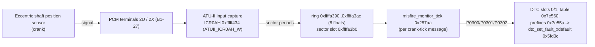
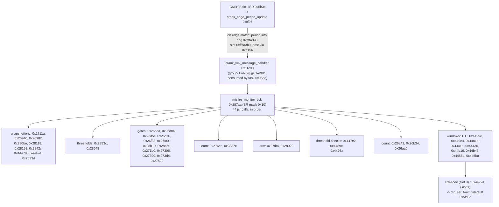

# Misfire detection / monitor — subsystem report

| Date | What changed | Version |
|------|--------------|---------|
| 2026-11-27 | Initial report | 1 |

**Applicable ROMs** — the behavior described here is **assumed identical across
all ROM bins until proven otherwise**; a row documents any per-ROM difference
(also detailed in [`docs/investigations/<rom-id>/`](../investigations/README.md),
never re-derived here):

| ROM | ROM specifics | Short one-line description |
|-----|---------------|----------------------------|
| [`60E15120_N3J1E`](../investigations/60E15120_N3J1E/README.md) | reference ROM — all `0x` addresses in this report are from this bin unless a row says otherwise; `submodules/Mazda_RX8_PCM_ReverseEngineering/Stock_ROMs/60E15120_N3J1E.bin` (512 KiB, SHA-256 `a7cd953c2a87af12ee2814a95c958dc23959d352ef9c5e7f82b8ab8952f264f1`), untouched | Crank-fluctuation misfire monitor: compares per-sector crank speed against a learned baseline per rotor, counts events, and raises P0300/P0301/P0302 |

Everything in this report is from static analysis of the canonical export
([`reverse-engineered/decompiled/`](../../reverse-engineered/decompiled/60E15120_N3J1E/)),
the disassembly and the ROM bytes, except where a section explicitly states
otherwise.

## 1. Introduction — what misfire detection is and does

The PCM detects misfire by watching the **crankshaft speed fluctuation**: when a
rotor fails to fire, its power stroke is missing and the eccentric shaft slows
down measurably for that sector. The firmware measures the duration of every
crank sector in the ATU-II input-capture hardware, keeps an 8-entry ring of
sector periods, and — once per matched sector — computes how much the current
sector deviates from a **learned baseline** for the current RPM/load cell, per
rotor bank. Deviations above an RPM/load-dependent threshold raise per-rotor
event flags; surviving events are counted in 400-tick and 2000-tick windows;
when a window's count exceeds its calibrated limit the PCM sets the misfire
DTCs **P0300** (random/multiple), **P0301** (rotor 1) or **P0302** (rotor 2).

Key numbers in plain terms:

- The sector period is stored as a float in "period × 6,666,666" units
  (constant at ROM `0xd124`); the deviation math runs on these scaled floats.
- Events are counted per rotor bank over two windows: **400 ticks** (evaluated
  by `0x44b46` → DTC slot 0) and **2000 ticks** (evaluated by `0x445ba` → DTC
  slot 1). Both windows only count while the supply/enable gate `0xffffb69c`
  is 1.
- The baseline is learned into a **2-bank × 68-cell table** persisted in the
  93C56 EEPROM (chip bytes `0x20-0x63`), so the monitor adapts to the engine's
  normal roughness over drive cycles.

## 2. How it works, step by step

### 2.1 Hardware setup — crank sensing



Terminals 2U/2X are a documented harness connection
([`pcm_connections.tsv`](../architecture/hardware/pcm_connections.tsv),
[`mazda-rx-8-pcm-pinout-series-1.md`](../architecture/hardware/mazda-rx-8-pcm-pinout-series-1.md)).
The ATU-II capture path (ICR0AH `0xfffff434`) is firmware-level; its package
pin is not traced, so no terminal is claimed for it here. The monitor output
is firmware-only (DTC storage + OBD reporting); there is no misfire actuator.

### 2.2 Overview — components and execution order



### 2.3 Crank sector capture — the fluctuation source

The CMI10B tick ISR (`0x5b3c`, IVT slot `0x7fc50+0x2c8`) calls
`crank_edge_period_update` (`0xcf96`): it matches the current sector
`0xffff9f95` against an edge table (ROM `0xd124`), reads the ATU-II capture
register ICR0AH (`0xfffff434`, `ATUII_ICR0AH_W`), computes the sector period
into `0xffffa3cc`, shifts the 8-float ring `0xffffa390..0xffffa3ac` and stores
`ring[0] = (edges_per_sector × 6666666.0) / period` (the `6666666.0` float is at
ROM `0xd124`; `0xffffa3d7` holds the per-slot edge count). It records the matched
slot index in `0xffffa3b0` and posts a crank-tick message (`0xa156` →
group-1 record[9] at ROM `0xd98c`, handler `0x11c98`), which the message task
(`0x96de`) dispatches: `0x11c98` calls `misfire_monitor_tick` `0x287aa` and the
fuel/load update `0x3a0bc`.

### 2.4 Per-tick pipeline — deviation from the learned baseline

`misfire_monitor_tick` (`0x287aa`, 276 bytes, SR-masked with mask `0x10`) runs
the chain above in fixed order:

1. **Snapshot** (`0x26940`, `0x26982`): copies the sector ring into
   `0xffffb664..0xffffb680` and latches `sector_parity_bank` `0xffffb660` =
   `0xffffa3b0`; `&1` selects the rotor bank for the whole pass.
2. **Learned value** (`0x28198` `e2ram_learned_table_apply`, with
   `0x2711a` cell index and `0x271b0` learn gate): the current cell
   `0xffffb6c4` = RPM cell (0..16, tbl `0x6a694`) + 17 × load band (0..3, load
   thresholds 0.4/0.65/3.0). The learned float for that cell is read from
   `0xffff8108+cell*8` (bank 0) or `0xffff8328+cell*8` (bank 1) and interpolated
   between neighbouring RPM cells; the raw deviation
   `0xffffba2c = (b668 - (b680-b668)/6.0) - b664` and the residual
   `0xffffba30 = ba2c - learned` are computed. The one-tick delay line
   `0xffffba48 = ba44; ba44 = ba40` is updated here too.
3. **Filter** (`0x2837c`): per bank, if the cell is learned (`0xffffb6c6==1`),
   `0xffffba30` is low-pass filtered (k=0.125) into `0xffffba34/0xffffba38`;
   `0xffffba40 = max(0, filtered)` is the excess deviation.
4. **Delay line** (`0x2842c`): `ba58 = ba54; ba54 = ba50; ba50 = max(0,
   b668-b664 [+ b67c-b680 when ba5c > 0x3b or ba6c < 13.133])` — the secondary
   deviation used by the load-threshold check.

The learn side (`0x276ec`) stores `0xffffba2c` into the live cell
`0xffffb6cc[bank][cell]` when the steady-state gate (`0x27520`), the hold
counter (`0x27306`) and the ±100 rpm cell window allow it; `0x27808` persists
cells whose learn counter exceeds 29 into the checksummed EEPROM cells
(storage layer: [eeprom_content_map_report.md](../investigations/60E15120_N3J1E/eeprom_content_map_report.md)).

### 2.5 Enable conditions — when the monitor runs and arms

- **Supply/enable gate** `0xffffb69c` (`misfire_supply_gate` `0x26fc0`): 0 when
  battery `0xffffb590` < 11.0 V (float pool `0x75474`) or the fault-persistence
  pair `0xffffb6a4/0xffffb6a6` is set; gates the window counters, both event
  arms and the count-floor lookup.
- **Operating window** `0xffffb6ac` (`misfire_enable_window` `0x26d70`): 1 only
  with load-delta pulse `0xffffb6aa`, speed `0xffffb6a0` ≥ 3000.0 (pool
  `0x75450`), persistence `0xffffb6ab`, `0xffffb0ca==0`, coolant `0xffffa98c` >
  0, `0xffffa92c` > 0, 660 ≤ rpm < 4500, load `0xffffc0b4` ≥ floor
  `0xffffb698` (tbl `0x6a680`), engine not stopped (`0xffffa41c==0`) and
  `0xffffd1c5==0`.
- **High-rpm flag** `0xffffba60` (`0x280be`): rpm ≥ 5000 selects the
  coolant-corrected threshold form; `0xffffcb87` (`0x44a1e`) latches rpm ≥ 5000
  for the 400-tick DTC branch.
- **Cell learned** `0xffffb6c6` (`0x271b0`): the current cell's EEPROM flag
  must be set and a learned neighbour cell must cover the current RPM.
- **Neutral/gear** `0xffffb53a` (set by `0x24b8c`): in neutral/park the load
  floor is bypassed for the primary arm.
- All per-tick state (counters, flags, windows) is cleared when `0xffffd1c5==1`
  (engine-stop latch, set by `0x55992`, cleared by `0x55a06`).

### 2.6 Thresholds and event arming

- **Primary threshold** `0xffffba78` (`0x2853c`): one-tick-delayed
  `0xffffba74`; when `0xffffba60!=0`, `ba74 = coolant_corr × lookup_3d(load, rpm,
  tbl 0x6a630 [10×17, load 0.16..1.1 × rpm 780..8500, values 3.75..45.86])` with
  the coolant correction from tbl `0x6a5e0` (neutral) / `0x6a5f4`; otherwise
  `ba74 = 40.0-or-0.0-term + ba84 × lookup_3d(...)`. **Secondary threshold**
  `0xffffba80` (`0x28648`): same shape with tbl `0x6a644` (values 6..125) and
  coolant tables `0x6a608/0x6a61c`.
- **Load floor for arming** `0xffffba28` (`0x27fb4`): `lookup_2d(rpm, tbl
  0x6a6b8 [17 cells, 700..8500 rpm])`.
- **Primary arm** (`misfire_event_arm` `0x27fb4`): per rotor bank, sets
  `0xffffba24[parity] = 1` when `(0xffffb53a==1 || load ≥ ba28) && b69c==1 &&
  b6c6==1 && ba40 > ba78` (asm: `cmp/eq 0x1` on `0xffffb53a` at `0x27fda`,
  `bt/s 0x27fea` skips the load compare in neutral; final `fcmp/gt` at
  `0x2800a` requires `ba40 > ba78`). **Secondary arm** (`0x28022`): sets
  `0xffffba26[parity] = 1` when `ba50 > ba80 && b69c==1`.
- **Threshold checks**: `misfire_threshold_check_rpm` `0x447e2` clears the
  primary flag when `cb8c×ba44 < ba48 || cb90×ba44 < ba40` (RPM thresholds
  `0xffffcb8c/cb90` from tbl `0x6b9f4/0x6ba00` via `0x44a78`), else bumps counters
  `0xffffcb78/cb7a`; `misfire_threshold_check_load` `0x4489c` does the same on
  the secondary flag with load-limit thresholds `0xffffcb94/cb98` (tbl
  `0x6ba0c/0x6ba18` via `0x44a9e`) against `ba54/ba58/ba50`, bumping
  `0xffffcb7c/cb7e`. `0x4493a` delays the counters to `0xffffcb80/cb82`.

### 2.7 Counting, windows and DTCs

- **Per-rotor counters** (`0x26a42`/`0x26b34`): if either event flag fired this
  tick, both u16 counters of the current bank saturate up at 0xff
  (`0xffffb688/b68e` bank 1, `0xffffb68a/b68c` bank 0) and `0xffffb694 = 1`.
- **Windows**: `0x28b10` counts `0xffffba9c` to 400, `0x28b50` counts
  `0xffffba9e` to 2000 (both only while `b69c==1`, zeroed on `0xffffd1c5==1`).
  `misfire_window_snapshot` `0x26aa0` snapshots `b690 = max(cb78,cb7c)` at
  tick 400 and `b692 = max(cb7a,cb7e)` at tick 2000.
- **Sustained window** (`0x44436`): while load is within `[ba50, ba80]`, in
  gear (`b53a==0`), `b69c==1` and not (rpm ≥ 4000.0 or vehicle stopped without
  events), bumps `0xffffcb60/cb62` (saturate 1000) and holds `0xffffcb68=0x28`
  on event ticks.
- **400-tick evaluation** (`0x44b16`/`0x44b46` at `ba9c==400`): threshold
  `0xffffcba2` = 100 (or `cb84`, the min of 3D tbl `0x6b9e0` over the window, when
  `0xffffcf90 ≥ 0`); compares `b690` and a rpm-scaled product (raw u16 tbl
  `0x6ba24` × 0.5) against `cba2/cb60` → pending `0xffffcb9d` / confirmed
  `0xffffcb9e` + rotor bits `0xffffcb9c`; then `misfire_dtc_set_400` `0x44cec`
  calls `dtc_set_fault_xdefault` `0x5fd3c` **slot 0** with code 4 (2 on a
  detected drive cycle) or code 1 with the rotor bits.
- **2000-tick evaluation** (`0x4458a`/`0x445ba` at `ba9e==2000`):
  `misfire_dtc_evaluate` `0x445ba` compares `b692` and the rpm-lookup product
  (raw u16 tbl `0x6b9c0` × 0.5, affine-decoded) against `cb72` (0xff or 100) and
  `cb62` → `0xffffcb6d/cb6e` + rotor bits `0xffffcb6c`; then `misfire_dtc_set`
  `0x44724` calls `dtc_set_fault_xdefault` **slot 1** with code 4/2 or code 1 +
  rotor bits. Both slots map to code `0x0300` in the DTC slot table `0x7e560`;
  the rotor bits select the prefix `0x0301`/`0x0302` from `0x7e55a` via
  `ref_lookupCodeTypeMisfire` `0x5f98a`, so the response reads P0300 (both
  rotors), P0301 (bank 0) or P0302 (bank 1)
  ([dtc_control_report.md](../investigations/60E15120_N3J1E/dtc_control_report.md)).

## 3. Technical pseudocode

```python
# --- per crank sector (CMI10B ISR 0x5b3c -> 0xcf96) ---
period = ICR0AH - last_icr0ah                      # ATUII_ICR0AH_W 0xfffff434
ring[0xffffa390..] = shift(ring); ring[0] = edges*6666666.0 / period   # 6666666.0 @ ROM 0xd124
sector_slot 0xffffa3b0 = matched_index
post_crank_tick_message()                           # 0xa156 -> handler 0x11c98

# --- per crank-tick message (0x11c98 -> misfire_monitor_tick 0x287aa, SR mask 0x10) ---
bank = sector_parity_bank 0xffffb660 & 1            # = 0xffffa3b0 & 1 (0x26982)
copy ring 0xffffa390.. to b664..b680                # 0x26940
cell = rpm_cell(rpm, tbl 0x6a694) + 17*load_band(load)   # 0x2711a; bands 0.4/0.65/3.0
learned = read_learned_cell(bank, cell, rpm)        # 0xffff8108/0xffff8328 + 8*cell, interp (0x28198/0x28484)
ba2c = (b668 - (b680-b668)/6.0) - b664              # raw sector-speed deviation (0x28198)
ba30 = ba2c - learned                               # misfire_residual
ba40 = max(0, filter(ba30, k=0.125)) if b6c6 else 0 # 0x2837c -> misfire_excess_deviation
ba58, ba54, ba50 = ba54, ba50, max(0, b668-b664)    # delay line 0x2842c
ba78 = ba74; ba74 = coolant_corr(tbl 0x6a5e0/0x6a5f4) * lookup_3d(load, rpm, 0x6a630)  # 0x2853c
ba80 = ba7c; ba7c = coolant_corr(0x6a608/0x6a61c) * lookup_3d(load, rpm, 0x6a644)        # 0x28648
b69c = 0 if battery 0xffffb590 < 11.0 or (b6a4 and b6a6) else 1          # 0x26fc0
b6ac = window_gate(...)                              # 0x26d70: 660<=rpm<4500, load>=b698, coolant>0, ...
ba9c = (ba9c+1) % 400 if b69c else 0                 # 0x28b10
ba9e = (ba9e+1) % 2000 if b69c else 0                # 0x28b50
# arm (per bank)
ba24[bank] = 1 if (b53a==1 or load >= lookup_2d(rpm, 0x6a6b8)) and b69c==1 and b6c6==1 and ba40 > ba78 else 0   # 0x27fb4
ba26[bank] = 1 if ba50 > ba80 and b69c==1 else 0     # 0x28022
# threshold checks (per bank)
if ba24[bank] and not (cb8c*ba44 < ba48 or cb90*ba44 < ba40): cb78+=1; cb7a+=1   # 0x447e2, tbl 0x6b9f4/0x6ba00
else: ba24[bank] = 0
if ba26[bank] and not (cb94*ba54 < ba58 or cb98*ba54 < ba50): cb7c+=1; cb7e+=1   # 0x4489c, tbl 0x6ba0c/0x6ba18
else: ba26[bank] = 0
# count (per bank)
if ba24[bank] or ba26[bank]: counters[bank] = saturate(counters[bank]+1, 0xff); b694 = 1   # 0x26a42/0x26b34
# windows
if ba9c == 400: b690 = max(cb78, cb7c); evaluate_400()    # 0x26aa0, 0x44b16/0x44b46 -> 0x44cec -> slot 0
if ba9e == 2000: b692 = max(cb7a, cb7e); evaluate_2000()  # 0x26aa0, 0x4458a/0x445ba -> 0x44724 -> slot 1
# evaluate_2000: dtc_set_fault_xdefault(1, 4|2 if b692 < cb72 or rpm_prod < cb62 else 1, rotor_bits)  # 0x445ba/0x44724
```

## 4. Proof — evidence and validation

### 4.1 Memory map (mandatory)

Functions (ROM addresses, reference ROM `60E15120_N3J1E`):

| Address | Name | Role |
|---------|------|------|
| 0x00005b3c | cmi10b_tick_isr | CMI10B tick ISR (IVT 0x7fc50+0x2c8); calls 0xcf96 |
| 0x0000cf96 | crank_edge_period_update | sector period into ring 0xffffa390, slot 0xffffa3b0, posts 0xa156 |
| 0x0000a156 | post_crank_tick_message | posts group-1 rec[9] (ROM 0xd98c) |
| 0x00011c98 | crank_tick_message_handler | calls 0x287aa and 0x3a0bc |
| 0x000287aa | misfire_monitor_tick | per-tick misfire pass, SR mask 0x10, 44 jsr calls |
| 0x00026940 | misfire_sector_ring_copy | ring 0xffffa390.. -> 0xffffb664.. |
| 0x00026982 | sector_parity_latch | 0xffffb660 = 0xffffa3b0 |
| 0x000280be | misfire_high_rpm_flag | 0xffffba60 = rpm >= 5000 |
| 0x00028118 | misfire_sector_counter | 0xffffba5c saturate 0x8000; 0xffffba6c |
| 0x00026934 | candidate_misfire_aux_pool_update | calls 0xcf30(ba5e, ba5f) |
| 0x0002711a | e2ram_learned_table_cell_index | cell = rpm_cell + 17*load_band |
| 0x00028198 | e2ram_learned_table_apply | learned value, ba2c/ba30 residual, ba44/ba48 delay |
| 0x0002842c | misfire_deviation_delay_line | ba50/ba54/ba58 delay line |
| 0x00044a78 | misfire_threshold_rpm_lookup | cb8c/cb90 from tbl 0x6b9f4/0x6ba00 |
| 0x00044a9e | misfire_threshold_load_lookup | cb94/cb98 from tbl 0x6ba0c/0x6ba18 |
| 0x0002853c | misfire_threshold_a_calc | ba78 threshold (3D 0x6a630 x coolant) |
| 0x00028648 | misfire_threshold_b_calc | ba80 threshold (3D 0x6a644 x coolant) |
| 0x00026bda | candidate_misfire_load_delta_gate | b6b0 lookup, b6aa pulse |
| 0x00026d04 | candidate_misfire_persistence_count | b6a8/b6ab/b6ad |
| 0x00026d5c | misfire_load_floor_lookup | b698 = tbl 0x6a680(rpm) |
| 0x00026d70 | misfire_enable_window | b6ac operating window |
| 0x00026f38 | candidate_misfire_fault_persistence | b6a4/b6a6 persistence |
| 0x00026fc0 | misfire_supply_gate | b69c supply/enable gate |
| 0x00028b10 | misfire_window_400_tick | ba9c 400-tick counter |
| 0x00028b50 | misfire_window_2000_tick | ba9e 2000-tick counter |
| 0x000271b0 | e2ram_learned_table_learn_gate | b6c6 cell-learned gate |
| 0x00027306 | candidate_misfire_learn_hold_decay | ba04 hold counter decay |
| 0x00027390 | candidate_misfire_ol_fuel_gate | ba08/ba0c OL-fuel gate |
| 0x000273d4 | candidate_misfire_sustained_gate | ba09 sustained gate |
| 0x00027520 | misfire_learn_steady_state | ba0a learn steady-state |
| 0x000276ec | e2ram_learned_table_cell_learn | learns ba2c into live cell |
| 0x0002837c | e2ram_learned_table_correction_filter | ba34/ba38/ba40 filtered residual |
| 0x00027fb4 | misfire_event_arm | primary arm ba24/ba25 |
| 0x00028022 | misfire_event_arm_secondary | secondary arm ba26/ba27 |
| 0x000447e2 | misfire_threshold_check_rpm | rpm-threshold check, counters cb78/cb7a |
| 0x0004489c | misfire_threshold_check_load | load-threshold check, counters cb7c/cb7e |
| 0x0004493a | misfire_counter_delay | cb80/cb82 delay |
| 0x00026a42 | misfire_event_count | per-bank counter select |
| 0x00026b34 | misfire_counter_bump | counter bump + b694 |
| 0x00026aa0 | misfire_window_snapshot | b690 @400, b692 @2000 |
| 0x0004499c | misfire_count_floor_lookup | cb84 min of 3D 0x6b9e0 |
| 0x000449e4 | candidate_misfire_load_ceiling_lookup | cb88/cb86 |
| 0x00044a1e | candidate_misfire_high_rpm_latch | cb87 rpm>=5000 |
| 0x0004441e | misfire_type_count_lookup | cb64 = 3D 0x6b9ac |
| 0x00044436 | misfire_sustained_window | cb60/cb62/cb68 sustained counters |
| 0x00044b16 | candidate_misfire_400_threshold | cba2 at ba9c==400 |
| 0x00044b46 | misfire_dtc_evaluate_400 | 400-tick DTC evaluation |
| 0x00044cec | misfire_dtc_set_400 | dtc_set_fault_xdefault slot 0 |
| 0x0004458a | misfire_2000_threshold | cb72 at ba9e==2000 |
| 0x000445ba | misfire_dtc_evaluate | 2000-tick DTC evaluation |
| 0x00044724 | misfire_dtc_set | dtc_set_fault_xdefault slot 1 |
| 0x0005fd3c | dtc_set_fault_xdefault | DTC setter (slots 0/1) |
| 0x0005f98a | ref_lookupCodeTypeMisfire | prefix-table index 0x7e55a (inherited name) |
| 0x0000ab8a | ref_misfireDetectInit_ | init called from 0x60c8/0x61a8 (inherited name; see §4.3) |

RAM:

| Address | Alias | Type | Meaning |
|---------|-------|------|---------|
| 0xffffa390 | sector_period_ring | float[8] | crank sector period ring (0xcf96) |
| 0xffffa3b0 | crank_sector_slot | uint8 | matched sector slot index |
| 0xffffb660 | sector_parity_bank | uint16 | rotor bank = slot & 1 |
| 0xffffb664 | misfire_sector_ring_copy | float[8] | sector ring copy 0xffffb664..0xffffb680 (0x26940) |
| 0xffffb688 | misfire_counter_bank1_a | uint16 | bank1 counter pair b688/b68c |
| 0xffffb68a | misfire_counter_bank0_a | uint16 | bank0 counter pair b68a/b68e |
| 0xffffb68c | misfire_counter_bank1_b | uint16 | bank1 second counter |
| 0xffffb68e | misfire_counter_bank0_b | uint16 | bank0 second counter |
| 0xffffb694 | misfire_any_event_tick | uint8 | any event this tick |
| 0xffffb69c | misfire_supply_enable | uint8 | supply/enable gate |
| 0xffffb6c6 | misfire_cell_learned | uint8 | learned cell covers current rpm |
| 0xffffba04 | misfire_learn_hold | uint8 | learn-hold counter |
| 0xffffba24 | misfire_event_flag_a | uint8[2] | primary per-rotor event flags |
| 0xffffba26 | misfire_event_flag_b | uint8[2] | secondary per-rotor event flags |
| 0xffffba28 | misfire_load_floor | float | arm load floor (tbl 0x6a6b8) |
| 0xffffba30 | misfire_residual | float | deviation minus learned baseline |
| 0xffffba34 | misfire_residual_filtered_bank0 | float | filtered residual bank 0 |
| 0xffffba38 | misfire_residual_filtered_bank1 | float | filtered residual bank 1 |
| 0xffffba40 | misfire_excess_deviation | float | max(0, filtered residual) |
| 0xffffba44 | misfire_excess_deviation_delayed | float | one-tick delay of ba40 |
| 0xffffba50 | misfire_deviation_now | float | current deviation (delay line) |
| 0xffffba54 | misfire_deviation_d1 | float | delayed deviation 1 |
| 0xffffba58 | misfire_deviation_d2 | float | delayed deviation 2 |
| 0xffffba60 | misfire_high_rpm_active | uint8 | rpm >= 5000 flag |
| 0xffffba78 | misfire_threshold_a | float | primary threshold |
| 0xffffba80 | misfire_threshold_b | float | secondary threshold |
| 0xffffba9c | misfire_window_400 | uint16 | 400-tick window counter |
| 0xffffba9e | misfire_window_2000 | uint16 | 2000-tick window counter |
| 0xffffb690 | misfire_event_count_400 | uint16 | max(cb78,cb7c) at tick 400 |
| 0xffffb692 | misfire_event_count_2000 | uint16 | max(cb7a,cb7e) at tick 2000 |
| 0xffffcb60 | misfire_sustained_counter_a | uint16 | sustained counter A |
| 0xffffcb62 | misfire_sustained_counter_b | uint16 | sustained counter B |
| 0xffffcb68 | misfire_sustained_decay | uint8 | sustained decay latch |
| 0xffffcb6c | misfire_dtc_rotor_bits | uint8 | rotor bits for P0301/P0302 |
| 0xffffcb6d | misfire_dtc_pending | uint8 | 2000-tick pending result |
| 0xffffcb6e | misfire_dtc_confirmed | uint8 | 2000-tick confirmed result |
| 0xffffcb72 | misfire_threshold_2000 | uint16 | 2000-tick window threshold |
| 0xffffcb78 | misfire_rpm_counter_a | uint16 | rpm-threshold counter A |
| 0xffffcb7a | misfire_rpm_counter_b | uint16 | rpm-threshold counter B |
| 0xffffcb7c | misfire_load_counter_a | uint16 | load-threshold counter A |
| 0xffffcb7e | misfire_load_counter_b | uint16 | load-threshold counter B |
| 0xffffcb8c | misfire_threshold_rpm_a | float | RPM threshold A (tbl 0x6b9f4) |
| 0xffffcb90 | misfire_threshold_rpm_b | float | RPM threshold B (tbl 0x6ba00) |
| 0xffffcb94 | misfire_threshold_load_a | float | load limit A (tbl 0x6ba0c) |
| 0xffffcb98 | misfire_threshold_load_b | float | load limit B (tbl 0x6ba18) |

ROM tables / pools:

| Address | Name | Contents |
|---------|------|----------|
| 0x0006a630 | DAT_0006a630 | 3D 10x17 threshold base, load 0.16..1.1 x rpm 780..8500, 3.75..45.86 |
| 0x0006a644 | DAT_0006a644 | 3D 10x17 secondary threshold base, 6..125 |
| 0x0006a6b8 | DAT_0006a6b8 | 2D 17-cell arm load floor vs rpm 700..8500 |
| 0x0006a5e0 / 0x0006a5f4 | DAT_0006a5e0 / DAT_0006a5f4 | 2D 9-cell coolant correction (-40..120 C, 128 = x1.0), neutral / in-gear |
| 0x0006a608 / 0x0006a61c | tbl_table_2d_156_0006a608 / DAT_0006a61c | 2D 9-cell coolant correction for secondary threshold |
| 0x0006a658 / 0x0006a66c | DAT_0006a658 / DAT_0006a66c | 2D 18-cell load-delta limit vs rpm 500..9000 |
| 0x0006a680 | tbl_table_2d_157_0006a680 | 2D 18-cell load floor vs rpm 1000..9000 (20..71 raw) |
| 0x0006a694 | tbl_table_2d_332_check_datatype_0006a694 | 2D 17-cell RPM cell index (axis 0..8750) |
| 0x0006a6a0 | tbl_table_2d_333_check_datatype_0006a6a0 | 2D 17-cell RPM breakpoints 750..9000 |
| 0x0006a6ac | PTR_PTR_0006a6ac | 2D 5-cell OL-fuel target scale (axis 0..0.5, data 1.25) |
| 0x0006b9ac | tbl_table_3d_126_0006b9ac | 3D 10x17 sustained-window count scale, 5..79.7 |
| 0x0006b9c0 | DAT_0006b9c0 | 2D 23-cell raw-u16 rpm product for 2000-tick eval, rpm 400..9200 |
| 0x0006b9cc | tbl_table_2d_277_0006b9cc | 2D 13-cell load ceiling vs rpm 700..6500 (raw 58..96) |
| 0x0006b9e0 | tbl_table_3d_127_0006b9e0 | 3D 10x8 count floor, load 0.125..1.2 x rpm 500..4000 |
| 0x0006b9f4 / 0x0006ba00 | DAT_0006b9f4 / DAT_0006ba00 | 2D 12-cell RPM thresholds A/B, rpm 780..8500 |
| 0x0006ba0c / 0x0006ba18 | tbl_load_limit_a_0006ba0c / tbl_load_limit_b_0006ba18 | 2D 12-cell load limits A/B (0.3..0.75 / 0.6..0.95), rpm 780..8500 |
| 0x0006ba24 | DAT_0006ba24 | 2D 23-cell raw-u16 rpm product for 400-tick eval, rpm 400..9200 |
| 0x0007e55a | dtc_misfire_prefix_codes | BE u16 0x0300/0x0301/0x0302 prefixes (P0300/P0301/P0302) |
| 0x0007e560 | DAT_0007e560 | DTC slot table; slots 0/1 = 0x0300 |
| 0x00075474 | (float pool) | 11.0 V supply gate constant (0x26fc0) |
| 0x00075450 | (float pool) | 3000.0 window speed constant (0x26d70) |
| 0x0007bf58 | (float pool) | 4000.0 rpm sustained-window bound (0x44436) |
| 0x00075758 | (float pool) | 13.133 deviation bound (0x2842c) |
| 0x00074d38..0x00074d48 | (float pool) | 40.0 / 0.0 threshold add terms (0x2853c/0x28648) |
| 0x0000d124 | (pool of 0xcf96) | edge table + 6666666.0 sector-period scale |

### 4.2 Labeling applied

All names above are accepted aliases in
[`accepted_function_aliases.tsv` / `accepted_ram_aliases.tsv`](../investigations/60E15120_N3J1E/labeling/source_review/)
(basis `misfire_detection`) and are folded into the decompiled export
(`function_index.tsv`, `symbols.tsv`, the per-function files and both
monoliths). The label record is
[`misfire_detection_labels.json`](../../data/labels/60E15120_N3J1E/misfire_detection_labels.json);
the `misfire_*` entries moved out of the EEPROM-content record, which keeps the
learned-table storage layer (`e2ram_learned_table_*`). Evidence strings cite
pool words re-read from the raw ROM (e.g. `0x28058=0xb660`, `0x447ac=0x5fd3c`,
`0x44d54=0x5fd3c`, `0x75474=11.0f`); `tests/test_misfire_detection.py`
re-verifies them against the pinned ROM bytes.

### 4.3 Corrections

- The earlier evidence string for `misfire_event_arm` (`0x27fb4`, in the EEPROM
  record) read "when `0xffffb53a==1` && load ≥ `0xffffba28`". The disassembly
  shows `cmp/eq 0x1` on `0xffffb53a` at `0x27fda` with `bt/s 0x27fea` skipping
  the load compare (`fcmp/gt` at `0x27fe4`) — the neutral flag and the load
  floor are OR-ed, not AND-ed. Corrected in the moved label record.
- `ref_misfireDetectInit_` (`0xab8a`) is an inherited `ref_` name whose body
  does not initialize crank/misfire state: it initializes an ADC-pair monitor
  block (`0xffffa1cc`=1.0f, `0xffffa1d4/a1d8`=512.0f,
  `adc_pair_*_ffffa1dc..0xa207`, learned default read from `0xffff8030` via
  `0x3dc22`, write-back `0x3dcd0`) and calls `FUN_0000ac02()`; it is called from
  `ref_getSensorStuff__` `0x60c8` and `ref_mainInit__` `0x61a8`. The name is
  kept per the label ladder (no new evidence to rename it); the misfire monitor
  state itself is initialized implicitly (zeroed RAM) and cleared on
  engine-stop (`0xffffd1c5==1`) by the per-tick functions.

### 4.4 Files

- Report: this file.
- Label record: [`data/labels/60E15120_N3J1E/misfire_detection_labels.json`](../../data/labels/60E15120_N3J1E/misfire_detection_labels.json), generated by `utilities/scripts/rx8-pcm-pipeline/review_misfire_detection_labels.py` (re-run = idempotent; `tests/test_misfire_detection.py`).
- TSV rows: `docs/investigations/60E15120_N3J1E/labeling/source_review/accepted_function_aliases.tsv`, `accepted_ram_aliases.tsv` (basis `misfire_detection` in `source_review/validation.json`).
- Export fold-back: `reverse-engineered/decompiled/60E15120_N3J1E/` (function files, `firmware_decompiled.c`, `named/firmware_named.c`, `function_index.tsv`, `callgraph.tsv`, `symbols.tsv`, `data/labels/60E15120_N3J1E/integrated_names.json`) via `annotate_source_review.py` + `integrate_reviewed_names.py` + `refine_comment_merge.py`.
- Review evidence: [`docs/investigations/60E15120_N3J1E/reviews/misfire_detection/`](../investigations/60E15120_N3J1E/reviews/misfire_detection/).
- Tests: `tests/test_misfire_detection.py`.

### 4.5 Validation

- ROM SHA-256 pinned in every artifact: `a7cd953c2a87af12ee2814a95c958dc23959d352ef9c5e7f82b8ab8952f264f1` (unchanged; no binary touched).
- Binary-level verification (rule 7): every pool word, threshold constant,
  call target and table descriptor cited above was re-read from the raw ROM and
  the committed disassembly this session; `tests/test_misfire_detection.py`
  re-checks the cited pool words/instruction addresses against the pinned ROM.
- Pipeline validators run green in the same change: `validate_export.py`,
  `validate_reports.py` (this report's memory map resolves row by row),
  `verify_claims.py`, `verify_readability.py`, `verify_math_units.py`, and
  `python -m pytest tests/` (incl. the fold-back regeneration test
  `tests/test_reviewed_name_foldback.py` and the label-artifact consistency
  test `tests/test_label_artifact_consistency.py`).
- Static analysis only: no emulator or bench run was part of this report; the
  monitor's dynamic behavior (event counting over drive cycles) is not
  claimed as verified.

### 4.6 Limits

- Neighboring items mapped while tracing, out of scope here: the co-handler
  `0x3a0bc` (fuel/load update sharing the crank-tick message, `0x11c98`), the
  aux pool update `0xcf30` called by `0x26934` with `ba5e=9`/`ba5f=0xc`, and the
  ADC-pair monitor block `0xffffa1cc..0xffffa207` initialized by `0xab8a` (see
  §4.3) — sensor-acquisition scope, covered by the sensor-acquisition subsystem report.
- `0xffffd1c5` (engine-stop latch; set `0x55992`, cleared `0x55a06`) is used
  as the state-clear flag throughout the monitor but has no accepted alias yet;
  it stays `DAT_ffffd1c5`.
- The DTC response-side rotor-bit → P0301/P0302 mapping runs through
  `0x5b13a`/`0x667c8`/`0x67bbc` (covered by
  [dtc_control_report.md](../investigations/60E15120_N3J1E/dtc_control_report.md));
  only the monitor-side production of the rotor bits is covered here.
- The learned-table persistence (load/save/erase to the 93C56, chip `0x20-0x63`)
  is the EEPROM subsystem's scope
  ([eeprom_content_map_report.md](../investigations/60E15120_N3J1E/eeprom_content_map_report.md));
  this report covers only its use as the misfire baseline.
- Table semantics (e.g. 0x6a630 as "threshold base") are inferred from the
  dataflow, not from an upstream def name; the shared-logic assumption across
  ROM bins is unproven for the other 10 ROMs.

### 4.7 Related reports

- [Knock control](knock_control_report.md) — the other per-rotor abnormal-combustion monitor; shares the rotor-bank concept and the learned-offset-to-EEPROM pattern.
- [Starting/cranking](starting_cranking_report.md) — crank/rpm input chain context.
- [DTC control](../investigations/60E15120_N3J1E/dtc_control_report.md) — DTC slot table `0x7e560`, prefix codes `0x7e55a`, response builder `0x667c8`.
- [EEPROM content map](../investigations/60E15120_N3J1E/eeprom_content_map_report.md) — learned-table storage (chip `0x20-0x63`, RAM `0xffff8108/0xffff8328/0xffff8548`).
- [OS scheduler / CAN IVT](../investigations/60E15120_N3J1E/os_scheduling_deep_dive_report.md) — CMI10B vector, crank-tick message posting and task dispatch.
- Per-ROM differences, if any are found later: `docs/investigations/<rom-id>/`.
