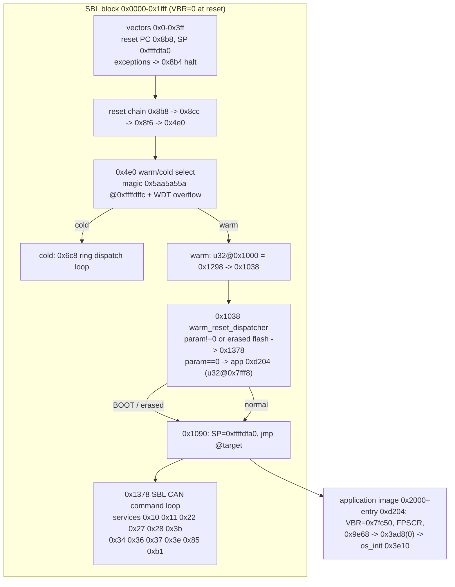
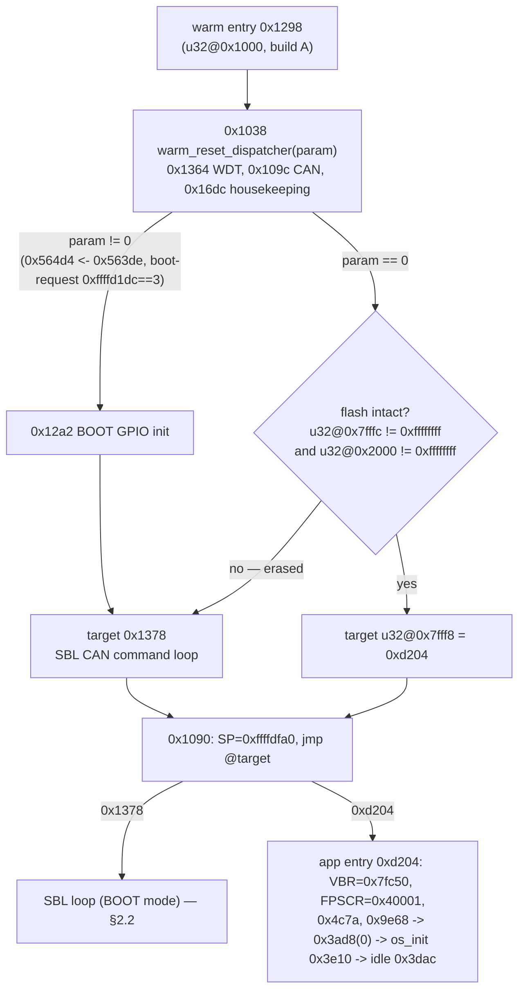
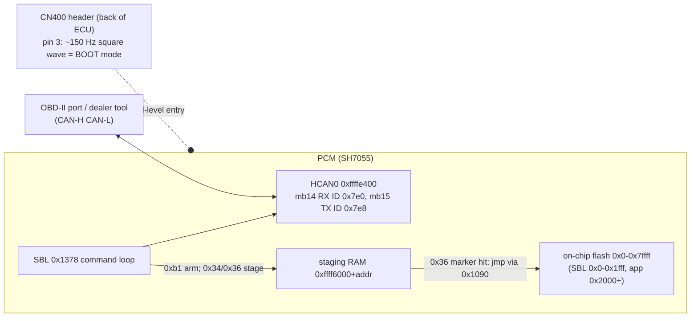

# SBL serial bootloader and boot handover — subsystem report

| Date | What changed | Version |
|------|--------------|---------|
| 2026-11-16 | Initial report (SBL labeling + handover consolidated into one report) | 1 |
| 2026-11-16 | External review corrections: 0xB1 arms one download (the SBL has no flash-write path), 0x1008 is the 0x7fb00/0x7fb02 hole pair check, the app-side 0xB1 00B2 boot request mapped, service-table details corrected, SBL loop validated dynamically in the emulator | 2 |
| 2026-11-18 | On-car handshake feedback processed: 0x16dc(param) latch semantics mapped (the app→SBL handover arrives session-set/unlocked/download-armed; the fixed seed is a non-handover-entry behavior), the observed post-handover SBL replies reproduced frame-for-frame in the emulator; bench-confirmed handshake sequence recorded in §2.3 | 3 |

**Applicable ROMs** — the behavior described here is **assumed identical across
all ROM bins until proven otherwise**; a row documents any per-ROM difference
(also detailed in [`docs/investigations/<rom-id>/`](../investigations/README.md),
never re-derived here). The SBL block `0x0000–0x1fff` of every corpus ROM was
byte-hashed and byte-diffed for this report
([`data/labels/cross_rom/sbl_first_8k.json`](../../data/labels/cross_rom/sbl_first_8k.json)):

| ROM | ROM specifics | Short one-line description |
|-----|---------------|----------------------------|
| [`60E15120_N3J1E`](../investigations/60E15120_N3J1E/README.md) | reference ROM — all `0x` addresses in this report are from this bin unless a row says otherwise; `submodules/Mazda_RX8_PCM_ReverseEngineering/Stock_ROMs/60E15120_N3J1E.bin` (512 KiB, SHA-256 `a7cd953c2a87af12ee2814a95c958dc23959d352ef9c5e7f82b8ab8952f264f1`), untouched | SBL build A: reset chain + CAN flash-loader services (0x10/0x11/0x22/0x27/0x28/0x3b/0x34/0x36/0x37/0x3e/0x85/0xb1) |
| `60E0G500_N3ZHEC` | our own factory dump `binaries/dumps/60E0G500_N3ZHEC.bin` (SHA-256 `a33f79a4…`, see [`binaries/manifest.csv`](../../binaries/manifest.csv)) | SBL byte-identical to the reference ROM (first-8-KiB SHA-256 `cdc620b6…`) |
| `60E0E500` | `Stock_ROMs/60E0E500.bin` | SBL build A code; stamp at `0xffa` differs (`cf0efc18…`) |
| `60E0E700_N3YLEE` | `Stock_ROMs/60E0E700_N3YLEE.bin` | SBL build A code; stamp differs (`af04e34e…`) |
| `60E0FB00` | `Stock_ROMs/60E0FB00.bin` | SBL build A code; stamp differs (`3b5c07e9…`) |
| `60E0FC00` | `Stock_ROMs/60E0FC00.bin` | SBL build A code; stamp differs (`557a66fa…`) |
| `60E1B900` | `Stock_ROMs/60E1B900.bin` | SBL build B: code from `0x1039` up differs from build A; `*SBL_END` at `0x1fbc`, warm entry `0x12b4`, app entry `0xd49c`; stamp `2c8a5561…` |
| `60E1C500_N3J6EB` | `Stock_ROMs/60E1C500_N3J6EB.bin` | SBL build B, byte-identical to 60E1D400 (`9d104875…`); app entry `0xd49c` |
| `60E1D400` | `Stock_ROMs/60E1D400.bin` | SBL build B, byte-identical to 60E1C500_N3J6EB (`9d104875…`) |
| `60E32000_N3M5E` | `Stock_ROMs/60E32000_N3M5E.bin` | SBL build B, byte-identical to 60E1B900 (`2c8a5561…`); app entry `0xd494` |
| `60E32000_N3N5EB` | `Stock_ROMs/60E32000_N3N5EB.bin` | SBL build B; app entry `0xd494`; stamp `8e1c8bb0…` |

All content in this report is from static analysis of the canonical export
([`reverse-engineered/decompiled/`](../../reverse-engineered/decompiled/60E15120_N3J1E/)),
the disassembly and the ROM bytes, plus one emulator boot trace, except where a
section explicitly states otherwise.

## 1. Introduction — what the SBL is and does

Every RX-8 PCM flash image starts with an **8 KiB serial bootloader (SBL)** at
`0x0000–0x1fff`. It is the rescue program: it owns the hardware vector table at
reset (`0x0–0x3ff`, VBR = 0), runs the reset chain, and — when the ECU is put
into BOOT mode (CN400 header on the back of the ECU, ~150 Hz square wave on pin
3; see [the RX8Club thread extract](../references/rx8club-user-guide-thread.md)
§8) — it listens on the diagnostic CAN bus and accepts UDS-style reflash
commands: session control, a fixed seed/key unlock, a boot-mode arm request
(`0xB1 00 B2 00`, which enables exactly one download), block download and
transfer exit. When BOOT mode is not requested, the same block hands control
to the application image at `0x2000` — that handover (§2.3) is part of this
subsystem: the dispatcher `0x1038` and the jump trampoline `0x1090` live inside
the SBL block.

The SBL block contains, in order: the vector table (`0x0–0x3ff`), the reset and
cold-boot code (`0x40–0xb0d`), an erased gap (`0xb0e–0xfdf`, all `0xff` in all
11 ROMs), a 32-byte non-erased block (`0xfe0–0xfff`) with a per-build stamp at
`0xffa–0xffd`, and the flash-loader proper (`0x1000–0x1ffb`), ending in the
ASCII marker `*SBL_END` at `0x1ff4`.

## 2. How it works, step by step



The handover (§2.3) is the `0x1038` -> `0x1090` -> `0xd204` path on the right.

### 2.1 Reset chain and warm/cold selection

Vector 0 holds SP `0xffffdfa0` and PC `0x8b8`; all exception vectors point at
`0x8b4`, a terminal halt loop. `0x8b8` (`ref_Manual_Reset`) waits for the NMI
pin high (`0x8cc`, polls `ICR_W` `0xffffed18` bit 15), runs the boot mailbox
init `0x8f6`, then calls `0x4e0` (`reset_handler_warm_cold_select`) with
parameter 0. `0x4e0` services the WDT (`0x572`), initializes CAN (`0x170`),
clears the ring indices (`0x3d4`) and early RAM (`0x41c`), then selects the
entry: **warm** if the magic `0x5aa5a55a` at `0xffffdffc` matches or the WDT
overflow check (`0x5b0`) reports an overflow, **cold** otherwise. The warm entry
is read from ROM `0x1000` (holds `0x1298` in build A, `0x12b4` in build B); if
the flash pointers at `0x7fffc`/`0x2000` read as erased (`0xffffffff`), the
fallback entry is `u32@0x7fff8` (app entry `0xd204` in build A, `0xd49c`/`0xd494`
in build B). The magic is then written to `0xffffdffc` and the entry is jumped
to through trampoline `0x40` (sets SP, `jmp @r4`). The cold entry `0x6c8`
(`cold_entry_ring_dispatch_loop`) is a monitor loop over a 100-record ring at
`0xffffd4e0` that polls CAN mailbox 8 (`0x210`) when the reset cause is 0 and
dispatches ring records (`'z'` records to handlers `0x806`/`0x4c`/`0x64`/
`0x7c0`/`0x7c`/`0x8a`/`0xc0`, `0xff`/`0xc8` to the halt `0xd8`), servicing the
WDT (`0x31c`) every iteration.

### 2.2 BOOT-mode entry and the flash-loader command loop

When `0x1038` (`warm_reset_dispatcher`) is called with parameter != 0 — which
happens through `0x564d4` (called from `0x563de` when a diagnostic request set
the boot-request state `0xffffd1dc` to 3) — it runs the BOOT-mode GPIO init
`0x12a2` and jumps to the SBL CAN command loop `0x1378` via `0x1090`. The same
loop is also the fallback when the app flash looks erased. The loop
(`0x1378`) polls diagnostic mailbox 14 (CAN ID `0x7e0`, RX via `0x10fe` /
`0x125c`, buffer `0xffffdfa2`), reassembles ISO-TP frames (`0x154c` first frame,
`0x15a6` consecutive, `0x1624` single, `0x1654` flow control) into the request
buffer at `0xffffd3f0`, and dispatches on the service byte:

| Service | Handler | Action |
|---------|---------|--------|
| `0x10` | `0x17f0` | diagnostic session: sub `0x85` sets the session latch `0xffffdfb0 = 1` and answers `50 85`; sub `0x81` runs `0x16dc(0)` — a full relock, clearing all six latches `0xffffdfb0–0xffffdfb5` — and answers `50 81` |
| `0x11` | `0x19ce` | ECU reset: hard-reset sub `0x01` answers a bare `0x51`, then halts at `0x1a44` with the interrupt mask raised (SR |= 0xf0) — the unserviced WDT then overflows; gated by session + security latches |
| `0x22` | `0x1a50` | read DID `0xd100`: answers `62 D1 00` plus the session latch value itself — `0x85` when `0xffffdfb0 == 1`, else `0x81` (`0x1aa4`–`0x1ab6`) |
| `0x27` | `0x1858` | security access: needs the session latch (NRC `0x22` without it, `0x187c`–`0x1888`); seed request returns a **zero seed** `67 01 00 00 00` when the unlock latch `0xffffdfb1 == 1` (`0x18dc`–`0x18ec`), else the fixed seed `67 01 55 AA 55` (`0x1908`–`0x1914`); either seed reply clears the seed flag `0xffffdfb2` (`0x1968`); key send compares against the fixed key `4D AC CD` (`0x193a`–`0x1950`) and sets the unlock latch `0xffffdfb1` on match (`0x1958`), NRC `0x35` on mismatch, NRC `0x22` when no seed is outstanding — a key attempt always clears `0xffffdfb2`, so a failed key needs a new `27 01` |
| `0x28` | `0x170a` | communication control (answers `0x68` when the session latch is clear, NRC `0x22` otherwise) |
| `0x3b` | `0x1ac0` | write DID: always NRC `0x22` (not supported) |
| `0x34` | `0x1ad6` | request download: request is `34 <addr u32> 00 <field u24>` (length 8; the byte after the address must be 0, else NRC `0x31`); byte count = field − `0x7e000` (pool `0x1bec` = `0xfff82000`), must be > 0 and a multiple of `0x400`, and the staged range `0xffff6000 + addr` must end below the request buffer `0xffffd3f0` — caps the count at `0x7000` from address 0; answers `74 04 01`, clears `0xffffdfb3`, sets `0xffffdfb4`, initializes marker index `0xffffdfc5 = 1`; needs `0xffffdfb3` set (else NRC `0x10`) |
| `0x36` | `0x1c04` | transfer data: blocks must be exactly `0x400` bytes (else NRC `0x72`); copies them to the staging buffer while scanning for the marker starting at index 1 of ROM `0x1ff4` (matches `SBL_END` without the `*`); a marker before the last block, or none by the end, gives NRC `0x72`; on marker + exhausted size answers `0x78` and jumps to the staged image via `0x1090` |
| `0x37` | `0x1d30` | transfer exit: closes the download; the success reply is built as `7F 37 79` (NRC byte `0x79` in the negative-response frame) |
| `0x3e` | `0x197a` | tester present: sub `0x01` answers a bare `0x7e`; sub `0x02` gets no response at all |
| `0x85` | `0x1774` | control DTC setting: sub `0x01`/`0x02` answered `0xc5` |
| `0xb1` | `0x1d78` | boot-mode arm (no erase): payload `00 b2 00` with session + unlock latches clears `0xffffdfb4`, sets the download-armed latch `0xffffdfb3 = 1` (checked by `0x1ad6` before accepting a download, else NRC `0x10`) and answers `0xf1 00 b2`; the guard `0x1008` reads the u16 pair at `0x7fb00`/`0x7fb02` (the app-CVN hole) and returns the counter value when value == ~complement (and != `0xffff`), else 0 — the result must be < 100 (else NRC `0x10`). The handler's only callees are `0x1008` and the response sender `0x11fa` |
| other | `0x1e34` | NRC `0x11` (service not supported) |

**The latch block `0xffffdfb0–0xffffdfb5` and `0x16dc(param)`.** All SBL security
state lives in six adjacent RAM bytes, managed by `0x16dc` (`ref_handleException_`,
`0x16dc`–`0x1706`, pools `0x17d4`–`0x17e8` byte-verified): it always clears
`0xffffdfb0` (session), `0xffffdfb1` (unlock), `0xffffdfb2` (seed flag),
`0xffffdfb3` (download armed), `0xffffdfb4` (transfer active) and `0xffffdfb5`;
**only when its parameter == 1** it then sets `0xffffdfb0 = 1`, `0xffffdfb1 = 1`
and `0xffffdfb3 = 1` (`0x16f8`–`0x1704`). Its three callers are: `0x1038`
(passes its own dispatcher parameter, pool `0x107e`), the `10 81` branch of the
`0x10` handler (`0x182c`, param 0 — relock), and the SBL loop itself (`0x1428`,
param 0, taken when the `0x11cc` WDT-service counter reaches `0x5f6` — pool
`0x143a` — a periodic relock while the loop runs). The parameter-1 case exists
on exactly one path: `0x564d4` calls `0x1038` with `r4 = 1` (delay slot
`mov #1,r4` after `jsr 0x1038`, pool `0x564f2`, with the interrupt mask raised
first), so a handover from the application arrives with the session latch set,
the unlock latch set and one download already armed; every other entry
(warm boot `0x1298` → `0x1038(0)`, erased-flash fallback, `10 81`, the loop
relock) arrives fully locked.

All responses are built in the record at `0xffffdfc6` (`0x7f` = negative
response) and sent on mailbox 15 (CAN ID `0x7e8`) by `0x11fa` via `0x1150`. The
CAN peripheral (HCAN0 at `0xffffe400`) is set up by `0x170` (BCR `0x803e`) and
`0x109c` (mailboxes 14/15); mailbox config is built by `0x1ed0` (standard ID
stored low byte first, `id << 5`, in `MC[4..5]`). No checksum is verified by
the SBL itself — the app-side CVN is covered in §2.3 and in
[the UDS dispatch report §12](../investigations/60E15120_N3J1E/uds_mode22_dispatch_report.md).

**There is no flash-write path in the SBL.** A scan of every PC-relative
literal-pool reference in `0x1000–0x1ffb` (committed disassembly) finds only
HCAN0 (`0xffffe400`) and SYSC (`0xffffed00`) — no flash-control register
(`0xffffe800–0xffffe803`, FLMCR/EBR on the SH7055) is referenced anywhere in
the block. The `0xb1`/`0x34`/`0x36` services only move bytes in RAM (staging at
`0xffff6000 + addr`); the erase and programming are done by the staged image
that `0x36` jumps to after the marker.

**The `0x7fb00` hole pair.** `0x1008` reads the u16 at `0x7fb00` and the u16 at
`0x7fb02` and returns the first when it equals the complement of the second
(and is not `0xffff`), else 0 — i.e. it validates a counter+complement pair
inside the app-CVN hole `0x7fb00–0x7fb7f` (ASCII `_UDS` sits at `0x7fb04`). Across
the corpus the pair reads `0001/fffe`, `0002/fffd`, `0004/fffb`, `0005/fffa`,
`0007/fff8` in the build-A ROMs and `ffff/ffff` (erased) in the build-B ROMs —
consistent with a per-flash counter (candidate-level: no artifact in our
corpus shows it changing after a flash). On an erased hole `0x1008` returns 0,
which still passes the `< 100` gate.

### 2.3 The handover to the application



The warm entry `0x1298` calls `0x1038` (`warm_reset_dispatcher`) with
parameter 0. `0x1038` resets the WDT (`0x1364`), re-initializes the diag CAN
(`0x109c`), runs housekeeping (`0x16dc`), then picks the jump target: with
parameter != 0 it runs the BOOT-mode GPIO init `0x12a2` and targets the SBL
loop `0x1378` (this path is taken via `0x564d4`, called from `0x563de` when a
diagnostic request set the boot-request state `0xffffd1dc` to 3); with
parameter 0 it checks that the IVT tail pointer `u32@0x7fffc` (= `0x2000`) and
the app header `u32@0x2000` are not erased (`0xffffffff`) — if either is erased
it falls back to the SBL loop — and otherwise targets `u32@0x7fff8` = `0xd204`.
The jump itself is trampoline `0x1090` (SP = `0xffffdfa0`, `jmp @r4`). In the
emulator boot trace the SBL->app transition is exactly `0x1094` -> `0xd204` at
step 2856 of a 200,000-cycle boot.

App entry `0xd204` sets VBR = `0x7fc50` and FPSCR = `0x40001`, calls the nop
`0x4c7a`, then `0x9e68`, which runs `0x4c80`, a RAM-swap/semaphore mark
(`0xd518`), `0x9f0c(0)`, sets the interrupt mask, sets `PFDR_W` `0xfffff74e`
bit 3, calls `0x2064` and `0x4cf0`, and finally calls `0x3ad8(0)` — `os_init`
`0x3e10` — after which the scheduler runs and the CPU settles in the idle loop
`0x3dac`.

**The app-side request that triggers the handover (UDS `0xB1`, sub-function
`0x00B2`).** The request that sets the boot-request state `0xffffd1dc = 3` is
the application's own service `0xB1` handler `0x565e8` (dispatch record
`0x5ec84`). It reads a 16-bit sub-ID and scans a table of
`{id u16, data length u16, handler u32, permission mask u16, …}` records; the
record at `0x5f0f4` (ROM bytes `00 B2 00 01 00 05 63 50 FF FC`) is id `0x00B2`,
1 data byte, handler `0x56350`, mask `0xFFFC`. `0x56350` requires:

- session index 1 (`0xffffd1cf`; the session table at `0x5f040` maps index 1 to
  `0x85`) — else NRC `0x22`;
- the app unlock level 1 (`0xffffd1d0`, via `ref_securityNotUnlocked(1)`) —
  else NRC `0x33`;
- the conditions in `0x56428` — battery 8.0–16.5 V and coolant −40…120 °C
  unless `0xffffc5e6` is set (else NRC `0x22`), and `0x1008()` < 100 (else
  NRC `0x10`);
- the data byte 0 — else NRC `0x31`.

It then queues `F1 00 B2` (`0x564ac`) and sets `0xffffd1dc = 3`
(`0x563de(3)`). Nothing on this path checks engine speed. After the response
is sent, the UDS-session tail `0x680de` -> `0x6892a` -> `0x54a36(last service)`
calls `0x563de(1)` for service `0xB1`; with `0xffffd1dc == 3` that calls
`0x564d4` -> `0x1038(1)` -> the SBL loop (the §2.3 handover above). So the OBD
sequence is `10 85`, `27 01` / `27 02` (the app seed/key algorithm, `0x5609e` —
reproduced bit-exact and accepted by the ROM's own verifier in the emulator),
`B1 00 B2 00` -> `F1 00 B2`, after which the SBL loop is running — with its
latches already preset by `0x16dc(1)` (see below). The same code
lives at shifted addresses in `60E0E700_N3YLEE`: `0x55c28` (`0x565e8`),
`0x55990` (`0x56350`), `0x55a1e` (`0x563de`), `0x55b14` (`0x564d4`), sub-record
at `0x5e728` (byte-verified; `data/labels/cross_rom_function_matches.tsv`).

**Latch state after the handover — deliberate, and confirmed on a car.**
`0x564d4` calls `0x1038(1)`, and `0x1038` passes that parameter to `0x16dc`
(§2.2): the handover therefore enters the SBL loop with `0xffffdfb0 = 1`
(session), `0xffffdfb1 = 1` (unlock) and `0xffffdfb3 = 1` (one download
armed) — the app's authenticated `10 85` + `27 01/02` session is inherited via
the param-1 convention, not by sharing the app cells `0xffffd1cf`/`0xffffd1d0`
(the app's own gates at `0x56350` had to pass before `0xffffd1dc = 3` was ever
set). Concretely, straight after `F1 00 B2` the SBL answers `22 D1 00` with
`62 D1 00 85` (the DID returns the session latch) and `27 01` with the zero
seed `67 01 00 00 00` (the `0x27` handler's unlock-latch branch), and `0x34`
is accepted immediately because `0xffffdfb3` is already set. The fixed seed
`55 AA 55` / key `4D AC CD` is offered only when the SBL loop runs with the
unlock latch clear — i.e. on every entry except this handover: the warm-boot
`0x1038(0)` path (including its erased-flash fallback at `0x2000`/`0x7fffc`),
after `10 81`, and after the loop's periodic relock. The erased checks on
`0x2000`/`0x7fffc` only select SBL-loop vs application target; they do not
gate the seed.

An on-car session (RX-8 Series 1, Japanese market, PCM calibration
`N3YLEE00013SN0A0` — an `N3YLEE`-family bin whose SBL block is byte-identical
to the reference ROM at `0x16dc`/`0x1858`/`0x1a50`; guarded handshake, no
write services sent, 2026-11-18) observed exactly this:

```
10 81            -> 50 81
B1 00 B2 00      -> 7F B1 22     (default session: refused)
10 85            -> 50 85
B1 00 B2 00      -> 7F B1 33     (session 85 without unlock: refused)
27 01            -> 67 01 <seed> (app algorithm)
27 02 <key>      -> 67 02
B1 00 B2 00      -> F1 00 B2      (handover accepted, reply in ~5 ms)
22 D1 00         -> 62 D1 00 85  (SBL: session latch already set)
10 85            -> 50 85
27 01            -> 67 01 00 00 00   (zero seed: already unlocked)
27 02 4D AC CD   -> 7F 27 22     (no seed outstanding)
11 01            -> 51           (SBL reset; application back in ~1.05 s)
22 D1 00         -> (no answer — application running again)
01 0C            -> 41 0C 00 00  (application alive)
```

All of these replies are reproduced frame-for-frame in the emulator by running
`0x16dc(1)` before entering `0x1378` (§4.5; `tests/test_sbl_bootloader.py`),
and the app-side refusals (`7F B1 22` / `7F B1 33`) match the `0x56350` gates
(session index via `0xffffd1cf` → NRC `0x22`, unlock level via
`0xffffd1d0`/`0x55ed4` → NRC `0x33`). The `11 01` → `51` → WDT-overflow →
warm-reset → application sequence matches §2.2/§4.5 as well.

**App validity:** the handover performs no checksum check — only the
erased-pointer checks above. The application CVN (incremental dual-u16 additive
sum over `0x2000–0x7ffff`, skipping the hole `0x7fb00–0x7fb7f`, engine
`0x5a3f4`, finalize `0x5a714` storing to `0xffff9104`/`0xffff910c`) is computed
**after** boot by the application: its only caller chain is task[0] entry
`0x62a0` -> `0x1122a` -> `0x5a3f4` (task table at `0x4990`, record 0
byte-verified). A corrupt app image is therefore still booted; the CVN mismatch
is only observable afterwards through diagnostics (reader `0x5a5a6`, see
[the UDS dispatch report §12.1](../investigations/60E15120_N3J1E/uds_mode22_dispatch_report.md)).

**Entry mechanism of `ref_mainInit__` `0x61a8`:** it has no direct caller — no
`jsr`/`bsr`/branch targets it, no ROM32 pointer holds `0x000061a8`, and it is
not one of the 19 task-table entries at `0x4990`. Its only reference is pool
word `0x25164` (holds `0x61a8`, byte-verified), loaded inside `0x2508c`
(`FUN_0002508c`), which posts a record {handler `0x61a8` at `0xffff9f38`,
enable byte at +9 = 1} and arms an ATU-II channel-4 compare. `0x2508c` is
reached via thunk `0x21b84` from `0x1102a` (the large init fan-out), whose only
callgraph caller is `0x61a8` itself — a cycle, so the first entry of `0x61a8`
is not a direct call. The `0xffff9f38` record is consumed by interrupt handlers
`0x567a` (IVT offset `0x204`, trampoline `0x2b00`, handler pool `0x2b10`) and
`0x57c6` (IVT offset `0x224`, trampoline `0x2b78`, pool `0x2b88`). Dynamically,
`0x61a8` is never executed in a 2,000,000-cycle emulator boot (with or without
crank input), because the crank-angle-synchronous OS tick that dispatches tasks
never fires in the emulator — consistent with
[the OS scheduling deep dive](../investigations/60E15120_N3J1E/os_scheduling_deep_dive_report.md).

**Reset-at-10,000-RPM fold-in:** the
[reset_at_10000_rpm review](../investigations/60E15120_N3J1E/reviews/reset_at_10000_rpm.md)
found no confirmed reset-causing bug — the 10,000-RPM comparisons (`0xc3ce`,
`0x1f6ae`, `0x49c5a`, `0x123da`, `0x124d6`) are control-mode transitions or
blending factors, not reset requests. Combined with the above: nothing in the
boot or handover path resets the ECU at high RPM, and no CVN gate exists at
handover; the unresolved reset mechanisms remain watchdog starvation,
supply/reset-pin disturbance or crank-signal faults.

### 2.4 The fixed addresses at the end of the block

`0xb0e–0xfdf` is erased (`0xff`) in all 11 ROMs and is not covered by the
application checksum (which starts at `0x2000`). `0xfe0–0xfff` holds a 32-byte
block: `7aff ffff 5079 7730 1141 ffff` followed by twelve `00` bytes, then
`2797`, a 4-byte stamp at `0xffa–0xffd`, and `0000`. The stamp takes 8 distinct
values across the 11 ROMs (5 in build A over 6 ROMs, 3 in build B over 5 ROMs);
its role is not established — candidate SBL build stamp/checksum. `0x1ff4` holds the ASCII
marker `*SBL_END`, which the `0x36` transfer handler scans for.

### 2.5 Hardware setup — CAN and BOOT mode



The CAN connection to the OBD-II port is firmware-level (mailboxes 14/15 on
HCAN0); the CN400 BOOT-mode entry is board-level and documented only in
[the RX8Club thread extract](../references/rx8club-user-guide-thread.md) §8 —
the D9 pinout conflict (ROADMAP discrepancy register) is still open, so the
exact pin routing is not asserted here.

## 3. Technical pseudocode

```c
// reset (vector 0, VBR=0)
SP = 0xffffdfa0;                       // u32 @0x4
reset:  boot_wait_nmi_pin_high();      // 0x8cc: poll ICR_W 0xffffed18 bit15
        sbl_boot_mailbox_init();       // 0x8f6
        reset_handler_warm_cold_select(0);  // 0x4e0 -> jmp entry via 0x40

// 0x4e0: warm iff magic@0xffffdffc==0x5aa5a55a or wdt_overflow_check(7)
entry = warm ? u32@0x1000              // 0x1298 build A / 0x12b4 build B
                  (flash intact ? 0x1298 : u32@0x7fff8)
              : 0x6c8;                 // cold ring monitor loop
magic@0xffffdffc = 0x5aa5a55a; SP=0xffffdfa0; jmp entry;   // 0x40

// 0x16dc(p): clears latches 0xffffdfb0/b1/b2/b3/b4/b5;
//            if (p == 1) sets 0xffffdfb0 = 0xffffdfb1 = 0xffffdfb3 = 1
//            (p==1 only from 0x564d4: the app->SBL handover arrives open+armed)

// 0x1298 -> 0x1038(param) warm_reset_dispatcher
0x1038(p): wdt_reset(); resetOBDCAN(); handleException(p);
           target = (p != 0) ? 0x1378                       // SBL loop
                  : (u32@0x7fffc != -1 && u32@u32@0x7fffc != -1
                     ? u32@0x7fff8 : 0x1378);                 // app 0xd204
           SP = 0xffffdfa0; jmp target;                     // 0x1090

// 0xd204 app entry (normal boot target)
0xd204: VBR = 0x7fc50; FPSCR = 0x40001;   // pools 0xd2c0/0xd2c4
        jsr 0x4c7a;                       // nop
        jsr 0x9e68;                       // -> 0x3ad8(0) -> os_init 0x3e10 -> idle 0x3dac

// 0x1378 SBL CAN command loop (BOOT mode)
for (;;) {
    rx_head = 0;                                   // 0x11c4
    if (can_rx_poll_mb14(buf=0xffffdfa2)) {        // 0x125c/0x10fe
        svc = buf[0]; req = 0xffffd3f0;
        switch (svc) {                             // dispatch, pool words 0x14f4..0x1610
          case 0x10: svc_0x10_session(req); break;         // 0x17f0: 85 sets latch, 81 -> 0x16dc(0) relock
          case 0x11: svc_0x11_reset(req); break;           // 0x19ce
          case 0x22: svc_0x22_read_did(req); break;        // 0x1a50: DID 0xd100 returns the session latch (85/81)
          case 0x27: svc_0x27_security(req); break;        // 0x1858: zero seed if unlocked, else 55 AA 55 / key 4D AC CD
          case 0x28: svc_0x28_comm_control(req); break;    // 0x170a
          case 0x3b: svc_0x3b_nrc22(); break;              // 0x1ac0
          case 0x34: svc_0x34_download(req); break;        // 0x1ad6 -> stage 0xffff6000+addr
          case 0x36: svc_0x36_transfer(req); break;        // 0x1c04 -> 0x400 B blocks, "SBL_END" scan from marker index 1
          case 0x37: svc_0x37_exit(req); break;            // 0x1d30
          case 0x3e: svc_0x3e_tester_present(req); break;  // 0x197a
          case 0x85: svc_0x85_dtc_setting(req); break;     // 0x1774
          case 0xb1: svc_0xb1_arm(req); break;             // 0x1d78 -> 0x1008 hole-pair check; sets 0xffffdfb3 (download armed), no erase
          default:   nrc_0x11(req);                        // 0x1e34
        }
    }
    cnt = service_wdt();                           // 0x11cc
    if (isotp_state && cnt >= 0x5f6) handleException(0);   // 0x1428: periodic relock
}
```

## 4. Proof — evidence and validation

### 4.1 Memory map (mandatory)

Functions (ROM addresses are reference-ROM addresses; index names from
`function_index.tsv`):

| Address | Index name | Role |
|---------|-----------|------|
| `0x00000040` | `FUN_00000040` | entry trampoline: SP = 0xffffdfa0, jmp @r4 |
| `0x000000f4` | `FUN_000000f4` | big-endian u32 read |
| `0x0000011a` | `FUN_0000011a` | range byte-sum (WDT serviced per byte) |
| `0x00000170` | `FUN_00000170` | HCAN0 init (BCR 0x803e, mailboxes 0/1) |
| `0x00000210` | `FUN_00000210` | CAN RX poll, mailbox 8 |
| `0x00000256` | `FUN_00000256` | RX buffer append at 0xffffdfae |
| `0x0000031c` | `service_wdt_overflow_and_toggle_pb15` | WDT keyed service + PB15 heartbeat |
| `0x00000338` | `FUN_00000338` | ring post / RX buffer dispatch |
| `0x00000364` | `FUN_00000364` | cold-loop RX/ring poll step |
| `0x000003b0` | `FUN_000003b0` | ring record pointer (ring at 0xffffd4e0) |
| `0x000003d4` | `FUN_000003d4` | ring index reset |
| `0x000003e0` | `FUN_000003e0` | pending ring-record count |
| `0x0000041c` | `FUN_0000041c` | early RAM init |
| `0x00000450` | `FUN_00000450` | ring record scan |
| `0x0000047c` | `FUN_0000047c` | ring record builder (waits 0xaa ack) |
| `0x000004e0` | `reset_handler_warm_cold_select` | warm/cold entry select, writes magic |
| `0x00000572` | `wdt_keyed_reset` | keyed WDT reset |
| `0x000005b0` | `wdt_overflow_reset_check` | WDT overflow check |
| `0x000006c8` | `cold_entry_ring_dispatch_loop` | cold boot ring monitor loop |
| `0x000008b4` | `Illegal_instr` | exception halt loop |
| `0x000008b8` | `ref_Manual_Reset` | reset entry |
| `0x000008cc` | `boot_wait_nmi_pin_high` | NMI pin poll (ICR_W 0xffffed18 bit 15) |
| `0x000008f6` | `FUN_000008f6` | boot mailbox init |
| `0x000009c0` | `can_enter_reset_mode` | HCAN0 reset-mode enter |
| `0x000009de` | `can_exit_reset_mode` | HCAN0 reset-mode exit |
| `0x000009fc` | `INT_ATU102_IMI10AG` | mailbox config helper |
| `0x00001008` | `FUN_00001008` | CVN-hole pair check: returns u16@`0x7fb00` when it equals ~u16@`0x7fb02` and != `0xffff`, else 0 (pools `0x102c`/`0x1030`/`0x1034`); callers `0x1d78` and `0x56428`, result < 100 required |
| `0x00001038` | `warm_reset_dispatcher` | SBL/app handover dispatcher |
| `0x00001090` | `FUN_00001090` | handover trampoline: SP = 0xffffdfa0, jmp @r4 |
| `0x0000109c` | `ref_resetOBDCAN_` | CAN reset + diag mailboxes 14/15 (0x7e0/0x7e8) |
| `0x000010fe` | `FUN_000010fe` | diag CAN RX poll (mb14) |
| `0x00001150` | `FUN_00001150` | diag CAN TX (mb15) |
| `0x000011c4` | `FUN_000011c4` | RX buffer head clear |
| `0x000011cc` | `service_wdt_overflow_toggle_pb15_and_count` | WDT service in SBL loop |
| `0x000011fa` | `FUN_000011fa` | response frame send (from 0xffffdfc6) |
| `0x0000125c` | `FUN_0000125c` | CAN RX poll wrapper |
| `0x00001272` | `FUN_00001272` | RX buffer pointer (0xffffdfa2) |
| `0x000012a2` | `FUN_000012a2` | BOOT-mode GPIO init |
| `0x00001364` | `ref_resetWatchdog_00001364` | keyed WDT reset |
| `0x00001378` | `FUN_00001378` | SBL CAN command loop + service dispatch |
| `0x0000154c` | `FUN_0000154c` | ISO-TP first frame |
| `0x000015a6` | `FUN_000015a6` | ISO-TP consecutive frame |
| `0x00001624` | `FUN_00001624` | ISO-TP single frame |
| `0x00001654` | `FUN_00001654` | ISO-TP flow control |
| `0x000016dc` | `ref_handleException_` | SBL latch housekeeping: clears `0xffffdfb0–0xffffdfb5`; param == 1 (only from `0x564d4` via `0x1038(1)`) then sets session/unlock/download-armed = 1. Callers: `0x1038` (pool `0x107e`), `0x17f0` sub `0x81` (`0x182c`), loop relock (`0x1428`, counter `0x5f6`) |
| `0x0000170a` | `FUN_0000170a` | service 0x28 handler |
| `0x00001774` | `FUN_00001774` | service 0x85 handler |
| `0x000017f0` | `FUN_000017f0` | service 0x10 handler (session latch 0xffffdfb0) |
| `0x00001858` | `FUN_00001858` | service 0x27 handler (seed `55 AA 55` / key `4D AC CD`); any key attempt clears seed flag `0xffffdfb2` |
| `0x0000197a` | `FUN_0000197a` | service 0x3e handler: sub `01` -> bare `0x7e`; sub `02` -> no response |
| `0x000019ce` | `FUN_000019ce` | service 0x11 handler: sub `01` answers bare `0x51`, then halts at `0x1a44` with SR |= 0xf0 (WDT overflow follows) |
| `0x00001a50` | `FUN_00001a50` | service 0x22 handler (DID 0xd100) |
| `0x00001ac0` | `FUN_00001ac0` | service 0x3b handler (NRC 0x22) |
| `0x00001ad6` | `FUN_00001ad6` | service 0x34 request download: `34 <addr u32> 00 <field u24>`, count = field − `0x7e000`, > 0, % `0x400` == 0, staged end < request buffer `0xffffd3f0`; answers `74 04 01` |
| `0x00001c04` | `FUN_00001c04` | service 0x36 transfer data: exactly `0x400`-byte blocks (else NRC `0x72`), marker scan from index 1 of `0x1ff4` (`SBL_END` w/o `*`), marker + exhausted -> `0x78` + jmp via `0x1090` |
| `0x00001d30` | `FUN_00001d30` | service 0x37 transfer exit: success reply built as `7F 37 79` |
| `0x00001d78` | `FUN_00001d78` | service 0xb1 boot-mode arm: payload `00 b2 00` -> clears `0xffffdfb4`, sets download-armed latch `0xffffdfb3 = 1`, answers `0xf1 00 b2`; no erase (only callees `0x1008`, `0x11fa`) |
| `0x00001e34` | `FUN_00001e34` | default handler (NRC 0x11) |
| `0x00001e4c` | `FUN_00001e4c` | BE u32 address parse |
| `0x00001e72` | `FUN_00001e72` | BE u24 size parse |
| `0x00001e94` | `FUN_00001e94` | MMIO status wait (bit 3 set) |
| `0x00001eb2` | `FUN_00001eb2` | MMIO status wait (bit 3 clear) |
| `0x00001ed0` | `FUN_00001ed0` | HCAN0 mailbox config builder |
| `0x00001fa2` | `FUN_00001fa2` | 8-byte copy (CAN RX) |
| `0x00001fbc` | `FUN_00001fbc` | 8-byte copy (CAN TX) |
| `0x00001fe2` | `FUN_00001fe2` | HCAN0 mailbox control read |
| `0x0000563de` | `FUN_000563de` | boot-request state machine (`0xffffd1dc`==3 + param 1 -> `0x564d4`); set to 3 by the app 0xB1 sub-handler `0x56350` |
| `0x000564d4` | `FUN_000564d4` | calls `0x1038` with param 1 (BOOT-mode handover) |
| `0x000054a36` | `FUN_00054a36` | post-response service hook: for last service `0xb1` calls `0x563de(1)` (boot handover) |
| `0x0000565e8` | `uds_service_b1_mazda_specific` | app service 0xB1: scans the sub-table, record `0x5f0f4` (id `0x00B2`) -> handler `0x56350` |
| `0x00056350` | `FUN_00056350` | app 0xB1 sub `0x00B2` handler: session/unlock/conditions gates, queues `F1 00 B2` (`0x564ac`), sets `0xffffd1dc = 3` |
| `0x00056428` | `FUN_00056428` | app 0xB1 conditions: battery 8.0–16.5 V, coolant −40…120 °C unless `0xffffc5e6`, `0x1008()` < 100 |
| `0x000564ac` | `FUN_000564ac` | queues the `F1 00 B2` response |
| `0x0005609e` | `FUN_0005609e` | app 0x27 key verify: 64-round shift-Feistel over seed||`"MazdA"` with level key from ROM `0x5f089+3*level` (bit-exact port in `tests/test_sbl_bootloader.py`) |
| `0x00055e3e` | `FUN_00055e3e` | session-index compare (`0xffffd1cf`) |
| `0x00055ed4` | `ref_securityNotUnlocked` | unlock-level compare (`0xffffd1d0`) |
| `0x0006892a` | `FUN_0006892a` | UDS-session tail: passes last service (`0xffffdde0`) to `0x54a36` |
| `0x000680de` | `FUN_000680de` | UDS-session dispatch tail; calls `0x6892a` |
| `0x000061a8` | `ref_mainInit__` | application init; no direct caller, posted as handler at `0xffff9f38` by `0x2508c` |
| `0x00002508c` | `FUN_0002508c` | posts {`0x61a8` -> `0xffff9f38`}, arms ATU-II ch4 compare |
| `0x00021b84` | `jump_to_FUN_0002508c` | thunk to `0x2508c` |
| `0x0001102a` | `FUN_0001102a` | init fan-out, calls `0x21b84` |
| `0x00009e68` | `recovery_finalize_set_pf3_halt` | app-entry finalize (PFDR_W `0xfffff74e` bit 3, -> `0x3ad8`) |
| `0x00003ad8` | `FUN_00003ad8` | calls `os_init` `0x3e10` |
| `0x00005a3f4` | `FUN_0005a3f4` | app-side CVN checksum engine (post-boot, from task[0]) |
| `0x00005a714` | `FUN_0005a714` | CVN finalize -> `0xffff9104` |
| `0x0000567a` | `FUN_0000567a` | IVT `0x204` handler consuming `0xffff9f38` |

RAM (only addresses with accepted aliases are listed):

| Address | Alias | Role |
|---------|-------|------|
| `0xffffdfa8` | `reset_cause` | reset cause byte (written by 0x4e0 param!=0 path) |
| `0xffffdffc` | `warm_boot_magic` | warm-boot magic 0x5aa5a55a |
| `0xffffd3f0` | `sbl_request_buffer` | SBL CAN request buffer (r13; the 0x34 range check compares against it) |
| `0xffffdfb0` | `sbl_session_latch` | SBL session latch (set by `10 85`, or preset to 1 by `0x16dc(1)` on the app handover; DID `0xd100` returns it as `85`/`81`) |
| `0xffffdfb1` | `sbl_unlock_latch` | SBL unlock latch (set by `27 02 4D AC CD`, or preset to 1 by `0x16dc(1)`; when set, `27 01` returns the zero seed) |
| `0xffffdfb2` | `sbl_seed_flag` | SBL seed-requested flag (cleared by any seed reply or key attempt) |
| `0xffffdfb3` | `sbl_download_armed` | set by `0x1d78` (0xb1) or preset by `0x16dc(1)`; required by `0x1ad6` (0x34) |
| `0xffffdfb4` | `sbl_transfer_active` | set by `0x1ad6`, required by `0x1c04`/`0x1d30` |
| `0xffffdfb8` | `sbl_stage_base` | staging base = `0xffff6000 + addr` |
| `0xffffdfbc` | `sbl_remaining_count` | remaining byte count |
| `0xffffdfc0` | `sbl_stage_ptr` | staging write pointer |
| `0xffffdfc5` | `sbl_marker_index` | marker scan index (init 1 by `0x1ad6`) |
| `0xffffdfc6` | `sbl_response_record` | response frame record (0x7f = negative) |
| `0xffffd1cf` | `diag_session_index` | app session index (1 = `0x85`) |
| `0xffffd1d0` | `diag_unlock_level` | app security unlock level |
| `0xffffd1d5`–`0xffffd1d8` | `diag_seed` | app 0x27 seed (3 bytes) + level byte |
| `0xffffd1dc` | `boot_request_state` | 3 = boot requested (set by app 0xB1 `0x56350`) |

ROM data / fixed locations (reference ROM, byte-verified):

| Address | Content | Role |
|---------|---------|------|
| `0x00000000` | `0x000008b8` / `0xffffdfa0` | reset PC / initial SP (u32 @0x0 / @0x4) |
| `0x00000010`–`0x00000037` | `0x000008b4` | exception vectors -> halt |
| `0x00000b0e`–`0x00000fdf` | all `0xff` | erased SBL gap (all 11 ROMs) |
| `0x00000fe0`–`0x00000fff` | `7aff ffff 5079 7730 1141 ffff` + 12x`00` + `2797` + stamp + `0000` | 32-B block; stamp at `0xffa–0xffd` differs per build |
| `0x00001000` | `0x00001298` | warm entry pointer (build A; `0x12b4` build B) |
| `0x00001ff4` | `*SBL_END` | SBL end marker scanned by 0x1c04 (at `0x1fbc` in build B) |
| `0x00007fff8` | `0x0000d204` | app entry pointer (build A; `0xd49c`/`0xd494` build B) |
| `0x00007fffc` | `0x00002000` | IVT tail pointer, app validity check |
| `0x00025164` | `0x000061a8` | pool word — the only reference to `ref_mainInit__` |
| `0x00001bec` | `0xfff82000` | pool word added to the 0x34 field u24 (= −`0x7e000`) |
| `0x00005ec84` | `b1 00 00 00 00 05 65 e8 …` | app service-table record for `0xb1` -> handler `0x565e8` |
| `0x00005f040` | `81 00 ff fd 85 01 ff fc …` | app session table: index 0 = `0x81`, index 1 = `0x85` |
| `0x00005f0f4` | `00 b2 00 01 00 05 63 50 ff fc` | app 0xB1 sub-table record: id `0x00B2`, 1 data byte, handler `0x56350`, mask `0xfffc` |
| `0x00007fb00`–`0x00007fb7f` | u16 counter + u16 complement at `0x7fb00`/`0x7fb02`, then ASCII `_UDS` at `0x7fb04`; rest `0xff` | app-CVN hole; pair validated by `0x1008` (counter candidate: `0001`–`0007` in build-A ROMs, erased in build-B) |

### 4.2 Labeling applied

New label records: [`data/labels/60E15120_N3J1E/sbl_bootloader_labels.json`](../../data/labels/60E15120_N3J1E/sbl_bootloader_labels.json)
(per-function aliases plus the handover records — dispatcher chain, CVN caller
analysis, `0x61a8` entry mechanism — with binary-verified evidence). Cross-ROM
SBL hashes and diffs: [`data/labels/cross_rom/sbl_first_8k.json`](../../data/labels/cross_rom/sbl_first_8k.json).
For build-B ROMs the labels apply with the shifted anchor addresses listed in
the applicable-ROMs table above (`*SBL_END`, warm entry, app entry); the two
code builds are byte-identical in `0x0–0xffa` and differ only at `0xffb–0xffd`
(stamp), `0x1000–0x1007` (warm-entry pointer + ASCII tag) and `0x1039–0x1ffb`
(code).

### 4.3 Corrections

The SBL service map extends [the UDS dispatch report §12.2](../investigations/60E15120_N3J1E/uds_mode22_dispatch_report.md)
(the 13 dispatched services and the seed/key magic were already recorded
there); this report adds the full dispatch table, the response record layout,
the ISO-TP helpers, the erase guard and the cross-ROM SBL diff. An external
review (rx8tune project, 2026-11-16) corrected three points, all re-verified
against the ROM bytes, the disassembly and dynamically in the emulator:
`0x1008` is a hole-pair checksum, not an erase guard; `0xb1` arms one download
instead of erasing (and the SBL block contains no flash-write path at all);
and the app-side `0xB1 00B2` request that triggers the handover is now mapped
(§2.3). On the handover side, the design doc §3 stated that `ref_mainInit__` `0x61a8` "has no caller in
the call graph, the disassembly, or as a ROM32 pointer" — confirmed here, with
the one indirect reference added (pool `0x25164`, handler registration in
`0x2508c`) and the dynamic observation that it never executes in emulator boot.

A subsequent on-car session (2026-11-18, calibration `N3YLEE00013SN0A0`;
intake note `input/feedback-for-hee-handshake-on-car.md`, uncommitted, chassis
number redacted) showed the SBL answering `22 D1 00` with `85` and `27 01`
with a zero seed immediately after the application's `F1 00 B2` handover. This
report previously implied the SBL always starts its `10 85`/`27` sequence from
the locked state with the fixed seed `55 AA 55` — corrected in §2.2/§2.3: that
is the state of every entry except the param-1 handover, which `0x16dc(1)`
presets to session-set/unlocked/download-armed. The full on-car frame sequence
is reproduced in the emulator (§4.5).

### 4.4 Files

- [`data/labels/60E15120_N3J1E/sbl_bootloader_labels.json`](../../data/labels/60E15120_N3J1E/sbl_bootloader_labels.json) — per-function SBL + handover label records
- [`data/labels/cross_rom/sbl_first_8k.json`](../../data/labels/cross_rom/sbl_first_8k.json) — per-ROM SBL hashes, groups, diff ranges, stamps
- [`docs/investigations/60E15120_N3J1E/reviews/sbl_bootloader/`](../investigations/60E15120_N3J1E/reviews/sbl_bootloader/README.md) — evidence notes (incl. the 2026-11-18 on-car handshake feedback) + [`dynamic_handover_oncar_log.txt`](../investigations/60E15120_N3J1E/reviews/sbl_bootloader/dynamic_handover_oncar_log.txt)
- [`docs/investigations/60E15120_N3J1E/reviews/boot_handover/`](../investigations/60E15120_N3J1E/reviews/boot_handover/README.md) — handover evidence notes + emulator boot trace excerpt (`boot_trace_excerpt.txt`)

### 4.5 Validation

- ROM SHA-256 `a7cd953c2a87af12ee2814a95c958dc23959d352ef9c5e7f82b8ab8952f264f1`
  quoted above equals the actual ROM hash; no binary was modified.
- Every pool word, vector slot, marker and stamp cited above was re-read from
  the raw ROM bytes this session (rule 7); the dispatch targets were resolved
  from the `0x1378` literal pool words at addresses `0x14f4` through `0x1610`.
- Emulator boot trace (vector 0, 200,000 cycles, profile `60E15120_N3J1E`):
  `0x8b8` -> `0x4e0` -> warm `0x1298` -> `0x1038(param 0)` -> `0x1090` -> app
  `0xd204` at step 2856; `0x1378` not entered on a normal boot. A second run of
  2,000,000 cycles (also with ATU-II crank input at 900 rpm) never executes
  `0x61a8`/`0x1102a`/`0x62a0`/`0x5a3f4`, because the crank-synchronous tick
  never fires in the emulator. Trace excerpt in
  [`reviews/boot_handover/boot_trace_excerpt.txt`](../investigations/60E15120_N3J1E/reviews/boot_handover/boot_trace_excerpt.txt).
- Emulator dynamic validation of the SBL loop (2026-11-16/2026-11-18; re-runnable as
  `python -m pytest tests/test_sbl_bootloader.py`, 9 tests): the SBL command
  loop `0x1378` was entered the way trampoline `0x1090` does (SP =
  `0xffffdfa0`) and driven over the virtual CAN port — `10 85` -> `50 85`;
  `27 01` -> `67 01 55 aa 55` (seed flag `0xffffdfb2` set); `27 02 4d ac cd` ->
  `67 02` (unlock latch `0xffffdfb1` set, seed flag cleared); `b1 00 b2 00` ->
  `f1 00 b2` with `0xffffdfb3` = 1 / `0xffffdfb4` = 0 (one download armed, no
  erase); `3e 01` -> `7e`; `11 01` -> `51`, then halt at `0x1a44` with SR mask
  `0xf0`, WDT OVF set after 400k cycles. Handler-level checks: `0x34` count
  `0x400` -> `74 04 01` (staging `0xffff6000`, remaining `0x400`, marker index
  init 1), count `0x401` -> `7f 34 31`, count `0x7000` from address 0 -> `74`,
  count `0x7400` -> `7f 34 31` (request-buffer cap); `0x36` block `0x100` ->
  `7f 36 72`, block `0x400` without marker -> `7f 36 72`. After the `11 01` halt
  and a reset (vector 0), the trace goes `0x8b8` -> `0x4e0` -> warm `0x1298` ->
  `0x1038(0)` -> app `0xd204`; cold `0x6c8` and SBL `0x1378` are not taken.
  `0x1008` returns 2 with the stock hole; `0x56428` returns 0 with 12.5 V
  injected on AN14; the app `0x27` key algorithm (`0x5609e`) ported to Python
  is accepted by the ROM's own verifier for 3 seeds. Log:
  [`reviews/sbl_bootloader/dynamic_sbl_loop_log.txt`](../investigations/60E15120_N3J1E/reviews/sbl_bootloader/dynamic_sbl_loop_log.txt).
- Post-handover state (2026-11-18, on-car confirmed): `harness.call(0x16dc,
  r4=1)` — exactly what `0x1038(1)` does before jumping to the loop — then the
  loop over the virtual CAN port reproduces the on-car trace frame-for-frame:
  `22 d1 00` -> `62 d1 00 85` (session latch preset, before any `10 85`);
  `10 85` -> `50 85`; `27 01` -> `67 01 00 00 00` (zero seed, unlock latch set,
  seed flag cleared); `27 02 4d ac cd` -> `7f 27 22` (no seed outstanding);
  `10 81` -> `50 81` relocks all six latches, after which `22 d1 00` ->
  `62 d1 00 81` and, with `10 85` again, `27 01` -> `67 01 55 aa 55` (the
  fixed seed returns whenever the entry was not the param-1 handover).
  `harness.call(0x16dc, r4=0/1)` asserts the latch bytes directly
  (`test_handleException_param_sets_sbl_latches`,
  `test_sbl_loop_after_app_handover_matches_on_car_trace`).
- `validate_reports.py`, `verify_claims.py` PASS and `python -m pytest tests/`
  passes (incl. the new `tests/test_sbl_bootloader.py`; the single
  `test_extract_scalars.py` failure and the `verify_readability.py` failure are
  pre-existing on `main` in this environment; see
  [`reviews/sbl_bootloader/README.md`](../investigations/60E15120_N3J1E/reviews/sbl_bootloader/README.md)).

### 4.6 Limits

- The 32-B block at `0xfe0–0xfff` and its `0xffa–0xffd` stamp have no identified
  consumer in the SBL code; role is candidate-level.
- The `0x7fb00`/`0x7fb02` counter+complement pair looks like a reflash counter
  (values `0001`–`0007` across the build-A ROMs, erased `ffff/ffff` in the
  build-B ROMs), but no artifact in our corpus shows it changing after a
  flash — candidate-level.
- The CN400 BOOT-mode pin routing is not traced (D9 pinout conflict open in the
  ROADMAP discrepancy register); only the firmware side of the entry (the
  `0x1038` parameter and the `0xffffd1dc` boot-request state) is mapped here.
- The build-B SBL code (`0x1039` up) was diffed byte-wise but not functionally
  re-analyzed; labels for build-B ROMs rely on the byte-identity of `0x0–0xffa`
  and the identical marker/entry fields.
- The SBL block has no flash-write path (no flash-control register is
  referenced in `0x1000–0x1ffb`); erase/programming happens in the staged
  image that `0x36` jumps to. That staged code — the Mazda flash kernel
  uploaded by dealer/Rx8Man-class tools — is not in our corpus, and no public
  IDS/MDS kernel image for this PCM was found; whether it updates the
  `0x7fb00` counter is therefore unanalyzed. (The Renesas FDT "7055" kernel
  mentioned in [the RX8Club thread](../references/rx8club-user-guide-thread.md)
  §8 is the separate CN400 BOOT-mode mechanism.)
- The SBL loop `0x1378` is now exercised dynamically (§4.5), but the full
  app->SBL delivery over the virtual CAN port still stalls in the emulator:
  the OS tick never fires (E6), so the diag-init task bodies
  (`0x67f10`/`0x67d44`/`0x55cae`/`0x55c88`) and the CAN/scheduler chain have to
  be driven by hand; the app `0xB1` handler was therefore validated at handler
  level (latch inputs set via harness `ram=`), not end-to-end over CAN.
- The first entry of `0x61a8` is not proven: its only static reference is the
  handler registration in `0x2508c`, itself reachable only through `0x61a8` ->
  `0x1102a`; the consuming IVT handlers (`0x567a`, `0x57c6`) read the
  `0xffff9f38` record, but the exact first-dispatch path on real hardware is
  not traced — candidate-level.
- The emulator never fires the crank-synchronous tick, so task dispatch (and
  any task-mediated entry into `0x61a8` or the CVN computation) is not
  dynamically covered.

### 4.7 Related reports

- [UDS service + Mode 22 dispatch report §12](../investigations/60E15120_N3J1E/uds_mode22_dispatch_report.md) — app-side checksum/CVN (`0x5a3f4`) and seed/key (`0x27` app + SBL)
- [Flash and memory layout](../architecture/flash-memory-layout.md) §3 — the shared 512 KiB skeleton incl. the SBL block
- [Firmware design document](../architecture/design/README.md) §2–3 — entry points and boot flow
- [RX8Club user-guide thread extract](../references/rx8club-user-guide-thread.md) §8 — CN400 BOOT mode, UDS services
- [OS scheduler / IVT report](../investigations/60E15120_N3J1E/os_scheduler_can_ivt_report.md) — runtime VBR/IVT and CAN transport
- [OS scheduling deep dive](../investigations/60E15120_N3J1E/os_scheduling_deep_dive_report.md) — task table, tick, why tasks don't run in the emulator
- [Ignition power-state report](../investigations/60E15120_N3J1E/ignition_power_state_report.md) — key-on latch, shutdown/relay-hold
- [reset_at_10000_rpm review](../investigations/60E15120_N3J1E/reviews/reset_at_10000_rpm.md) — folded in at §2.3
