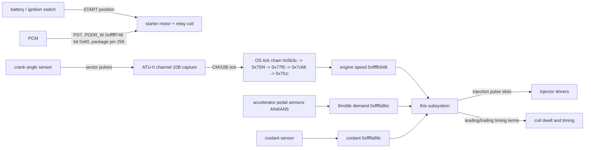

# Engine start and cranking — subsystem report

| Date | What changed | Version |
|------|--------------|---------|
| 2026-11-23 | Initial report | 1 |

**Applicable ROMs** — the behavior described here is **assumed identical across
all ROM bins until proven otherwise**; a row documents any per-ROM difference
(also detailed in [`docs/investigations/<rom-id>/`](../investigations/README.md),
never re-derived here).

| ROM | ROM specifics | Short one-line description |
|-----|---------------|----------------------------|
| [`60E15120_N3J1E`](../investigations/60E15120_N3J1E/README.md) | reference ROM — all `0x` addresses in this report are from this bin unless a row says otherwise; SHA-256 `a7cd953c2a87af12ee2814a95c958dc23959d352ef9c5e7f82b8ab8952f264f1`, untouched | Decides when the engine counts as running, feeds cranking fuel and closed-throttle timing, cuts fuel on a wide-open throttle during cranking, and drives the starter-relay output until the engine runs. |

All content in the report is from static analysis of the canonical export
(`reverse-engineered/decompiled/`), the disassembly and the ROM bytes, except
where a section explicitly states otherwise.

## 1. Introduction — what this subsystem is and does

An engine does not run and then suddenly start; the controller has to decide,
second by second, whether the engine is being turned by the starter or is
running on its own, and it has to feed fuel and spark differently in each case.
That decision, and everything that depends on it, is this subsystem.

The engine's own speed is the primary input. Below roughly 250 rpm the engine
cannot be running; above 500 rpm it is running; between those numbers the
controller keeps whatever it decided before. Two further states are layered on
top: a *post-start* blanking period after the first crossing of 500 rpm, during
which the engine is running but not yet treated as settled, and a
*closed-throttle* state that becomes true after the throttle pedal has been
released for a while.

Three consumers act on those states:

* **Fuel.** While the engine is not running, the controller computes a cranking
  injection pulse from a coolant-keyed table, scales it by four correction
  factors, and hands it to the injector arbitration; a decay counter taken from
  a second coolant table keeps the cranking pulse selected for a few cycles
  after the engine fires, so the hand-over to the running pulse is not a step.
* **Spark.** While the throttle is closed, the main timing table is faded out
  over about twenty task passes and replaced by a coolant-keyed closed-throttle
  advance, while the idle base timing table takes over the idle term. The
  cranking advance itself lives inside that same fade.
* **Flood clear.** A cranking pulse multiplier keyed on throttle position drops
  to zero above roughly 22 % pedal, so a throttle held open during extended
  cranking gets no fuel — the classic "clear flood" procedure.

Finally the subsystem drives the output that a starter relay would sit on: a
port pin that is high only while the engine is being cranked and has not yet
started, provided the car is stationary.

The numbers that matter to a calibrator are the coolant-keyed cranking pulse
width (microseconds of injector open time), the cranking pulse decay count, the
target closed-throttle advance in degrees versus coolant, and the throttle
threshold of the flood cut.

## 2. How it works, step by step

### 2.1 Hardware setup — what is wired to what



The firmware-level path is traced at instruction level throughout this report.
The physical side is **not** traced: PD7 as the starter relay is a harness
candidate (package pin 256; harness terminal 5A), and the crank-angle sensor
routing to ATU-II is documented with the OS tick in
[`os_scheduling_deep_dive_report.md`](../investigations/60E15120_N3J1E/os_scheduling_deep_dive_report.md).

### 2.2 Where the code runs — components and execution order

The scheduler dispatch table at `0x4990` holds 19 sixteen-byte records (count
`0x0013` at `0x493c`); each record's `+8` word is a task entry and its `+0xc`
byte a reload credit. Start-up logic is spread over four of those records:

```mermaid
flowchart TD
    T6["scheduler record 6 (0x49f0), entry 0x661e, reload 2"] --> ECT["ref_engineControlTASK 0x11ba4"]
    ECT --> FUEL["fueling_main_task 0x20e40"]
    ECT --> IGNK["ignition_timing_main_task 0x142a4"]
    FUEL --> PW["0x30274 pulse width from coolant"]
    FUEL --> FACT["0x302a2 / 0x300e4 / 0x303f2 / 0x303a8 factors"]
    FUEL --> ADD["cranking_pulse_adder 0x30678"]
    FUEL --> PROD["0x30228 pulse product"]
    FUEL --> ARB["injector_pulse_time_arbitrate 0x2fea8"]
    IGNK --> STATE["ref_getEngineCrankingState__ 0x1481c"]
    IGNK --> FILT["0x43934 / 0x439b2 closed-throttle advance"]
    IGNK --> BLEND["0x123da / 0x124d6 timing fade"]
    T11["scheduler record 11 (0x4a40), entry 0x6584, reload 2"] --> B11["0x117ac"]
    B11 --> IBTS["idle_base_timing_select 0x14100 via 0x1465e"]
    B11 --> PD7C["0x390fc -> pd7 condition 0x4ed3c"]
    T9["scheduler record 9 (0x4a20), entry 0x64ba, reload 2"] --> DBW["dbw_task9_batch 0x1150e"]
    DBW --> PED["pedal_tp_sensor_batch 0x199d4"]
    PED --> RUN["engine_running_from_rpm 0xe274"]
    PED --> DWELL["closed-throttle dwell 0x1a51c"]
    PED --> GATE["closed-throttle gate 0x1a564"]
    T13["scheduler record 13 (0x4a60), entry 0x65b2, reload 2"] --> DTCB["dtc_fault_service_batch 0x118d0"]
    DTCB --> CIP["cranking_in_progress_calc 0x532d0 via 0x3957c"]
    T8["scheduler record 8 (0x4a10), entry 0x648e, reload 2"] --> RLY["0x114d0 -> 0x38e12"]
    RLY --> FLAG["pd7 flag 0x4ef86"]
    RLY --> PIN["relay output pair 0x3a0ec"]
```



The reload byte is copied into the per-task block by `0x3ec0` (`mov.b
@(0xc,r13),r0` at `0x3ef0`) and decremented by `0x3878` (`add -0x1` at
`0x3886`), so a record with credit 2 runs once every two scheduler ticks. The
tick itself is crank-angle synchronous (see
[`os_scheduling_deep_dive_report.md`](../investigations/60E15120_N3J1E/os_scheduling_deep_dive_report.md)).

### 2.3 From crank pulses to engine speed

Engine speed is produced by the CMI10B tick chain and stored as a float in
`0xffffb548`; the per-sector capture, the period ring and the `120000000 / sum`
arithmetic are documented in
[`os_scheduling_deep_dive_report.md`](../investigations/60E15120_N3J1E/os_scheduling_deep_dive_report.md)
and [`knock_control_report.md`](knock_control_report.md). The start-up
subsystem consumes that value only; it does not compute it. Crank-sensor
initialisation (`ref_crankSensorInit_` `0x7c0c`, `ref_reInitCrankSensor__`
`0x7724`) belongs to the tick chain and is documented there as well.

### 2.4 Deciding that the engine is running

Two independent comparisons turn engine speed into a state, each with its own
hysteresis so that a speed wobbling around the threshold cannot chatter.

**Running flag.** `engine_running_from_rpm` `0xe274` sets byte `0xffffa428` to 1
once speed reaches 500.0 rpm (float `0x6c194`) and clears it below 250.0 rpm
(float `0x6c190`, `fcmp/gt` at `0xe27e`/`0xe28e`). Between the two values the
flag keeps its previous setting. This byte is the firmware's own definition of
"the engine is not being cranked any more" — it is what the fuel chain tests.

**Cranking state with post-start blanking.** `ref_getEngineCrankingState__`
`0x1481c` keeps three bytes:

| Cell | Meaning |
|------|---------|
| `0xffffa79e` | rpm state: 1 at 500.0 rpm and above, 0 below 300.0 rpm, held in between |
| `0xffffa79d` | blanking counter, primed on the 0→1 edge and decremented once per pass |
| `0xffffa79c` | output: equals the rpm state while the counter is zero, 0 otherwise |

The counter is primed from a coolant-keyed lookup (descriptor `0x6a6cc`, axis
`0x757c8` = −30…20 °C, data `0x757e0`) and is 4 for every coolant cell in this
calibration, so the engine is treated as settled four task passes after it
first reaches 500 rpm. The zeroing writes are at `0x14874`/`0x14878`; the
decrement is the byte add of `0x00ff` at `0x14832`. `0x10e8e` exports the same
state as a two-valued status (1 while `0xffffa79c` is 0, 2 afterwards), which
the CAN status builder `0x10390` packs into a frame.

### 2.5 The closed-throttle flag

A third state is not about speed at all. In the pedal batch `0x199d4` two small
functions maintain it:

* `ref_getDriverOffThrottleTimer__` `0x1a51c` holds a latch `0xffffaa64` with a
  0.5 %-wide hysteresis around 2.5 % of throttle demand (floats `0x6f184`,
  `0x6f188`) and increments a saturating 16-bit counter `0xffffaa60` while the
  throttle stays below 2.0 %, resetting it otherwise.
* `ref_getDriverOffThrottleInstatanious` `0x1a564` keeps the same kind of latch
  in `0xffffaa65` and sets `0xffffaa62` to 1 when the throttle is closed **and**
  `0xffffaa60` has reached 19 counts (constant `0x13` at ROM `0x6f180`,
  `cmp/hs` at `0x1a59e`), 0 otherwise. `candidate_start_flags_prime` `0x1a508`
  primes counter and flag to the satisfied state during initialisation.

`0xffffaa62` therefore states "the throttle is closed and has been for 19 task
passes". It is the term the timing fade in §2.7 tests, and it is also what the
relay path in §2.8 requires before a crank is considered in progress. The
cranking fuel in §2.6 does not use it: that chain tests `0xffffa428 == 0`.

### 2.6 Cranking fuel

The fuel task builds the cranking pulse in four steps, all inside
`fueling_main_task` `0x20e40`, and hands the result to the injector
arbitration.

**Pulse width from coolant.** `0x30274` runs only while `0xffffa428 == 0`. It
looks coolant `0xffffa98c` up in descriptor `0x6ab48` (13 cells, axis
`0x780c8` = −30…80 °C, data `0x780fc`, scale 5.0) into `0xffffbe88`, and the
same coolant in descriptor `0x6ab5c` (data `0x7814c`, all zero bytes in this
calibration) into `0xffffbe8c`. The first table is the calibration a tuner sees
as *Primary Fuel Injector Cranking Pulse Width*: 24749 counts at −30 °C to 1627
at 80 °C, i.e. 123.7 ms down to 8.1 ms of injector open time.

**Four correction factors.** `0x302a2`, `0x300e4`, `0x303f2` and `0x303a8`
maintain `0xffffbe6c`, `0xffffbe7c` (coolant, descriptor `0x6aab0`),
`0xffffbe80` (barometric pressure `0xffffad14`, descriptor `0x6ab14`) and
`0xffffbe84` (a running-state factor). `0x30228` then multiplies them while the
engine is not running or the decay counter is still non-zero:

```
0xffffbe58 = be68 * be7c * be80 * be84 * be88      # cranking pulse
0xffffbe5c = be68 * be7c * be80 * be84 * be8c      # second cranking pulse
```

`be68` is the throttle factor of §2.7 and is 1.0 for a normal closed-throttle
crank. The unity seed is the float at `0x77f58` (pool `0x3032c`).

**Decay and arbitration.** `injector_pulse_time_arbitrate` `0x2fea8` reloads
byte `0xffffbe3c` from descriptor `0x6bab0` (9 cells, axis `0x7c968` =
−40…120 °C, data `0x7c98c` = 3, 3, 0, 0, …) on every pass in which the engine
is not running, and decrements it by one per pass once it is. While the counter
is non-zero, or while the engine is still not running, the cranking pulses go
into the primary slots; when it reaches zero the running pulses take over:

| Path | be24 / be28 | be2c / be30 | be34 / be38 |
|------|-------------|-------------|-------------|
| cranking or counter > 0 | be58 + latency `0xffffbe40` | be5c + latency `0xffffbe44` | be5c + `0xffffbe44` |
| running, counter = 0 | be4c + `0xffffbe40` | be50 + `0xffffbe44` | be54 + `0xffffbe44` |

Cold starts therefore keep the cranking pulse for three extra cycles after the
engine fires, and a warm start switches immediately, because the table is zero
at 0 °C and above.

**The accumulator.** `cranking_pulse_adder` `0x30678` adds the cranking pulse
into `0xffffbe94` while the engine is not running, the injector-off flag
`0xffffa42c` is 1 and the I/O status byte `0xffffce32` is 1. That accumulator
is not part of the injection amount: it has exactly one reader, the
10 000 000 threshold test in `0x30468` (float `0x77f70`, `fcmp/gt` at
`0x305fe`), which feeds a correction of the running-state factor `0xffffbe84`.

### 2.7 Flood clear

The throttle factor `0xffffbe68` is computed by `0x303a8`, again only while the
engine is not running. For coolant below 150.0 °C (float `0x77f6c`) it is a
scaled lookup of throttle position `0xffffad44` in descriptor `0x6ab00`:

| Throttle position | Factor |
|-------------------|--------|
| ≤ 21.02 % (axis cell 0) | 1.0 (raw 128 × 1/128) |
| ≥ 22.52 % (axis cell 1) | 0.0 |
| between | linear, 1.0 → 0.0 |

Because the factor multiplies the cranking pulse, a throttle held past 22.5 %
during cranking produces no fuel at all — the clear-flood behaviour the service
literature describes for a flooded engine. The remaining four axis cells of
`0x6ab00` all sit at 100.0, so the transition band is the only part of the axis
that does anything. At 150.0 °C and above the factor is 1.0 unless one of two
flags computed elsewhere (`0xffffc5e6`, `0xffffb423`) is set.

### 2.8 From crank request to the starter-relay output


`cranking_in_progress_calc` `0x532d0` sets `0xffffd15c` when four conditions
hold together: vehicle speed `0xffffbbb4` lies inside a 1.884-wide tolerance band around
zero (float at pool slot `0x5337c`, tested by `0x2440` at `0x532e8`), `0xffffaa62` is 1,
`0xffffa428` is 1 (the engine has fired) and the 16-bit dwell counter
`0xffff86e8` has not yet reached 234 (ROM `0x7dc9e`, `cmp/ge` at `0x5331a`).
While the flag is set, that counter is incremented by one per pass through the
saturating add `0x2460`, so the condition is bounded in time: the pin stays high
for at most 234 passes after the engine starts. The cell is a validated record —
the 16-bit value at `0xffff86e8` followed by its one's complement at
`0xffff86ea`; `0x3db94` returns the default 0 unless the two agree and `0x3dc80`
rewrites both halves, so a corrupted counter reads as zero and the request
simply starts its window again. A final gate at `0x532f8` also
requires the closed-throttle flag, which is why an open throttle produces no
crank request at all.

The condition itself is `0x4ed3c`, which writes `0xffffcfbc` = 1 when the
cranking flag is set, and clears it when `0xffffcfc1` is set, with a
non-cranking term `0xffffcfbe` combined from two 16-bit cells. `0x4ef86`
copies that byte into `0xffffcfb6` and `0x3a0ec` drives the pin from it
(PDDR_W `0xfffff746`, mask `0x0080`; the same function drives PE0 for the
throttle relay from `0xffffcfb7`). The whole chain is a plain level: no latch,
no timer of its own.

### 2.9 Spark while cranking and at closed throttle

Ignition timing during a start is delivered by a fade, not by a separate table:

* `0x43934` (`cranking_timing_leading_filter`) and `0x439b2` (trailing) run
  only when `0xffffaa62 == 1` **and** `0xffffb53c == 1`. They look coolant up
  in descriptors `0x6b630` (leading, data `0x7ac30`) and `0x6b644` (trailing,
  data `0x7ac60`), both with scale 0.5 and offset −50, storing the raw value in
  `0xffffcaa4`/`0xffffcaa8` and a filtered value in `0xffffca9c`/`0xffffcaa0`.
  The filter coefficient is 1.0 in this calibration, so the filtered value
  equals the table value; both cells are zeroed when either gate is clear.
* `0x123da` (leading) and `0x124d6` (trailing) then fade the main timing out.
  The weight `0xffffa644` drops by 0.05 per pass (float `0x6d764`) to a floor of
  0, and recovers by +1.0 per pass (float `0x6d768`) to a ceiling of 1.0. The
  fade-down requires `0xffffaa62 == 1` and a clear rpm latch `0xffffa668`; the
  latch is set at `0xffffa7ac` + 10000.0 rpm (float `0x6d778`) and cleared
  100.0 rpm below that (float `0x6d77c`), so a high-speed closed throttle keeps
  the main timing.

```
0xffffa640 = a5e8 * m + (1 - m) * (a5f0 + a718 + 0xffffca9c) + 0xffffa780 - 0xffffa778
```

Only the base timing term `0xffffa5e8` is scaled by the weight; the coolant,
idle-error and closed-throttle advance terms form the `(1 - m)` group, and the
idle base timing `0xffffa780` and the intake-air term `0xffffa778` sit outside
it. `idle_base_timing_select` `0x14100` supplies `0xffffa780` and, in its
`0xffffaa62 == 1` branch, reads descriptor `0x69208` whose data `0x6d8e4` is 80
in every cell — 0.0° after the scale/offset, i.e. during a closed-throttle start
the idle term contributes nothing and the closed-throttle advance above is what
the coils see.

Degrees after scaling (leading, data `0x7ac30`): 5.0° at −40 and −20 °C, 0.0° at
0 and 20 °C, 5.0° at 40 °C, 10.0° at 60 °C, 15.0° at 80 °C and above. Trailing
(`0x7ac60`): 5.0° at −40 and −20 °C, 0.0° from 0 °C up.

### 2.10 Key calibrated tables

| Table (descriptor) | Data address | Shape | Role |
|--------------------|--------------|-------|------|
| `0x6ab48` | `0x780fc` | 13 × u16, scale 5.0, axis coolant −30…80 °C | cranking pulse width |
| `0x6ab5c` | `0x7814c` | 13 × u16, scale 5.0, axis coolant | second cranking pulse (all zero here) |
| `0x6bab0` | `0x7c98c` | 9 × byte, axis coolant −40…120 °C | cranking pulse decay count |
| `0x6ab00` | `0x78020` | 6 × byte, scale 1/128, axis throttle | flood-clear factor |
| `0x6b630` | `0x7ac30` | 9 × byte, scale 0.5 offset −50, axis coolant | leading closed-throttle advance |
| `0x6b644` | `0x7ac60` | 9 × byte, scale 0.5 offset −50, axis coolant | trailing closed-throttle advance |
| `0x69208` | `0x6d8e4` | 9 × byte, scale 0.5 offset −40, axis coolant | idle base timing, closed-throttle branch (constant 0.0°) |
| `0x6a6cc` | `0x757e0` | 6 × byte, axis coolant −30…20 °C | post-start blanking count (4 everywhere) |
| `0x6af2c` | `0x7952c` | 12 × byte, scale 1.0, axis coolant −20…80 °C | *Ignition Leading - Cranking Timing Advance*; read by `0x3337c`, not by the start chain |

## 3. Technical pseudocode

```python
# --- scheduler context -------------------------------------------------------
# record 6  0x49f0 -> 0x661e -> 0x11ba4 -> 0x20e40 (fuel) + 0x142a4 (spark)
# record 9  0x4a20 -> 0x64ba -> 0x1150e -> 0x199d4 (pedal batch)
# record 11 0x4a40 -> 0x6584 -> 0x117ac -> 0x1465e -> 0x14100, and 0x390fc -> 0x4ed3c
# record 13 0x4a60 -> 0x65b2 -> 0x118d0 -> 0x3957c -> 0x532d0
# record 8  0x4a10 -> 0x648e -> 0x114d0 -> 0x38e12 -> 0x4ef86 + 0x3a0ec

# --- engine state (pedal batch 0x199d4) -------------------------------------
def engine_running():                                   # 0xe274
    if rpm >= 500.0:  a428 = 1                          # 0xe28e, f32 0x6c194
    elif rpm < 250.0: a428 = 0                          # 0xe27e, f32 0x6c190
    return a428                                         # held in between

def closed_throttle():                                  # 0x1a51c + 0x1a564
    latch = hysteresis(a9bc, hi=2.5, lo=2.0)            # 0x6f184 / 0x6f188
    aa60 = 0 if latch else sat_add16(aa60, 1)           # 0xffffaa60
    aa65 = hysteresis(a9bc, hi=2.5, lo=2.0)             # 0xffffaa65
    aa63 = 0 if aa65 else 1                             # 0xffffaa63
    aa62 = 1 if (not aa65 and aa60 >= 19) else 0         # ROM 0x6f180 = 0x13

# --- cranking state with post-start blanking (spark task) --------------------
def cranking_state():                                   # 0x1481c
    if a79d > 0: a79d -= 1                               # byte add of 0x00ff
    if rpm >= 500.0:                                        state = 1
    elif rpm < 300.0:                                       state = 0   # 0x7579c
    else:                                                   state = a79e
    if state == 1 and a79e == 0:                         # 0->1 edge
        a79d = lookup_u8(coolant, 0x6a6cc)               # = 4 every cell
    a79e = state
    a79c = state if a79d == 0 else 0

# --- cranking fuel (fuel task 0x20e40) --------------------------------------
def cranking_pulse():
    if a428 == 0:                                        # 0x30274
        be88 = lookup_scaled(coolant, 0x6ab48)           # scale 5.0 -> microseconds
        be8c = lookup_scaled(coolant, 0x6ab5c)           # all zero here
        be68 = flood_factor()                            # 0x303a8
    if a428 == 0 or be3c > 0:                            # 0x30228
        be58 = be68 * be7c * be80 * be84 * be88
        be5c = be68 * be7c * be80 * be84 * be8c

def arbitrate():                                         # 0x2fea8
    if a428 == 0:
        be3c = lookup_u8(coolant, 0x6bab0)               # 3,3,0,0,... counts
    elif be3c > 0:
        be3c -= 1                                        # + 0x00ff in a byte
    if a428 == 0 or be3c > 0:
        be24 = be28 = be58 + be40                        # cranking pulse + latency
        be2c = be30 = be34 = be38 = be5c + be44
    else:
        be24 = be28 = be4c + be40                        # running pulse + latency
        be2c = be30 = be50 + be44
        be34 = be38 = be54 + be44

def cranking_pulse_adder():                              # 0x30678
    if a428 == 0 and a42c == 1 and ce32 == 1:
        be94 += be58                                     # read only by 0x30468 (> 1e7)

def flood_factor():                                      # 0x303a8
    if a428 != 0: return
    if coolant < 150.0 and (c5e6 == 0 and b423 == 0 or coolant < 150.0):
        return lookup_scaled(tp_position, 0x6ab00)       # 1.0 below 21.02 %, 0.0 above 22.52 %
    return 1.0

# --- closed-throttle spark fade ---------------------------------------------
def closed_throttle_advance():                           # 0x43934 / 0x439b2
    if aa62 == 1 and b53c == 1:
        caa4 = lookup_scaled(coolant, 0x6b630)           # scale 0.5, offset -50
        ca9c = filter(caa4, ca9c, coeff=0x7ac00, snap=1e-5)
        caa8 = lookup_scaled(coolant, 0x6b644)
        caa0 = filter(caa8, caa0, coeff=0x7ac08, snap=1e-5)
    else:
        caa4 = ca9c = caa8 = caa0 = 0.0

def timing_fade():                                       # 0x123da / 0x124d6
    thr = a7ac + 10000.0                                 # f32 0x6d778
    if rpm >= thr:            a668 = 1                   # 0x123fa
    elif rpm < thr - 100.0:   a668 = 0                   # 0x12462, f32 0x6d77c
    if aa62 == 1 and a668 == 0:  m = max(a644 - 0.05, 0.0)
    else:                        m = min(a644 + 1.0, 1.0)
    a644 = m
    a640 = a5e8 * m + (1 - m) * (a5f0 + a718 + ca9c) + a780 - a778

# --- starter-relay output ----------------------------------------------------
def cranking_in_progress():                              # 0x532d0
    n = read_u16(0xffff86e8)                             # via 0x3db94
    if (inside_band(vspeed, 0.0, 1.884) and aa62 == 1 and a428 == 1
            and n < 234 and read_u8(0x7dc9c) == 0):
        d15c = 1
        if n != 234: write_u16(0xffff86e8, sat_add16(n, 1))
    else:
        d15c = 0

def pd7_output():                                        # 0x4ed3c -> 0x4ef86 -> 0x3a0ec
    cfbc = 0 if cfc1 == 1 else 1 if (d15c == 1 or (cfbe == 1 and u16(cfaa) >= u16(cfa6))) else 0
    cfb6 = 1 if cfbc == 1 else 0
    PDDR_W_bit7 = cfb6                                   # 0xfffff746 bit 0x80
```

## 4. Proof — evidence and validation

### 4.1 Memory map (mandatory)

Every row below is machine-checked by
[`validate_reports.py`](../../utilities/scripts/rx8-pcm-pipeline/validate_reports.py);
the raw-word checks behind the names, constants and descriptors are in
[`verify_starting_cranking_chain.py`](../../utilities/scripts/rx8-pcm-pipeline/verify_starting_cranking_chain.py)
(174 checks, log in
[`reviews/starting_cranking/rawbin_reverify_log.txt`](../investigations/60E15120_N3J1E/reviews/starting_cranking/rawbin_reverify_log.txt)).

**Functions**

| Address | Name | Role |
|---------|------|------|
| `0x0000e274` | `engine_running_from_rpm` | rpm 250/500 hysteresis → `0xffffa428` |
| `0x00010e8e` | `candidate_cranking_status_selector` | `0xffffa79c` → status 1/2 for the CAN builder |
| `0x00011f00` | `leading_base_timing_calc` | base leading timing `0xffffa5e8`, first spark step |
| `0x000123da` | `leading_timing_cranking_blend` | leading timing fade, weight `0xffffa644` |
| `0x000124d6` | `trailing_timing_cranking_blend` | trailing timing fade, weight `0xffffa654` |
| `0x00014100` | `idle_base_timing_select` | idle base timing, closed-throttle branch |
| `0x000142a4` | `ignition_timing_main_task` | spark task body |
| `0x0001480c` | `ref_engineCrankingConditionsInit__` | clears the three state bytes |
| `0x0001481c` | `ref_getEngineCrankingState__` | rpm state + post-start blanking |
| `0x0001a508` | `candidate_start_flags_prime` | primes dwell counter and flag |
| `0x0001a51c` | `ref_getDriverOffThrottleTimer__` | closed-throttle dwell counter |
| `0x0001a564` | `ref_getDriverOffThrottleInstatanious` | closed-throttle flag `0xffffaa62` |
| `0x00020e40` | `fueling_main_task` | fuel task body |
| `0x0002fea8` | `injector_pulse_time_arbitrate` | cranking ↔ running pulse arbitration |
| `0x00030228` | `candidate_cranking_pulse_product` | five-factor cranking pulse product |
| `0x00030274` | `candidate_cranking_pulse_width_lookup` | pulse width from coolant |
| `0x000303a8` | `candidate_cranking_throttle_factor` | flood-clear factor `0xffffbe68` |
| `0x00030678` | `cranking_pulse_adder` | `0xffffbe94 += 0xffffbe58` while not running |
| `0x0003a0ec` | `relay_output_pair_pd7_pe0` | PD7 / PE0 port drives |
| `0x00043934` | `cranking_timing_leading_filter` | leading closed-throttle advance |
| `0x000439b2` | `cranking_timing_trailing_filter` | trailing closed-throttle advance |
| `0x0004ed3c` | `candidate_pd7_condition_calc` | condition byte `0xffffcfbc` |
| `0x0004ef86` | `relay_flag_pair_pd7_pe0_calc` | copies the condition to `0xffffcfb6` |
| `0x000532d0` | `cranking_in_progress_calc` | cranking-in-progress flag `0xffffd15c` |

**RAM**

| Address | Name | Width | Use |
|---------|------|-------|-----|
| `0xffffa428` | `engine_running` | u8 | running definition, all fuel gates |
| `0xffffa5e8` | `leading_base_timing_final` | f32 | scaled by the fade weight |
| `0xffffa5ec` | `trailing_base_timing_final` | f32 | trailing base timing |
| `0xffffa5f0` | `leading_coolant_scaled_advance_term` | f32 | part of the `(1-m)` group |
| `0xffffa640` | `leading_timing_after_cranking_blend` | f32 | fade output, leading |
| `0xffffa644` | `cranking_timing_multiplier_leading` | f32 | fade weight, −0.05 / +1.0 |
| `0xffffa650` | `trailing_timing_after_cranking_blend` | f32 | fade output, trailing |
| `0xffffa654` | `cranking_timing_multiplier_trailing` | f32 | trailing fade weight |
| `0xffffa668` | `candidate_timing_fade_latch_leading` | u8 | rpm latch (10000 / 9900 rpm) |
| `0xffffa669` | `candidate_timing_fade_latch_trailing` | u8 | trailing rpm latch |
| `0xffffa718` | `idle_leading_timing_error_correction` | f32 | part of the `(1-m)` group |
| `0xffffa780` | `idle_base_timing_leading` | f32 | idle base timing (0.0° while closed throttle) |
| `0xffffa784` | `idle_base_timing_trailing` | f32 | copy of the leading cell |
| `0xffffa79c` | `candidate_engine_running_stable` | u8 | state after the blanking window |
| `0xffffa79d` | `candidate_post_start_blanking_counter` | u8 | counts down from the coolant table |
| `0xffffa79e` | `candidate_engine_running_state` | u8 | rpm state, 500/300 rpm |
| `0xffffaa60` | `candidate_closed_throttle_dwell` | u16 | 0…65535 counts, threshold 19 |
| `0xffffaa62` | `cranking_active` | u8 | closed-throttle gate |
| `0xffffaa63` | `candidate_closed_throttle_flag` | u8 | closed-throttle, instantaneous |
| `0xffffaa65` | `candidate_throttle_open_latch` | u8 | 2.0 / 2.5 % hysteresis |
| `0xffffb548` | `engine_speed_rpm` | f32 | every threshold compares against it |
| `0xffffb53c` | `at_drive_range_engaged` | u8 | second gate of the advance filters |
| `0xffffbe24` | `injector_pulse_time` | f32 | selected pulse slot (also diagnostic PID 0x1410) |
| `0xffffbe3c` | `cranking_decay_counter` | u8 | cranking → running hand-over timer |
| `0xffffbe58` | `injector_pulse_crank` | f32 | cranking pulse |
| `0xffffbe5c` | `injector_pulse_crank_base` | f32 | second cranking pulse |
| `0xffffbe68` | `candidate_cranking_throttle_factor` | f32 | flood-clear multiplier |
| `0xffffbe7c` | `candidate_cranking_coolant_factor` | f32 | factor 2 of 5 |
| `0xffffbe80` | `candidate_cranking_baro_factor` | f32 | factor 3 of 5 |
| `0xffffbe84` | `candidate_cranking_running_factor` | f32 | factor 4 of 5 |
| `0xffffbe94` | `cranking_pulse_adder` | f32 | accumulator, read only by the 1e7 test |
| `0xffffca9c` | `cranking_angle_timing_leading_filtered` | f32 | leading closed-throttle advance |
| `0xffffcaa0` | `cranking_angle_timing_trailing_filtered` | f32 | trailing closed-throttle advance |
| `0xffffcaa4` | `cranking_angle_timing_leading_raw` | f32 | unfiltered leading table value |
| `0xffffcaa8` | `cranking_angle_timing_trailing_raw` | f32 | unfiltered trailing table value |
| `0xffffcaac` | `candidate_off_throttle_timing_latch_leading` | u8 | first-activation latch |
| `0xffffcaad` | `candidate_off_throttle_timing_latch_trailing` | u8 | trailing latch |
| `0xffffcfb6` | `pd7_relay_flag` | u8 | pin flag |
| `0xffffcfbc` | `pd7_relay_condition` | u8 | condition before the copy |
| `0xffffd15c` | `cranking_in_progress` | u8 | crank request term |
| `0xffff86e8` | `candidate_cranking_dwell_accumulator` | u16 | 0…234 counter bounding the request |

**ROM tables, descriptors, axes and constants**

| Address | What |
|---------|------|
| `0x0006ab48` | cranking pulse-width descriptor (13 × u16, scale 5.0) |
| `0x000780fc` | cranking pulse-width data (*Primary Fuel Injector Cranking Pulse Width*) |
| `0x000780c8` | cranking pulse-width axis (coolant −30…80 °C) |
| `0x0006ab5c` | second cranking pulse descriptor (data `0x7814c`, all zero) |
| `0x0006bab0` | cranking decay descriptor (9 × byte, data `0x7c98c`) |
| `0x0007c98c` | cranking decay data (*Primary Fuel Injector Cranking Pulse Decay Time*) |
| `0x0006ab00` | flood-clear descriptor (scale `0x6ab0c` = 1/128) |
| `0x00078020` | flood-clear data (128, 0, 0, 0, 0, 0) |
| `0x00078008` | flood-clear axis (throttle 21.02 / 22.52 / 100 °C-style tail) |
| `0x0006b630` | leading closed-throttle advance descriptor (data `0x7ac30`) |
| `0x0007ac30` | leading closed-throttle advance data |
| `0x0006b644` | trailing closed-throttle advance descriptor (data `0x7ac60`) |
| `0x0007ac60` | trailing closed-throttle advance data |
| `0x0006af2c` | *Ignition Leading - Cranking Timing Advance* descriptor (data `0x7952c`) |
| `0x0007952c` | cranking timing advance data, read by `0x3337c` only |
| `0x00069208` | idle base timing, closed-throttle branch (data `0x6d8e4`, constant 80) |
| `0x0006d8e4` | idle base timing data for that branch |
| `0x0006a6cc` | post-start blanking descriptor (data `0x757e0` = 4) |
| `0x000757e0` | post-start blanking data |
| `0x000757c8` | post-start blanking axis (−30…20 °C) |
| `0x00077f58` | unity factor 1.0 for the pulse product |
| `0x00077f6c` | 150.0 °C bypass threshold of the flood factor |
| `0x00077f70` | 1e7 threshold on the cranking accumulator |
| `0x0006d764` | fade step 0.05 |
| `0x0006d768` | fade recovery 1.0 |
| `0x0006d778` | fade rpm offset 10000.0 |
| `0x0006d77c` | fade rpm hysteresis 100.0 |
| `0x0006c190` | running off-threshold 250.0 rpm |
| `0x0006c194` | running on-threshold 500.0 rpm |
| `0x0007579c` | cranking-state off-threshold 300.0 rpm |
| `0x000757a0` | cranking-state on-threshold 500.0 rpm |
| `0x0006f180` | closed-throttle dwell threshold 0x13 = 19 |
| `0x0006f184` | closed-throttle open threshold 2.5 % |
| `0x0006f188` | closed-throttle hysteresis 0.5 % |
| `0x0007dc9e` | crank-request counter limit 0x00ea = 234 |
| `0x0007abfc` | leading advance first-activation enable 1.0 |
| `0x0007ac00` | leading advance filter coefficient 1.0 |
| `0x0007ac04` | trailing advance first-activation enable 1.0 |
| `0x0007ac08` | trailing advance filter coefficient 1.0 |
| `0x00004990` | scheduler dispatch table, 19 records (`0x49f0` record 6, `0x4a20` record 9, `0x4a40` record 11, `0x4a60` record 13) |
| `0x0000493c` | scheduler record count `0x0013` |

**Peripheral I/O**

| Address | Name | Use |
|---------|------|-----|
| `0xfffff746` | `PDDR_W` | PD7 drive, bit 0x80 |
| `0xfffff754` | `PEDR_W` | PE0 drive (throttle relay, same output function) |

### 4.2 Labeling applied

The label record [`starting_cranking_labels.json`](../../data/labels/60E15120_N3J1E/starting_cranking_labels.json)
holds the 24 function aliases and 48 RAM aliases used above, each with the
instruction and pool address that proves it; the rows are mirrored into
[`accepted_function_aliases.tsv`](../investigations/60E15120_N3J1E/labeling/source_review/accepted_function_aliases.tsv)
and
[`accepted_ram_aliases.tsv`](../investigations/60E15120_N3J1E/labeling/source_review/accepted_ram_aliases.tsv).
Names follow the rule-6 ladder: `ref_` where the reference project supplied the
name, `candidate_` where the address is proven but the meaning is only
demonstrated, and plain identifiers where the cell's role is established by its
readers. `0xffffaa62` keeps its inherited name `cranking_active`; §4.6 records
what the binary actually computes there.

### 4.3 Corrections

Corrections to earlier claims, each settled by an instruction word or a pool
word re-read this session:

1. [`fueling_control_report.md`](../investigations/60E15120_N3J1E/fueling_control_report.md)
   described `cranking_pulse_adder` `0x30678` as "be94 += be58 when cranking".
   The gate is not the cranking flag: it is `0xffffa428 == 0` (`tst` at
   `0x3067c`) plus `0xffffa42c == 1` (`cmp/eq` at `0x30688`) and
   `0xffffce32 == 1` (`cmp/eq` at `0x30694`), and the accumulator it writes has
   a single reader, the 1e7 comparison at `0x305fe`. Corrected in that report.
2. The same report listed `0xffffbe24` as the pulse slot fed by the cranking
   pulse; `0x2fea8` writes `be24` **and** `be28` from the same sum
   (`0x2ff06`/`0x2ff08`), and `be2c`/`be30`/`be34`/`be38` from the second pulse
   (`0x2ff10`-`0x2ff1a`). Corrected there.
3. [`ignition_timing_report.md`](../investigations/60E15120_N3J1E/ignition_timing_report.md)
   put `idle_base_timing_select` `0x14100` inside the "task `0x142a4` per cycle"
   group. `0x142a4` contains no call to it — the only reference to `0x14100` in
   the image is pool `0x14730`, read by `0x1466a` inside `0x1465e`, which
   belongs to the `0x6584` task chain (`0x117ac` calls `0x1465e`). Corrected
   there.
4. The same report's fade comment gave "rpm < `0xffffa7ac` + 9900" as the
   condition. The compare is against `0xffffa7ac` + **10000.0** (float
   `0x6d778`, `fcmp/gt` at `0x123f0`), with a 100.0 rpm hysteresis (float
   `0x6d77c`, `0x1245a`) stored in the latch `0xffffa668`, and the decay is
   clamped at 0.0 by `0x23e4`. Corrected there.
5. The same report's table row attributed descriptors `0x6af2c` **and** `0x6b644`
   to the cranking filters. The leading filter reads `0x6b630` (pool `0x43a30`);
   `0x6af2c` has exactly one longword reference in the image, pool `0x33498`
   inside `0x3337c`. Corrected there.

### 4.4 Files

| Artifact | Purpose |
|----------|---------|
| [`starting_cranking_report.md`](starting_cranking_report.md) | this report |
| [`starting_cranking_labels.json`](../../data/labels/60E15120_N3J1E/starting_cranking_labels.json) | label record (functions + RAM) |
| [`verify_starting_cranking_chain.py`](../../utilities/scripts/rx8-pcm-pipeline/verify_starting_cranking_chain.py) | re-runnable raw-ROM checks for every number in this report |
| [`reviews/starting_cranking/`](../investigations/60E15120_N3J1E/reviews/starting_cranking/README.md) | evidence log, dynamic validation log, review notes |
| [`tests/test_starting_cranking.py`](../../tests/test_starting_cranking.py) | label/ROM/TSV checks and emulator checks |
| [`tests/test_starting_cranking_chain.py`](../../tests/test_starting_cranking_chain.py) | regeneration test for the verifier log |

### 4.5 Validation

* ROM `60E15120_N3J1E`, SHA-256
  `a7cd953c2a87af12ee2814a95c958dc23959d352ef9c5e7f82b8ab8952f264f1`.
* [`verify_starting_cranking_chain.py`](../../utilities/scripts/rx8-pcm-pipeline/verify_starting_cranking_chain.py):
  174 raw-word checks (pool words, instruction words, floats, descriptor
  bytes, task-table records), all passing; the log is committed as
  [`rawbin_reverify_log.txt`](../investigations/60E15120_N3J1E/reviews/starting_cranking/rawbin_reverify_log.txt).
* Emulator checks through `utilities/scripts/emu/harness.py` for the state
  machine, the closed-throttle gate, the arbitration, the fade and the port
  drive; recorded in
  [`dynamic_validation_log.txt`](../investigations/60E15120_N3J1E/reviews/starting_cranking/dynamic_validation_log.txt).
* Pipeline validators (`validate_export.py`, `validate_reports.py`,
  `verify_claims.py`, `verify_readability.py`, `verify_math_units.py`) and
  `python -m pytest tests/` run over the change.

What this proves: the addresses, RAM widths, constants, descriptor geometry and
the branch structure of the listed functions. It does not prove the physical
wiring (§4.6) or any behaviour on a running engine.

### 4.6 Limits

* **Not traced to hardware.** PD7 (package pin 256) as the starter relay is a
  harness candidate; the crank-angle sensor path to ATU-II and the injector and
  coil drivers are outside this report. Terminal ↔ package-pin identity is
  board routing.
* **The name `cranking_active` is inherited.** `0xffffaa62` is computed from
  closed-throttle dwell and is true at idle and on a closed-throttle coast as
  well as during a start (§2.5). Its use as a cranking term in the spark chain,
  and the closed-throttle advance tables it selects, are unaffected by this
  report, but a rename would need per-scenario evidence; tracked in
  [`ROADMAP.md`](../../ROADMAP.md) as a discrepancy.
* **The closed-throttle advance tables carry two upstream names.** Descriptor
  `0x6b630`'s payload `0x7ac30` is *Off-Throttle Leading Timing* in the merged
  definition while `0x6af2c`'s payload `0x7952c` is *Ignition Leading - Cranking
  Timing Advance*; only the former is read by the start chain (`0x3337c` reads
  the latter).
* **`0xffffbe94` purpose.** The only consumer is a 1e7 threshold that switches a
  correction of `0xffffbe84` (branch at `0x30644`, subtracting 0.046875). The
  arithmetic is verified; what it protects is not established.
* **Cell consumers that may be indirect.** `be2c`/`be30`/`be34`/`be38` have no
  direct literal-pool reference; a read through a base register in the injector
  scheduling code would not be visible to a pool scan.
* **Descriptor type byte of the decay table.** `0x6bab0` declares type 0
  (float32 reader) while its consumer reads the payload as bytes (`mov.b` at
  `0x26b4`) and the definition declares `uint8`. The bytes are only meaningful
  as counts.
* **Neighbouring items mapped while tracing, not covered here** — throttle
  demand `0xffffa9bc` and its percent chain `0x193c4` (throttle/DBW), the PE0
  throttle-relay half of `0x4ef86`/`0x3a0ec` (throttle/DBW), the flood-factor
  bypass flags `0xffffc5e6` (`0x3c9e4`) and `0xffffb423` (`0x231f0`), I/O status
  `0xffffce32` (`0x5d210` via `0x4bc80`), injector-off `0xffffa42c` (`0xe2a8`),
  barometric pressure `0xffffad14`, and the AT range flag `0xffffb53c`. Each has
  a [ROADMAP](../../ROADMAP.md) group or an existing report; see §4.7.
* **Shared-logic assumption.** Only the reference ROM was investigated; a ROM
  whose byte windows shift would move every address above.

### 4.7 Related reports

* [`os_scheduling_deep_dive_report.md`](../investigations/60E15120_N3J1E/os_scheduling_deep_dive_report.md)
  — scheduler, task table, CMI10B tick chain and the rpm computation this
  subsystem consumes.
* [`fuel_pump_control_report.md`](fuel_pump_control_report.md) — port-bank
  tracing that first mapped the PD7 output pair, and the fuel-pump relay logic
  that shares `0x3a0ec`.
* [`knock_control_report.md`](knock_control_report.md) — crank-angle ring and
  the same task structure on the spark side.
* [`throttle_dbw_control_report.md`](throttle_dbw_control_report.md) — throttle
  demand, the PE0 relay half of the same output function.
* [`ignition_timing_report.md`](../investigations/60E15120_N3J1E/ignition_timing_report.md)
  — the complete timing chain the fade in §2.9 is part of.
* [`fueling_control_report.md`](../investigations/60E15120_N3J1E/fueling_control_report.md)
  — the fuel chain the cranking pulse feeds into.
* [`dtc_control_report.md`](../investigations/60E15120_N3J1E/dtc_control_report.md)
  — the misfire and start-related diagnostic codes.
* [`docs/references/README.md`](../references/README.md) — the dealer service
  bulletin describing the flooded-engine "purge by cranking" procedure.
