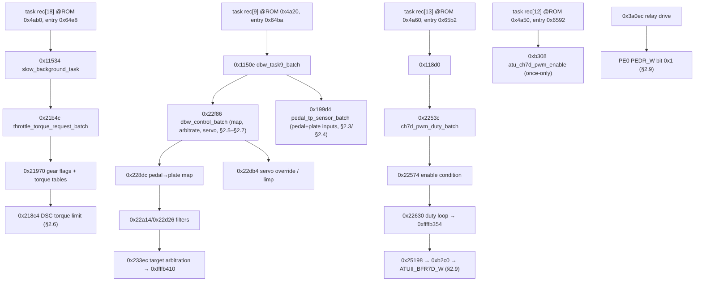

# Throttle / drive-by-wire (DBW) control — pedal, plate, servo, motor drive — subsystem report

| Date | What changed | Version |
|------|--------------|---------|
| 2026-11-22 | Initial report | 1 |

**Applicable ROMs** — the behavior described here is **assumed identical across
all ROM bins until proven otherwise**; a row documents any per-ROM difference
(also detailed in [`docs/investigations/<rom-id>/`](../investigations/README.md),
never re-derived here). List only ROMs actually investigated for this subsystem
(the reference ROM always present):

| ROM | ROM specifics | Short one-line description |
|-----|---------------|----------------------------|
| [`60E15120_N3J1E`](../investigations/60E15120_N3J1E/README.md) | reference ROM — all `0x` addresses in this report are from this bin; `submodules/Mazda_RX8_PCM_ReverseEngineering/Stock_ROMs/60E15120_N3J1E.bin` (512 KiB, SHA-256 `a7cd953c2a87af12ee2814a95c958dc23959d352ef9c5e7f82b8ab8952f264f1`), untouched | Electronic throttle: pedal APP sensors → demand → gear-dependent plate request → arbitrated target → servo → TO7D PWM motor drive, with TP plausibility monitors, learned zeros, limp-home and the DBW power relay |

All content in this report is from static analysis of the canonical export
([`reverse-engineered/decompiled/`](../../reverse-engineered/decompiled/60E15120_N3J1E/)),
the disassembly and the raw ROM bytes, except where a section explicitly states
otherwise (the dynamic checks in §2.3, §2.4, §2.9 and §2.10 were run in the
SH-2E emulator against the ROM's own functions — see §4.5).

## 1. Introduction — what this subsystem is and does

The RX-8 has no throttle cable: the PCM drives the throttle plate with an
electric motor inside the throttle body (drive-by-wire), and reads the driver's
request from two accelerator-pedal-position (APP) sensors and the plate angle
from two throttle-position (TP) sensors. The wiring book puts the throttle body
on PCM connector B1-19 (six wires: motor, two TP signals, TP 5 V, TP ground)
and the pedal sensor on B1-14 (two supplies, two signals, two grounds), plus a
drive-by-wire relay on terminal 4C
([`docs/architecture/hardware/mazda-rx-8-pcm-pinout-series-1.md`](../architecture/hardware/mazda-rx-8-pcm-pinout-series-1.md)).

In firmware the chain is: the ADC sweep latches the four raw channels
(APP1/APP2 = AN4/AN5, TP1/TP2 = AN18/AN19) into RAM; a sensor batch converts
them to volts, applies range checks, clamps, learned-zero subtraction and
produces pedal percent (`0xffffa9b4`/`0xffffa9b8`, 0–100 %) and demand
(`0xffffa9bc`); a gear-dependent set of 3D maps turns demand into a plate
request (`0xffffb398`, clamped to 0–84.0); filters smooth it into a base plate
position (`0xffffb38c`); an arbitration step adds idle air and applies DSC /
fuel-cut clamps to produce the target plate position (`0xffffb424`, raw counts
`0xffffb410`); a servo override (limp/home) can replace the target; a duty
loop computes the motor PWM duty (`0xffffb354`) which is written to the ATU
channel 7D compare register; and a power relay (PE0) switches the motor
supply. Plausibility monitors cross-check the two TP channels and the pedal
channels, latch DTCs, and force a limp plate position of 20.0 when the plate
is implausible.

Key numbers: pedal raw ADC counts scale to volts as
`raw × 6.341 × 7.6294e-5` (plus a 3.488 V base term on one channel), are
clamped at 25.0, have a learned zero subtracted (default 10.856), and convert
to percent as `zeroed / 12.7 × 100` clamped to [0, 100]. The plate full scale
is 84.0 (`0xffffad44` units; percent `0xffffad48` = `ad44 / 84 × 100`); limp
position is 20.0; demand is capped at 13.5/15.0 depending on fault flags. The
motor PWM runs on ATU channel 7D (TO7D = port PB7) with a 32000-count period;
duty is 0–100 %.

## 2. How it works, step by step

### 2.1 Hardware setup

```text
Throttle body (PCM connector B1-19, six wires)
  motor  (+) 1B R/B ─┐
  motor  (−) 1C R   ─┼─ H-bridge motor drive (see §2.9 / §4.6: only the PWM
                     │   output TO7D is firmware-identified; the phase pins
  TP1    1J G/R ────┼─► AN18 (ADDR18H_B 0xfffff82c → RAM 0xffff9f08)
  TP2    1M B/L ────┼─► AN19 (ADDR19H_B 0xfffff82e → RAM 0xffff9f0a)
  TP 5V  1Q G   ────┘   TP supply
  TP GND 2F G/Y ──────── TP ground

Accelerator pedal sensor (PCM connector B1-14, A–F)
  APP2 supply 4X R/Y, APP1 supply 4Y G/R
  APP2 signal 5C R/W ──► AN5 (ADDR5H_B 0xfffff80a → RAM 0xffff9eee)
  APP1 signal 5F W/R ──► AN4 (ADDR4H_B 0xfffff808 → RAM 0xffff9eec)
  APP GND 5AB LG/B, 5AE GY

Drive-by-wire relay (terminal 4C W/B, ETV relay per circuit B1-02)
  coil control 4C ◄── PE0 (PEDR_W 0xfffff754 bit 0x1, SH7055F pkg pin 7),
                      driven by 0x3a0ec from flag 0xffffcfb7 (inverted)
  relay contact feeds the throttle-motor supply

Motor PWM
  TO7D = PB7 (SH7055F pkg pin 154), pin function selected by
  PBCRL_W 0xfffff734 = 0x4000 (written at 0x51de; PBIOR_W 0xfffff730 = 0xf484)
  duty in ATUII_BFR7D_W 0xfffff596, period 32000 in 0xffff9f50,
  counter ATUII_TCNT7D_W 0xfffff586 / cycle ATUII_CYLR7D_W 0xfffff58e,
  timer start ATUII_TSTR2_B 0xfffff400 bit 7 — all driven by 0xb308/0xb2c0
```

Firmware-level paths are distinguished from pin routing: the firmware facts
are the register/bit and function assignments above; the package-pin →
connector-terminal hop (PE0 pin 7 → 4C, PB7 pin 154 → throttle body, AN4/AN5 →
5F/5C, AN18/AN19 → 1J/1M) is board routing and remains unresolved in this repo
(see §4.6).

### 2.2 Structured overview — which tasks run what, in what order



### 2.3 Pedal input chain — AN4/AN5 to pedal percent and demand

The ADC sweep (`0x6884`) latches each `ADDRnH` result into RAM at
`0xffff9ee4 + 2n` (pool `0x6a1c`=0xffff9ee4), so AN4/AN5 land at
`0xffff9eec`/`0xffff9eee` (`adc_an4_pedal_raw`/`adc_an5_pedal_raw`). The sensor
batch `0x199d4` (called from `0x1150e`, pool `0x116b8`=0x000199d4) then runs:

1. `0x94f0` `pedal_adc_raw_to_volts` — range-checks the raw counts against ROM
   words `0x6eeb0`=0xf5c3 (upper) and `0x6eeb4`=0x11ec (lower), raising fault
   bytes `0xffffa110`/`0xffffa111` (DTC 0x66–0x69 family), and computes
   `0xffffa108` = `0.0f + raw × 6.341f (0x6eeb8=0x40cae979) × 7.6294e-5`, plus
   a second term with base `3.488f (0x6eec4=0x405f3b64)`. Also called from
   `0x60c8` `ref_getSensorStuff__`.
2. `0x18f60` `pedal_volts_clamp_latch` — latches the raw cell
   (pool `0x19058`=0xffff9eec) into `0xffffa9c4` (pool `0x1904a`=0xa9c4) and
   clamps: `0xffffa99c` = min(25.0f (`0x6eed0`=0x41c80000), `0xffffa108`).
3. `0x1933a` `pedal_learned_zero_subtract` — `0xffffa9ac` = max(0,
   `0xffffa99c` − learned zero `0xffff8068`) (pool `0x19386`=0x8068; the
   learned default is 10.856f = 0x412db22d, adapted by `0x18fe8`; the second
   channel uses `0xffff8070`).
4. `0x193c4` `throttle_percent_and_demand_calc` — pedal percent
   `0xffffa9b4` = clamp(`0xffffa9ac` / 12.7f × 100) with `0x194d4`=0x6ef18
   (12.7f) and `0x194d0`=0x42c80000 (100.0f); the same chain gives
   `0xffffa9b8` from AN5. Demand `0xffffa9bc` = min(max(`0xffffa9b4`, cruise
   output `0xffffbcf8`), limiter `0xffffc028`), capped at 13.5 / 15.0
   depending on fault flags.

Dynamic check (SH-2E emulator, `tests/test_throttle_dbw.py`): running task
`0x64ba` with AN4 raw = 50000 produces `0xffffa9b4` = 100.0 (the unclamped
value is 105 %).

### 2.4 Throttle plate feedback — AN18/AN19 to plate position

The same sensor batch converts the plate channels: `0xb398` (also called from
`0x60c8`) computes TP volts `0xffffa218`/`0xffffa21c` =
`base (0x6f3ec) + raw × scale (0x6f3e4 = 25.0f, 0x6f3e8 = 31.25f) × 7.6294e-5`
with range/fault flags from ROM words at `0x6f3dc`/`0x6f3e0` and `0x6c172`/
`0x6c176`; `0x1b08e` `plate_tp1_volts_latch` and `0x1b14c`
`plate_tp2_volts_latch` latch AN18/AN19 (pools `0x1b12c`=0xffff9f08,
`0x1b1d0`=0xffff9f0a) into `0xffffad5c`/`0xffffad5e` (pools `0x1b0e6`=0xad5c,
`0x1b1c0`=0xad5e — the TP1/TP2 volt cells also exported on PIDs 0x0011 /
0x1154) and copy the computed volts into `0xffffad30`/`0xffffad34`. Then
`0x1b940` computes the plate position: `0xffffad38` = max(0,
`0xffffad30` − learned `0xffff807c`), `0xffffad3c` = max(0, `0xffffad34` −
learned `0xffff8084`) (defaults 15.0f = 0x41700000 at `0x6f438`, adapted by
`0x1b3f2`); `0xffffad44` = `0xffffad38`, or `0xffffad3c` when `0xffffcc98`==1,
or **20.0** (limp) when additionally `0xffffcc99`==1; percent
`0xffffad48` = `0xffffad44` / 84.0 × 100 (inline 0x42a80000).

Dynamic check: AN18/AN19 raw = 50000 → `0xffffa218` = 95.367, `0xffffad44` =
80.367, `0xffffad48` = 95.676; with `0xffffcc98`=1 and `0xffffcc99`=1,
`0xffffad44` = 20.0 (`tests/test_throttle_dbw.py`).

### 2.5 Demand to plate request — the gear-dependent maps and filters

In the DBW control batch `0x22f86` (from `0x1150e`, pool `0x116c8`=0x00022f86):

- `0x228dc` `throttle_pedal_to_plate_request_map` — 3D lookup of (rpm
  `0xffffb548`, demand `0xffffa9bc`) in one of four tables selected by the gear
  flags `0xffffb2cc`/`0xffffb2cd`/`0xffffb2ce` (set by `0x21970` from the AT
  gear bytes): `0x6a458` (gears 1/2), `0x6a474` (neutral), `0x6a490` (5/6),
  `0x6a4ac` (3/4) (pools `0x229dc`=0x6a458, `0x229e0`=0x6a474,
  `0x229e4`=0x6a490, `0x229e8`=0x6a4ac). The result is clamped to [0, 84.0f]
  (pool `0x229f0`=0x7372c) by helper `0x2404` into `0xffffb398` (pool
  `0x229ec`), with a 12-deep history shift (`0xffffb3ec`…, pool `0x229f8`).
- `0x22a14` `pedal_demand_filter_coeffs` — first-order filter of the demand
  with coefficient tables (rpm `0x6a354`/`0x6a368`/`0x6a37c`/`0x6a390`,
  coolant `0x6a3a4`/`0x6a3b8`, base `0x6a3cc`…`0x6a430`), rate-decay flag and
  2.0 hysteresis → base position `0xffffb38c`.
- `0x22d26` `throttle_base_position_filter` — `0xffffb390` = filter(`0xffffb38c`,
  0.25), `0xffffb394` = (`0xffffb38c` <= 2.0).

### 2.6 Torque / DSC arbitration — the target plate position

The background task rec[18] (`0x64e8` → `0x11534`) runs
`0x21b4c` `throttle_torque_request_batch`: `0x21970` `throttle_gear_mode_flags`
sets `0xffffb2cc`/`0xffffb2cd`/`0xffffb2ce` from the AT gear bytes
`0xffffbc41`–`0xffffbc43` and computes torque-related lookups (`0x6a180`
Throttle Position To Torque, `0x6a164` Trans Requested Torque To Throttle Plate
Position); `0x218c4` `ref_throttlePlateControl_Related` evaluates the DSC
torque request (CAN 0x212, see
[`dsc_can_arbitration_report.md`](../investigations/60E15120_N3J1E/dsc_can_arbitration_report.md)):
`0xffffb2cf` = DSC torque-limit active (clamp value `0xffffb2b8` from table
`0x6a164`), `0xffffb2d0` = DSC mode C active (max opening `0xffffb2bc` from
table `0x6a150`).

Back in `0x22f86`, `0x233ec` `throttle_target_plate_position` arbitrates the
target `0xffffb424`: clamp(`0xffffb2b8`, coolant table `0x6a4c8`,
`0xffffb38c` + idle air `0xffffb2a4`) when `0xffffb2cf`==1; max(`0xffffb38c` +
`0xffffb2a4`, `0xffffb2bc`) when `0xffffb2d0`==1; otherwise clamp(`0xffffb38c` +
`0xffffb2a4`, 0, 84.0) with fuel-cut decel reduction (tables
`0x6a4dc`/`0x6a4f0`/`0x6a504`). The target is converted to raw counts
`0xffffb410` = `0x5ccb4`(`0xffffb424`) — exported on PIDs 0x004c/0x091a.

### 2.7 Servo override, limp/home and learned values

Also in `0x22f86`:

- `0x22db4` `throttle_servo_override` — direction `0xffffb400` = (`0xffffb4b0`
  >= learned `0xffff807c` + 0.5f (`0x747b8`=0x3f000000)); mode byte
  `0xffffccbc` (from `0x487d6` `engine_stop_conditions_eval`); override duty
  `0xffffb3f8`: 0.0 when mode != 1, else min(`0xffffb410` + learned, learned +
  0.5), decaying max(5.0f (`0x747bc`), `b3f8` − 0.05f (`0x747c0`)) while
  counters `0xffffb3fc`/`0xffffb3fe` exceed 1 (pools `0x22ea0`=0xb4b0,
  `0x22ea2`=0xccbc, `0x22ea4`=0xb3f8, `0x22ea6`=0xb410, `0x22ebc`=0xffffb400).
- `0x231f0` `learned_pedal_value_calc` — `0xffffb40c` = clamp(`0xffffb410` +
  learned `0xffff807c`, 0, learned `0xffff808c` default 110.0f = 0x42de0000);
  99.0 on the fault path.
- `0x23558` `throttle_position_delta_calc` — `0xffffb414` = `0xffffb410` −
  `0xffffb428` (0.0 when `0xffffccc9` set); both exported via the E2RAM block
  encode `0x244bc`.

### 2.8 Plausibility monitors, learning and DTCs

- `0x4595a` `tp_correlation_fault_check` (called from `0x38e12`) — compares the
  two pedal zeroed channels: threshold 3.5f (`0x7c77c`=0x40600000) when the
  learned value is valid (`0xffff8078`==1), else 9.536f (`0x7c790`=0x41189375).
  Good counter `0xffffcbf2` > 0x18 → `0xffffcbec`=1; bad counter `0xffffcbee`
  > 0x1c → `0xffff872c`=1 and DTC 0x6c via `0x5fd38`.
- `0x33e98` `plate_range_high_fault` (called from the fueling main task
  `0x20e40`) — `0xffffc108` = 1 while plate percent `0xffffad48` >= 200.0f
  (`0x79be0`=0x43480000), cleared below 196.48 (hysteresis 3.52f,
  `0x79be4`=0x406147ae); consumers `0x33dc8`/`0x34230` zero the
  accel-enrichment accumulators.
- Range faults on the pedal raw channels (`0xffffa110`/`0xffffa111` from
  `0x94f0`) feed DTCs 0x66–0x69.
- Learning: pedal zeros `0xffff8068`/`0xffff8070` adapted by `0x18fe8`, plate
  zeros `0xffff807c`/`0xffff8084` by `0x1b3f2`; plausibility flags
  `0xffffad60`/`0xffffad61` (set by `0x1ba20`/`0x1bd9e`) feed
  `shutdown_allowed` `0x48cc0`, which blocks the main-relay hold. All learned
  cells are E2RAM-backed and persisted by `0x244bc`/`0x23844`.

### 2.9 Motor drive — DBW power relay and the TO7D PWM

**Power relay.** PE0 (`PEDR_W 0xfffff754` bit 0x1, SH7055F package pin 7) =
(`0xffffcfb7` == 0), driven by `0x3a0ec` `relay_output_pair_pd7_pe0` (flag
computed by `0x4ef86`); harness candidate terminal 4C (W/B, the ETV relay coil
per circuit diagram B1-02). Dynamic check: `0x3a0ec` sets PE0 with
`0xffffcfb7`=0, clears it with `0xffffcfb7`=1 (`tests/test_throttle_dbw.py`).

**PWM output.** Channel 7D of the ATU (TO7D = PB7, package pin 154) is the only
ATU PWM output enabled in the running configuration: `0xb308`
`atu_ch7d_pwm_enable` (called once from task rec[12] `0x6592`) sets
`PBCRL_W 0xfffff734` = 0x4000 at init (`0x51de`, pools `0x52d8`/`0x52da`),
starts the timer (`ATUII_TSTR2_B 0xfffff400` bit 7) and loads
`ATUII_CYLR7D_W 0xfffff58e` = `ATUII_TCNT7D_W 0xfffff586` =
`ATUII_BFR7D_W 0xfffff596` = `ATUII_DTR7D_W 0xfffff59e` = 32000 (0x7d00, also
kept in `0xffff9f50`); `0xb23c` is the motor-off init. The running duty loop
runs in task rec[13] (`0x65b2` → `0x118d0`, pool `0x66d8`=0x000118d0 →
`0x2253c` `ch7d_pwm_duty_batch`, pools `0x22560`–`0x2256c`):

- `0x22574` `ch7d_pwm_enable_condition` — enable `0xffffb358` = engine running
  (`0xffffa428`) && running timer `0xffffa424` >= table `0x6a340`(coolant
  model) && coolant >= −50.0f (`0x7353c`) && 9.0f <= battery `0xffffb590` <
  16.0f (`0x73540`/`0x73544`) && !`0xffffcd70` (stuck-duty latch from the stall
  monitors `0x4162e`/`0x416bc` via `0x4a11c`).
- `0x22630` `ch7d_pwm_duty_control_loop` — closed-loop duty `0xffffb354`
  (0–100 %): PID-style terms on the filtered feedback `0xffffaa78` (see §4.6
  for its identity): P (`aa78`−30.0f (`0x7355c`))×4.5f (`0x73550`), I
  `0xffffb364` += (`aa78`−30)×0.1875f (`0x73554`), D (`0xffffb36c`−`aa78`)×0.75f
  (`0x73558`), hysteresis 39/44/40/45 (`0x7354c`/`0x73548`), feedforward/limit
  tables `0x6a2cc`/`0x6a2f4`/`0x6a324`/`0x6a2e0`.
- `0x25198` `ch7d_pwm_duty_ratio` — `0xffffb570` = clamp(`0xffffb354`, 0,
  100.0f (`0x251c4`=0x42c80000)) / 100 by `0x2404` (pool `0x251c8`), then
  tail-jumps to `0xb2c0`.
- `0xb2c0` `ch7d_pwm_duty_write` — `0xffffa210`[0] = (u32)(duty × 65536.0f)
  (`0xb390`=0x47800000, pool `0xb37c`=0xffffa210); when enabled
  (`0xffffa214`, pool `0xb380`), `ATUII_BFR7D_W 0xfffff596` =
  saturating_mul_shift16(`0xffffa210`[0], `0xffff9f50`) via `0x231c` (pools
  `0xb374`=0xf596, `0xb38c`=0xffff9f50, `0xb394`=0x231c).

### 2.10 Logger PID 0x1410 — settled as injector pulse time

The UDS mode-22 dispatch record at ROM `0x5f394` (bytes
`14100200 fffc0000 00056f6c`: PID 0x1410, length 2, −4, handler `0x56f6c`)
points at handler `0x56f6c`, which reads the float `0xffffbe24` (pool
`0x57018`=0xbe24 — the injector pulse time written by
`injector_pulse_time_arbitrate` `0x2fea8`, see
[`fueling_control_report.md`](../investigations/60E15120_N3J1E/fueling_control_report.md))
and encodes it as u16 with step 8.0f (pool `0x57048`=0x41000000) via the
encoder `0x2490` (pool `0x57038`=0x2490) — i.e. **8 µs units**. The upstream
logger definition lists both "Injector Pulse Time" and "Throttle Pedal
Position" at 0x221410; on this ROM it is the injector pulse time, and the
reviewed def (`data/definitions/romraider/reviewed-rx8defs-copy/logger_60E15120_reviewed.xml`)
now carries only that meaning (the "Throttle Pedal Position" entry was removed,
see §4.3). The throttle plate is exported on PIDs 0x0011/0x093c
(`0x569f0`→`0x5553e` reads `0xffffad5c`, `0x56e04` reads `0xffffad44`) and the
pedal on PIDs 0x0049/0x004a (`0xffffa9c4`/`0xffffa9c6`) plus 0x0914/0x0915,
0x004c/0x091a (`0xffffb410`) and 0x1154 (`0xffffad5c` raw). Dynamic check:
handler `0x56f6c` with `0xffffbe24` = 80.0 encodes u16 10, with 16.0 encodes 2
(step 8.0; `tests/test_throttle_dbw.py`). The design doc §5.8 note is settled
accordingly
([`docs/architecture/design/README.md`](../architecture/design/README.md)).

## 3. Technical pseudocode

```c
// ---- task rec[9] 0x64ba -> 0x1150e -> 0x199d4 (sensor batch) ----
void pedal_tp_sensor_batch(void) {                    // 0x199d4
    pedal_adc_raw_to_volts();                          // 0x94f0: a108 = raw*6.341f*7.6294e-5 (+3.488f), range 0x11ec..0xf5c3 -> faults a110/a111
    pedal_volts_clamp_latch();                         // 0x18f60: a9c4 = 9eec; a99c = min(25.0f, a108)
    pedal_learned_zero_subtract();                     // 0x1933a: a9ac = max(0, a99c - learned 0xffff8068)
    throttle_percent_and_demand_calc();                // 0x193c4: a9b4 = clamp(a9ac/12.7f*100, 0, 100); a9bc = min(max(a9b4, bcf8), c028)
    FUN_0000b398();                                    // plate raw -> volts a218/a21c (base 0x6f3ec + raw*scale 0x6f3e4*7.6294e-5)
    plate_tp1_volts_latch();                           // 0x1b08e: ad5c = 9f08; ad30 = a218
    plate_tp2_volts_latch();                           // 0x1b14c: ad5e = 9f0a; ad34 = a21c
    ref_calculateThrottlePedalPercentForSomethingElse_(); // 0x1b940: ad44 = ad38|ad3c, limp 20.0 if cc98&&cc99; ad48 = ad44/84*100
}

// ---- task rec[9] 0x64ba -> 0x1150e -> 0x22f86 (DBW control batch) ----
void dbw_control_batch(void) {                        // 0x22f86
    throttle_servo_override();                         // 0x22db4: dir b400, duty b3f8 (mode ccbc)
    throttle_target_plate_position();                  // 0x233ec: b424 = arbitrate(b38c+b2a4, DSC b2cf/b2d0, fuel-cut); b410 = 0x5ccb4(b424)
    learned_pedal_value_calc();                        // 0x231f0: b40c = clamp(b410+learned807c, 0, learned808c)
    throttle_position_delta_calc();                    // 0x23558: b414 = b410 - b428
    throttle_pedal_to_plate_request_map();             // 0x228dc: b398 = clamp(tbl_gear(rpm, a9bc), 0, 84.0f)
    pedal_demand_filter_coeffs();                      // 0x22a14: b38c = filtered demand (rpm/coolant coeff tables)
    throttle_base_position_filter();                   // 0x22d26: b390 = filter(b38c, 0.25); b394 = (b38c <= 2.0)
}

// ---- task rec[18] 0x64e8 -> 0x11534 -> 0x21b4c (torque batch) ----
void throttle_torque_request_batch(void) {            // 0x21b4c
    throttle_gear_mode_flags();                        // 0x21970: b2cc/b2cd/b2ce from AT bytes; tbl 0x6a180 / 0x6a164
    ref_throttlePlateControl_Related();                // 0x218c4: b2cf/b2d0 DSC gates; b2b8 = tbl 0x6a164, b2bc = tbl 0x6a150
}

// ---- task rec[13] 0x65b2 -> 0x118d0 -> 0x2253c (motor PWM) ----
void ch7d_pwm_duty_batch(void) {                      // 0x2253c
    ch7d_pwm_enable_condition();                       // 0x22574: b358 = running && timer && coolant>=-50 && 9<=batt<16 && !cd70
    ch7d_pwm_duty_control_loop();                      // 0x22630: b354 = PID-ish loop on aa78 (P 4.5 / I 0.1875 / D 0.75), limits tbl 0x6a2cc..
    ch7d_pwm_duty_ratio();                             // 0x25198: b570 = clamp(b354,0,100)/100 -> 0xb2c0
}
void ch7d_pwm_duty_write(void) {                      // 0xb2c0: a210[0] = (u32)(fr4*65536.0f); if (a214[0]) ATUII_BFR7D_W = sat_mul16(a210[0], 0xffff9f50)
}

// ---- relay + once-only PWM setup ----
void relay_output_pair_pd7_pe0(void) {                // 0x3a0ec: PEDR_W bit 0x1 = (0xffffcfb7 == 0)
}
void atu_ch7d_pwm_enable(void) {                      // 0xb308 (once): TSTR2 bit7, CYLR7D=TCNT7D=BFR7D=DTR7D=32000; BFR7D=duty*32000>>16
}

// ---- logger PID 0x1410 (dispatch record 0x5f394) ----
u16 diag22_pid1410_injector_pulse_time(void) {        // 0x56f6c
    return encode_u16(0xffffbe24, step 8.0f);          // 0x2490, pool 0x57048=0x41000000
}
```

## 4. Proof — evidence and validation

### 4.1 Memory map (mandatory)

Functions:

| Address | Label | Role |
|---------|-------|------|
| `0x000064ba` | task rec[9] entry | tail-calls `0x1150e` (pool `0x656c`=0x0001150e) |
| `0x000064e8` | task rec[18] entry | runs `0x11534` slow/background task |
| `0x00006592` | task rec[12] entry | calls `0xb308` (once-only PWM enable) |
| `0x000065b2` | task rec[13] entry | calls `0x118d0` (pool `0x66d8`=0x000118d0) |
| `0x0001150e` | `dbw_task9_batch` | batch dispatcher: pools `0x116b8`=0x199d4, `0x116c8`=0x22f86, `0x116e4`=0x21b4c |
| `0x000199d4` | `pedal_tp_sensor_batch` | pedal + plate sensor conversion batch |
| `0x000094f0` | `pedal_adc_raw_to_volts` | AN4/AN5 range check + volts scaling |
| `0x00018f60` | `pedal_volts_clamp_latch` | raw latch + min(25.0f) clamp |
| `0x0001933a` | `pedal_learned_zero_subtract` | learned-zero subtraction |
| `0x000193c4` | `throttle_percent_and_demand_calc` | pedal % and demand (a9b4/a9b8/a9bc) |
| `0x0000b398` | (plate raw→volts) | TP volts a218/a21c + range flags |
| `0x0001b08e` | `plate_tp1_volts_latch` | AN18 → ad5c/ad30 |
| `0x0001b14c` | `plate_tp2_volts_latch` | AN19 → ad5e/ad34 |
| `0x0001b940` | plate position calc | ad44/ad48, limp 20.0 |
| `0x00022f86` | `dbw_control_batch` | DBW control batch |
| `0x000228dc` | `throttle_pedal_to_plate_request_map` | gear-selected 3D maps → b398 |
| `0x00022a14` | `pedal_demand_filter_coeffs` | demand filter → b38c |
| `0x00022d26` | `throttle_base_position_filter` | b390/b394 |
| `0x00022db4` | `throttle_servo_override` | servo dir/duty/mode (b400/b3f8/ccbc) |
| `0x000233ec` | `throttle_target_plate_position` | arbitration → b424 → b410 |
| `0x000231f0` | `learned_pedal_value_calc` | b40c learned pedal clamp |
| `0x00023558` | `throttle_position_delta_calc` | b414 = b410 − b428 |
| `0x00021b4c` | `throttle_torque_request_batch` | torque batch from `0x11534` |
| `0x00021970` | `throttle_gear_mode_flags` | b2cc/b2cd/b2ce + torque tables |
| `0x000218c4` | `ref_throttlePlateControl_Related` | DSC torque limit (b2cf/b2d0, tbl 0x6a150/0x6a164) |
| `0x0004595a` | `tp_correlation_fault_check` | TP correlation monitor → DTC 0x6c |
| `0x00033e98` | `plate_range_high_fault` | ad48 >= 200.0 → c108 |
| `0x0002253c` | `ch7d_pwm_duty_batch` | PWM batch from `0x118d0` |
| `0x00022574` | `ch7d_pwm_enable_condition` | b358 enable gates |
| `0x00022630` | `ch7d_pwm_duty_control_loop` | duty loop → b354 |
| `0x00025198` | `ch7d_pwm_duty_ratio` | b570 = clamp(b354)/100 → `0xb2c0` |
| `0x0000b2c0` | `ch7d_pwm_duty_write` | a210 q16 → ATUII_BFR7D_W |
| `0x0000b308` | `atu_ch7d_pwm_enable` | once-only TO7D setup |
| `0x0000b23c` | `ch7d_pwm_off_init` | motor-off init |
| `0x0003a0ec` | `relay_output_pair_pd7_pe0` | PE0 (PEDR_W bit 0x1) = (cfb7==0) |
| `0x00056f6c` | `diag22_pid1410_injector_pulse_time` | PID 0x1410 handler (dispatch record `0x5f394`) |

RAM:

| Address | Label | Type | Written by | Read by |
|---------|-------|------|-----------|---------|
| `0xffff9eec` | `adc_an4_pedal_raw` | u16 | ADC sweep `0x6884` | `0x18f60` (pool `0x19058`) |
| `0xffff9eee` | `adc_an5_pedal_raw` | u16 | ADC sweep `0x6884` | `0x18fa4` |
| `0xffff9f08` | `adc_an18_plate_tp1_raw` | u16 | ADC sweep `0x6884` | `0x1b08e`, `0xb398` |
| `0xffff9f0a` | `adc_an19_plate_tp2_raw` | u16 | ADC sweep `0x6884` | `0x1b14c`, `0xb398` |
| `0xffffa108` | `pedal_1_scaled_volts` | float | `0x94f0` | `0x18f60` |
| `0xffffa99c` | `pedal_1_volts_clamped25` | float | `0x18f60` | `0x1933a` |
| `0xffffa9ac` | `pedal_1_volts_zeroed` | float | `0x1933a` | `0x193c4`, `0x4595a` |
| `0xffffa9b4` | `accelerator_pedal_1_percent` | float | `0x193c4` | `0x193c4` demand, `0x228dc`, cruise `0x4c896` |
| `0xffffa9b8` | `accelerator_pedal_2_percent` | float | `0x193c4` | demand chain |
| `0xffffa9bc` | demand percent | float | `0x193c4` | `0x228dc` maps |
| `0xffffad5c` | TP1 volts cell | u16 | `0x1b08e` | PIDs 0x0011/0x1154 |
| `0xffffad5e` | `inferred_throttle_sensor_2_volts_ffffad5e` | u16 | `0x1b14c` | PID 0x1154 |
| `0xffffad44` | `inferred_throttle_position` | float | `0x1b940` | `0x33e98`, PID 0x093c, consumers |
| `0xffffad48` | plate percent | float | `0x1b940` | `0x33e98` (pool `0x33f6a`) |
| `0xffffb398` | `throttle_plate_request` | float | `0x228dc` | `0x22a14`, `0x233ec` |
| `0xffffb38c` | base plate position | float | `0x22a14` | `0x22d26`, `0x233ec` |
| `0xffffb424` | `throttle_target_plate_percent` | float | `0x233ec` | `0x5ccb4` → `0xffffb410` |
| `0xffffb410` | target plate raw counts | u16 | `0x233ec` via `0x5ccb4` | PIDs 0x004c/0x091a, servo `0x22db4`/`0x231f0` |
| `0xffffb3f8` | `throttle_servo_override_duty` | float | `0x22db4` | `0x231f0`/`0x233ec` |
| `0xffffb400` | `throttle_servo_direction` | u8 | `0x22db4` | — |
| `0xffffccbc` | `throttle_servo_mode` | u8 | `0x487d6` | `0x22db4`, `0x231f0` |
| `0xffffb2cc` | `throttle_gear_mode_1_2` | u8 | `0x21970` | `0x228dc` map select |
| `0xffffb2cf` | `dsc_torque_limit_active` | u8 | `0x218c4` | `0x233ec` |
| `0xffffb2d0` | `dsc_mode_c_active` | u8 | `0x218c4` | `0x233ec` |
| `0xffffb354` | `ch7d_pwm_duty_percent` | float | `0x22630` | `0x25198`, stall monitors |
| `0xffffb358` | `ch7d_pwm_enable` | u8 | `0x22574` | `0x22630` |
| `0xffffb570` | duty ratio | float | `0x25198` | PID 0x1631 |
| `0xffffa210` | `ch7d_pwm_duty_q16` | u32 | `0xb2c0` | `0xb2c0` → BFR7D |
| `0xffffa214` | `ch7d_pwm_enabled` | u8 | `0xb308`/`0xb23c` | `0xb2c0` |
| `0xffff9f50` | `ch7d_pwm_period` | u16 | `0xb308` (0x7d00) | `0xb2c0` |
| `0xffffcd70` | `throttle_fault_latch` | u8 | `0x4a11c` | `0x22574` |
| `0xffff8068` | `learned_pedal_zero_1` | float | `0x18fe8` (default 10.856f) | `0x1933a` |
| `0xffff8070` | `learned_pedal_zero_2` | float | `0x18fe8` | `0x1933a` |
| `0xffff807c` | learned plate zero 1 | float | `0x1b3f2` (default 15.0f) | `0x1b940`, `0x22db4`, `0x231f0` |
| `0xffff8084` | `learned_plate_zero_2` | float | `0x1b3f2` | `0x1b940` |
| `0xffffad60` | `tp_plausibility_fault_a` | u8 | `0x1ba20` | `0x48cc0` |
| `0xffffad61` | `tp_plausibility_fault_b` | u8 | `0x1bd9e` | `0x48cc0`/`0x487d6` |
| `0xffff872c` | `tp_correlation_fault_latch` | u8 | `0x4595a` | DTC 0x6c via `0x5fd38` |
| `0xffffc108` | `tp_range_high_fault` | u8 | `0x33e98` | `0x33dc8`/`0x34230` |
| `0xffffcbec` | `tp_correlation_ok` | u8 | `0x4595a` | — |
| `0xffffcfb7` | `pe0_relay_flag` | u8 | `0x4ef86` | `0x3a0ec` → PE0 |
| `0xffffbe24` | `injector_pulse_time` | float | `0x2fea8` | PID 0x1410 handler `0x56f6c` |
| `0xffffaa78` | filtered feedback (AN11/AN23 pair ratio, `0xffffa1d4`) | float | `0x1ac00` | `0x22630` duty loop |
| `0xffffb40c` | `candidate_learned_pedal_value` | float | `0x231f0` | E2RAM `0x244bc` |
| `0xffffb414` | `throttle_pedal_position_delta` | float | `0x23558` | E2RAM `0x244bc` |

ROM tables and literal pools (all words re-read from the raw ROM —
[`reviews/throttle_dbw/rawbin_reverify_log.txt`](../investigations/60E15120_N3J1E/reviews/throttle_dbw/rawbin_reverify_log.txt)):

| Address | Contents |
|---------|----------|
| `0x6a458` / `0x6a474` / `0x6a490` / `0x6a4ac` | pedal→plate request 3D tables (gears 1/2, neutral, 5/6, 3/4), pools `0x229dc`–`0x229e8` |
| `0x6a150` | DSC mode C max plate opening 2D table (used by `0x218c4` → `0xffffb2bc`) |
| `0x6a164` | trans requested torque → plate position (→ `0xffffb2e4`/`0xffffb2b8`) |
| `0x6a180` | throttle position → torque (used by `0x21970`/`0x21a80`) |
| `0x7372c` | 84.0f plate-request clamp (pool `0x229f0`) |
| `0x6eeb0`/`0x6eeb4` | pedal raw range 0xf5c3 / 0x11ec |
| `0x6eeb8`/`0x6eec4` | pedal scale 6.341f (0x40cae979) / base 3.488f (0x405f3b64) |
| `0x6eed0` | 25.0f pedal volts clamp |
| `0x6ef18` | 12.7f pedal→percent scale (pool `0x194d4`) |
| `0x194d0` | 100.0f (0x42c80000) |
| `0x6f3e4`/`0x6f3e8`/`0x6f3ec` | TP scales 25.0f/31.25f, base 0.0f (plate raw→volts in `0xb398`) |
| `0x6f438` | 15.0f learned-plate default |
| `0x79be0`/`0x79be4` | 200.0f / 3.52f plate range-high threshold + hysteresis |
| `0x7c77c`/`0x7c790` | 3.5f / 9.536f TP correlation thresholds |
| `0x7353c`/`0x73540`/`0x73544` | −50.0f coolant, 9.0f/16.0f battery gates |
| `0x73548`–`0x7355c` | duty-loop constants 45.0/44.0/4.5/0.1875/0.75/30.0 |
| `0x747b8`/`0x747bc`/`0x747c0` | servo 0.5f / 5.0f / 0.05f |
| `0x5f394` | UDS dispatch record for PID 0x1410 (`14100200 fffc0000 00056f6c`) |
| `0x57018`/`0x57038`/`0x57048` | PID 0x1410 handler pools: `0xffffbe24`, encoder `0x2490`, step 8.0f |
| `0x4a20`/`0x4a50`/`0x4a60`/`0x4ab0` | task-table records 9/12/13/18 (entries `0x64ba`/`0x6592`/`0x65b2`/`0x64e8`) |

### 4.2 Labeling applied

`data/labels/60E15120_N3J1E/throttle_dbw_labels.json` — 25 function aliases,
41 RAM aliases (including carried entries from the starting/cranking,
UDS-dispatch and fueling records so the file is self-contained), 7 lookup
aliases, the 3 corrections (§4.3) and the PID 0x1410 settlement, each with
raw-bin evidence strings. Mirrored as rows in
[`accepted_function_aliases.tsv`](../investigations/60E15120_N3J1E/labeling/source_review/accepted_function_aliases.tsv),
[`accepted_ram_aliases.tsv`](../investigations/60E15120_N3J1E/labeling/source_review/accepted_ram_aliases.tsv)
and
[`accepted_lookup_aliases.tsv`](../investigations/60E15120_N3J1E/labeling/source_review/accepted_lookup_aliases.tsv);
the names were folded back into the decompiled export (`functions/*.c`,
`firmware_decompiled.c`, `named/firmware_named.c`, `function_index.tsv`,
`callgraph.tsv`, `symbols.tsv`, `integrated_names.json`) by
`utilities/scripts/rx8-pcm-pipeline/review_throttle_dbw_labels_apply.py`
(wired into `rebuild.sh`; idempotent). Register names (`PEDR_W`,
`ATUII_BFR7D_W`, …) are the `symbols.tsv` entries.

### 4.3 Corrections

- `0xffffa9b4` was labeled `throttle_position_1_percent` — it is the **pedal**
  (APP1) percent (AN4 chain, feeds demand and the cruise pedal-override
  compare); renamed to `accelerator_pedal_1_percent`. Same for
  `0xffffa9b8` → `accelerator_pedal_2_percent`. The throttle **plate** percent
  is `0xffffad48`. Emulator-verified (AN4=50000 → `0xffffa9b4`=100.0 while the
  plate chain is separate). Folded back into
  [`cruise_control_labels.json`](../../data/labels/60E15120_N3J1E/cruise_control_labels.json),
  [`uds_dispatch_labels.json`](../../data/labels/60E15120_N3J1E/uds_dispatch_labels.json),
  [`cruise_control_report.md`](../investigations/60E15120_N3J1E/cruise_control_report.md),
  [`reviews/cruise_control/README.md`](../investigations/60E15120_N3J1E/reviews/cruise_control/README.md)
  and the ADC channel line in [`docs/learnings.md`](../learnings.md).
- `0xffffad5e` was `inferred_pedal_volts_ffffad5e` — it latches AN19 (plate
  TP2), renamed `inferred_throttle_sensor_2_volts_ffffad5e`.
- Logger PID 0x1410: the upstream `logger_rx8_defs.xml` carries both "Injector
  Pulse Time" and "Throttle Pedal Position" at 0x221410; on this ROM the
  handler `0x56f6c` (dispatch record `0x5f394`) reads `0xffffbe24` with step
  8.0 µs — injector pulse time. The reviewed def
  [`logger_60E15120_reviewed.xml`](../../data/definitions/romraider/reviewed-rx8defs-copy/logger_60E15120_reviewed.xml)
  keeps only that entry, and the design doc §5.8 note is settled
  ([`docs/architecture/design/README.md`](../architecture/design/README.md)).

### 4.4 Files

- Label record: [`data/labels/60E15120_N3J1E/throttle_dbw_labels.json`](../../data/labels/60E15120_N3J1E/throttle_dbw_labels.json)
- TSV mirrors + `validation.json`: [`labeling/source_review/](../investigations/60E15120_N3J1E/labeling/source_review/)
- Review scripts: `utilities/scripts/rx8-pcm-pipeline/review_throttle_dbw_labels.py`
  (TSV/JSON writer, wired into `rebuild.sh`) and
  `review_throttle_dbw_labels_apply.py` (fold-back apply, wired into
  `rebuild.sh`)
- Tests: [`tests/test_throttle_dbw.py`](../../tests/test_throttle_dbw.py)
- Review evidence:
  [`reviews/throttle_dbw/`](../investigations/60E15120_N3J1E/reviews/throttle_dbw/)
  (README, REVIEW_NOTES, `validation.json`, `rawbin_reverify_log.txt`)
- Reviewed logger def:
  [`data/definitions/romraider/reviewed-rx8defs-copy/logger_60E15120_reviewed.xml`](../../data/definitions/romraider/reviewed-rx8defs-copy/logger_60E15120_reviewed.xml)
- Decompiled export fold-back: `reverse-engineered/decompiled/60E15120_N3J1E/`

### 4.5 Validation

- ROM SHA-256 `a7cd953c2a87af12ee2814a95c958dc23959d352ef9c5e7f82b8ab8952f264f1`
  (pinned in the tests; re-checked on every run).
- Raw-bin re-verification of every cited pool word / dispatch record /
  constant: [`reviews/throttle_dbw/rawbin_reverify_log.txt`](../investigations/60E15120_N3J1E/reviews/throttle_dbw/rawbin_reverify_log.txt)
  (all PASS).
- `tests/test_throttle_dbw.py`: 17 passed — static (TSV mirrors, function-index
  membership, symbols.tsv register names, ROM pool-byte assertions) and dynamic
  in the SH-2E emulator (task `0x64ba` pedal → `0xffffa9b4`=100.0; plate chain
  → `0xffffad44`=80.367 / limp 20.0; PID 0x1410 handler 80.0→10, 16.0→2; PE0
  relay drive `0x3a0ec`).
- Pipeline validators run from the repo root: results recorded in
  [`reviews/throttle_dbw/validation.json`](../investigations/60E15120_N3J1E/reviews/throttle_dbw/validation.json)
  (`validate_export.py`, `validate_reports.py`, `verify_claims.py`,
  `verify_math_units.py`, full `pytest tests/`).

### 4.6 Limits

- The throttle-motor **phase pins** (terminals 1B/1C) are not firmware-identified:
  whole-ROM scans find only the TO7D/PB7 PWM output in the running configuration
  and no second motor leg or direction GPIO; the H-bridge drive side is board
  routing. Package-pin ↔ connector-terminal routing in general is unresolved
  in this repo (the 4C/1B/1C/1J/1M/1Q/2F/4X/5AE/5C/4Y/5AB/5F associations are
  candidates from
  [`mazda-rx-8-pcm-pinout-series-1.md`](../architecture/hardware/mazda-rx-8-pcm-pinout-series-1.md)).
- The duty-loop feedback `0xffffaa78` (filtered AN11/AN23 pair ratio,
  `0xffffa1d4`, copied by `0x1ac00`) is labeled in-repo as a lambda-band
  consumer; its identity as the throttle-motor current/position feedback is
  plausible but not proven — the AN11/AN23 channel assignment is ambiguous in
  this repo.
- `0xffffb4b0`/`0xffffb4b4` (servo home reference) are written only at boot by
  the E2RAM decode `0x23844`, not per cycle.
- The DSC torque request arrives over CAN 0x212; the TX side is covered in
  [`dsc_can_arbitration_report.md`](../investigations/60E15120_N3J1E/dsc_can_arbitration_report.md),
  only the PCM-side consumption (`0x218c4`) is in scope here.
- Only the reference ROM `60E15120_N3J1E` was investigated; no cross-ROM
  byte-match was run for this chain (the shared-logic assumption stands until
  proven otherwise).

### 4.7 Related reports

- [`fueling_control_report.md`](../investigations/60E15120_N3J1E/fueling_control_report.md) — producer of `injector_pulse_time` `0xffffbe24` (`0x2fea8`), caller of `0x33e98`
- [`dsc_can_arbitration_report.md`](../investigations/60E15120_N3J1E/dsc_can_arbitration_report.md) — CAN 0x212 torque request consumed by `0x218c4`
- [`cruise_control_report.md`](../investigations/60E15120_N3J1E/cruise_control_report.md) — cruise output `0xffffbcf8` mixed into demand; `0xffffa9b4` correction folded back there
- [`idle_control_report.md`](../investigations/60E15120_N3J1E/idle_control_report.md) — idle air `0xffffb2a4` added in `0x233ec`
- [`fuel_pump_control_report.md`](fuel_pump_control_report.md) — neighboring PE0 relay drive recorded there in §4.6, analyzed here
- [`os_scheduling_deep_dive_report.md`](../investigations/60E15120_N3J1E/os_scheduling_deep_dive_report.md) — task table `0x4990`, records 9/12/13/18
- [`uds_mode22_dispatch_report.md`](../investigations/60E15120_N3J1E/uds_mode22_dispatch_report.md) — mode-22 dispatch records incl. `0x5f394`
- [`docs/architecture/design/README.md`](../architecture/design/README.md) §5.8 — logger PID 0x1410 settlement
- [`docs/architecture/hardware/mazda-rx-8-pcm-pinout-series-1.md`](../architecture/hardware/mazda-rx-8-pcm-pinout-series-1.md) — terminals 1B/1C/1J/1M/1Q/2F, 4X/4Y/5C/5F/5AB/5AE, 4C
