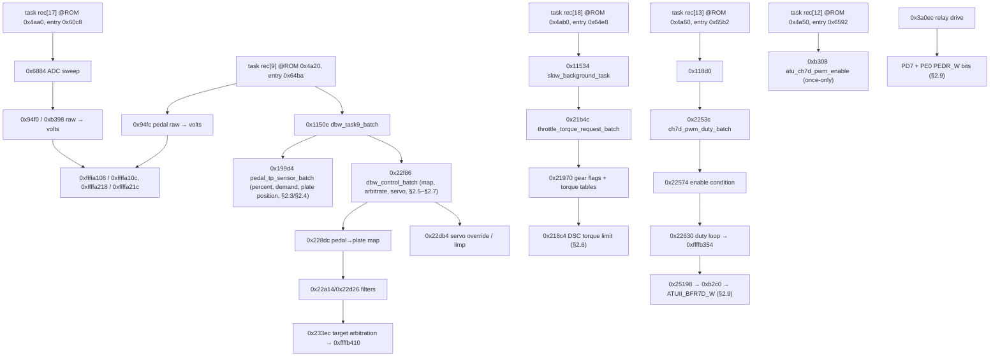

# Throttle / drive-by-wire (DBW) control — pedal, plate, servo, motor drive — subsystem report

| Date | What changed | Version |
|------|--------------|---------|
| 2026-11-22 | Initial report | 1 |
| 2026-11-22 | Gear-source chain for the pedal→plate maps, learning mechanics of the E2RAM zeros, AN11/AN23 pair clarification, 9 more RAM labels (`pedal_range_fault_{1,2}`, `plate_tp{1,2}_volts`, correlation counters, `plate_tp2_source_select`/`limp_home_request`, `learned_pedal_zero_valid`), upstream-duplicate note for PID 0x1410 | 2 |
| 2026-11-22 | Re-verified against the disassembly: pedal conversion entry (`0x94fc`) and task rec[17] ownership of the ADC sweep, per-channel TP scale/base and the band/fault word pairs, gear-flag→table priority, float type of `0xffffb410` and what `0x5ccb4` does, the full demand branch set, zero-learner arming/raise counters, PBCRL ownership (`0x51c8`), `0xb23c` state, the relay's PD7 half, duty-loop structure; memory map aligned with the export index and the TSVs | 3 |

**Applicable ROMs** — the behavior described here is **assumed identical across
all ROM bins until proven otherwise**; a row documents any per-ROM difference
(also detailed in [`docs/investigations/<rom-id>/`](../investigations/README.md),
never re-derived here). List only ROMs actually investigated for this subsystem
(the reference ROM always present):

| ROM | ROM specifics | Short one-line description |
|-----|---------------|----------------------------|
| [`60E15120_N3J1E`](../investigations/60E15120_N3J1E/README.md) | reference ROM — all `0x` addresses in this report are from this bin; `submodules/Mazda_RX8_PCM_ReverseEngineering/Stock_ROMs/60E15120_N3J1E.bin` (512 KiB, SHA-256 `a7cd953c2a87af12ee2814a95c958dc23959d352ef9c5e7f82b8ab8952f264f1`), untouched | Electronic throttle: pedal APP sensors → demand → gear-dependent plate request → arbitrated target → servo → TO7D PWM motor drive, with TP plausibility monitors, learned zeros, limp-home and the DBW power relay |

All content in this report is from static analysis of the canonical export
([`reverse-engineered/decompiled/`](../../reverse-engineered/decompiled/60E15120_N3J1E/)),
the disassembly and the raw ROM bytes, except where a section explicitly states
otherwise (the dynamic checks in §2.3, §2.4, §2.9 and §2.10 were run in the
SH-2E emulator against the ROM's own functions — see §4.5).

## 1. Introduction — what this subsystem is and does

The RX-8 has no throttle cable: the PCM drives the throttle plate with an
electric motor inside the throttle body (drive-by-wire), and reads the driver's
request from two accelerator-pedal-position (APP) sensors and the plate angle
from two throttle-position (TP) sensors. The wiring book puts the throttle body
on PCM connector B1-19 (six wires: motor, two TP signals, TP 5 V, TP ground)
and the pedal sensor on B1-14 (two supplies, two signals, two grounds), plus a
drive-by-wire relay on terminal 4C
([`docs/architecture/hardware/mazda-rx-8-pcm-pinout-series-1.md`](../architecture/hardware/mazda-rx-8-pcm-pinout-series-1.md)).

In firmware the chain is: one task (rec[17], entry `0x60c8`) sweeps the ADC and
latches the four raw channels (APP1/APP2 = AN4/AN5, TP1/TP2 = AN18/AN19) into
RAM and converts them to volts; the sensor batch of task rec[9] (entry `0x64ba`
→ `0x1150e` → `0x199d4`) range-checks, clamps, subtracts the learned zeros and
produces pedal percent (`0xffffa9b4`/`0xffffa9b8`, 0–100 %) and demand
(`0xffffa9bc`); a gear-selected set of 3D maps turns demand into a plate
request (`0xffffb398`, clamped to 0–84.0); filters smooth it into a base plate
position (`0xffffb38c`); an arbitration step adds idle air and applies DSC /
fuel-cut clamps to produce the target plate position (`0xffffb424`, copied to
`0xffffb410` through the PID export); a servo override (limp/home) can replace
the target; a duty loop computes the motor PWM duty (`0xffffb354`) which is
written to the ATU channel 7D compare register; and a power relay (PE0) switches
the motor supply. Plausibility monitors cross-check the two TP channels and the
pedal channels, latch DTCs, and force a limp plate position of 20.0 when the plate
is implausible.

Key numbers: pedal raw ADC counts scale to volts as
`raw × 6.341 × 7.6294e-5` on a per-channel base (0.0 V for AN4, 3.488 V for
AN5), are clamped at 25.0, have a learned zero subtracted (default 10.856), and
convert to percent as `zeroed / 12.7 × 100` clamped to [0, 100]. The plate
channels scale as `base + raw × scale × 7.6294e-5` with scale 25.0/base 0.0 V
(AN18) and scale 31.25/base −31.25 V (AN19). The plate full scale is 84.0
(`0xffffad44` units; percent `0xffffad48` = `ad44 / 84 × 100`); limp position is
20.0. Demand is `15.0` when both pedal fault flags are set, `min(13.5, …)` of the
corresponding pedal percent when exactly one is set, and otherwise
`min(max(pedal_1_percent, cruise output), limiter)` further capped at 13.5 while
`0xffffa914` is set. The motor PWM runs on ATU channel 7D (TO7D = port PB7) with
a 32000-count period; duty is 0–100 %.

## 2. How it works, step by step

### 2.1 Hardware setup

```text
Throttle body (PCM connector B1-19, six wires)
  motor  (+) 1B R/B ─┐
  motor  (−) 1C R   ─┼─ H-bridge motor drive (see §2.9 / §4.6: only the PWM
                     │   output TO7D is firmware-identified; the phase pins
  TP1    1J G/R ────┼─► AN18 (ADDR18H_B 0xfffff82c → RAM 0xffff9f08)
  TP2    1M B/L ────┼─► AN19 (ADDR19H_B 0xfffff82e → RAM 0xffff9f0a)
  TP 5V  1Q G   ────┘   TP supply
  TP GND 2F G/Y ──────── TP ground

Accelerator pedal sensor (PCM connector B1-14, A–F)
  APP2 supply 4X R/Y, APP1 supply 4Y G/R
  APP2 signal 5C R/W ──► AN5 (ADDR5H_B 0xfffff80a → RAM 0xffff9eee)
  APP1 signal 5F W/R ──► AN4 (ADDR4H_B 0xfffff808 → RAM 0xffff9eec)
  APP GND 5AB LG/B, 5AE GY

Drive-by-wire relay (terminal 4C W/B, ETV relay per circuit B1-02)
  coil control 4C ◄── PE0 (PEDR_W 0xfffff754 bit 0x1, SH7055F pkg pin 7),
                      driven by 0x3a0ec from flag 0xffffcfb7 (inverted)
  relay contact feeds the throttle-motor supply

Motor PWM
  TO7D = PB7 (SH7055F pkg pin 154), pin function selected by
  PBCRL_W 0xfffff734 = 0x4000 (written at 0x51de; PBIOR_W 0xfffff730 = 0xf484)
  duty in ATUII_BFR7D_W 0xfffff596, period 32000 in 0xffff9f50,
  counter ATUII_TCNT7D_W 0xfffff586 / cycle ATUII_CYLR7D_W 0xfffff58e,
  timer start ATUII_TSTR2_B 0xfffff400 bit 7 — all driven by 0xb308/0xb2c0
```

Firmware-level paths are distinguished from pin routing: the firmware facts
are the register/bit and function assignments above; the package-pin →
connector-terminal hop (PE0 pin 7 → 4C, PB7 pin 154 → throttle body, AN4/AN5 →
5F/5C, AN18/AN19 → 1J/1M) is board routing and remains unresolved in this repo
(see §4.6).

### 2.2 Structured overview — which tasks run what, in what order



### 2.3 Pedal input chain — AN4/AN5 to pedal percent and demand

The conversion runs in two tasks: task rec[17] (entry `0x60c8`
`ref_getSensorStuff__`, record at ROM `0x4aa0`) sweeps the ADC and converts
both sensor pairs to volts, task rec[9] (`0x64ba`) enters the same pedal
conversion body at `0x94fc` (pool `0x6564`=0x000094fc) and later runs the
percent/demand batch `0x199d4`.

- **ADC sweep `0x6884`** latches each `ADDRnH` result into RAM at
  `0xffff9ee4 + 2n` (pool `0x6a1c`=0xffff9ee4), so AN4/AN5 land at
  `0xffff9eec`/`0xffff9eee` (`adc_an4_pedal_raw`/`adc_an5_pedal_raw`).
- **`0x94f0` `pedal_adc_raw_to_volts`** (called from `0x60c8`, pool
  `0x6250`) range-checks the raw counts against the ROM words
  `0x6eeb0`=0xf5c3 (upper) and `0x6eeb4`=0x11ec (lower) and sets the
  direction-coded bytes `pedal_range_fault_1`/`pedal_range_fault_2`
  (`0xffffa110`/`0xffffa111`: 1 = above 0xf5c3, 2 = below 0x11ec, 0 = in band;
  AN4 → `a110`, AN5 → `a111`; the DTC paths 0x66–0x69 read the code). It then
  computes `0xffffa108` = `0.0f (0x6eec0) + raw4 × 6.341f (0x6eeb8=0x40cae979)
  × 7.6294e-5` and `0xffffa10c` = `3.488f (0x6eec4=0x405f3b64) + raw5 × 6.341f
  (0x6eebc) × 7.6294e-5`. Entry `0x94fc`, used by task rec[9], skips only the
  prologue that re-latches the debounced raw cells `0xffffa112`/`0xffffa114`
  (debounce counters `0xffffa116`/`0xffffa117` against ROM byte `0x6c144`=3).
- **`0x18f60` `pedal_volts_clamp_latch`** latches the raw cell (pool
  `0x19058`=0xffff9eec) into `0xffffa9c4` (pool `0x1904a`=0xa9c4), copies
  `0xffffa112` into `0xffffa9c8`, and clamps
  `0xffffa99c` = min(25.0f (`0x6eed0`=0x41c80000), `0xffffa108`). The second
  channel is the sibling `0x18fa4`: `0xffffa9a4` = min(25.0f (`0x6eed8`),
  `0xffffa10c`); `0x18f86`/`0x18fca` low-pass both channels (coefficient 0.25 at
  `0x6eed4`/`0x6eedc`, 1e-5 deadband) into `0xffffa9a0`/`0xffffa9a8`.
- **`0x1933a` `pedal_learned_zero_subtract`** — `0xffffa9ac` = max(0,
  `0xffffa99c` − learned zero `0xffff8068`) (pool `0x19386`=0x8068; the
  learned default is 10.856f = 0x412db22d, adapted by `0x18fe8`) and
  `0xffffa9b0` = max(0, `0xffffa9a4` − `0xffff8070`) (pool `0x19388`).
- **`0x193c4` `throttle_percent_and_demand_calc`** — pedal percent
  `0xffffa9b4` = clamp(`0xffffa9ac` / 12.7f × 100) with `0x194d4`=0x6ef18
  (12.7f) and `0x194d0`=0x42c80000 (100.0f); the same chain gives
  `0xffffa9b8` from `0xffffa9b0`. Demand `0xffffa9bc`:

  | Condition | `0xffffa9bc` |
  |-----------|--------------|
  | `0xffffcc9b`==1 and `0xffffcc9c`==1 | 15.0 (`0x6ef28`), constant |
  | `0xffffcc9b`==1, `0xffffcc9c`!=1 | min(13.5 (`0x6ef20`), `accelerator_pedal_2_percent` `0xffffa9b8`) |
  | `0xffffcc9b`!=1, `0xffffcc9c`==1 | min(13.5, `accelerator_pedal_1_percent` `0xffffa9b4`) |
  | neither set | min(max(`accelerator_pedal_1_percent`, cruise `0xffffbcf8`), `0xffffc028`), then min(…, 13.5) while `0xffffa914`==1, else min(…, 100.0 (`0x6ef24`)) |

  Calibration byte `0x6eec8` = 0x00 on this ROM, so the alternative ±0.01 ramped
  branch (`0x19508`–`0x1952e`) is never taken. The tail stores the demand
  history `0xffffa9c0`/`0xffffa9d0`/`0xffffa9d4` that the pedal learner uses.

Dynamic check (SH-2E emulator, `tests/test_throttle_dbw.py`): running task
`0x64ba` with AN4 raw = 50000 produces `0xffffa9b4` = 100.0 (the unclamped
value is 105 %); AN5 stays at 0, so `pedal_range_fault_2` reads 2 (below band).

### 2.4 Throttle plate feedback — AN18/AN19 to plate position

Task rec[17] converts the plate channels: `0xb398` (called from `0x60c8`,
pool `0x625c`) computes the TP volts `plate_tp1_volts`/`plate_tp2_volts`
(`0xffffa218`/`0xffffa21c`) as `base + raw × scale × 7.6294e-5` with
per-channel constants — scale 25.0f (`0x6f3e4`) and base 0.0f (`0x6f3ec`) for
AN18, scale 31.25f (`0x6f3e8`) and base −31.25f (`0x6f3f0`) for AN19 — from the
ranges AN18 `0xffff9f08` / AN19 `0xffff9f0a`. Two word pairs do different jobs:

- band check `0x6f3dc`/`0x6f3de` = 0xf5c2 (upper) and `0x6f3e0` = 0x0fd2 (AN18
  lower) / `0x6f3e2` = 0x2659 (AN19 lower): in band the debounce counter
  `0xffffa226`/`0xffffa227` is cleared and the raw cell `0xffffa222`/`0xffffa224`
  latched immediately, out of band the counter saturates at 0xff and the cell is
  held until the counter reaches ROM byte `0x6c17a` = 3; the volts are computed
  from this debounced cell;
- fault check `0x6c172`/`0x6c174` = 0xf5c2 (high) and `0x6c176`/`0x6c178` =
  0x0a3d (low) sets the fault bytes `0xffffa220`/`0xffffa221` (1 = high,
  2 = low, 0 = in range).

`0x1b08e` `plate_tp1_volts_latch` and `0x1b14c` `plate_tp2_volts_latch` latch
AN18/AN19 raw counts (pools `0x1b12c`=0xffff9f08, `0x1b1d0`=0xffff9f0a) into
`0xffffad5c`/`0xffffad5e` (pools `0x1b0e6`=0xad5c, `0x1b1c0`=0xad5e — the raw
TP cells, exported on PIDs 0x0011 / 0x1154) and copy the computed volts into
`0xffffad30`/`0xffffad34`. Then `0x1b940` computes the plate position:
`0xffffad38` = max(0, `0xffffad30` − learned `0xffff807c`), `0xffffad3c` =
max(0, `0xffffad34` − learned `0xffff8084`) (defaults 15.0f = 0x41700000 at
`0x6f438`, adapted by `0x1b3f2`); `0xffffad44` = `0xffffad38`, or `0xffffad3c`
when `plate_tp2_source_select` (`0xffffcc98`)==1, or **20.0** (ROM `0x6f464`,
limp) when additionally `limp_home_request` (`0xffffcc99`)==1; percent
`0xffffad48` = `0xffffad44` / 84.0 (ROM `0x6f468`) × 100.0 (mova `0x1bab4`).

Dynamic check: AN18/AN19 raw = 50000 → `plate_tp1_volts` = 95.367,
`0xffffad44` = 80.367, `0xffffad48` = 95.676; with `plate_tp2_source_select`=1
and `limp_home_request`=1, `0xffffad44` = 20.0 (`tests/test_throttle_dbw.py`).

### 2.5 Demand to plate request — the gear-dependent maps and filters

In the DBW control batch `0x22f86` (from `0x1150e`, pool `0x116c8`=0x00022f86):

- `0x228dc` `throttle_pedal_to_plate_request_map` — 3D lookup of (rpm
  `0xffffb548`, demand `0xffffa9bc`) in one of four tables picked by a priority
  chain over the gear flags `0xffffb2cc`/`0xffffb2cd`/`0xffffb2ce` (set by
  `0x21970`): `0xffffb2cc`==1 → `0x6a458` (gears 1/2), else
  `0xffffb2cd`==1 → `0x6a474` (neutral), else `0xffffb2ce`==1 → `0x6a490`
  (5/6), else `0x6a4ac` (3/4) (pools `0x229dc`=0x6a458, `0x229e0`=0x6a474,
  `0x229e4`=0x6a490, `0x229e8`=0x6a4ac — all-zero flags therefore select
  `0x6a4ac`). The result is clamped to [0, 84.0f] (pool `0x229f0`=0x7372c) by
  helper `0x2404` into `0xffffb398` (pool `0x229ec`), with a 12-entry history of
  the request at `0xffffb398+4i` (write `0xffffb39c`–`0xffffb3c8`) indexed by
  the byte `0xffffb3ec` (0–12, pool `0x229f8`), which also selects
  `0xffffb3cc` = `history[index]`.

  Where the "gear" comes from: the flags are computed by `0x21970` from the
  bytes `0xffffbc41`/`bc42`/`bc43`, which `0x2c15a` derives from the
  transmission state. `0x24b44` stores `0xffffb534` = 1 whenever ROM `0x74924`
  reads 0x00 and 0 otherwise; this bin reads **0x00**, so `0xffffb534` = 1 and
  `0x2c15a` takes the range/state branch (`0x2c180`…) driven by
  `0xffffbc3e`/`bc3f`/`bc40` with debounce counters `0xffffbc44`/`bc46`/`bc48`.
  The alternative switch-code decode (`0x2c294`–`0x2c312`: code 1 or 7 →
  `bc41`, 2/3 → `bc42`, 4 → `bc43`, fed by `0xffffbaed`) is not reached with
  `0xffffb534` = 1. The gear number itself is computed from the rpm/vss ratio
  (`candidate_gear` `0xffffbc3c` by `0x2c324`, latched into `current_gear`
  `0xffffbc3d` by `0x2c3b2` once the per-candidate counter reaches 12, ROM
  `0x758a2`–`0x758ac` — see
  [`cruise_control_report.md`](../investigations/60E15120_N3J1E/cruise_control_report.md)).
- `0x22a14` `pedal_demand_filter_coeffs` — filters the demand into
  `0xffffb3d4` with a fixed 0.1 coefficient (ROM `0x73730`), sets the rate
  flag `0xffffb3ed` on a ±2.0 step and uses the coefficient tables
  (rpm `0x6a354`/`0x6a368`/`0x6a37c`/`0x6a390`, coolant
  `0x6a3a4`/`0x6a3b8`, base `0x6a3cc`…`0x6a444`) for the base-position
  equation: `0xffffb38c` = min(`0xffffb2c4`, filter(x=`0xffffb38c`,
  y=`0xffffb3cc`, c=`0xffffb3d0`)), overridden to 5.0 (ROM `0x7373c`) while
  `0xffffcc9c`==1 and `0xffffb2c4`==1.
- `0x22d26` `throttle_base_position_filter` — `0xffffb390` = filter(
  x=`0xffffb38c`, y=`0xffffb394`, 0.25 (ROM `0x73740`)), then
  `0xffffb394` = (`0xffffb394` <= 2.0f, ROM `0x73744`).

### 2.6 Torque / DSC arbitration — the target plate position

The background task rec[18] (`0x64e8` → `0x11534`) runs
`0x21b4c` `throttle_torque_request_batch`: `0x21970` `throttle_gear_mode_flags`
sets `0xffffb2cc`/`0xffffb2cd`/`0xffffb2ce` from the AT gear bytes
`0xffffbc41`–`0xffffbc43` and computes torque-related lookups (`0x6a180`
Throttle Position To Torque, `0x6a164` Trans Requested Torque To Throttle Plate
Position); `0x218c4` `ref_throttlePlateControl_Related` evaluates the DSC
torque request (CAN 0x212, see
[`dsc_can_arbitration_report.md`](../investigations/60E15120_N3J1E/dsc_can_arbitration_report.md)):
`0xffffb2cf` = DSC torque-limit active (clamp value `0xffffb2b8` from table
`0x6a164`), `0xffffb2d0` = DSC mode C active (max opening `0xffffb2bc` from
table `0x6a150`).

Back in `0x22f86`, `0x233ec` `throttle_target_plate_position` arbitrates the
target `0xffffb424`: clamp(`0xffffb2b8`, coolant table `0x6a4c8`,
`0xffffb38c` + idle air `0xffffb2a4`) when `0xffffb2cf`==1; max(`0xffffb38c` +
`0xffffb2a4`, `0xffffb2bc`) when `0xffffb2d0`==1; otherwise clamp(`0xffffb38c` +
`0xffffb2a4`, 0, 84.0 from ROM `0x747d4`) with fuel-cut decel reduction (tables
`0x6a4dc`/`0x6a4f0`/`0x6a504`). The target is then passed through `0x5ccb4`,
whose result is stored as a **float** in `0xffffb410` (4 bytes, `fmov.s`): that
routine writes the value out as a Mode-22 quantity for PID 0x091a, quantized to
1/512 steps (constant `0x3b000000`, encoder `0x2490`) and decodes it back
(`0x24c0`) for the descriptor entries that hold the codes 5 or 7 — `0xffffb410`
therefore keeps the units of `0xffffb424` and is exported on PIDs
0x004c/0x091a.

### 2.7 Servo override, limp/home and learned values

Also in `0x22f86`:

- `0x22db4` `throttle_servo_override` — direction `0xffffb400` = (`0xffffb4b0`
  >= learned `0xffff807c` + 0.5f (`0x747c4`=0x3f000000) with a 0.0f band
  (`0x747c8`); mode byte `0xffffccbc` (from `0x487d6`
  `engine_stop_conditions_eval`); override duty `0xffffb3f8`: 0.0 when mode
  != 1, else min(`0xffffb410` + learned, learned + 0.5f (`0x747b8`)) while
  byte `0xffffb401`==0, decaying max(5.0f (`0x747bc`), `b3f8` − 0.05f
  (`0x747c0`)) while the word counters `0xffffb3fc`/`0xffffb3fe` exceed 2
  (`0x747b4`/`0x747b6`) (pools `0x22ea0`=0xb4b0, `0x22ea2`=0xccbc,
  `0x22ea4`=0xb3f8, `0x22ea6`=0xb410, `0x22ebc`=0xffffb400).
- `0x231f0` `learned_pedal_value_calc` — writes `0xffffb40c` as one of six
  mutually exclusive candidates selected by the bytes
  `0xffffccbb`/`ccbc`/`ccbd`/`ccac`/`cca2` (first match wins): the learned
  limit `H` + learned zero, the servo override duty `0xffffb3f8`,
  `0xffffcc88` + learned zero, `0xffffb410` + learned zero (capped at learned +
  5.0f, `0x747e4`), `0xffffcca8`, otherwise `0xffffb410` + learned zero; the
  clamp is `clamp(value, 0, H)` where `H` = readValue(`0xffff808c`, default
  111.0f = 0x42de0000 at ROM `0x6f45c`), except the `0x747e8` = 99.0 branch
  taken when the high byte of `0xffff808c` reads 1. The function also copies
  byte `0xffffa41c` into `0xffffb436`. Every operand is plate-/servo-side; the
  alias name is a carry-over from the earlier pass (§4.3).
- `0x23558` `throttle_position_delta_calc` — `0xffffb414` = `0xffffb410` −
  `0xffffb428` (0.0 when `0xffffccc9` set), then `0xffffb428` = `0xffffb410`;
  both exported via the E2RAM block encode `0x244bc`.

### 2.8 Plausibility monitors, learning and DTCs

- `0x4595a` `tp_correlation_fault_check` (called from `0x38e12`) — compares the
  two pedal zeroed-volt channels `0xffffa9ac`/`0xffffa9b0`; the monitor runs only
  while `0xffffcbf0`==1. The |difference| limit is a five-rung ladder keyed on
  pedal-2 volts `0xffffa9b0` (breakpoints 0.6/1.2/2.0/4.0 at
  `0x7c76c`–`0x7c778`; every rung limit is 3.5f, `0x7c77c`–`0x7c78c`) while the
  learned value is valid (`learned_pedal_zero_valid` `0xffff8078`==1), else
  9.536f (`0x7c790`=0x41189375). Good counter `tp_correlation_good_counter`
  (`0xffffcbf2`) >= 25 (ROM u16 `0x7c794`) → `0xffffcbec`=1; bad counter
  `tp_correlation_bad_counter` (`0xffffcbee`) >= 29 (`0x7c796`) → `0xffff872c`=1
  and DTC 0x6c via `0x5fd38`. The operands are the APP channels; the `tp_` prefix
  on these three aliases is a carry-over (§4.3).
- `0x33e98` `plate_range_high_fault` (called from the fueling main task
  `0x20e40`) — `0xffffc108` = 1 while plate percent `0xffffad48` >= 200.0f
  (`0x79be0`=0x43480000), cleared below 196.48 (hysteresis 3.52f,
  `0x79be4`=0x406147ae); consumers `0x33dc8`/`0x34230` zero the
  accel-enrichment accumulators.
- Range faults on the pedal raw channels (`pedal_range_fault_1`/`_2` =
  `0xffffa110`/`0xffffa111` from `0x94f0`, value 1 = above band, 2 = below
  band, 0 = in band) feed DTCs 0x66–0x69; the four DTC paths read the code with
  `==1` / `!=1` tests, so 0x67/0x69 report the high side and 0x66/0x68 the
  "not high" case.
- Learning, pedal zeros (`0xffff8068`/`0xffff8070`, adapted by `0x18fe8`):
  arming (`0xffffa9ce`=1) requires the learner to be idle, the previous-cycle
  demand-rate flag `0xffffa9cc`=1 (demand-history cell `0xffffa9c0` in
  [−0.5, −0.3), `0x6eee0`/`0x6eee4`), the sticky "pedal was in [5, 40) %" flag
  `0xffffa9cd`, pedal percent < 5.0 (`0x6eef0`/`0x6eef4`) and no pedal range
  fault. While armed, counter `0xffffa9d8` counts up and disarms the learner at
  0x177 (ROM `0x6eeca`); the +0.01 raise (`0x6ef04`) is gated by the second
  counter `0xffffa9da` against the same 0x177 (`0x6eecc`) and applies once after
  arming. The learned value is stepped down by 0.005 (`0x6eefc`) toward the
  filtered clamped volts `0xffffa9a0`/`0xffffa9a8` (only when those are at or
  below the learned value), floored at 9.626f (`0x6eef8`) and capped at 10.856f
  (`0x6ef00`); when both channels agree within 0.032f (`0x6ef10`) the valid flag
  `learned_pedal_zero_valid` (`0xffff8078`) is set to 1. On a pedal range fault
  (`0xffffcc9b`/`cc9c`) both learned zeros are reset to the 10.856f default
  (`0x6ef08`/`0x6ef0c`) and the valid flag cleared.
- Learning, plate zeros (`0xffff807c`/`0xffff8084`, adapted by `0x1b3f2`):
  the boot-time home reference (`0xffffb4b0`/`0xffffb4b4`, E2RAM-decoded by
  `0x23844`) is filtered (0.5, ROM `0x6f434`) into `0xffffad68`/`0xffffad6c`
  and clamped to [10 (`0x6f440`), 20 (`0x6f43c`)] into
  `0xffffad58`/`0xffffad78`. Once the stable-pass counter `0xffffadc8` reaches
  the ROM u16 `0x6f3f8` = 10 the flag `0xffffad8e` is set; with
  `0xffff873e`==0, the engine-running cells `0xffff809c`/`0xffff809e` (derived
  from `0xffffaa68`) and byte `0xffffcc5e`==1, the learned zeros are updated
  from `0xffffad58`/`0xffffad78` plus the E2RAM offsets `0xffff80ac`/
  `0xffff80b4`. The enable flag `0xffff80a0` (written by `0x1b3f2` itself)
  cleared resets both to the 15.0f default (`0x6f438`), and limp/fault flags
  (`0xffffcc98`/`cc99`, bit of `0xffff873c`) force the same reset.
- Plausibility flags `0xffffad60`/`0xffffad61` (written by `0x1ba20` and
  `0x1bd9e`, the latter also setting `0xffff80a2`): in `0x48cc0` a 1 on either
  flag, or on `0xffff80a2`, permits the shutdown path and sets
  `shutdown_allowed` `0xffffccc1`; `0x251d0` then derives `0xffffb574` and
  drops the main-relay hold PD11. All learned cells are E2RAM-backed and
  persisted by `0x244bc`/`0x23844`.

### 2.9 Motor drive — DBW power relay and the TO7D PWM

**Power relay.** `0x3a0ec` `relay_output_pair_pd7_pe0` drives two outputs, both
gated by the pad-control helper `0x4bbc`: PD7 (`PDDR_W 0xfffff746` bit 0x80) =
(`0xffffcfb6` == 1) and PE0 (`PEDR_W 0xfffff754` bit 0x1, SH7055F package pin 7)
= (`0xffffcfb7` == 0), i.e. the PE0 side is inverted and the PD7 side is not.
The flag producer is `0x4ef86` (writes `0xffffcfb6`/`0xffffcfb7`). The PE0 half
is the drive-by-wire relay, harness candidate terminal 4C (W/B, the ETV relay
coil per circuit diagram B1-02). Dynamic check: `0x3a0ec` sets PE0 with
`0xffffcfb7`=0, clears it with `0xffffcfb7`=1 (`tests/test_throttle_dbw.py`).

**PWM output.** Channel 7D of the ATU (TO7D = PB7, package pin 154) carries the
motor duty. Boot initialises the ATU block in the init chain reached from
`0x4c92`: `ATUII_TSTR2_B` (`0xfffff400`) and `ATUII_TSTR1_B` (`0xfffff401`) are
loaded with 0xff and `ATUII_TSTR3_B` (`0xfffff402`) with 0x01
(`0x4ef6`–`0x4efe`), so the timer block runs independently of the throttle
channel. The pin-function select `PBCRL_W 0xfffff734` = 0x4000
(TO7D on PB7; pools `0x52d8`/`0x52da`) is written at `0x51de` inside the init
function entered at `0x51c8`, together with `PBCRH_W` = 0x1450 and
`PBIOR_W` = 0xf484. What is unique to the throttle motor is the compare
register: `ATUII_BFR7D_W 0xfffff596` has exactly three writers (`0xb270`,
`0xb300`, `0xb346`), all inside `0xb2c0`/`0xb308`. `0xb308`
`atu_ch7d_pwm_enable` (called once from task rec[12] `0x6592`, single pool
reference `0x66cc`) starts channel 7D (`ATUII_TSTR2_B` bit 7) and loads
`ATUII_CYLR7D_W 0xfffff58e` = `ATUII_TCNT7D_W 0xfffff586` =
`ATUII_BFR7D_W 0xfffff596` = `ATUII_DTR7D_W 0xfffff59e` = 32000 (0x7d00, also
kept in `0xffff9f50`); it does not touch `PBCRL_W`. `0xb23c`
`ch7d_pwm_off_init` clears `0xffffa214[0]` and the 32-bit `0xffffa210`, clears
and then re-sets the channel-7D start bit with `CYLR7D`/`TCNT7D`/`DTR7D` = 1 and
`BFR7D` = 0, i.e. it leaves the channel running at 0 % duty on a 1-count period.
The running duty loop is task rec[13] (`0x65b2` → `0x118d0`, pool
`0x66d8`=0x000118d0 → `0x2253c` `ch7d_pwm_duty_batch`, pools
`0x22560`–`0x2256c`):

- `0x22574` `ch7d_pwm_enable_condition` — enable `0xffffb358` = engine running
  (`0xffffa428`) && running timer `0xffffa424` >= the u16 result of a 3D
  coolant/IAT lookup (table `0x6a340`, held in `0xffffb386`; inputs the
  coolant-derived `0xffffb35c` and `0xffffade0`), compared unsigned
  (`cmp/hs`) — && coolant gate `0xffffb388` (coolant `0xffffa98c` >= −50.0f
  `0x7353c`, released at −52.5f) && 9.0f <= battery `0xffffb590` < 16.0f
  (`0x73540`/`0x73544`) && !`0xffffcd70` (stuck-duty latch, OR of the six flags
  `0xffffc91d`/`c912`/`c914`/`c96d`/`c96f`/`c971` in `0x4a11c`, written by the
  stall monitor `0x416bc`). The ROM byte `0x73538`==0xff bypass is inert on this
  bin (0x00).
- `0x22630` `ch7d_pwm_duty_control_loop` — closed-loop duty `0xffffb354`
  (0–100 %): the loop tracks the filtered feedback `0xffffaa78` around 30.0f
  (`0x7355c`) with P (×4.5f, `0x73550`), I (`0xffffb364` += Δ×0.1875f,
  `0x73554`) and D ((`0xffffb36c`−`aa78`)×0.75f, `0x73558`) terms; the P term is
  applied only while neither hysteresis latch `0xffffb389`/`0xffffb38a` is set,
  the D term only while byte `0xffffb384` < 0xea (ROM `0x7353a`), and two
  alternative branches write the duty outright from the feedforward tables
  (`0x6a2cc`/`0x6a2f4`/`0x6a324`/`0x6a2e0`, scaled by `b378`, byte `0x7353a`
  ramp scale 128.0f at `0x22894`). The latches are 44.0f/39.0f
  (`0x7354c`, 39 = 44 − 5.0f at `0x226b0`) and 45.0f/40.0f (`0x73548`); the
  final duty is min(P+I+D, `0xffffb360`) and is forced to 0 when
  `0xffffb358`==0.

  The loop feedback `0xffffaa78` is the labeled differential ADC pair: `0xaee8`
  `adc_pair_correlation_fault_compute` (entered from task rec[12] through the
  `0xad2a` thunk) samples AN23 (`ADDR23H_B 0xfffff836`) twice and AN11
  (`ADDR11H_B 0xfffff816`) twice per cycle and computes
  |ΔAN23|·7.6294e-5 / |Δ(AN23−AN11)/200| − 16.25 → `adc_pair_ratio_raw`
  `0xffffa1d8`, filtered (0.25) → `adc_pair_ratio_filtered` `0xffffa1d4`,
  copied to `0xffffaa78` by `0x1ac00` (which also uses it for the lambda band
  flag `lambda_in_target_band` `0xffffaa80`); the pair also has range
  (`0xffffa1dc`) and correlation (`0xffffa1dd`, ±0.005 V) fault cells. Only
  the pin-level identity of AN11/AN23 is unresolved (§4.6).
- `0x25198` `ch7d_pwm_duty_ratio` — `0xffffb570` = clamp(`0xffffb354`, 0, 100.0f
  (`0x251c4`=0x42c80000)) via `0x2404` (pool `0x251c8`), divided by 100 with an
  inline `fdiv` (`0x251ae`), then tail-jumps to `0xb2c0` with r4 = 0 (channel
  index).
- `0xb2c0` `ch7d_pwm_duty_write` — `0xffffa210`[ch] = (u32)(duty × 65536.0f)
  (`0xb390`=0x47800000, pool `0xb37c`=0xffffa210); when enabled
  (`0xffffa214`[ch], pool `0xb380`) and ch == 0, `ATUII_BFR7D_W 0xfffff596` =
  saturating_mul_shift16(`0xffffa210`[0], `0xffff9f50`) via `0x231c` (pools
  `0xb374`=0xf596, `0xb38c`=0xffff9f50, `0xb394`=0x231c). `0xffff9f50` is also
  written by `0xb290`.

### 2.10 Logger PID 0x1410 — settled as injector pulse time

The UDS mode-22 dispatch record at ROM `0x5f394` (bytes
`14100200 fffc0000 00056f6c`: PID 0x1410, length 2, −4, handler `0x56f6c`)
points at handler `0x56f6c`, which reads the float `0xffffbe24` (pool
`0x57018`=0xbe24 — the injector pulse time written by
`injector_pulse_time_arbitrate` `0x2fea8`, see
[`fueling_control_report.md`](../investigations/60E15120_N3J1E/fueling_control_report.md))
and encodes it as u16 with step 8.0f (pool `0x57048`=0x41000000) via the
encoder `0x2490` (pool `0x57038`=0x2490) — i.e. **8 µs units**. The upstream
logger definition lists both "Injector Pulse Time" and "Throttle Pedal
Position" at 0x221410; on this ROM it is the injector pulse time, and the
reviewed def (`data/definitions/romraider/reviewed-rx8defs-copy/logger_60E15120_reviewed.xml`)
now carries only that meaning (the "Throttle Pedal Position" entry was removed,
see §4.3). The throttle plate is exported on PIDs 0x0011/0x093c
(`0x569f0`→`0x5553e` reads `0xffffad5c`, `0x56e04` reads `0xffffad44`) and the
pedal on PIDs 0x0049/0x004a (`0xffffa9c4`/`0xffffa9c6`) plus 0x0914/0x0915,
0x004c/0x091a (`0xffffb410`) and 0x1154 (`0xffffad5c` raw). Dynamic check:
handler `0x56f6c` with `0xffffbe24` = 80.0 encodes u16 10, with 16.0 encodes 2
(step 8.0; `tests/test_throttle_dbw.py`). The design doc §5.8 note is settled
accordingly
([`docs/architecture/design/README.md`](../architecture/design/README.md)).

## 3. Technical pseudocode

```c
// ---- task rec[17] 0x60c8 (ADC sweep + both raw->volts conversions) ----
void ref_getSensorStuff__(void) {                     // 0x60c8, task record 0x4aa0
    adc_sweep();                                       // 0x6884: ADDRnH -> 0xffff9ee4 + 2n (AN4/AN5 = 9eec/9eee, AN18/AN19 = 9f08/9f0a)
    pedal_adc_raw_to_volts();                          // 0x94f0: a108 = 0.0f + raw4*6.341f*7.6294e-5; a10c = 3.488f + raw5*6.341f*7.6294e-5; band 0x11ec..0xf5c3 -> a110/a111 (1 = high, 2 = low)
    FUN_0000b398();                                    // plate raw -> volts a218/a21c: AN18 25.0f/0.0f, AN19 31.25f/-31.25f (0x6f3e4..0x6f3f0); band 0x6f3dc..0x6f3e2 (debounce 0x6c17a=3), fault bytes a220/a221 vs 0x6c172..0x6c178
}

// ---- task rec[9] 0x64ba: pedal conversion entry + batch dispatcher ----
void knock_sensor_fault_task(void) {                  // 0x64ba, task record 0x4a20
    candidate_main_task_software_reset_check();        // 0xd21e
    FUN_00006842();                                    // 0x6842
    pedal_adc_raw_to_volts_entry();                    // 0x94fc: body of 0x94f0 after the raw-relatch prologue
    ref_knockSensorADCFault();                         // 0xc290
    dbw_task9_batch();                                 // 0x1150e (pool 0x656c)
}

// ---- task rec[9] -> 0x1150e -> 0x199d4 (sensor/percent batch) ----
void pedal_tp_sensor_batch(void) {                    // 0x199d4
    pedal_volts_clamp_latch();                         // 0x18f60: a9c4 = 9eec, a9c8 = a112, a99c = min(25.0f, a108)
    ref_filterSomething();                             // 0x18f86: a9a0 = filter(a99c)
    FUN_00018fa4();                                    // 0x18fa4: a9a4 = min(25.0f (0x6eed8), a10c)
    ref_filterSomething2();                            // 0x18fca: a9a8 = filter(a9a4)
    FUN_00018fe8();                                    // pedal-zero learner (a9ce/a9d8/a9da, 10.856f default)
    pedal_learned_zero_subtract();                     // 0x1933a: a9ac = max(0, a99c - 0xffff8068); a9b0 = max(0, a9a4 - 0xffff8070)
    throttle_percent_and_demand_calc();                // 0x193c4: a9b4/a9b8 = clamp(zeroed/12.7f*100, 0, 100); a9bc per the §2.3 branch table
    plate_tp1_volts_latch();                           // 0x1b08e: ad5c = 9f08 (raw); ad30 = a218 (volts)
    plate_tp2_volts_latch();                           // 0x1b14c: ad5e = 9f0a (raw); ad34 = a21c (volts)
    FUN_0001b3f2();                                    // plate-zero learner (ad68/ad6c -> ad58/ad78, 15.0f default)
    ref_calculateThrottlePedalPercentForSomethingElse_(); // 0x1b940: ad44 = ad38 | ad3c (cc98) | 20.0 (cc98&&cc99); ad48 = ad44/84*100
}

// ---- task rec[9] -> 0x1150e -> 0x22f86 (DBW control batch) ----
void dbw_control_batch(void) {                        // 0x22f86
    throttle_servo_override();                         // 0x22db4: dir b400, duty b3f8 (mode ccbc)
    throttle_target_plate_position();                  // 0x233ec: b424 = arbitrate(b38c+b2a4, DSC b2cf/b2d0, fuel-cut); b410 = 0x5ccb4(b424) as float
    learned_pedal_value_calc();                        // 0x231f0: b40c = clamp(candidate, 0, H) with H = readValue(0xffff808c, 111.0f)
    throttle_position_delta_calc();                    // 0x23558: b414 = b410 - b428; b428 = b410
    throttle_pedal_to_plate_request_map();             // 0x228dc: b398 = clamp(tbl_gear(rpm, a9bc), 0, 84.0f); history index b3ec
    pedal_demand_filter_coeffs();                      // 0x22a14: b3d4 = filter(a9bc, 0.1); b38c = min(b2c4, filter(b38c, b3cc, b3d0))
    throttle_base_position_filter();                   // 0x22d26: b390 = filter(b38c, b394, 0.25); b394 = (b394 <= 2.0)
}

// ---- task rec[18] 0x64e8 -> 0x11534 -> 0x21b4c (torque batch) ----
void throttle_torque_request_batch(void) {            // 0x21b4c
    throttle_gear_mode_flags();                        // 0x21970: b2cc/b2cd/b2ce priority chain from bc41/bc42/bc43; tbl 0x6a180 / 0x6a164
    ref_throttlePlateControl_Related();                // 0x218c4: b2cf/b2d0 DSC gates; b2b8 = tbl 0x6a164, b2bc = tbl 0x6a150
}

// ---- task rec[13] 0x65b2 -> 0x118d0 -> 0x2253c (motor PWM) ----
void ch7d_pwm_duty_batch(void) {                      // 0x2253c
    ch7d_pwm_enable_condition();                       // 0x22574: b358 = running && timer >= 0xffffb386 && coolant>=-50 (b388) && 9<=batt<16 && !cd70
    ch7d_pwm_duty_control_loop();                      // 0x22630: b354 = min(P+I+D, b360) on aa78 (P 4.5 / I 0.1875 / D 0.75), latches b389/b38a
    ch7d_pwm_duty_ratio();                             // 0x25198: b570 = clamp(b354,0,100)/100 -> 0xb2c0(ch 0)
}
void ch7d_pwm_duty_write(int ch, float duty) {        // 0xb2c0: a210[ch] = (u32)(duty*65536.0f); if (a214[ch] && ch==0) ATUII_BFR7D_W = sat_mul16(a210[0], 0xffff9f50)
}

// ---- relay + once-only PWM setup ----
void relay_output_pair_pd7_pe0(void) {                // 0x3a0ec: PDDR_W bit 0x80 = (0xffffcfb6 == 1); PEDR_W bit 0x1 = (0xffffcfb7 == 0)
}
void atu_ch7d_pwm_enable(void) {                      // 0xb308 (once): TSTR2 bit7, CYLR7D=TCNT7D=BFR7D=DTR7D=32000; BFR7D=duty*32000>>16
}
void ch7d_pwm_off_init(void) {                        // 0xb23c: a214[0]=0, a210=0, start bit clear + CYLR7D/TCNT7D/DTR7D=1, BFR7D=0, start bit set
}

// ---- logger PID 0x1410 (dispatch record 0x5f394) ----
u16 diag22_pid1410_injector_pulse_time(void) {        // 0x56f6c
    return encode_u16(0xffffbe24, step 8.0f);          // 0x2490, pool 0x57048=0x41000000
}
```

## 4. Proof — evidence and validation

### 4.1 Memory map (mandatory)


#### Functions (labels as in `function_index.tsv`)


| Address | Label | Role |

|---------|-------|------|

| 0x000060c8 | `ref_getSensorStuff__` (task rec[17] entry) | ADC sweep `0x6884` → `0x94f0` (pedal volts) → `0xb398` (plate volts) |

| 0x00006884 | `adc_scan_sweep_all_channels` | `ADDRnH` → `0xffff9ee4 + 2n` |

| 0x000064ba | `knock_sensor_fault_task` (task rec[9] entry) | pedal-volts entry `0x94fc`, tail-calls `0x1150e` (pool `0x656c`=0x0001150e) |

| 0x000064e8 | `slow_task_entry` (task rec[18] entry) | runs the `0x11534` background task |

| 0x00006592 | `task12_adc_feedback_pwm_entry` (task rec[12] entry) | calls `0xb308` (once-only PWM enable) and `0xaee8` via the `0xad2a` thunk |

| 0x000065b2 | `task13_temp_sensor_dtc_entry` (task rec[13] entry) | calls `0x118d0` (pool `0x66d8`=0x000118d0) |

| 0x0001150e | `dbw_task9_batch` | batch dispatcher: pools `0x116b8`=0x199d4, `0x116c8`=0x22f86, `0x116e4`=0x21b4c |

| 0x000199d4 | `pedal_tp_sensor_batch` | pedal percent/demand + plate position batch |

| 0x000094f0 | `pedal_adc_raw_to_volts` | AN4/AN5 range check + volts scaling |

| 0x000094fc | `FUN_000094fc` | task-rec[9] entry into the `0x94f0` body (pool `0x6564`) |

| 0x00018f60 | `pedal_volts_clamp_latch` | AN4 raw latch + min(25.0f) clamp |

| 0x0001933a | `pedal_learned_zero_subtract` | learned-zero subtraction, both pedal channels |

| 0x000193c4 | `throttle_percent_and_demand_calc` | pedal % (a9b4/a9b8) and demand (a9bc) |

| 0x0000b398 | `FUN_0000b398` (plate raw→volts) | TP volts a218/a21c, band + fault bytes |

| 0x0001b08e | `plate_tp1_volts_latch` | AN18 → ad5c (raw) / ad30 (volts) |

| 0x0001b14c | `plate_tp2_volts_latch` | AN19 → ad5e (raw) / ad34 (volts) |

| 0x0001b940 | `ref_calculateThrottlePedalPercentForSomethingElse_` (`ref_` hypothesis name; computes the plate position) | ad44/ad48, limp 20.0 |

| 0x00022f86 | `dbw_control_batch` | DBW control batch |

| 0x000228dc | `throttle_pedal_to_plate_request_map` | gear-selected 3D maps → b398 |

| 0x00022a14 | `pedal_demand_filter_coeffs` | demand filter → b3d4/b38c |

| 0x00022d26 | `throttle_base_position_filter` | b390/b394 |

| 0x00022db4 | `throttle_servo_override` | servo dir/duty/mode (b400/b3f8/ccbc) |

| 0x000233ec | `throttle_target_plate_position` | arbitration → b424 → b410 |

| 0x000231f0 | `learned_pedal_value_calc` (carry-over name; plate-/servo-side operands) | b40c learned-value clamp |

| 0x00023558 | `throttle_position_delta_calc` | b414 = b410 − b428 |

| 0x00021b4c | `throttle_torque_request_batch` | torque batch from `0x11534` |

| 0x00021970 | `throttle_gear_mode_flags` | b2cc/b2cd/b2ce + torque tables |

| 0x000218c4 | `ref_throttlePlateControl_Related` | DSC torque limit (b2cf/b2d0, tbl 0x6a150/0x6a164) |

| 0x0004595a | `tp_correlation_fault_check` (carry-over name; compares the two pedal channels) | pedal correlation monitor → DTC 0x6c |

| 0x00033e98 | `plate_range_high_fault` | ad48 >= 200.0 → c108 |

| 0x0002253c | `ch7d_pwm_duty_batch` | PWM batch from `0x118d0` |

| 0x00022574 | `ch7d_pwm_enable_condition` | b358 enable gates |

| 0x00022630 | `ch7d_pwm_duty_control_loop` | duty loop → b354 |

| 0x00025198 | `ch7d_pwm_duty_ratio` | b570 = clamp(b354)/100 → `0xb2c0` |

| 0x0000b2c0 | `ch7d_pwm_duty_write` | a210 q16 → ATUII_BFR7D_W |

| 0x0000b308 | `atu_ch7d_pwm_enable` | once-only TO7D setup + start |

| 0x0000b23c | `ch7d_pwm_off_init` | 0 % duty, 1-count period |

| 0x000051c8 | `FUN_000051c8` (init) | `PBCRL_W`=0x4000 at `0x51de`, `PBCRH_W`=0x1450, `PBIOR_W`=0xf484 |

| 0x0003a0ec | `FUN_0003a0ec` (medium-confidence alias `relay_output_pair_pd7_pe0`) | PD7 = (cfb6==1), PE0 = (cfb7==0) |

| 0x0000aee8 | `adc_pair_correlation_fault_compute` | AN11/AN23 pair ratio → a1d8/a1d4 |

| 0x00002490 | `rx8_encode_u16_affine_saturate` | PID encoder helper (round(v/step), clamped u16) |

| 0x000024c0 | `rx8_decode_u16_affine` | PID decoder helper |

| 0x0005ccb4 | `FUN_0005ccb4` | Mode-22 export/requantize (1/512) for PID 0x091a |

| 0x00056f6c | `diag22_pid1410_injector_pulse_time` | PID 0x1410 handler (dispatch record `0x5f394`) |


#### RAM (0xffff…)


| Address | Label | Type | Written by | Read by |

|---------|-------|------|-----------|---------|

| 0xffff9eec | `adc_an4_pedal_raw` | u16 | `0x6884` | `0x94f0`, `0x18f60` |

| 0xffff9eee | `adc_an5_pedal_raw` | u16 | `0x6884` | `0x94f0`, `0x18fa4` |

| 0xffff9f08 | `adc_an18_plate_tp1_raw` | u16 | `0x6884` | `0xb398`, `0x1b08e` |

| 0xffff9f0a | `adc_an19_plate_tp2_raw` | u16 | `0x6884` | `0xb398`, `0x1b14c` |

| 0xffffa108 | `pedal_1_scaled_volts` | float | `0x94f0` | `0x18f60` |

| 0xffffa99c | `pedal_1_volts_clamped25` | float | `0x18f60` | `0x1933a` |

| 0xffffa9ac | `pedal_1_volts_zeroed` | float | `0x1933a` | `0x193c4`, `0x4595a` |

| 0xffffa9b4 | `accelerator_pedal_1_percent` | float | `0x193c4` | `0x193c4` (demand), `0x18fe8`, cruise `0x4c896`, torque batch |

| 0xffffa9b8 | `accelerator_pedal_2_percent` | float | `0x193c4` | demand branch `0x193c4` |

| 0xffffa9bc | `inferred_ram_a9bc_ffffa9bc` (pedal demand, 0–100 %) | float | `0x193c4` | `0x228dc`, `0x22a14` |

| 0xffffad5c | `inferred_throttle_sensor_volts_ffffad5c` (AN18 raw counts) | u16 | `0x1b08e` | PIDs 0x0011/0x0917/0x1154 |

| 0xffffad5e | `inferred_throttle_sensor_2_volts_ffffad5e` (AN19 raw counts) | u16 | `0x1b14c` | PID 0x1154 |

| 0xffffad44 | `inferred_throttle_position` | float | `0x1b940` | `0x33e98`, PID 0x093c |

| 0xffffad48 | `inferred_ram_ad48_ffffad48` (plate percent) | float | `0x1b940` | `0x33e98` (pool `0x33f6a`) |

| 0xffffa110 | `pedal_range_fault_1` | u8 | `0x94f0` | DTC paths `0x45b3c`/`0x45c42` |

| 0xffffa111 | `pedal_range_fault_2` | u8 | `0x94f0` | DTC paths `0x45d90`/`0x45e96` |

| 0xffffa218 | `plate_tp1_volts` | float | `0xb398` | `0x1b08e` → `0xffffad30` |

| 0xffffa21c | `plate_tp2_volts` | float | `0xb398` | `0x1b14c` → `0xffffad34` |

| 0xffffb398 | `throttle_plate_request` | float | `0x228dc` | `0x228dc` history (`0xffffb398+4i`) |

| 0xffffb38c | `candidate_throttle_base_position` | float | `0x22a14` | `0x22d26`, `0x233ec`, `0x231f0`, `0x218c4` |

| 0xffffb424 | `throttle_target_plate_percent` | float | `0x233ec` | `0x5ccb4` |

| 0xffffb410 | `inferred_ram_b410_ffffb410` (target plate position) | float | `0x233ec` via `0x5ccb4` | PIDs 0x004c/0x091a, `0x22db4`, `0x231f0`, `0x23558` |

| 0xffffb3f8 | `throttle_servo_override_duty` | float | `0x22db4` | `0x22db4` (decay), `0x231f0` |

| 0xffffb400 | `throttle_servo_direction` | u8 | `0x22db4` | — |

| 0xffffccbc | `throttle_servo_mode` | u8 | `0x487d6` | `0x22db4` |

| 0xffffb2cc | `throttle_gear_mode_1_2` | u8 | `0x21970` | `0x228dc` map select |

| 0xffffb2cf | `dsc_torque_limit_active` | u8 | `0x218c4` | `0x233ec` |

| 0xffffb2d0 | `dsc_mode_c_active` | u8 | `0x218c4` | `0x233ec` |

| 0xffffb354 | `ch7d_pwm_duty_percent` | float | `0x22630` | `0x25198`, `0x416bc` |

| 0xffffb358 | `ch7d_pwm_enable` | u8 | `0x22574` | `0x22630` |

| 0xffffb570 | `inferred_ram_b570_ffffb570` (duty ratio 0–1) | float | `0x25198` | PID 0x1631 |

| 0xffffa210 | `ch7d_pwm_duty_q16` | u32 array | `0xb2c0`, `0xb23c`, `0xb308` | `0xb2c0` → BFR7D |

| 0xffffa214 | `ch7d_pwm_enabled` | u8 array | `0xb308`, `0xb23c` | `0xb2c0` |

| 0xffff9f50 | `ch7d_pwm_period` | u16 | `0xb308`, `0xb290` | `0xb2c0` |

| 0xffffcd70 | `throttle_fault_latch` | u8 | `0x4a11c` | `0x22574` |

| 0xffffa428 | `engine_running` | u8 | `0xe274` | `0x22574` |

| 0xffffa424 | `engine_running_timer` | u16 | `0xe21c` | `0x22574` |

| 0xffffaa68 | `engine_running_flag` | u8 | — | `0x1b3f2` → `0xffff809c`/`0xffff809e` |

| 0xffffa41c | `engine_stopped_latch` | u8 | — | `0x231f0` → `0xffffb436` |

| 0xffff8068 | `learned_pedal_zero_1` | float | `0x18fe8` | `0x1933a` |

| 0xffff8070 | `learned_pedal_zero_2` | float | `0x18fe8` | `0x1933a` |

| 0xffff8078 | `learned_pedal_zero_valid` | u8 | `0x18fe8` | `0x4595a` threshold select |

| 0xffff807c | `inferred_ram_807c_ffff807c` (learned plate zero 1) | float | `0x1b3f2` | `0x1b940`, `0x22db4`, `0x231f0` |

| 0xffff8084 | `learned_plate_zero_2` | float | `0x1b3f2` | `0x1b940` |

| 0xffffa1d4 | `adc_pair_ratio_filtered` | float | `0xaee8` | `0x1ac00` (lambda band), duty loop |

| 0xffffad60 | `tp_plausibility_fault_a` (carry-over name; 1 permits shutdown) | u8 | `0x1ba20` | `0x48cc0` |

| 0xffffad61 | `tp_plausibility_fault_b` (carry-over name; 1 permits shutdown) | u8 | `0x1ba20`, `0x1bd9e` | `0x48cc0` |

| 0xffffccc1 | `shutdown_allowed` | u8 | `0x48cc0` | `0x251d0` |

| 0xffffb574 | `relay_hold_flag` | u8 | `0x251d0` | PD11 hold |

| 0xffff872c | `tp_correlation_fault_latch` | u8 | `0x4595a` | DTC 0x6c via `0x5fd38` |

| 0xffffc108 | `tp_range_high_fault` | u8 | `0x33e98` | `0x33dc8`/`0x34230` |

| 0xffffcbec | `tp_correlation_ok` | u8 | `0x4595a` | — |

| 0xffffcbf2 | `tp_correlation_good_counter` | u16 | `0x4595a` | → `0xffffcbec` |

| 0xffffcbee | `tp_correlation_bad_counter` | u16 | `0x4595a` | → `0xffff872c` + DTC 0x6c |

| 0xffffcc98 | `plate_tp2_source_select` | u8 | — | `0x1b940`, `0x487d6` |

| 0xffffcc99 | `limp_home_request` | u8 | — | `0x1b940`, `0x1b3f2` |

| 0xffffcfb6 | `pd7_relay_flag` | u8 | `0x4ef86` | `0x3a0ec` → PD7 |

| 0xffffcfb7 | `pe0_relay_flag` | u8 | `0x4ef86` | `0x3a0ec` → PE0 |

| 0xffffbe24 | `injector_pulse_time` | float | `0x2fea8` | PID 0x1410 handler `0x56f6c` |

| 0xffffaa78 | AN11/AN23 pair ratio copy (no accepted alias) | float | `0x1ac00` | `0x22630` duty loop |

| 0xffffb40c | `candidate_learned_pedal_value` | float | `0x231f0` | E2RAM `0x244bc` |

| 0xffffb414 | `throttle_pedal_position_delta` | float | `0x23558` | E2RAM `0x244bc` |


Cells referenced in §2 that carry no accepted RAM alias yet (kept as bare

addresses there and in `reviews/throttle_dbw/README.md`): pedal conversion

second channel and filters `0xffffa10c`, `0xffffa9a0`, `0xffffa9a4`,

`0xffffa9a8`; pedal learner state `0xffffa9c0`, `0xffffa9c8`, `0xffffa9cc`,

`0xffffa9cd`, `0xffffa9ce`, `0xffffa9d0`, `0xffffa9d4`, `0xffffa9d8`,

`0xffffa9da`, `0xffff808c`; demand branches `0xffffa914`, `0xffffcc9b`,

`0xffffcc9c`; TP band and fault words `0xffffa220`, `0xffffa221`,

`0xffffa222`, `0xffffa224`, `0xffffa226`, `0xffffa227`, `0xffffad30`,

`0xffffad34`; plate learner `0xffffad58`, `0xffffad68`, `0xffffad6c`,

`0xffffad78`, `0xffffad8e`, `0xffffadc8`, `0xffff80a0`, `0xffff80ac`,

`0xffffb4b0`, `0xffffb4b4`, `0xffff873e`; plausibility `0xffff80a2`;

map and filter state `0xffffb2b8`, `0xffffb2bc`, `0xffffb2c4`, `0xffffb3cc`,

`0xffffb3d0`, `0xffffb3d4`, `0xffffb3ec`, `0xffffb41c`; duty loop

`0xffffb360`, `0xffffb364`, `0xffffb36c`, `0xffffb384`, `0xffffb386`,

`0xffffb388`, `0xffffb389`, `0xffffb38a`, `0xffffb436`; correlation gate

`0xffffcbf0`; coolant `0xffffa98c`, battery `0xffffb590`.


ROM tables and literal pools (all words re-read from the raw ROM —
[`reviews/throttle_dbw/rawbin_reverify_log.txt`](../investigations/60E15120_N3J1E/reviews/throttle_dbw/rawbin_reverify_log.txt)):

| Address | Contents |
|---------|----------|
| `0x6a458` / `0x6a474` / `0x6a490` / `0x6a4ac` | pedal→plate request 3D tables (gears 1/2, neutral, 5/6, 3/4), pools `0x229dc`–`0x229e8` (21×18, axes 0–9000 rpm `0x73974` and 0–100 `0x739c8`) |
| `0x6a150` | DSC mode C max plate opening 2D table (used by `0x218c4` → `0xffffb2bc`) |
| `0x6a164` | trans requested torque → plate position (→ `0xffffb2e4`/`0xffffb2b8`) |
| `0x6a180` | throttle position → torque (used by `0x21970`/`0x21a80`) |
| `0x6a340` | coolant/IAT → minimum engine-running timer for the channel-7D enable (3D, result u16 in `0xffffb386`) |
| `0x7372c` | 84.0f plate-request clamp (pool `0x229f0`) |
| `0x6eeb0`/`0x6eeb4` | pedal raw range 0xf5c3 / 0x11ec |
| `0x6eeb8`/`0x6eebc`/`0x6eec0`/`0x6eec4` | pedal scale 6.341f (0x40cae979, two entries) / bases 0.0f and 3.488f (0x405f3b64) |
| `0x6eec8` | 0x00 — selects the nominal demand branch of `0x193c4` on this bin |
| `0x6eed0` | 25.0f pedal volts clamp (channel 2 `0x6eed8`) |
| `0x6eeca`/`0x6eecc` | u16 0x177 — pedal-learner disarm and raise counters |
| `0x6eee0`/`0x6eee4`/`0x6eee8`/`0x6eeec`/`0x6eef0`/`0x6eef4` | pedal-learner windows: −0.5/−0.3 (demand rate), 5.0/40.0 (pedal %), 0.0/5.0 (arm) |
| `0x6eef8`/`0x6eefc`/`0x6ef00`/`0x6ef04`/`0x6ef08`/`0x6ef10` | pedal-learner floor 9.626f, step 0.005f, cap/default 10.856f, raise 0.01f, agreement 0.032f |
| `0x6ef18` | 12.7f pedal→percent scale (pool `0x194d4`) |
| `0x6ef20`/`0x6ef24`/`0x6ef28` | demand limits 13.5f / 100.0f / 15.0f (`0x194d0` holds 100.0f for the percent clamp) |
| `0x6f3e4`/`0x6f3e8`/`0x6f3ec`/`0x6f3f0` | TP scales 25.0f/31.25f and bases 0.0f/−31.25f (plate raw→volts in `0xb398`) |
| `0x6f3dc`…`0x6f3e2` | TP band words 0xf5c2/0xf5c2 (upper) and 0x0fd2/0x2659 (per-channel lower) |
| `0x6c172`…`0x6c178` | TP fault words 0xf5c2 (high) / 0x0a3d (low); debounce limit byte `0x6c17a`=3 |
| `0x6f434`/`0x6f438`/`0x6f43c`/`0x6f440`/`0x6f3f8` | plate learner: filter 0.5f, 15.0f default, clamp 20.0f/10.0f, stable-pass limit u16 10 |
| `0x6f45c`/`0x6f464`/`0x6f468` | 111.0f `0xffff808c` default (→`0xffffb40c` clamp), 20.0f limp plate, 84.0f plate full scale |
| `0x79be0`/`0x79be4` | 200.0f / 3.52f plate range-high threshold + hysteresis |
| `0x7c76c`–`0x7c78c` | 0.6/1.2/2.0/4.0 pedal-2 breakpoints with 3.5f limits (ladder) |
| `0x7c790`/`0x7c794`/`0x7c796` | 9.536f invalid-default threshold, counter limits u16 25 / 29 |
| `0x73534`–`0x7355c` | duty-loop constants: −50.0f coolant gate `0x7353c`, 9.0f/16.0f battery `0x73540`/`0x73544`, 45.0/44.0/4.5/0.1875/0.75/30.0 `0x73548`–`0x7355c`, D-term byte limit 0xea `0x7353a`, bypass byte `0x73538`=0x00 |
| `0x73730`/`0x7373c`/`0x73740`/`0x73744` | demand/position filters 0.1f, 5.0f override, 0.25f, 2.0f |
| `0x226b0`/`0x22894` | 5.0f latch offset, 128.0f ramp scale |
| `0x747b4`/`0x747b6`/`0x747b8`/`0x747bc`/`0x747c0` | servo: decay counter limit u16 2, min limit 0.5f, 5.0f floor, 0.05f step |
| `0x747c4`/`0x747c8`/`0x747e4`/`0x747e8`/`0x747ec` | servo direction 0.5f + 0.0f band; `0xffffb40c` limits 5.0f / 99.0f; 500.0f rpm gate |
| `0x51c8`/`0x51de` | ATU pin-function init: `PBCRL_W`=0x4000, `PBCRH_W`=0x1450, `PBIOR_W`=0xf484 (pools `0x52d8`/`0x52da`) |
| `0x5f394` | UDS dispatch record for PID 0x1410 (`14100200 fffc0000 00056f6c`) |
| `0x57018`/`0x57038`/`0x57048` | PID 0x1410 handler pools: `0xffffbe24`, encoder `0x2490`, step 8.0f |
| `0x57018`…`0x5ce00` family | plate/pedal PIDs 0x0011/0x093c/0x0049/0x004a/0x0914/0x0915/0x004c/0x091a/0x1154 (handlers `0x569f0`/`0x56e04`/`0x56bda`/`0x56c78`/`0x56ce8`/`0x56d1a`/`0x56c8c`/`0x56de6`/`0x56eb8`) |
| `0x4a20`/`0x4a50`/`0x4a60`/`0x4aa0`/`0x4ab0` | task-table records 9/12/13/17/18 (entries `0x64ba`/`0x6592`/`0x65b2`/`0x60c8`/`0x64e8`) |

### 4.2 Labeling applied

`data/labels/60E15120_N3J1E/throttle_dbw_labels.json` — 25 function aliases,
50 RAM aliases (including carried entries from the starting/cranking,
UDS-dispatch and fueling records so the file is self-contained), 7 lookup
aliases, the 3 corrections (§4.3) and the PID 0x1410 settlement, each with
raw-bin evidence strings. Mirrored as rows in
[`accepted_function_aliases.tsv`](../investigations/60E15120_N3J1E/labeling/source_review/accepted_function_aliases.tsv),
[`accepted_ram_aliases.tsv`](../investigations/60E15120_N3J1E/labeling/source_review/accepted_ram_aliases.tsv)
and
[`accepted_lookup_aliases.tsv`](../investigations/60E15120_N3J1E/labeling/source_review/accepted_lookup_aliases.tsv);
the names were folded back into the decompiled export (`functions/*.c`,
`firmware_decompiled.c`, `named/firmware_named.c`, `function_index.tsv`,
`callgraph.tsv`, `symbols.tsv`, `integrated_names.json`) by
`utilities/scripts/rx8-pcm-pipeline/review_throttle_dbw_labels_apply.py`
(wired into `rebuild.sh`; idempotent). Register names (`PEDR_W`,
`ATUII_BFR7D_W`, …) are the `symbols.tsv` entries.

### 4.3 Corrections

- `0xffffa9b4` was labeled `throttle_position_1_percent` — it is the **pedal**
  (APP1) percent (AN4 chain, feeds demand and the cruise pedal-override
  compare); renamed to `accelerator_pedal_1_percent`. Same for
  `0xffffa9b8` → `accelerator_pedal_2_percent`. The throttle **plate** percent
  is `0xffffad48`. Emulator-verified (AN4=50000 → `0xffffa9b4`=100.0 while the
  plate chain is separate). Folded back into
  [`cruise_control_labels.json`](../../data/labels/60E15120_N3J1E/cruise_control_labels.json),
  [`uds_dispatch_labels.json`](../../data/labels/60E15120_N3J1E/uds_dispatch_labels.json),
  [`cruise_control_report.md`](../investigations/60E15120_N3J1E/cruise_control_report.md),
  [`reviews/cruise_control/README.md`](../investigations/60E15120_N3J1E/reviews/cruise_control/README.md)
  and the ADC channel line in [`docs/learnings.md`](../learnings.md).
- `0xffffad5e` was `inferred_pedal_volts_ffffad5e` — it latches AN19 (plate
  TP2), renamed `inferred_throttle_sensor_2_volts_ffffad5e`.
- Logger PID 0x1410: the upstream `logger_rx8_defs.xml` carries both "Injector
  Pulse Time" and "Throttle Pedal Position" at 0x221410; on this ROM the
  handler `0x56f6c` (dispatch record `0x5f394`) reads `0xffffbe24` with step
  8.0 µs — injector pulse time. The reviewed def
  [`logger_60E15120_reviewed.xml`](../../data/definitions/romraider/reviewed-rx8defs-copy/logger_60E15120_reviewed.xml)
  keeps only that entry, and the design doc §5.8 note is settled
  ([`docs/architecture/design/README.md`](../architecture/design/README.md)).
- Earlier versions of this report attributed the ADC sweep and both raw→volts
  conversions (`0x94f0`, `0xb398`) to the `0x199d4` sensor batch. They run in
  task rec[17] (entry `0x60c8`); `0x199d4` only consumes their output cells, and
  task rec[9] enters the pedal conversion body directly at `0x94fc`.
- Earlier versions stated `0xffffb410` as `u16` raw counts produced by a
  percent→counts conversion. `0x233ec` stores a **float** (`fmov.s`), and
  `0x5ccb4` is the PID 0x091a export with a 1/512 requantization round-trip; the
  cell keeps the units of `0xffffb424`.
- Earlier versions stated that all-zero gear flags select the neutral map and
  that `0xffffb534` reads 0 on this bin (MT branch). The map select is a priority
  chain whose fall-through is `0x6a4ac`, and `0x24b44` stores
  `0xffffb534` = 1 when ROM `0x74924` is 0x00 — which this bin is — so the
  range/state branch of `0x2c15a` is the one taken.
- Earlier versions attributed `PBCRL_W` = 0x4000 to `0xb308` and called `0xb23c`
  a motor-off init. `PBCRL_W` is written by the init function at `0x51c8`
  (`0x51de`), and `0xb23c` leaves channel 7D running at 0 % duty on a 1-count
  period.
- Alias names that do not match the traced operands are kept unchanged to avoid
  churn across passes and are marked as carry-overs where they are used:
  `tp_correlation_fault_check` and the `tp_correlation_*` / `tp_plausibility_*`
  cells (the monitor compares the two pedal channels and a 1 on the plausibility
  flags permits shutdown), and `learned_pedal_value_calc` /
  `candidate_learned_pedal_value` (plate- and servo-side operands).

### 4.4 Files

- Label record: [`data/labels/60E15120_N3J1E/throttle_dbw_labels.json`](../../data/labels/60E15120_N3J1E/throttle_dbw_labels.json)
- TSV mirrors + `validation.json`: [`labeling/source_review/](../investigations/60E15120_N3J1E/labeling/source_review/)
- Review scripts: `utilities/scripts/rx8-pcm-pipeline/review_throttle_dbw_labels.py`
  (TSV/JSON writer, wired into `rebuild.sh`) and
  `review_throttle_dbw_labels_apply.py` (fold-back apply, wired into
  `rebuild.sh`)
- Tests: [`tests/test_throttle_dbw.py`](../../tests/test_throttle_dbw.py)
- Review evidence:
  [`reviews/throttle_dbw/`](../investigations/60E15120_N3J1E/reviews/throttle_dbw/)
  (README, REVIEW_NOTES, `validation.json`, `rawbin_reverify_log.txt`)
- Reviewed logger def:
  [`data/definitions/romraider/reviewed-rx8defs-copy/logger_60E15120_reviewed.xml`](../../data/definitions/romraider/reviewed-rx8defs-copy/logger_60E15120_reviewed.xml)
- Decompiled export fold-back: `reverse-engineered/decompiled/60E15120_N3J1E/`

### 4.5 Validation

- ROM SHA-256 `a7cd953c2a87af12ee2814a95c958dc23959d352ef9c5e7f82b8ab8952f264f1`
  (pinned in the tests; re-checked on every run).
- Raw-bin re-verification of every cited pool word, dispatch record, task
  record, float constant and byte limit: 154/154 PASS in
  [`reviews/throttle_dbw/rawbin_reverify_log.txt`](../investigations/60E15120_N3J1E/reviews/throttle_dbw/rawbin_reverify_log.txt).
- `tests/test_throttle_dbw.py`: 20 passed — static (TSV mirrors, function-index
  membership, symbols.tsv register names, ROM pool/constant/byte assertions
  incl. the `fmov.s` store into `0xffffb410` and the per-channel TP constants)
  and dynamic in the SH-2E emulator (task `0x64ba` pedal → `0xffffa9b4`=100.0;
  plate chain → `0xffffad44`=80.367 / limp 20.0; PID 0x1410 handler 80.0→10,
  16.0→2; PD7/PE0 relay drive `0x3a0ec`).
- Pipeline validators run from the repo root: results recorded in
  [`reviews/throttle_dbw/validation.json`](../investigations/60E15120_N3J1E/reviews/throttle_dbw/validation.json)
  (`validate_export.py`, `validate_reports.py`, `verify_claims.py`,
  `verify_math_units.py`, full `pytest tests/`).

### 4.6 Limits

- The throttle-motor **phase pins** (terminals 1B/1C) are not firmware-identified:
  whole-ROM scans find no second motor leg and no direction GPIO, and the only
  firmware-driven ATU compare register is channel 7D; the H-bridge drive side is
  board routing. Package-pin ↔ connector-terminal routing in general is unresolved
  in this repo (the 4C/1B/1C/1J/1M/1Q/2F/4X/5AE/5C/4Y/5AB/5F associations are
  candidates from
  [`mazda-rx-8-pcm-pinout-series-1.md`](../architecture/hardware/mazda-rx-8-pcm-pinout-series-1.md)).
- The duty-loop feedback `0xffffaa78` is the labeled AN11/AN23 differential
  pair ratio (`0xaee8` → `0xffffa1d4` → `0x1ac00` → `0xffffaa78`; see §2.9),
  also consumed by the lambda-band logic in `0x1ac00`. What is unresolved is
  only the pin-level identity of AN11/AN23 (which physical sensors they are) —
  package-pin ↔ terminal routing is board-level (§4.6 above).
- `0xffffb4b0`/`0xffffb4b4` (servo home reference) are written only at boot by
  the E2RAM decode `0x23844`, not per cycle.
- The DSC torque request arrives over CAN 0x212; the TX side is covered in
  [`dsc_can_arbitration_report.md`](../investigations/60E15120_N3J1E/dsc_can_arbitration_report.md),
  only the PCM-side consumption (`0x218c4`) is in scope here.
- Only the reference ROM `60E15120_N3J1E` was investigated; no cross-ROM
  byte-match was run for this chain (the shared-logic assumption stands until
  proven otherwise).
- Roughly 60 cells used in §2 have no accepted RAM alias yet; they are listed by
  address at the end of §4.1.
- The relay driver `0x3a0ec` also drives PD11-adjacent relay outputs through
  `0x251d0` (`relay_hold_output_pd11`, main-relay hold `0xffffb574`); the
  fuel-pump relay outputs on PE1/PE2 (`0x2f890`/`0x2f8ce`) are recorded in
  [`fuel_pump_control_report.md`](fuel_pump_control_report.md) §4.6 — neither is
  analyzed here.
- Alias names that no longer match the traced operands (`tp_correlation_*`,
  `tp_plausibility_*`, `learned_pedal_value_calc`, `candidate_learned_pedal_value`)
  are flagged in §4.3 instead of being renamed, to avoid cross-pass churn.

### 4.7 Related reports

- [`fueling_control_report.md`](../investigations/60E15120_N3J1E/fueling_control_report.md) — producer of `injector_pulse_time` `0xffffbe24` (`0x2fea8`), caller of `0x33e98`
- [`dsc_can_arbitration_report.md`](../investigations/60E15120_N3J1E/dsc_can_arbitration_report.md) — CAN 0x212 torque request consumed by `0x218c4`
- [`cruise_control_report.md`](../investigations/60E15120_N3J1E/cruise_control_report.md) — cruise output `0xffffbcf8` mixed into demand; `0xffffa9b4` correction folded back there
- [`idle_control_report.md`](../investigations/60E15120_N3J1E/idle_control_report.md) — idle air `0xffffb2a4` added in `0x233ec`
- [`fuel_pump_control_report.md`](fuel_pump_control_report.md) — neighboring PE0 relay drive recorded there in §4.6, analyzed here
- [`os_scheduling_deep_dive_report.md`](../investigations/60E15120_N3J1E/os_scheduling_deep_dive_report.md) — task table `0x4990`, records 9/12/13/18
- [`uds_mode22_dispatch_report.md`](../investigations/60E15120_N3J1E/uds_mode22_dispatch_report.md) — mode-22 dispatch records incl. `0x5f394`
- [`docs/architecture/design/README.md`](../architecture/design/README.md) §5.8 — logger PID 0x1410 settlement
- [`docs/architecture/hardware/mazda-rx-8-pcm-pinout-series-1.md`](../architecture/hardware/mazda-rx-8-pcm-pinout-series-1.md) — terminals 1B/1C/1J/1M/1Q/2F, 4X/4Y/5C/5F/5AB/5AE, 4C
